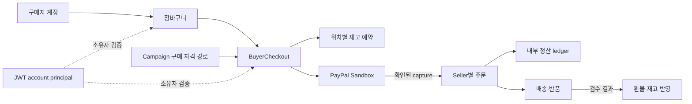

# ATLAS

ATLAS는 **PayPal AI Hackathon 참가를 위해 개발하는 이커머스 플랫폼**입니다. 상품 탐색부터 장바구니, PayPal 결제, 주문 이행과 정산까지 전체 거래 흐름과 데이터 정합성을 다룹니다. 한정 판매에만 범위를 한정하지 않습니다.

> [!IMPORTANT]
> PayPal Sandbox API를 사용합니다. 자격 증명은 Git에서 제외되는 `.env.local`에 보관하세요. Spring 애플리케이션은 OS 환경 변수를 읽으며, `.env.local`을 자동으로 불러오지 않습니다.

## 현재 기능과 모듈

| 모듈 디렉터리 | 책임 |
|---|---|
| `ATLAS-application/` | Spring Boot 실행, HTTP API/controller, 보안·공통 오류·scheduler 설정, Flyway migration |
| `ATLAS-account/` | Buyer account, Seller profile, JWT access token과 rotating refresh session |
| `ATLAS-catalog/` | Seller, Product·category·SKU, 가격, 판매 상태와 channel별 판매 가능 여부 |
| `ATLAS-cart/` | Buyer cart와 cart item |
| `ATLAS-campaign/` | Campaign과 구매 자격 |
| `ATLAS-admission/` | FIFO queue, ticket, checkout slot과 queue policy |
| `ATLAS-inventory/` | Stock pool, reservation, fulfillment location, capacity 조정과 transfer |
| `ATLAS-order/` | Seller별 주문·항목, Buyer 주문 내역(cursor), 배송·반품·환불 |
| `ATLAS-payment/` | PayPal Sandbox authorization/capture/refund, webhook과 payment recovery |
| `ATLAS-settlement/` | Capture/refund 내부 ledger, Seller별 allocation과 statement |

Buyer 주문 내역: `GET /api/buyers/{buyerRef}/orders`는 인증된 Buyer의 Campaign·cart 주문 요약을 keyset cursor로 조회. 기본 limit 10, 최대 100; 상세는 `GET /api/orders/{orderId}`.

## 구매 흐름과 아키텍처

Gradle multi-module 구조의 Spring Boot **modular monolith**. 코드는 모듈별 디렉터리로 분리하고 애플리케이션은 하나로 실행합니다. 상세 경계와 데이터 흐름은 [모듈 경계 결정 기록](docs/02-decisions/adr/ADR-0003-gradle-module-boundaries.md) 참고.



PayPal API 호출은 DB transaction 밖에서 수행합니다. 확인된 응답만 주문·재고·ledger 상태에 반영하며, 결과가 불명확하면 기존 attempt를 확인할 때까지 재고 hold를 유지합니다.

## 로컬 개발

필요 도구: JDK 25와 Docker Compose. PostgreSQL 18.6은 `compose.yaml`로 실행. 환경 변수 예시는 [.env.example](.env.example). 저장소 root에서 다음 순서로 준비:

```sh
export JAVA_HOME="<JDK 25 home>"
export PATH="$JAVA_HOME/bin:$PATH"
if [ ! -f .env.local ]; then cp .env.example .env.local; fi
chmod 600 .env.local
# .env.local에 PayPal Sandbox 자격 증명을 입력한 뒤 현재 shell에 로드
set -a
. ./.env.local
set +a
docker compose up -d --wait postgres
./gradlew :application-module:bootRun
```

느린 SQL 감지는 Java `DataSource` decorator로 선택 활성화.
- `ATLAS_DB_SLOW_QUERY_THRESHOLD_MS`: 측정 근거가 있는 양의 임계값(ms). 미설정 시 감지기 비활성화.
- 기록 항목: 경과 시간·성공 여부·SQL template. Bind value는 제외하나 SQL literal은 남을 수 있음.
- 세부 조건·한계: [EXP-025](docs/03-experiments/EXP-025-slow-query-detection.md)

기본 API 주소: `http://127.0.0.1:8080`. `.env.local`은 Spring이 자동으로 읽지 않으므로 위처럼 shell 환경 변수로 전달합니다. Gradle project path는 [`settings.gradle`](settings.gradle)에 지정되어 있으며 `:application-module`은 `ATLAS-application/`을 가리킵니다. 운영 규칙은 [저장소 작업 지침](AGENTS.md) 참고.

### 검증

```sh
./gradlew --no-daemon check :application-module:bootJar
git ls-files -z -- '*.md' | xargs -0 npx --yes markdownlint-cli2@0.24.0
```

PostgreSQL integration test에는 Docker 접근 필요. Colima에서는 현재 Docker context에서 `DOCKER_HOST`를 설정하고 `TESTCONTAINERS_DOCKER_SOCKET_OVERRIDE=/var/run/docker.sock` 사용. 기기별 socket path를 고정하지 않음.

> [!WARNING]
> V6 migration은 빈 데이터베이스에서 시작하는 경우만 지원. 기존 application table에 행이 있으면 DDL 전에 중단되며, 자동 변환·backfill은 수행하지 않습니다. 상세 기준은 [ADR-0006](docs/02-decisions/adr/ADR-0006-v6-clean-start.md) 참고.

## 부하·성능 검증

- k6 시나리오: [`load-tests/`](load-tests/)
- 기본 동작: 실제 API로 checkout 예약·도메인 상태 검증, 외부 payment provider 호출 없음
- PayPal Sandbox: [buyer-checkout](load-tests/buyer-checkout.js)의 `paypal-sandbox-order-smoke`는 order 1회 생성, `paypal-sandbox-verify`는 수동 Buyer approval 뒤 `CAPTURED`·`PAID` 확인. Gate4 smoke도 1회만 허용; 기본 부하에는 PSP 호출 없음
- Coupon redemption: coupon cap 경합 검증만 수행. 결제 부하와 분리
- 요약은 기본 stdout 출력. 파일 저장 시 `SUMMARY_FILE`을 지정하고 `ATLAS-application/build/k6-results/` 사용
- 테스트 계정 비밀번호·PayPal credential은 무시 파일 `.env.local`에 보관. 코드·명령 인자·결과 파일에 기록 금지
- Buyer checkout 진단: `K6_DEBUG_ERRORS=true`는 stage·HTTP status·error code만 출력. Response body·token 미출력

`ATLAS_PAYMENT_PROVIDER` 기본값은 `disabled`. Compose의 OAuth client ID/secret 기본값도 `disabled`이며, PayPal API 호출을 선택하지 않음. 실행마다 고유한 `RUN_ID` 사용.

K6 Compose app 준비 (처음 실행·Java 변경 후):

```sh
./gradlew --no-daemon :application-module:bootJar
docker compose --env-file .env.local --profile loadtest up -d --build application
```

`Started AtlasApplication` 로그 확인 후 K6 시나리오 실행.

로컬 5초 checkout pilot:

```sh
docker compose --env-file .env.local --profile loadtest run --rm \
  -e RUN_ID=local-pilot-001 \
  -e PROFILE=one-seller \
  -e UNIT_PRICE_WON=1000 \
  -e SESSION_RATE_NUMERATOR=1 \
  -e SESSION_RATE_TIME_UNIT=1s \
  -e DURATION=5s \
  -e FIXED_VUS=1 \
  -e PAYMENT_MODE=checkout-only \
  k6 run /scripts/buyer-checkout.js
```

PayPal Sandbox smoke에는 Business app credentials와 별도 Sandbox Buyer 계정 필요. `.env.local`에서 `ATLAS_PAYMENT_PROVIDER=paypal`, Sandbox `PAYPAL_BASE_URL`, `ATLAS_PUBLIC_BASE_URL=http://127.0.0.1:18080`, `ATLAS_PAYMENT_RETURN_PORT=18080` 설정 후 앞의 Compose app 준비 명령 실행.

`paypal-sandbox-order-smoke`는 order를 1회 생성. approval URL은 `PAYPAL_SHOW_APPROVAL_URL=true`일 때만 출력되며, 한 번만 사용하는 민감 링크. 로컬 외부 로그·PR에 복사 금지.

1. 출력된 approval URL을 브라우저에서 열고 Sandbox Buyer로 승인. PayPal return은 loopback `127.0.0.1:18080`의 ATLAS app으로 돌아오며, 실제 Sandbox authorization/capture 진행
2. 출력된 checkout ID를 사용해 capture 결과 확인

PayPal Sandbox order 생성:

```sh
docker compose --env-file .env.local --profile loadtest run --rm \
  -e RUN_ID=paypal-smoke-001 \
  -e PROFILE=one-seller \
  -e UNIT_PRICE_WON=1000 \
  -e FIXED_VUS=1 \
  -e PAYMENT_MODE=paypal-sandbox-order-smoke \
  -e PAYPAL_SHOW_APPROVAL_URL=true \
  k6 run /scripts/buyer-checkout.js
```

Capture·inventory·settlement 확인:

```sh
docker compose --env-file .env.local --profile loadtest run --rm \
  -e RUN_ID=paypal-smoke-001 \
  -e PROFILE=one-seller \
  -e UNIT_PRICE_WON=1000 \
  -e FIXED_VUS=1 \
  -e PAYMENT_MODE=paypal-sandbox-verify \
  -e PAYPAL_CHECKOUT_ID=CHECKOUT_ID_FROM_OUTPUT \
  k6 run /scripts/buyer-checkout.js
```

Sandbox Buyer approval/capture는 이번 구현에서 아직 실행하지 않음. 현재 local process에 Buyer account가 없어 실제 승인 결과는 검증 근거로 주장하지 않음.
## 문서 지도

| 확인할 내용 | 정본 |
|---|---|
| 기능 요구사항·불변조건·미결정 정책 | [요구사항 인덱스](docs/01-requirements/requirements-index.md) |
| 승인된 결정과 현재 상태 | [결정 로그](docs/00-governance/decision-log.md) |
| 설계 결정과 근거 | [설계 결정 기록(ADR)](docs/02-decisions/adr/) |
| 성능·장애 가설, workload와 측정 결과 | [실험 기록](docs/03-experiments/) |
| 코드 규칙·테스트·GitHub Markdown 작성법 | [저장소 작업 지침](AGENTS.md) |
| 외부 참고자료와 적용 한계 | [참고 자료 목록](docs/00-governance/reference-register.md) |
