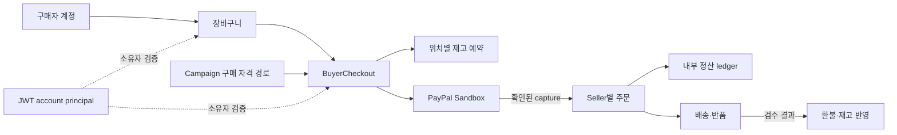

# ATLAS

ATLAS는 **PayPal AI Hackathon 참가를 위해 개발하는 이커머스 플랫폼**입니다. 상품 탐색부터 장바구니, PayPal 결제, 주문 이행과 정산까지 전체 거래 흐름과 데이터 정합성을 다룹니다. 한정 판매에만 범위를 한정하지 않습니다.

> [!IMPORTANT]
> PayPal Sandbox API를 사용합니다. 자격 증명은 Git에서 제외되는 `.env.local`에 보관하세요. Spring 애플리케이션은 OS 환경 변수를 읽으며, `.env.local`을 자동으로 불러오지 않습니다.

## 현재 기능과 모듈

| 모듈 디렉터리 | 책임 |
|---|---|
| `ATLAS-application/` | Spring Boot 실행, HTTP API/controller, 보안·공통 오류·scheduler 설정, Flyway migration |
| `ATLAS-account/` | Buyer account, Seller profile, JWT access token과 rotating refresh session |
| `ATLAS-catalog/` | Seller, Product·category·SKU, 가격, 판매 상태와 channel별 판매 가능 여부 |
| `ATLAS-cart/` | Buyer cart와 cart item |
| `ATLAS-campaign/` | Campaign과 구매 자격 |
| `ATLAS-admission/` | FIFO queue, ticket, checkout slot과 queue policy |
| `ATLAS-inventory/` | Stock pool, reservation, fulfillment location, capacity 조정과 transfer |
| `ATLAS-order/` | BuyerCheckout, Seller별 order/item, shipment, return/refund |
| `ATLAS-payment/` | PayPal Sandbox authorization/capture/refund, webhook과 payment recovery |
| `ATLAS-settlement/` | Capture/refund 내부 ledger, Seller별 allocation과 statement |

## 구매 흐름과 아키텍처

Gradle multi-module 구조의 Spring Boot **modular monolith**. 코드는 모듈별 디렉터리로 분리하고 애플리케이션은 하나로 실행합니다. 상세 경계와 데이터 흐름은 [모듈 경계 결정 기록](docs/02-decisions/adr/ADR-0003-gradle-module-boundaries.md) 참고.



PayPal API 호출은 DB transaction 밖에서 수행합니다. 확인된 응답만 주문·재고·ledger 상태에 반영하며, 결과가 불명확하면 기존 attempt를 확인할 때까지 재고 hold를 유지합니다.

## 로컬 개발

필요 도구: JDK 25, Docker Compose. PostgreSQL 18.6은 `compose.yaml`에 정의.

```sh
export JAVA_HOME="<JDK 25 home>"
export PATH="$JAVA_HOME/bin:$PATH"
docker compose up -d --wait postgres
./gradlew :application-module:bootRun
```

기본 API 주소: `http://127.0.0.1:8080`. Gradle project path는 [`settings.gradle`](settings.gradle)에 지정되어 있으며 `:application-module`은 `ATLAS-application/` 디렉터리를 가리킵니다. PayPal Sandbox 변수는 OS 환경 변수로 전달하세요. `.env.local`은 자동 로드되지 않습니다. 세부 규칙은 [저장소 작업 지침](AGENTS.md) 참고.

### 검증

```sh
./gradlew --no-daemon check :application-module:bootJar
npx --yes markdownlint-cli2@0.24.0 "**/*.md" "*.md" "!docs/plans/**" "!docs/working-plans/**"
```

PostgreSQL integration test에는 Docker 접근 필요. Colima에서는 현재 Docker context에서 `DOCKER_HOST`를 설정하고 `TESTCONTAINERS_DOCKER_SOCKET_OVERRIDE=/var/run/docker.sock` 사용. 기기별 socket path를 고정하지 않음.

> [!WARNING]
> V6 migration은 빈 데이터베이스에서 시작하는 경우만 지원. 기존 application table에 행이 있으면 DDL 전에 중단되며, 자동 변환·backfill은 수행하지 않습니다. 상세 기준은 [ADR-0006](docs/02-decisions/adr/ADR-0006-v6-clean-start.md) 참고.

## 문서 지도

| 확인할 내용 | 정본 |
|---|---|
| 기능 요구사항·불변조건·미결정 정책 | [요구사항 인덱스](docs/01-requirements/requirements-index.md) |
| 승인된 결정과 현재 상태 | [결정 로그](docs/00-governance/decision-log.md) |
| 설계 결정과 근거 | [설계 결정 기록(ADR)](docs/02-decisions/adr/) |
| 성능·장애 가설, workload와 측정 결과 | [실험 기록](docs/03-experiments/) |
| 코드 규칙·테스트·GitHub Markdown 작성법 | [저장소 작업 지침](AGENTS.md) |
| 외부 참고자료와 적용 한계 | [참고 자료 목록](docs/00-governance/reference-register.md) |
