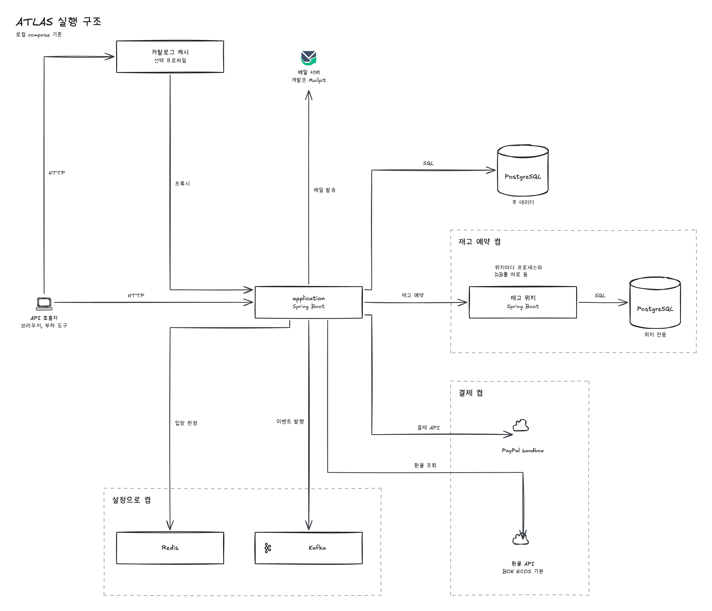
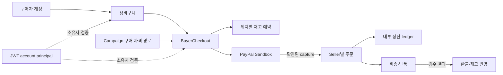

# ATLAS

ATLAS는 **PayPal AI Hackathon 참가용 이커머스 플랫폼**. 상품 탐색부터 장바구니, PayPal 결제, 주문 이행과 정산까지 전체 거래 흐름과 데이터 정합성 범위. 한정 판매 외 일반 거래도 포함.

> [!IMPORTANT]
> PayPal Sandbox API 사용. 자격 증명은 Git 제외 대상인 `.env.local`에 보관. Spring 애플리케이션은 OS 환경 변수만 읽고 `.env.local` 자동 로드 미지원.



로컬 compose 기준 실행 구조다. 파란 영역은 항상 실행되는 Spring Boot application과 그 안의 도메인 모듈이다. 청록(재고 예약), 주황(결제), 보라(Redis, Kafka) 영역은 설정을 켜야 동작하고 기본은 꺼져 있다. 카탈로그 캐시는 `edge-cache`, 초록 영역은 `observability` compose profile에서만 뜬다. 아이콘은 [excalidraw-libraries](https://github.com/excalidraw/excalidraw-libraries)(MIT, Copyright (c) 2020 Excalidraw)의 것이다.

## 현재 기능과 모듈

| 모듈 디렉터리 | 책임 |
|---|---|
| `atlas-application/` | Spring Boot 실행, HTTP API/controller, 보안·공통 오류·scheduler 설정, Flyway migration |
| `atlas-account/` | Buyer account, Seller profile, JWT access token과 rotating refresh session, family 기반 즉시 revoke 및 기기별 session 관리 |
| `atlas-catalog/` | Seller, Product·category·SKU, 가격, 판매 상태와 channel별 판매 가능 여부 |
| `atlas-admission/` | FIFO queue, ticket, checkout slot과 queue policy, Campaign과 구매 자격 |
| `atlas-inventory/` | Stock pool, reservation, fulfillment location, capacity 조정과 transfer |
| `atlas-inventory-location/` | Inventory bounded context의 독립 Spring Boot runtime. process당 fulfillment location 하나와 별도 PostgreSQL을 사용하며 예약·claim·release·만료를 처리 |
| `atlas-order/` | Seller별 주문·항목, Buyer 주문 내역(cursor), 배송·반품·환불, Buyer cart와 cart item |
| `atlas-payment/` | PayPal Sandbox authorization/capture/refund, webhook과 payment recovery |
| `atlas-settlement/` | Capture/refund 내부 ledger, Seller별 allocation과 statement |

각 기능의 API 동작과 운영 절차는 [기능 상세와 운영 가이드](docs/operations-guide.md)에 있다.

## 구매 흐름과 아키텍처

Gradle multi-module 구조의 Spring Boot **modular monolith**. 코드는 모듈별 디렉터리로 분리하고 애플리케이션은 단일 프로세스로 실행. 상세 경계와 데이터 흐름은 [모듈 경계 결정 기록](docs/02-decisions/adr/ADR-0003-gradle-module-boundaries.md) 참고.



PayPal API 호출은 DB transaction 밖에서 수행. 확인된 응답만 주문·재고·ledger 상태에 반영하며, 결과가 불명확하면 기존 attempt 확인 시점까지 재고 hold 유지.

## 로컬 개발

필요 도구: JDK 25와 Docker Compose. PostgreSQL 18.6은 `compose.yaml`로 실행. 환경 변수 예시는 [.env.example](.env.example). 저장소 root에서 다음 순서로 준비:

```sh
export JAVA_HOME="<JDK 25 home>"
export PATH="$JAVA_HOME/bin:$PATH"
if [ ! -f .env.local ]; then cp .env.example .env.local; fi
chmod 600 .env.local
# `.env.local`에 SMTP host·발신자와 PayPal Sandbox Business 자격 증명을 설정한다. 환율은 기본 BOK ECOS(API key 필요) 또는 무가입 Frankfurter(`ATLAS_EXCHANGE_RATE_PROVIDER=frankfurter`)를 선택한 뒤 현재 shell에 로드한다.
set -a
. ./.env.local
set +a
docker compose up -d --wait postgres
./gradlew :atlas-application:bootRun
```

DB 스키마는 `atlas-application/src/main/resources/db/migration/V1__baseline.sql` 하나로 시작한다. 아직 배포하지 않아 이전 증분 마이그레이션(V1~V75)을 같은 최종 스키마를 만드는 기준 마이그레이션으로 대체했다. 이전 버전으로 만든 로컬 DB는 Flyway 이력이 맞지 않으므로 `docker compose down -v`로 볼륨을 지우고 다시 올린다. 이후 변경은 `V2__...`부터 추가한다.

선택 구성(PayPal Payouts, 독립 inventory-location 실행, 부하 측정, 핫 SKU gate, Kafka relay)의 설정과 절차는 [운영 가이드](docs/operations-guide.md)로 옮겼다.

### 검증

```sh
./gradlew --no-daemon check :atlas-application:bootJar
git ls-files -z -- '*.md' | xargs -0 npx --yes markdownlint-cli2@0.24.0
```

PostgreSQL integration test에는 Docker 접근 필요. Colima에서는 현재 Docker context에서 `DOCKER_HOST`를 설정하고 `TESTCONTAINERS_DOCKER_SOCKET_OVERRIDE=/var/run/docker.sock` 사용. 기기별 socket path 고정 금지.

> [!WARNING]
> V6 migration은 빈 데이터베이스에서 시작하는 경우만 지원. 기존 application table에 행이 있으면 DDL 전 중단. 자동 변환·backfill 미지원. 상세 기준은 [ADR-0006](docs/02-decisions/adr/ADR-0006-v6-clean-start.md) 참고.

## 문서 지도

| 확인할 내용 | 정본 |
|---|---|
| 기능 요구사항·불변조건·미결정 정책 | [요구사항 인덱스](docs/01-requirements/requirements-index.md) |
| 승인된 결정과 현재 상태 | [결정 로그](docs/00-governance/decision-log.md) |
| 설계 결정과 근거 | [설계 결정 기록(ADR)](docs/02-decisions/adr/) |
| PayPal 결제 통화·FX 스냅샷 | [ADR-0030](docs/02-decisions/adr/ADR-0030-paypal-currency-boundary.md) |
| 성능·장애 가설, workload와 측정 결과 | [실험 기록](docs/03-experiments/) |
| 코드 규칙·테스트·GitHub Markdown 작성법 | [저장소 작업 지침](AGENTS.md) |
| 외부 참고자료와 적용 한계 | [참고 자료 목록](docs/00-governance/reference-register.md) |
| 기능별 API 동작과 운영 절차 | [기능 상세와 운영 가이드](docs/operations-guide.md) |

## 분산 이행 단계별 근거

주문·재고·결제를 분산 구성으로 옮기는 8단계(4단계의 hot SKU gate는 4a로 따로 적었다)별로 어떤 근거가 있는지다. 상태는 `검증됨`(근거 문서와 테스트·실험이 있음), `부분`(일부만 근거가 있음), `미구현`이다. 실험은 모두 로컬 단일 호스트의 탐색적 측정이라 운영 보장이 아니다. 측정값과 조건, 한계를 단계별로 적은 원본 표는 [운영 가이드](docs/operations-guide.md#분산-이행-단계별-근거)에 있다.

| 단계 | 상태 | 근거 문서 |
| --- | --- | --- |
| 1. 단일 모놀리스 기준선 | 검증됨 | [ADR-0058](docs/02-decisions/adr/ADR-0058-distributed-fulfillment-stage-one-baseline.md) |
| 2. 재고 잠금 전략 선택 | 검증됨 | [EXP-055](docs/03-experiments/EXP-055-stock-lock-strategy-comparison.md) |
| 3. 독립 재고 위치 서비스 | 검증됨 | [ADR-0059](docs/02-decisions/adr/ADR-0059-independent-inventory-location-service.md), [EXP-053](docs/03-experiments/EXP-053-inventory-location-failure-load.md) |
| 4. 주문 재고 예약 workflow와 복구 | 검증됨 | [ADR-0060](docs/02-decisions/adr/ADR-0060-order-inventory-reservation-workflow.md), [ADR-0062](docs/02-decisions/adr/ADR-0062-order-recovery-backlog-observability.md), [ADR-0063](docs/02-decisions/adr/ADR-0063-order-inventory-write-batching.md), [ADR-0064](docs/02-decisions/adr/ADR-0064-order-inventory-just-in-time-lease-claims.md), [EXP-056](docs/03-experiments/EXP-056-order-inventory-recovery-capacity.md), [EXP-057](docs/03-experiments/EXP-057-checkout-recovery-index.md), [EXP-058](docs/03-experiments/EXP-058-order-reservation-submit-capacity.md), [EXP-059](docs/03-experiments/EXP-059-order-reservation-load-and-idempotent-replay.md), [EXP-064](docs/03-experiments/EXP-064-location-fault-convergence.md), [EXP-065](docs/03-experiments/EXP-065-claim-cancel-race.md), [EXP-066](docs/03-experiments/EXP-066-db-outage-convergence.md) |
| 4a. 핫 SKU admission gate (선택) | 부분 | [ADR-0066](docs/02-decisions/adr/ADR-0066-redis-admission-gate.md), [EXP-060](docs/03-experiments/EXP-060-hot-sku-admission-gate.md), [EXP-062](docs/03-experiments/EXP-062-admission-gate-paired-comparison.md), [EXP-063](docs/03-experiments/EXP-063-redis-gate-failopen-and-paired-rerun.md) |
| 5. 독립 결제 서비스 | 부분 | [ADR-0038](docs/02-decisions/adr/ADR-0038-durable-payment-recovery-workflow.md), [ADR-0075](docs/02-decisions/adr/ADR-0075-keep-payment-in-process.md), [EXP-073](docs/03-experiments/EXP-073-paypal-sandbox-payouts-response-shapes.md), [EXP-077](docs/03-experiments/EXP-077-payout-dispatch-provider-integration.md), [EXP-081](docs/03-experiments/EXP-081-paypal-double-vs-sandbox.md) |
| 6. 이벤트 로그와 broker | 검증됨(옵트인 relay) | [ADR-0067](docs/02-decisions/adr/ADR-0067-event-log-kafka-relay.md), [EXP-061](docs/03-experiments/EXP-061-event-log-fanout-and-replay.md), [EXP-067](docs/03-experiments/EXP-067-event-consumer-contract.md), [EXP-072](docs/03-experiments/EXP-072-kafka-outage-relay.md), [EXP-078](docs/03-experiments/EXP-078-relay-lease-length.md) |
| 7. 부분 이행·부분 환불 | 부분 | [ADR-0061](docs/02-decisions/adr/ADR-0061-return-restock-source-shipment.md), [EXP-054](docs/03-experiments/EXP-054-location-split-allocation.md) |
| 8. 장애 주입 | 부분 | [EXP-053](docs/03-experiments/EXP-053-inventory-location-failure-load.md), [EXP-059](docs/03-experiments/EXP-059-order-reservation-load-and-idempotent-replay.md), [EXP-060](docs/03-experiments/EXP-060-hot-sku-admission-gate.md), [EXP-063](docs/03-experiments/EXP-063-redis-gate-failopen-and-paired-rerun.md), [EXP-070](docs/03-experiments/EXP-070-real-stack-fault-injection.md), [EXP-071](docs/03-experiments/EXP-071-production-like-fault-injection.md), [EXP-072](docs/03-experiments/EXP-072-kafka-outage-relay.md) |
