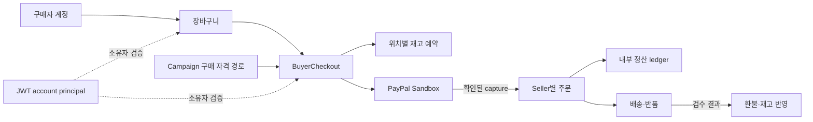

# ATLAS

ATLAS는 **PayPal AI Hackathon 참가용 이커머스 플랫폼**. 상품 탐색부터 장바구니, PayPal 결제, 주문 이행과 정산까지 전체 거래 흐름과 데이터 정합성 범위. 한정 판매 외 일반 거래도 포함.

> [!IMPORTANT]
> PayPal Sandbox API 사용. 자격 증명은 Git 제외 대상인 `.env.local`에 보관. Spring 애플리케이션은 OS 환경 변수만 읽고 `.env.local` 자동 로드 미지원.

## 현재 기능과 모듈

| 모듈 디렉터리 | 책임 |
|---|---|
| `ATLAS-application/` | Spring Boot 실행, HTTP API/controller, 보안·공통 오류·scheduler 설정, Flyway migration |
| `ATLAS-account/` | Buyer account, Seller profile, JWT access token과 rotating refresh session |
| `ATLAS-catalog/` | Seller, Product·category·SKU, 가격, 판매 상태와 channel별 판매 가능 여부 |
| `ATLAS-cart/` | Buyer cart와 cart item |
| `ATLAS-campaign/` | Campaign과 구매 자격 |
| `ATLAS-admission/` | FIFO queue, ticket, checkout slot과 queue policy |
| `ATLAS-inventory/` | Stock pool, reservation, fulfillment location, capacity 조정과 transfer |
| `ATLAS-order/` | Seller별 주문·항목, Buyer 주문 내역(cursor), 배송·반품·환불 |
| `ATLAS-payment/` | PayPal Sandbox authorization/capture/refund, webhook과 payment recovery |
| `ATLAS-settlement/` | Capture/refund 내부 ledger, Seller별 allocation과 statement |

Buyer 주문 내역: `GET /api/buyers/{buyerRef}/orders`는 인증된 Buyer의 Campaign·cart 주문 요약을 keyset cursor로 조회. 기본 limit 10, 최대 100; 상세는 `GET /api/orders/{orderId}`.
Buyer 관심 상품 목록은 `GET /api/buyers/{buyerRef}/wishlist`로 페이지 조회하고, `POST`/`DELETE /api/buyers/{buyerRef}/wishlist/products/{productId}`로 멱등 저장·삭제. 본인 계정만 접근하며 장바구니·재고 예약과 분리됩니다.
Verified buyer 상품 리뷰는 배송 완료된 본인 주문 상품만 작성할 수 있습니다: `POST /api/buyers/{buyerRef}/reviews`; 공개 평점·리뷰 페이지는 `GET /api/products/{productId}/reviews`입니다.
Buyer 상품 목록은 `minPriceWon`/`maxPriceWon`으로 SKU 유효 가격 범위를 필터링하며, 기간 판매가가 활성인 동안에는 effective price 기준으로 cursor 페이지 조회합니다.

## 구매 흐름과 아키텍처

Gradle multi-module 구조의 Spring Boot **modular monolith**. 코드는 모듈별 디렉터리로 분리하고 애플리케이션은 단일 프로세스로 실행. 상세 경계와 데이터 흐름은 [모듈 경계 결정 기록](docs/02-decisions/adr/ADR-0003-gradle-module-boundaries.md) 참고.



PayPal API 호출은 DB transaction 밖에서 수행. 확인된 응답만 주문·재고·ledger 상태에 반영하며, 결과가 불명확하면 기존 attempt 확인 시점까지 재고 hold 유지.

## 계정 인증·복구

- `POST /api/auth/signup`은 검증 메일 전송 요청을 접수하고 `202` 반환. 이미 사용 중인 이메일에도 같은 HTTP status/body 반환; SMTP delivery timing 평준화는 미지원. 메일 token 검증 후 `POST /api/auth/verify-email`을 호출해야 login 가능.
- `POST /api/auth/email-verification/request`와 `/api/auth/password-reset/request`는 account 존재 여부와 무관하게 같은 accepted 응답 반환. Reset은 `POST /api/auth/password-reset/confirm`에서 수행하며 기존 refresh family와 미소비 MFA login challenge 전체 revoke. Login은 token/challenge 발급 전 account password hash를 row lock 안에서 재검증해 동시 reset에 따른 stale credential 사용 방지.
- Login에서 MFA 미사용 시 `tokens` 반환. MFA 사용 시 5분 유효 challenge만 반환하며, `POST /api/auth/mfa/challenge`의 TOTP 또는 단회 recovery code 확인 뒤 token 발급.
- 선택형 MFA endpoint: 인증된 account에서 `POST /api/auth/mfa/enroll`로 enrollment 시작, `/api/auth/mfa/enable`로 활성화·recovery code 10개 발급, `/api/auth/mfa/disable`로 해제.
- SMTP host·자격 증명과 발신 주소는 [.env.example](.env.example)의 환경 변수 참조. External `ATLAS_ACCOUNT_MAIL_PUBLIC_BASE_URL`은 HTTPS 필수; HTTP는 loopback 개발 주소만 허용. MFA 설정 전 `ATLAS_ACCOUNT_MFA_ENCRYPTION_KEY`에 `openssl rand -base64 32`로 생성한 32-byte key 설정; 평문 key·메일 token은 로그나 저장소에 기록 금지.
- 사용자용 메일 화면 미구현. Client는 메일의 one-time token을 API 요청 body로 전달; token의 URL·access log 기록 금지.

## PayPal Balance report 대사

- PayPal merchant portal에서 내려받은 Balance Reconciliation report CSV의 단일 파일 업로드 지원. 공식 [Balance report 문서](https://developer.paypal.com/reports/balance)와 [공개 CSV sample](https://www.paypalobjects.com/ppdevdocs/Sample-Balance%20Report-CCOP.csv) 기준의 header-driven parsing.
- `POST /api/internal/settlement/paypal/balance-report/reconciliation`의 multipart `report` 필드로 업로드. 응답에 report SHA-256, 행별 `MATCHED`·`UNMATCHED`·`DUPLICATE`·`MISMATCH`, PayPal `Transfer ID` 참조 포함. Gross amount와 report에 포함된 fee/net amount도 행 결과에 보존.
- Account-sensitive 결과 보호를 위해 기본 비활성화. 활성화 시 `ATLAS_SETTLEMENT_REPORT_OPERATOR_ENABLED=true`, 전용 `ATLAS_SETTLEMENT_REPORT_OPERATOR_USERNAME`, 최소 32-character `ATLAS_SETTLEMENT_REPORT_OPERATOR_PASSWORD` 설정 필요. Stateless HTTP Basic 인증 사용; 외부 TLS ingress, `Authorization` header log redaction, 전용 secret 저장소와 rotation 정책 필요. Enabled가 true가 아니면 operator API 미등록.
- 단일 파일 최대 10 MiB, detail 행 최대 10,000개. 분할 생성된 report의 일부 파일만으로는 완전 대사가 불가능하므로 `Total files > 1` 입력 거절.
- `Sale`은 report `Record ID == provider_capture_id`, `Refund`는 `Record ID == provider_refund_id` 및 `Related Record ID == refund.capture_id == provider_capture_id` exact equality로만 대조. Capture/refund provider 상태가 confirmed이고 provider currency와 signed gross amount까지 일치할 때만 `MATCHED`; top-level Order ID·fuzzy·amount-only matching 금지. 누락·미확정은 `UNMATCHED`, report/provider facts 충돌 또는 ambiguous ID는 `MISMATCH`, report 내부 동일 ID 반복은 `DUPLICATE`. `Related Record ID`와 `Original Record ID`는 응답에 보존하며 internal attempt/refund ID나 journal 값을 응답하지 않음. `providerIdMappingStatus=EXACT_PROVIDER_ID_WITH_AMOUNT_CURRENCY_VALIDATION`.
- 공식 자료는 각 ID 필드 의미를 설명하지만 보편적인 Balance report `Record ID`와 Orders/Payments API ID crosswalk은 보장하지 않음. Exact equality는 행별 candidate check이며 실제 merchant entitlement·report version·ID 행은 아직 검증하지 않음; 운영 report 사용 전 merchant report로 확인 필요. 미확정 row는 계속 `UNMATCHED`.
- `Transfer ID`는 PayPal 문서상 bank statement line과 대조할 식별자. 은행 거래 내역을 별도로 받지 않는 본 endpoint는 은행 입금 수령을 증명하지 않으며 payout 결과에 `NOT_VERIFIED_FROM_PAYPAL_REPORT_ALONE` 표시.
- 원본 report 저장이나 자동 SFTP 수집 미지원. 결과 응답만으로 감사 기록을 만들 수 있으나 보존 시 report hash와 결과를 접근 통제된 외부 감사 저장소에 보관.

## 로컬 개발

필요 도구: JDK 25와 Docker Compose. PostgreSQL 18.6은 `compose.yaml`로 실행. 환경 변수 예시는 [.env.example](.env.example). 저장소 root에서 다음 순서로 준비:

```sh
export JAVA_HOME="<JDK 25 home>"
export PATH="$JAVA_HOME/bin:$PATH"
if [ ! -f .env.local ]; then cp .env.example .env.local; fi
chmod 600 .env.local
# .env.local에 SMTP host·발신자, PayPal Sandbox Business 자격 증명과 BOK_ECOS_API_KEY를 설정한 뒤 현재 shell에 로드
set -a
. ./.env.local
set +a
docker compose up -d --wait postgres
./gradlew :application-module:bootRun
```

느린 SQL 감지는 Java `DataSource` decorator로 선택 활성화.
- `ATLAS_DB_SLOW_QUERY_THRESHOLD_MS`: 측정 근거가 있는 양의 임계값(ms). 미설정 시 감지기 비활성화.
- 기록 항목: HTTP 요청의 `requestId`, datasource bean 이름, 경과 시간, 성공 여부, statement 수, SHA-256 statement fingerprint. SQL text·literal·bind value 기록 0건.
- 감지기 활성·비활성 상태는 startup INFO 로그로 기록.
- 세부 조건·한계: [EXP-025](docs/03-experiments/EXP-025-slow-query-detection.md)

기본 API 주소: `http://127.0.0.1:8080`. `.env.local`은 Spring 자동 로드 대상이 아니므로 위 예시처럼 shell 환경 변수로 전달. Gradle project path는 [`settings.gradle`](settings.gradle)에 지정되며 `:application-module`의 대상은 `ATLAS-application/`. 운영 규칙은 [저장소 작업 지침](AGENTS.md) 참고.

### 검증

```sh
./gradlew --no-daemon check :application-module:bootJar
git ls-files -z -- '*.md' | xargs -0 npx --yes markdownlint-cli2@0.24.0
```

PostgreSQL integration test에는 Docker 접근 필요. Colima에서는 현재 Docker context에서 `DOCKER_HOST`를 설정하고 `TESTCONTAINERS_DOCKER_SOCKET_OVERRIDE=/var/run/docker.sock` 사용. 기기별 socket path 고정 금지.

> [!WARNING]
> V6 migration은 빈 데이터베이스에서 시작하는 경우만 지원. 기존 application table에 행이 있으면 DDL 전 중단. 자동 변환·backfill 미지원. 상세 기준은 [ADR-0006](docs/02-decisions/adr/ADR-0006-v6-clean-start.md) 참고.

## 부하·성능 검증

- k6 시나리오: [`load-tests/`](load-tests/)
- 기본 동작: 실제 API로 checkout 예약·도메인 상태 검증, 외부 payment provider 호출 0건
- PayPal Sandbox: [buyer-checkout](load-tests/buyer-checkout.js)의 `paypal-sandbox-order-smoke`는 order 1회 생성, `paypal-sandbox-verify`는 수동 Buyer approval 뒤 `CAPTURED`·`PAID` 확인. Gate4 smoke도 1회만 허용; 기본 부하의 PSP 호출 0건
- Coupon redemption: coupon cap 경합 검증만 수행. 결제 부하와 분리
- 요약은 기본 stdout 출력. 파일 저장 시 `SUMMARY_FILE`을 지정하고 `ATLAS-application/build/k6-results/` 사용
- 테스트 계정 비밀번호·PayPal credential은 무시 파일 `.env.local`에 보관. 코드·명령 인자·결과 파일에 기록 금지
- Buyer checkout 진단: `K6_DEBUG_ERRORS=true`는 stage·HTTP status·error code만 출력. Response body·token 미출력

`ATLAS_PAYMENT_PROVIDER` 기본값은 `disabled`. Compose의 OAuth client ID/secret 기본값도 `disabled`이며, PayPal API 호출 비활성. 실행마다 고유한 `RUN_ID` 사용.

K6 Compose app 준비 (처음 실행·Java 변경 후):

```sh
./gradlew --no-daemon :application-module:bootJar
docker compose --env-file .env.local --profile loadtest up -d --build application
```

`Started AtlasApplication` 로그 확인 후 K6 시나리오 실행.

로컬 5초 checkout pilot:

```sh
docker compose --env-file .env.local --profile loadtest run --rm \
  -e RUN_ID=local-pilot-001 \
  -e PROFILE=one-seller \
  -e UNIT_PRICE_WON=1000 \
  -e SESSION_RATE_NUMERATOR=1 \
  -e SESSION_RATE_TIME_UNIT=1s \
  -e DURATION=5s \
  -e FIXED_VUS=1 \
  -e PAYMENT_MODE=checkout-only \
  k6 run /scripts/buyer-checkout.js
```

### PayPal Sandbox

사전 조건:
- Business app credentials, `BOK_ECOS_API_KEY`, Sandbox Buyer 계정.
- `.env.local`: `ATLAS_PAYMENT_PROVIDER=paypal`, Sandbox `PAYPAL_BASE_URL`, `ATLAS_PUBLIC_BASE_URL=http://127.0.0.1:18080`, `ATLAS_PAYMENT_RETURN_PORT=18080`.
- 승인 callback 준비: `docker compose --env-file .env.local up -d --build --wait application` (host `18080` → container `8080`).
- `bootRun` 사용 시 `ATLAS_PUBLIC_BASE_URL`을 실제로 열어 둔 app port와 일치.

`paypal-sandbox-order-smoke`는 order를 1회 생성. approval URL은 `PAYPAL_SHOW_APPROVAL_URL=true`일 때만 출력되며, 한 번만 사용하는 민감 링크. 로컬 외부 로그·PR에 복사 금지.

1. 출력된 approval URL을 브라우저에서 열고 Sandbox Buyer로 승인. PayPal return은 loopback `127.0.0.1:18080`의 ATLAS app으로 돌아오며, 실제 Sandbox authorization/capture 진행
2. 출력된 checkout ID를 사용해 capture 결과 확인

PayPal Sandbox order 생성:

```sh
docker compose --env-file .env.local --profile loadtest run --rm \
  -e RUN_ID=paypal-smoke-001 \
  -e PROFILE=one-seller \
  -e UNIT_PRICE_WON=1000 \
  -e FIXED_VUS=1 \
  -e PAYMENT_MODE=paypal-sandbox-order-smoke \
  -e PAYPAL_SHOW_APPROVAL_URL=true \
  k6 run /scripts/buyer-checkout.js
```

Capture·inventory·settlement 확인:

```sh
docker compose --env-file .env.local --profile loadtest run --rm \
  -e RUN_ID=paypal-smoke-001 \
  -e PROFILE=one-seller \
  -e UNIT_PRICE_WON=1000 \
  -e FIXED_VUS=1 \
  -e PAYMENT_MODE=paypal-sandbox-verify \
  -e PAYPAL_CHECKOUT_ID=CHECKOUT_ID_FROM_OUTPUT \
  k6 run /scripts/buyer-checkout.js
```

#### 검증 기록 (2026-11-13)

- KRW 2,000 → PayPal USD 1.50 (BOK 기준환율 1,332.4 KRW/USD, 기준일 2026-11-13).
- Sandbox Buyer 승인·capture 완료. Unknown capture는 PayPal order GET으로 복구; K6 결과 `CAPTURED` · `PAID` · `CLAIMED`.
- Settlement journal: `PSP_CLEARING` debit / `SELLER_PAYABLE` credit, 각각 KRW 2,000. [Issue #254](https://github.com/Neo1228/ATLAS/issues/254).

## 문서 지도

| 확인할 내용 | 정본 |
|---|---|
| 기능 요구사항·불변조건·미결정 정책 | [요구사항 인덱스](docs/01-requirements/requirements-index.md) |
| 승인된 결정과 현재 상태 | [결정 로그](docs/00-governance/decision-log.md) |
| 설계 결정과 근거 | [설계 결정 기록(ADR)](docs/02-decisions/adr/) |
| PayPal 결제 통화·FX 스냅샷 | [ADR-0030](docs/02-decisions/adr/ADR-0030-paypal-currency-boundary.md) |
| 성능·장애 가설, workload와 측정 결과 | [실험 기록](docs/03-experiments/) |
| 코드 규칙·테스트·GitHub Markdown 작성법 | [저장소 작업 지침](AGENTS.md) |
| 외부 참고자료와 적용 한계 | [참고 자료 목록](docs/00-governance/reference-register.md) |
