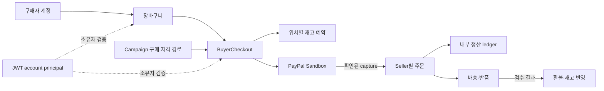

# ATLAS

ATLAS는 **PayPal AI Hackathon 참가용 이커머스 플랫폼**. 상품 탐색부터 장바구니, PayPal 결제, 주문 이행과 정산까지 전체 거래 흐름과 데이터 정합성 범위. 한정 판매 외 일반 거래도 포함.

> [!IMPORTANT]
> PayPal Sandbox API 사용. 자격 증명은 Git 제외 대상인 `.env.local`에 보관. Spring 애플리케이션은 OS 환경 변수만 읽고 `.env.local` 자동 로드 미지원.

## 현재 기능과 모듈

| 모듈 디렉터리 | 책임 |
|---|---|
| `ATLAS-application/` | Spring Boot 실행, HTTP API/controller, 보안·공통 오류·scheduler 설정, Flyway migration |
| `ATLAS-account/` | Buyer account, Seller profile, JWT access token과 rotating refresh session, family 기반 즉시 revoke 및 기기별 session 관리 |
| `ATLAS-catalog/` | Seller, Product·category·SKU, 가격, 판매 상태와 channel별 판매 가능 여부 |
| `ATLAS-cart/` | Buyer cart와 cart item |
| `ATLAS-campaign/` | Campaign과 구매 자격 |
| `ATLAS-admission/` | FIFO queue, ticket, checkout slot과 queue policy |
| `ATLAS-inventory/` | Stock pool, reservation, fulfillment location, capacity 조정과 transfer |
| `ATLAS-inventory-location/` | Inventory bounded context의 독립 Spring Boot runtime. process당 fulfillment location 하나와 별도 PostgreSQL을 사용하며 예약·claim·release·만료를 처리 |
| `ATLAS-order/` | Seller별 주문·항목, Buyer 주문 내역(cursor), 배송·반품·환불 |
| `ATLAS-payment/` | PayPal Sandbox authorization/capture/refund, webhook과 payment recovery |
| `ATLAS-settlement/` | Capture/refund 내부 ledger, Seller별 allocation과 statement |

Buyer 주문 내역: `GET /api/buyers/{buyerRef}/orders`는 인증된 Buyer의 Campaign·cart 주문 요약을 keyset cursor로 조회. 기본 limit 10, 최대 100; 상세는 `GET /api/orders/{orderId}`.
Buyer 관심 상품 목록은 `GET /api/buyers/{buyerRef}/wishlist`로 페이지 조회하고, `POST`/`DELETE /api/buyers/{buyerRef}/wishlist/products/{productId}`로 멱등 저장·삭제. 본인 계정만 접근하며 장바구니·재고 예약과 분리됩니다.
Verified buyer 상품 리뷰는 배송 완료된 본인 주문 상품만 작성할 수 있습니다: `POST /api/buyers/{buyerRef}/reviews`; 공개 평점·리뷰 페이지는 `GET /api/products/{productId}/reviews`입니다.
반품은 배송 완료 후 구매자가 요청하고 Seller가 수령·검수합니다. 구매자는 `GET /api/buyers/{buyerRef}/orders/{orderId}/returns`로 자신의 주문에 대한 반품 목록과 단계별 상태를 조회합니다(`returnId` 없이). 단건 조회는 `GET /api/buyers/{buyerRef}/orders/{orderId}/returns/{returnId}`입니다. 다른 구매자의 주문은 `NOT_FOUND`로 응답해 존재 여부를 드러내지 않습니다.
계정 session은 `GET /api/auth/sessions`로 bounded 조회하고 `DELETE /api/auth/sessions/{familyId}`로 본인 family를 종료할 수 있습니다. Logout·비밀번호 재설정 뒤 관련 access JWT는 다음 요청부터 즉시 폐기됩니다.
인증 시도는 주체(이메일)·출처(주소) 두 축으로 제한합니다. PBKDF2 검증 1회가 수십 ms의 CPU를 쓰므로, 실패 한도를 넘으면 **비밀번호 검증 전에** 거절하고 응답은 실제 인증 실패와 동일하게 유지합니다. 실패 기록은 인증 transaction과 분리해 rollback되어도 남으며, 정상 로그인은 카운터를 초기화합니다. MFA 코드 시도와 비밀번호 재설정·이메일 인증 메일 발송도 같은 한도를 공유합니다. 설정과 판단 근거는 [ADR-0048](docs/02-decisions/adr/ADR-0048-authentication-attempt-throttling.md)입니다.
Buyer 상품 목록은 `minPriceWon`/`maxPriceWon`으로 SKU 유효 가격 범위를 필터링하며, 기간 판매가가 활성인 동안에는 effective price 기준으로 cursor 페이지 조회합니다.

## 구매 흐름과 아키텍처

Gradle multi-module 구조의 Spring Boot **modular monolith**. 코드는 모듈별 디렉터리로 분리하고 애플리케이션은 단일 프로세스로 실행. 상세 경계와 데이터 흐름은 [모듈 경계 결정 기록](docs/02-decisions/adr/ADR-0003-gradle-module-boundaries.md) 참고.



PayPal API 호출은 DB transaction 밖에서 수행. 확인된 응답만 주문·재고·ledger 상태에 반영하며, 결과가 불명확하면 기존 attempt 확인 시점까지 재고 hold 유지.

## 계정 인증·복구

- `POST /api/auth/signup`은 검증 메일 전송 요청을 접수하고 `202` 반환. 이미 사용 중인 이메일에도 같은 HTTP status/body 반환; SMTP delivery timing 평준화는 미지원. 메일 token 검증 후 `POST /api/auth/verify-email`을 호출해야 login 가능.
- `POST /api/auth/email-verification/request`와 `/api/auth/password-reset/request`는 account 존재 여부와 무관하게 같은 accepted 응답 반환. Reset은 `POST /api/auth/password-reset/confirm`에서 수행하며 기존 refresh family와 미소비 MFA login challenge 전체 revoke. Login은 token/challenge 발급 전 account password hash를 row lock 안에서 재검증해 동시 reset에 따른 stale credential 사용 방지.
- Login에서 MFA 미사용 시 `tokens` 반환. MFA 사용 시 5분 유효 challenge만 반환하며, `POST /api/auth/mfa/challenge`의 TOTP 또는 단회 recovery code 확인 뒤 token 발급.
- 선택형 MFA endpoint: 인증된 account에서 `POST /api/auth/mfa/enroll`로 enrollment 시작, `/api/auth/mfa/enable`로 활성화·recovery code 10개 발급, `/api/auth/mfa/disable`로 해제.
- SMTP host·자격 증명과 발신 주소는 [.env.example](.env.example)의 환경 변수 참조. External `ATLAS_ACCOUNT_MAIL_PUBLIC_BASE_URL`은 HTTPS 필수; HTTP는 loopback 개발 주소만 허용. MFA 설정 전 `ATLAS_ACCOUNT_MFA_ENCRYPTION_KEY`에 `openssl rand -base64 32`로 생성한 32-byte key 설정; 평문 key·메일 token은 로그나 저장소에 기록 금지.
- 사용자용 메일 화면 미구현. Client는 메일의 one-time token을 API 요청 body로 전달; token의 URL·access log 기록 금지.

## PayPal Balance report 대사

- PayPal merchant portal에서 내려받은 Balance Reconciliation report CSV의 단일 파일 업로드 지원. 공식 [Balance report 문서](https://developer.paypal.com/reports/balance)와 [공개 CSV sample](https://www.paypalobjects.com/ppdevdocs/Sample-Balance%20Report-CCOP.csv) 기준의 header-driven parsing.
- `POST /api/internal/settlement/paypal/balance-report/reconciliation`의 multipart `report` 필드로 업로드. 응답에 report SHA-256, 행별 `MATCHED`·`UNMATCHED`·`DUPLICATE`·`MISMATCH`, PayPal `Transfer ID` 참조 포함. Gross amount와 report에 포함된 fee/net amount도 행 결과에 보존.
- Account-sensitive 결과 보호를 위해 기본 비활성화. 활성화 시 `ATLAS_SETTLEMENT_REPORT_OPERATOR_ENABLED=true`, 전용 `ATLAS_SETTLEMENT_REPORT_OPERATOR_USERNAME`, 최소 32-character `ATLAS_SETTLEMENT_REPORT_OPERATOR_PASSWORD` 설정 필요. Stateless HTTP Basic 인증 사용; 외부 TLS ingress, `Authorization` header log redaction, 전용 secret 저장소와 rotation 정책 필요. Enabled가 true가 아니면 operator API 미등록.
- 단일 파일 최대 10 MiB, detail 행 최대 10,000개. 분할 생성된 report의 일부 파일만으로는 완전 대사가 불가능하므로 `Total files > 1` 입력 거절.
- `Sale`은 report `Record ID == provider_capture_id`, `Refund`는 `Record ID == provider_refund_id` 및 `Related Record ID == refund.capture_id == provider_capture_id` exact equality로만 대조. Capture/refund provider 상태가 confirmed이고 provider currency와 signed gross amount까지 일치할 때만 `MATCHED`; top-level Order ID·fuzzy·amount-only matching 금지. 누락·미확정은 `UNMATCHED`, report/provider facts 충돌 또는 ambiguous ID는 `MISMATCH`, report 내부 동일 ID 반복은 `DUPLICATE`. `Related Record ID`와 `Original Record ID`는 응답에 보존하며 internal attempt/refund ID나 journal 값을 응답하지 않음. `providerIdMappingStatus=EXACT_PROVIDER_ID_WITH_AMOUNT_CURRENCY_VALIDATION`.
- 공식 자료는 각 ID 필드 의미를 설명하지만 보편적인 Balance report `Record ID`와 Orders/Payments API ID crosswalk은 보장하지 않음. Exact equality는 행별 candidate check이며 실제 merchant entitlement·report version·ID 행은 아직 검증하지 않음; 운영 report 사용 전 merchant report로 확인 필요. 미확정 row는 계속 `UNMATCHED`.
- `Transfer ID`는 PayPal 문서상 bank statement line과 대조할 식별자. 은행 거래 내역을 별도로 받지 않는 본 endpoint는 은행 입금 수령을 증명하지 않으며 payout 결과에 `NOT_VERIFIED_FROM_PAYPAL_REPORT_ALONE` 표시.
- 원본 report 저장이나 자동 SFTP 수집 미지원. 결과 응답만으로 감사 기록을 만들 수 있으나 보존 시 report hash와 결과를 접근 통제된 외부 감사 저장소에 보관.

## 로컬 개발

필요 도구: JDK 25와 Docker Compose. PostgreSQL 18.6은 `compose.yaml`로 실행. 환경 변수 예시는 [.env.example](.env.example). 저장소 root에서 다음 순서로 준비:

```sh
export JAVA_HOME="<JDK 25 home>"
export PATH="$JAVA_HOME/bin:$PATH"
if [ ! -f .env.local ]; then cp .env.example .env.local; fi
chmod 600 .env.local
# `.env.local`에 SMTP host·발신자와 PayPal Sandbox Business 자격 증명을 설정한다. 환율은 기본 BOK ECOS(API key 필요) 또는 무가입 Frankfurter(`ATLAS_EXCHANGE_RATE_PROVIDER=frankfurter`)를 선택한 뒤 현재 shell에 로드한다.
set -a
. ./.env.local
set +a
docker compose up -d --wait postgres
./gradlew :application-module:bootRun
```

### PayPal Payouts Sandbox (opt-in)

PayPal Payouts 자동 송금은 구매자 결제와 별도 경로이며 기본 비활성화. Payouts 권한이 있는 Sandbox 앱, Seller가 연결한 verified account, operator가 검토한 수취 국가(기본 allowlist `US`), USD 지급 스냅샷과 audit reason이 필요하다. API는 임의 receiver email을 받거나 반환하지 않는다.

활성화 전 PayPal Sandbox Business 계정의 Payouts 권한과 recipient profile 적격성을 확인한다. JWT/MFA와 다른 전용 32-byte recipient encryption key를 생성한다. 아래 값을 `.env.local`에 설정하고 현재 shell에만 로드한다.

```sh
ATLAS_PAYPAL_PAYOUTS_ENABLED=true
ATLAS_PAYPAL_PAYOUT_RECIPIENT_ENCRYPTION_KEY=<base64-32-byte-key>
ATLAS_SETTLEMENT_PAYOUT_OPERATOR_ENABLED=true
ATLAS_SETTLEMENT_PAYOUT_OPERATOR_USERNAME=<dedicated-sandbox-operator>
ATLAS_SETTLEMENT_PAYOUT_OPERATOR_PASSWORD=<at-least-32-characters>
ATLAS_PAYPAL_PAYOUT_WORKER_ENABLED=false
```

먼저 worker를 끈 채 profile을 만들고 operator 검토를 통과시킨 다음, 지급 요청·operator 승인을 수행해 immutable outbox intent가 생성되는지 확인한다. Profile·국가·암호화 key·Sandbox entitlement 확인 후에만 `ATLAS_PAYPAL_PAYOUT_WORKER_ENABLED=true`로 전환한다. 적격하지 않은 profile은 자동 전송하지 않으며, 별도 manual route는 외부 증빙과 operator audit을 요구한다. Live credential이나 실계좌를 사용하지 않는다.
### 독립 inventory-location 실행

분리된 inventory runtime은 기존 `application-module`과 독립 실행된다. Compose의 location A/B는 PostgreSQL을 각각 사용한다. coordinator PostgreSQL과 loopback-only Mailpit SMTP는 `.local/distributed-fulfillment/compose.order-coordinator.yaml`에서 함께 제공한다. 로컬 Compose overlay는 `.local`에만 두며 GitHub에 포함하지 않는다. 기존 root `postgres` volume은 사용하지 않고, internal API와 모든 host port는 loopback에만 bind한다.

```sh
mkdir -p .local/distributed-fulfillment
if [ ! -f .env.local ]; then cp .env.example .env.local; fi
chmod 600 .env.local
set -a
. ./.env.local
set +a
if [ -z "${ATLAS_JWT_SIGNING_SECRET:-}" ]; then
  export ATLAS_JWT_SIGNING_SECRET="$(openssl rand -base64 32)"
fi
export INVENTORY_LOCATION_SERVICE_TOKEN="$(openssl rand -hex 32)"
export ATLAS_ORDER_INVENTORY_RESERVATION_API_TOKEN="$(openssl rand -hex 32)"
export ATLAS_SERVER_PORT=8082
location_a=00000000-0000-0000-0000-000000000001
location_b=00000000-0000-0000-0000-000000000002
{
  printf 'INVENTORY_LOCATION_SERVICE_TOKEN=%s\n' "$INVENTORY_LOCATION_SERVICE_TOKEN"
  printf 'ATLAS_ORDER_INVENTORY_RESERVATION_ENABLED=true\n'
  printf 'ATLAS_ORDER_INVENTORY_RESERVATION_API_TOKEN=%s\n' "$ATLAS_ORDER_INVENTORY_RESERVATION_API_TOKEN"
  printf 'ATLAS_ORDER_INVENTORY_RESERVATION_LOCATION_ENDPOINTS="%s=http://127.0.0.1:8090;%s=http://127.0.0.1:8091"\n' \
    "$location_a" "$location_b"
  printf 'ATLAS_DB_URL=jdbc:postgresql://127.0.0.1:5435/atlas_order\nATLAS_DB_USER=atlas\n'
  printf 'ATLAS_DB_PASSWORD=atlas-order-local-only\nATLAS_ORDER_DB_PASSWORD=atlas-order-local-only\n'
  printf 'SPRING_MAIL_HOST=127.0.0.1\nSPRING_MAIL_PORT=1025\n'
  printf 'ATLAS_SERVER_PORT=%s\nATLAS_JWT_SIGNING_SECRET=%s\n' \
    "$ATLAS_SERVER_PORT" "$ATLAS_JWT_SIGNING_SECRET"
} > .local/distributed-fulfillment/inventory.env
chmod 600 .local/distributed-fulfillment/inventory.env
./gradlew --no-daemon :inventory-location-module:bootJar :application-module:bootJar
      # JAR는 bind mount이므로 다시 빌드한 runtime을 적용할 때 container를 재생성한다. DB volume은 유지된다.
docker compose --env-file .local/distributed-fulfillment/inventory.env \
  -p atlas-inventory -f .local/distributed-fulfillment/compose.inventory-location.yaml -f .local/distributed-fulfillment/compose.order-coordinator.yaml up -d --wait --force-recreate
```

분리된 inventory runtime을 사용하는 order-side coordinator API는 선택형이다. Internal service token은 `.local` env에만 보관한다. 기본 feature flag가 꺼져 있으면 Buyer cart checkout은 monolith inventory path를 사용하며, flag를 켜면 아래와 같이 remote reservation workflow에 연결된다. Internal coordinator route는 remote reservation·location별 상태·부분 실패 보상·재조정을 별도로 검증하는 경계다.

```sh
set -a
. ./.local/distributed-fulfillment/inventory.env
set +a
java -jar ATLAS-application/build/libs/application-module.jar
```

`POST /api/internal/order-inventory/reservations`는 `Idempotency-Key`, order UUID와 location별 Seller·SKU allocation을 받는다. `RESERVED`는 모든 원격 예약 응답과 잔여 TTL 확인이 끝났다는 뜻이며, 다음 업무 단계는 각 location의 `expiresAt` 전에 시작해야 한다. `RETRY_PENDING`/`COMPENSATION_REQUIRED`는 `202` 상태 조회 대상으로 응답한다. `GET /api/internal/order-inventory/reservations/{workflowId}`로 복구 상태를 확인한다. `POST /api/internal/order-inventory/reservations/{workflowId}/cancel`은 모든 location을 해제하면 `200`(`CANCELLED`), 결과가 불확실하면 `202`(`CANCEL_PENDING`, recovery worker가 재시도), 자동 해제가 불가능하면 `409`(`NEEDS_REVIEW`)로 응답한다.

같은 flag가 켜지면 Buyer cart checkout도 이 workflow를 사용한다. checkout은 `RESERVATION_PENDING`으로 저장된 뒤 원격 예약이 모두 확인되면 `RESERVED`가 된다. 결제는 PayPal 승인까지만 진행한 뒤 모든 원격 예약을 claim하고 나서 매입한다. claim이 만료·취소로 거절되면 매입하지 않고 승인을 void하며, claim 결과가 불확실하면 승인 상태로 두고 payment recovery가 다시 확인한다. 세부 근거는 [ADR-0060](docs/02-decisions/adr/ADR-0060-order-inventory-reservation-workflow.md).

```sh
curl -X POST http://127.0.0.1:8082/api/internal/order-inventory/reservations \
  -H "X-Atlas-Service-Token: $ATLAS_ORDER_INVENTORY_RESERVATION_API_TOKEN" \
  -H "Idempotency-Key: order-reservation-00000000-0000-0000-0000-000000000101" \
  -H 'Content-Type: application/json' \
  -d '{"orderId":"00000000-0000-0000-0000-000000000101","allocations":[{"fulfillmentLocationId":"00000000-0000-0000-0000-000000000001","items":[{"sellerId":"00000000-0000-0000-0000-000000000011","skuId":"SKU-A","quantity":1}]},{"fulfillmentLocationId":"00000000-0000-0000-0000-000000000002","items":[{"sellerId":"00000000-0000-0000-0000-000000000012","skuId":"SKU-B","quantity":1}]}]}'
```

Tracked [`load-tests/distributed-coordinator.js`](load-tests/distributed-coordinator.js) profile은 기본 1,000 order/s × 30초이며 order당 SKU line 3개·location 2개로 초당 최대 2,000 remote reservation call을 만든다. K6는 unique `RUN_ID`로 seller-scoped stock을 seed하고 HTTP status별 응답, p95/p99·reserved/pending/rejected·stock conservation을 기록한다. `COORDINATOR_DB_CONTAINER` 설정 시 실제 iteration 수와 DB workflow 수를 대조하고 backlog가 모두 `RESERVED`로 수렴할 때까지 대기한다. Dropped iteration은 별도로 보고하며 `K6_DOCKER_CPUS`·`K6_DOCKER_MEMORY`로 부하 생성기 자원을 제한할 수 있다. 합성 profile이며 production capacity/SLO가 아니다. JSON은 `.local/distributed-fulfillment/k6/`에만 남는다.

`COORDINATOR_TRANSPORT_RETRIES=1`을 별도 실행에 지정하면 HTTP status 0 또는 5xx 뒤에 같은 요청 본문과 `Idempotency-Key`로 최대 한 번 재시도한다. 최대 2회까지 설정할 수 있고 기본값은 0이며, 기본 capacity profile 결과와 분리해 해석한다. 재시도 횟수·회복 여부·status별 응답을 요약에 기록해 응답 유실 후에도 workflow가 단일 건으로 수렴하는지 확인한다.

```sh
set -a
. ./.local/distributed-fulfillment/inventory.env
set +a
COORDINATOR_DB_CONTAINER=atlas-inventory-order-coordinator-postgres-1 COORDINATOR_RATE=250 COORDINATOR_DURATION=30s ./load-tests/run-distributed-coordinator.sh
COORDINATOR_DB_CONTAINER=atlas-inventory-order-coordinator-postgres-1 COORDINATOR_RATE=1000 COORDINATOR_DURATION=30s ./load-tests/run-distributed-coordinator.sh
COORDINATOR_DB_CONTAINER=atlas-inventory-order-coordinator-postgres-1 COORDINATOR_RATE=1000 COORDINATOR_DURATION=30s COORDINATOR_TRANSPORT_RETRIES=1 ./load-tests/run-distributed-coordinator.sh
```

Location A/B API는 각각 `http://127.0.0.1:8090`·`http://127.0.0.1:8091`이다. K6 scenario·runner는 tracked `load-tests/`에 두고, 실행 JSON·service token·분리 Compose overlay만 `.local/distributed-fulfillment/`에 보관한다. Inventory 경계와 수치는 [ADR-0059](docs/02-decisions/adr/ADR-0059-independent-inventory-location-service.md)·[EXP-053](docs/03-experiments/EXP-053-inventory-location-failure-load.md), coordinator/lease 정책은 [ADR-0060](docs/02-decisions/adr/ADR-0060-order-inventory-reservation-workflow.md)·[ADR-0064](docs/02-decisions/adr/ADR-0064-order-inventory-just-in-time-lease-claims.md) 참조.

느린 SQL 감지는 Java `DataSource` decorator로 선택 활성화.
- `ATLAS_DB_SLOW_QUERY_THRESHOLD_MS`: 측정 근거가 있는 양의 임계값(ms). 미설정 시 감지기 비활성화.
- 기록 항목: HTTP 요청의 `requestId`, datasource bean 이름, 경과 시간, 성공 여부, statement 수, SHA-256 statement fingerprint. SQL text·literal·bind value 기록 0건.
- 감지기 활성·비활성 상태는 startup INFO 로그로 기록.
- 세부 조건·한계: [EXP-025](docs/03-experiments/EXP-025-slow-query-detection.md)

기본 API 주소: `http://127.0.0.1:8080`. `.env.local`은 Spring 자동 로드 대상이 아니므로 위 예시처럼 shell 환경 변수로 전달. Gradle project path는 [`settings.gradle`](settings.gradle)에 지정되며 `:application-module`의 대상은 `ATLAS-application/`. 운영 규칙은 [저장소 작업 지침](AGENTS.md) 참고.

### 검증

```sh
./gradlew --no-daemon check :application-module:bootJar
git ls-files -z -- '*.md' | xargs -0 npx --yes markdownlint-cli2@0.24.0
```

PostgreSQL integration test에는 Docker 접근 필요. Colima에서는 현재 Docker context에서 `DOCKER_HOST`를 설정하고 `TESTCONTAINERS_DOCKER_SOCKET_OVERRIDE=/var/run/docker.sock` 사용. 기기별 socket path 고정 금지.

부하 측정에서 `load-tests/` 의 PayPal·ECOS stub 을 쓸 때는 stub 과 애플리케이션이 **같은 네트워크 네임스페이스**에 있어야 한다. 가장 확실한 방법은 **JVM·stub·k6 를 모두 호스트에서** 실행하는 것이다(`k6` 는 `brew install k6`). 그러면 검증이 허용하는 `127.0.0.1` 이 실제 stub 을 가리킨다. PayPal base URL 검증이 `localhost`/`127.0.0.1`/`::1`/sandbox 만 허용하므로, 컨테이너 안의 `127.0.0.1` 이 stub 을 가리켜야 한다. `--network host` 가 호스트 네임스페이스를 공유하지 않는 런타임(예: Colima VM)에서는 컨테이너가 호스트 stub 에 도달하지 못해 연결이 거부된다.

> [!WARNING]
> V6 migration은 빈 데이터베이스에서 시작하는 경우만 지원. 기존 application table에 행이 있으면 DDL 전 중단. 자동 변환·backfill 미지원. 상세 기준은 [ADR-0006](docs/02-decisions/adr/ADR-0006-v6-clean-start.md) 참고.

## 부하·성능 검증

- k6 시나리오: [`load-tests/`](load-tests/)
- 기본 동작: 실제 API로 checkout 예약·도메인 상태 검증, 외부 payment provider 호출 0건
- PayPal Sandbox: [buyer-checkout](load-tests/buyer-checkout.js)의 `paypal-sandbox-order-smoke`는 order 1회 생성, `paypal-sandbox-verify`는 수동 Buyer approval 뒤 `CAPTURED`·`PAID` 확인. Gate4 smoke도 1회만 허용; 기본 부하의 PSP 호출 0건
- Coupon redemption: coupon cap 경합 검증만 수행. 결제 부하와 분리
- 요약은 기본 stdout 출력. 파일 저장 시 `SUMMARY_FILE`을 지정하고 `ATLAS-application/build/k6-results/` 사용
- 테스트 계정 비밀번호·PayPal credential은 무시 파일 `.env.local`에 보관. 코드·명령 인자·결과 파일에 기록 금지
- Buyer checkout 진단: `K6_DEBUG_ERRORS=true`는 stage·HTTP status·error code만 출력. Response body·token 미출력

`ATLAS_PAYMENT_PROVIDER` 기본값은 `disabled`. Compose의 OAuth client ID/secret 기본값도 `disabled`이며, PayPal API 호출 비활성. 실행마다 고유한 `RUN_ID` 사용.

K6 Compose app 준비 (처음 실행·Java 변경 후):

```sh
./gradlew --no-daemon :application-module:bootJar
docker compose --env-file .env.local --profile loadtest up -d --build application
```

`Started AtlasApplication` 로그 확인 후 K6 시나리오 실행.

로컬 5초 checkout pilot:

```sh
docker compose --env-file .env.local --profile loadtest run --rm \
  -e RUN_ID=local-pilot-001 \
  -e PROFILE=one-seller \
  -e UNIT_PRICE_WON=1000 \
  -e SESSION_RATE_NUMERATOR=1 \
  -e SESSION_RATE_TIME_UNIT=1s \
  -e DURATION=5s \
  -e FIXED_VUS=1 \
  -e PAYMENT_MODE=checkout-only \
  k6 run /scripts/buyer-checkout.js
```

### PayPal Sandbox

사전 조건:
- Business app credentials, BOK ECOS API key (기본 provider 사용 시) 또는 무가입 Frankfurter provider 선택, Sandbox Buyer 계정.
- `.env.local`: `ATLAS_PAYMENT_PROVIDER=paypal`, Sandbox `PAYPAL_BASE_URL`, `ATLAS_PUBLIC_BASE_URL=http://127.0.0.1:18080`, `ATLAS_PAYMENT_RETURN_PORT=18080`.
- 승인 callback 준비: `docker compose --env-file .env.local up -d --build --wait application` (host `18080` → container `8080`).
- `bootRun` 사용 시 `ATLAS_PUBLIC_BASE_URL`을 실제로 열어 둔 app port와 일치.

회원가입/API key가 없는 FX source가 필요하면 `.env.local`에 `ATLAS_EXCHANGE_RATE_PROVIDER=frankfurter`를 명시한다. ECB 일별 USD/KRW 기준환율을 사용하며 source·기준일을 payment snapshot에 저장한다. 7일 초과·유효하지 않은 값은 거부한다. 실시간 PayPal 환율이나 은행 체결률이 아니므로 local/Sandbox용이며 기본 provider는 BOK ECOS다([ADR-0065](docs/02-decisions/adr/ADR-0065-frankfurter-sandbox-fx-provider.md)).

`paypal-sandbox-order-smoke`는 order를 1회 생성. approval URL은 `PAYPAL_SHOW_APPROVAL_URL=true`일 때만 출력되며, 한 번만 사용하는 민감 링크. 로컬 외부 로그·PR에 복사 금지.

1. 출력된 approval URL을 브라우저에서 열고 Sandbox Buyer로 승인. PayPal return은 loopback `127.0.0.1:18080`의 ATLAS app으로 돌아오며, 실제 Sandbox authorization/capture 진행
2. 출력된 checkout ID를 사용해 capture 결과 확인

PayPal Sandbox order 생성:

```sh
docker compose --env-file .env.local --profile loadtest run --rm \
  -e RUN_ID=paypal-smoke-001 \
  -e PROFILE=one-seller \
  -e UNIT_PRICE_WON=1000 \
  -e FIXED_VUS=1 \
  -e PAYMENT_MODE=paypal-sandbox-order-smoke \
  -e PAYPAL_SHOW_APPROVAL_URL=true \
  k6 run /scripts/buyer-checkout.js
```

Capture·inventory·settlement 확인:

```sh
docker compose --env-file .env.local --profile loadtest run --rm \
  -e RUN_ID=paypal-smoke-001 \
  -e PROFILE=one-seller \
  -e UNIT_PRICE_WON=1000 \
  -e FIXED_VUS=1 \
  -e PAYMENT_MODE=paypal-sandbox-verify \
  -e PAYPAL_CHECKOUT_ID=CHECKOUT_ID_FROM_OUTPUT \
  k6 run /scripts/buyer-checkout.js
```

#### 검증 기록 (2026-11-13)

- KRW 2,000 → PayPal USD 1.50 (BOK 기준환율 1,332.4 KRW/USD, 기준일 2026-11-13).
- Sandbox Buyer 승인·capture 완료. Unknown capture는 PayPal order GET으로 복구; K6 결과 `CAPTURED` · `PAID` · `CLAIMED`.
- Settlement journal: `PSP_CLEARING` debit / `SELLER_PAYABLE` credit, 각각 KRW 2,000. [Issue #254](https://github.com/Neo1228/ATLAS/issues/254).

## 문서 지도

| 확인할 내용 | 정본 |
|---|---|
| 기능 요구사항·불변조건·미결정 정책 | [요구사항 인덱스](docs/01-requirements/requirements-index.md) |
| 승인된 결정과 현재 상태 | [결정 로그](docs/00-governance/decision-log.md) |
| 설계 결정과 근거 | [설계 결정 기록(ADR)](docs/02-decisions/adr/) |
| PayPal 결제 통화·FX 스냅샷 | [ADR-0030](docs/02-decisions/adr/ADR-0030-paypal-currency-boundary.md) |
| 성능·장애 가설, workload와 측정 결과 | [실험 기록](docs/03-experiments/) |
| 코드 규칙·테스트·GitHub Markdown 작성법 | [저장소 작업 지침](AGENTS.md) |
| 외부 참고자료와 적용 한계 | [참고 자료 목록](docs/00-governance/reference-register.md) |

## 결제·환불 복구 운영

`PaymentAttempt`와 `PaymentRefundOperation`은 주문/checkout/refund 업무 변경과 **같은 transaction**에서 PostgreSQL `payment_recovery_job`에 기록됩니다. job은 `PROVIDER`(PayPal 호출/대조) → `APPLY`(주문·재고·fulfillment·정산 반영) 두 단계로 진행하며, owner 적용과 job 완료가 한 transaction이라 중간 종료 시 둘 다 rollback되어 재전달됩니다. lease 기반 worker가 두 단계를 stage별로 claim해 복구합니다. 외부 message broker를 추가하지 않으며, at-least-once 재실행은 저장된 provider request ID와 상태 검증에 의존합니다. 구매자 승인 redirect 대기 상태는 자동 재요청하지 않고 결제·재고는 provider 결과가 확정될 때까지 해제하지 않습니다. 자세한 상태·장애·절충은 [ADR-0038](docs/02-decisions/adr/ADR-0038-durable-payment-recovery-workflow.md)을 참고하세요.

- Worker 기본 활성화: `ATLAS_PAYMENT_RECOVERY_WORKER_ENABLED=true`. Initial delay 30초, poll 1초, batch 최대 10건(각 작업은 개별 claim), lease 60초, 최대 자동 시도 8회/24시간. `ATLAS_PAYMENT_RECOVERY_*` 환경 변수로 조정할 수 있습니다.
- 승인 화면 이탈 대비: 승인 대기에 들어가면 `payment_attempt.approval_expires_at`이 기록됩니다(`ATLAS_PAYMENT_APPROVAL_TTL`, 기본 `PT30M`). deadline이 지난 `WAITING_FOR_BUYER` job은 worker가 bounded sweep으로 재개하고, **provider에 실제 상태를 먼저 조회**합니다. 아직 승인 전이면 결제를 닫아 재고 예약과 캠페인 slot을 정리하고, 이미 capture가 확정됐으면 그대로 정상 결제로 수렴합니다. 자세한 판단 근거는 [ADR-0047](docs/02-decisions/adr/ADR-0047-abandoned-approval-deadline.md)입니다.
- `NEEDS_REVIEW`는 `/api/internal/payment/recovery/needs-review?limit=20&offset=0`에서 조회합니다. `/api/internal/payment/recovery/{recoveryJobId}/requeue`는 Idempotency-Key와 검토 사유가 필요하며 task당 최대 3회입니다.
- Operator API는 기본 비활성화(`ATLAS_PAYMENT_RECOVERY_OPERATOR_ENABLED=false`)입니다. 활성화 시 별도 Basic-auth 사용자와 32자 이상의 password가 필요하며, 인증정보는 secret manager/environment에서만 공급합니다.
- Prometheus metric prefix: `atlas.payment.recovery.*` (status별 backlog, stage별 `work_stage`+`status` backlog와 `oldest_due_age_seconds`, operation별 claim/retry/failure/completion, `operation_type`+`work_stage` 처리 duration). `work_stage=APPLY`의 pending count/age가 provider 결과 확정 후 owner 반영까지의 지연을 나타냅니다. `UNKNOWN` 또는 `NEEDS_REVIEW`를 성공/실패로 수동 간주하지 않습니다. 승인 대기 재개는 `atlas.payment.recovery.approval.resumed`로 관측합니다.
- 자세한 단계·crash window·검증은 [ADR-0046](docs/02-decisions/adr/ADR-0046-order-payment-transactional-outbox.md)에 정리했습니다.

## 주문 재고 recovery 운영

분산 inventory feature가 활성화된 환경에서는 예약 workflow, checkout 확정, 환불 재입고를 세 worker가 각각 bounded poll한다. 기본 poll 간격은 1초, 각 batch 기본값은 100이며 `ATLAS_ORDER_INVENTORY_WORKFLOW_BATCH_SIZE`, `ATLAS_ORDER_INVENTORY_CHECKOUT_BATCH_SIZE`, `ATLAS_ORDER_INVENTORY_RESTOCK_BATCH_SIZE`로 개별 조정한다. 기능은 기본 비활성화(`ATLAS_ORDER_INVENTORY_RESERVATION_ENABLED=false`)다.

- `atlas.order.inventory.recovery.polls{stage,result}`와 `atlas.order.inventory.recovery.duration{stage}`는 stage별 poll 성공·실패와 처리 시간을 나타낸다.
- `atlas.order.inventory.recovery.oldest_due_age_seconds{stage}`는 reservation/restock의 due 대기 시간을, `atlas.order.inventory.recovery.oldest_pending_age_seconds{stage="checkout-finalization",state}`는 remote reservation checkout의 대기 연령을 나타낸다. 취소 대기는 재시도마다 갱신되는 `updated_at` 대신 최초 `CANCEL_PENDING` 요청 시각을 사용한다. 기존 취소 행은 migration 당시 `updated_at`으로 근사 backfill한다.
- 예약 pending bounded poll의 `(state, created_at, checkout_id)` 조회는 V73 index를 사용한다. V71은 `CANCEL_PENDING` 최초 진입 시각을 `cancellation_requested_at`에 한 번 저장해 재시도에서 age가 초기화되지 않게 하고, 과거 행은 `updated_at`으로 근사 backfill한다. `buyer_checkout_cancel_pending_age_idx`는 취소 age query의 sparse partial index다. Query plan 비교 결과와 해석 한계는 [EXP-057](docs/03-experiments/EXP-057-checkout-recovery-index.md)에 기록했다. 이 1회 로컬 관측은 운영 처리량 보장이나 worker 설정 기준이 아니다.

## 핫 SKU admission gate (선택)

한 SKU에 요청이 몰리면 품절 요청도 order DB에 reservation workflow 행을 만들어, 승인될 수 없는 요청이 DB 쓰기와 CPU를 먼저 소모한다. 로컬 격리 측정에서 PostgreSQL만 쓰는 기준선은 500/s까지 요청률을 따라가다 1,000/s부터 완료 처리량이 383~485/s로 꺾였다. 이 문제를 줄이려고 workflow 생성 전에 요청을 앞단에서 거절하는 선택 기능을 두었고, 측정과 해석 한계는 [EXP-060](docs/03-experiments/EXP-060-hot-sku-admission-gate.md), 결정 근거는 [ADR-0066](docs/02-decisions/adr/ADR-0066-redis-admission-gate.md)에 있다. gate는 거절 비용을 앞으로 옮길 뿐이며 재고 정합성의 정본은 계속 inventory-location의 조건부 UPDATE다. 기본값은 모두 비활성화다.

| 환경 변수 | 기본값 | 의미 |
|---|---|---|
| `ATLAS_ORDER_INVENTORY_RESERVATION_ADMISSION_GATE_ENABLED` | `false` | Redis gate 활성화(`RedisReservationAdmissionGate`) |
| `ATLAS_ORDER_INVENTORY_RESERVATION_ADMISSION_GATE_REDIS_URI` | 없음(활성화 시 필수) | Redis 접속 URI. 인증정보는 secret manager/environment에서만 공급한다 |
| `ATLAS_ORDER_INVENTORY_RESERVATION_ADMISSION_GATE_COMMAND_TIMEOUT` | `PT0.2S` | Redis 명령 timeout |
| `ATLAS_ORDER_INVENTORY_RESERVATION_ADMISSION_GATE_STOCK_TTL` | `PT5S` | SKU별 재고 카운터 key TTL. 만료되면 location의 실제 판매 가능 수량으로 다시 채운다 |
| `ATLAS_ORDER_INVENTORY_RESERVATION_ADMISSION_GATE_DECISION_TTL` | `PT10M` | 요청별 판정 key TTL. 같은 admission key의 재시도는 재차감하지 않는다 |
| `ATLAS_ORDER_INVENTORY_RESERVATION_ADMISSION_GATE_BREAKER_COOLDOWN` | `PT2S` | Redis 오류 뒤 gate를 건너뛰는 시간 |
| `ATLAS_ORDER_INVENTORY_RESERVATION_ADMISSION_GATE_PRECHECK_ENABLED` | `false` | Redis 없는 대안(`AvailabilityPrecheckAdmissionGate`) 활성화 |

- Redis 없는 대안은 workflow 행을 만들기 전에 location의 판매 가능 수량을 한 번 읽어, 요청 수량보다 적으면 거절한다. 차감하지 않는 읽기라 동시 요청은 같은 수량을 보고 통과할 수 있으며, 그 요청은 뒤의 정본 경로에서 거절된다. 이 대안은 별도 metric을 내지 않는다.
- 두 gate는 **동시에 켜지 않는다**. 한 가지만 선택한다.
- **fail-open**: Redis 호출이 실패하거나 재고를 확인하지 못하면 거절하지 않고 정본 경로로 통과시킨다. 실패하면 `BREAKER_COOLDOWN` 동안 Redis 호출 없이 통과시켜 요청마다 timeout을 기다리지 않는다. Redis 연결은 첫 사용 때 만들어, 기동 시점의 Redis 장애가 애플리케이션 기동을 막지 않는다. precheck 대안도 읽기 실패 시 통과시킨다.
- Metric `atlas.order.admission.gate{result}`의 `result`는 `admitted`, `rejected`, `fail_open`이다. `fail_open`이 늘면 gate가 우회되고 있다는 신호다.
- 재현 스크립트는 Docker가 필요하고 격리된 임시 container/network만 쓰며 종료 시 정리한다. 결과는 git-ignored `.local/` 아래에만 쓴다.

```sh
# order 쪽 workflow까지 포함한 hot SKU 측정. HOT_SKU_GATE=redis로 Redis gate를 켠다(기본 off).
HOTSKU_COORD_RATES="500 1000" HOTSKU_COORD_STOCK=100 load-tests/run-hot-sku-coordinator.sh
HOT_SKU_GATE=redis load-tests/run-hot-sku-coordinator.sh
# Redis 장애 주입: HOT_SKU_GATE=redis에서만 허용되며 <초> 뒤에 Redis를 중지한다(형식은 스크립트 머리 주석 참고).
HOT_SKU_GATE=redis HOTSKU_COORD_REDIS_KILL_AFTER=<초> load-tests/run-hot-sku-coordinator.sh

# 이벤트 로그 fan-out·replay(FANOUT_RATE, FANOUT_DURATION, FANOUT_CONSUMERS, FANOUT_BATCH, FANOUT_POLL_MS, FANOUT_DB_CPUS).
load-tests/run-event-log-fanout.sh
```

`run-hot-sku-coordinator.sh`의 compose에는 precheck 전용 선택지가 없고 `HOT_SKU_GATE`는 `off`/`redis`/`precheck`을 받는다. 위 결과는 모두 **단일 호스트 탐색적 측정**이며 운영 처리량·SLO·용량 보장이 아니다. Redis 지연·장애 격리는 같은 호스트 안 container 사이의 조건에서만 관찰했다. 이벤트 로그 fan-out 측정은 [EXP-061](docs/03-experiments/EXP-061-event-log-fanout-and-replay.md), 그 결과로 Kafka를 도입하지 않은 판단은 [ADR-0067](docs/02-decisions/adr/ADR-0067-kafka-not-adopted.md)에 있다.

### 예약 NEEDS_REVIEW 운영

보상 재시도를 모두 쓴 예약 workflow는 `NEEDS_REVIEW`가 된다. 원격 재고가 `CLAIMED`로 남은 건은 TTL이 풀어 주지 않으므로 아래 gauge로 먼저 본다.

| 지표 | 의미 |
| --- | --- |
| `atlas.order.inventory.needs_review{stage="reservation"}` | 사람이 봐야 하는 workflow 수 |
| `atlas.order.inventory.needs_review_claimed{stage="reservation"}` | 그중 원격 재고가 `CLAIMED`로 남은 수(자동으로 풀리지 않음) |

내부 API(서비스 토큰 필요, 기존 `/api/internal/order-inventory/reservations` 아래):

- `GET /needs-review?limit=50`: 오래된 순으로 조회한다.
- `POST /{workflowId}/release`: 보상을 다시 실행해 원격 예약을 해제한다(`CLAIMED`는 복원). 시도 횟수를 0으로 되돌리고, `NEEDS_REVIEW`가 아니면 현재 상태를 그대로 돌려줘 반복 호출해도 안전하다. 원격 재고를 풀기 때문에 주문을 계속 진행하려는 경우에는 쓰지 않는다.

### 이벤트 로그와 Kafka relay (선택)

예약 workflow의 상태 전이는 V75 trigger가 `order_inventory_event`에 남긴다. 외부 consumer가 필요할 때만 relay를 켠다([ADR-0067](docs/02-decisions/adr/ADR-0067-kafka-not-adopted.md)).

| 환경 변수 | 기본값 | 설명 |
| --- | --- | --- |
| `ATLAS_ORDER_INVENTORY_EVENT_RELAY_ENABLED` | `false` | relay 활성화 |
| `ATLAS_ORDER_INVENTORY_EVENT_RELAY_BOOTSTRAP_SERVERS` | `localhost:9092` | Kafka 주소 |
| `ATLAS_ORDER_INVENTORY_EVENT_RELAY_TOPIC` | `atlas.order-inventory.events` | 토픽 |
| `ATLAS_ORDER_INVENTORY_EVENT_RELAY_BATCH_SIZE` | `500` | 한 번에 보내는 이벤트 수 |
| `ATLAS_ORDER_INVENTORY_EVENT_RELAY_LEASE_DURATION` | `PT30S` | relay 단일 실행 lease(전송 timeout + 5초 이상) |

DB 안 consumer는 `tx_id < pg_snapshot_xmin(pg_current_snapshot())` 아래만 읽는 cursor를 쓴다. 장기 트랜잭션이 consumer를 멈추게 하는지는 `atlas.order.inventory.event.relay.stalled_seconds`로 본다. 정확성 확인은 `load-tests/event-log-gap-check.sh`(현행 방식 손실 재현, 안전 방식 0건)로 한다.

## 분산 이행 단계별 근거

주문·재고·결제를 분산 구성으로 옮기는 8단계 각각에 어떤 근거가 있는지와 남은 공백을 정직하게 적는다. 상태는 `검증됨`(근거 문서와 테스트/실험이 있음), `부분`(일부만 근거가 있음), `미구현`이다. 실험은 모두 로컬 단일 호스트 측정이라 운영 보장이 아니다.

| 단계 | 존재하는 근거 | 상태 | 공백 |
|---|---|---|---|
| 1. 단일 모놀리스 기준선 | [ADR-0058](docs/02-decisions/adr/ADR-0058-distributed-fulfillment-stage-one-baseline.md), `CartCheckoutService`/`CheckoutPaymentService`/`OrderFulfillmentService`, 테스트 6종(`LocationRoutedCheckoutIntegrationTest`, `InventoryConcurrencyIntegrationTest`, `OrderShipmentIntegrationTest`, `OrderRefundLifecycleIntegrationTest`, `BuyerFlowIntegrationTest`, `PaymentWorkflowCrashWindowIntegrationTest`) | 검증됨 | 기준선은 단일 PostgreSQL 안의 동작 확인이며 분산 장애는 다루지 않는다 |
| 2. 재고 잠금 전략 선택 | [EXP-055](docs/03-experiments/EXP-055-stock-lock-strategy-comparison.md), `ATLAS-inventory-location/src/test/java/com/atlas/inventory/location/InventoryReservationIntegrationTest.java` | 검증됨 | 로컬 합성 workload 비교이며 운영 처리량 보장이 아니다 |
| 3. 독립 재고 위치 서비스 | [ADR-0059](docs/02-decisions/adr/ADR-0059-independent-inventory-location-service.md), [EXP-053](docs/03-experiments/EXP-053-inventory-location-failure-load.md) | 검증됨 | 같은 호스트의 container와 Toxiproxy 지연·중단 주입만 확인했고 실제 네트워크 분리·다중 호스트는 측정하지 않았다 |
| 4. 주문 재고 예약 workflow와 복구 | [ADR-0060](docs/02-decisions/adr/ADR-0060-order-inventory-reservation-workflow.md), [ADR-0062](docs/02-decisions/adr/ADR-0062-order-recovery-backlog-observability.md), [ADR-0063](docs/02-decisions/adr/ADR-0063-order-inventory-write-batching.md), [ADR-0064](docs/02-decisions/adr/ADR-0064-order-inventory-just-in-time-lease-claims.md), [EXP-056](docs/03-experiments/EXP-056-order-inventory-recovery-capacity.md), [EXP-057](docs/03-experiments/EXP-057-checkout-recovery-index.md), [EXP-058](docs/03-experiments/EXP-058-order-reservation-submit-capacity.md), [EXP-059](docs/03-experiments/EXP-059-order-reservation-load-and-idempotent-replay.md) | 검증됨 | 단일 호스트 측정이며 worker 설정값의 운영 기준이 아니다. 핫 SKU 거절 비용은 선택 기능(위 gate 절)으로만 줄였다 |
| 5. 독립 결제 서비스 | `ATLAS-application/src/test/java/com/atlas/payment/PaymentLifecycleIntegrationTest.java`(provider 결과 유실 후 같은 request ID로 복구), `ATLAS-application/src/test/java/com/atlas/payment/PaymentRecoveryIntegrationTest.java`(동시 worker claim과 lease fence), [ADR-0038](docs/02-decisions/adr/ADR-0038-durable-payment-recovery-workflow.md) | 부분 | PayPal unknown-result 복구와 capture 전 claim은 테스트됐지만 **독립 결제 서비스는 만들지 않았다**. 결제는 여전히 같은 애플리케이션·DB 안에 있다 |
| 6. 이벤트 로그와 broker | [ADR-0067](docs/02-decisions/adr/ADR-0067-kafka-not-adopted.md), [EXP-061](docs/03-experiments/EXP-061-event-log-fanout-and-replay.md) | 검증됨(도입하지 않음) | Kafka는 **측정 결과 PostgreSQL 로그로 충분해 채택하지 않았다**. 서비스·DB가 분리되어 consumer가 DB를 직접 읽을 수 없을 때, 로그 보존량이 OLTP DB 운영에 부담이 될 때, 처리율·consumer 수가 PostgreSQL 한계에 닿을 때 재검토한다(정확한 수치 조건은 ADR-0067) |
| 7. 부분 이행·부분 환불 | [ADR-0061](docs/02-decisions/adr/ADR-0061-return-restock-source-shipment.md), [EXP-054](docs/03-experiments/EXP-054-location-split-allocation.md) | 부분 | 위치 분할 할당과 반품 재입고의 원 shipment 추적까지만 근거가 있다. location별 부분 취소·부분 환불은 근거가 없다 |
| 8. 장애 주입 | [EXP-053](docs/03-experiments/EXP-053-inventory-location-failure-load.md), [EXP-056](docs/03-experiments/EXP-056-order-inventory-recovery-capacity.md), [EXP-059](docs/03-experiments/EXP-059-order-reservation-load-and-idempotent-replay.md), [EXP-060](docs/03-experiments/EXP-060-hot-sku-admission-gate.md) | 부분 | Toxiproxy 지연·중단과 Redis 중지를 단일 호스트에서 탐색적으로 주입했다. 정기 자동 회귀나 다중 호스트 카오스 시험은 없다 |

## 만료 sweep 운영

`RESERVED` 주문과 buyer checkout의 만료 처리는 1초 주기 scheduler가 담당합니다. 한 tick은 후보를 최대 `ATLAS_ORDERS_EXPIRY_SWEEP_BATCH_SIZE`(기본 100)건까지만 조회하고, 경과 시간이 `ATLAS_ORDERS_EXPIRY_SWEEP_TIME_BUDGET`(기본 `PT2S`)을 넘으면 남은 후보를 다음 tick으로 넘깁니다. 후보별 개별 transaction·잠금 순서·상태 전이는 기존과 동일합니다.

- 만료가 지연되면 해당 주문의 재고 reservation이 계속 점유되어 다른 구매자에게 품절로 보일 수 있으므로, backlog가 지속되면 batch를 키우거나 [ADR-0039](docs/02-decisions/adr/ADR-0039-bounded-expiry-sweep.md)의 후속 검토를 따릅니다.
- 상한 적용 전후 후보 조회 비용은 [EXP-026](docs/03-experiments/EXP-026-expiry-sweep-bound.md)에 기록했습니다(로컬 합성 데이터, 운영 SLA 아님).

### Admission queue 만료

Admission `WAITING`/`CHECKOUT_ACTIVE` ticket은 1초 poll에서 `(expires_at, ticket_id)` keyset으로 due rows를 이어 읽습니다. `ATLAS_ADMISSION_EXPIRY_SWEEP_BATCH_SIZE`(기본 100, 후보 window 2×)와 `ATLAS_ADMISSION_EXPIRY_SWEEP_TIME_BUDGET`(기본 `PT2S`, 정수초만 허용)으로 batch/work를 제한합니다. Candidate query timeout 후 성공한 page는 deadline이 지나도 첫 pair를 처리/skip해 cursor progress를 보장하며, 이때 pair transaction의 정수초 timeout 때문에 tick은 budget보다 최대 약 1초 더 걸릴 수 있습니다. Query timeout/error는 cursor를 보존해 다음 tick에 재시도하고 WARN은 분당 1회로 제한합니다. Counter가 다른 instance에 잠겨 있으면 `SKIP LOCKED`로 기다리지 않고 cursor를 전진시킵니다. V41 composite index가 first/cursor read를 정렬된 index scan으로 지원합니다. 세부 한계와 측정은 [ADR-0041](docs/02-decisions/adr/ADR-0041-bounded-admission-expiry-sweep.md), [EXP-029](docs/03-experiments/EXP-029-admission-expiry-candidates.md)에 기록했습니다.
