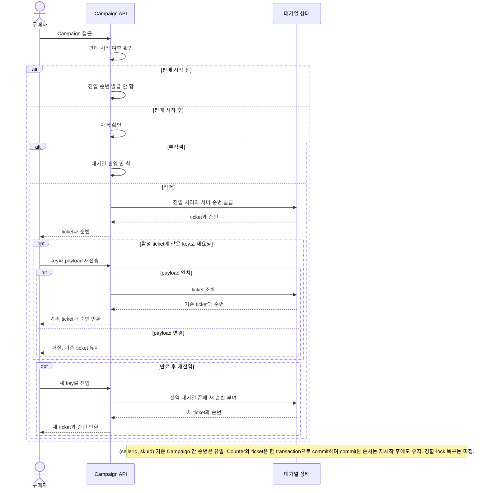
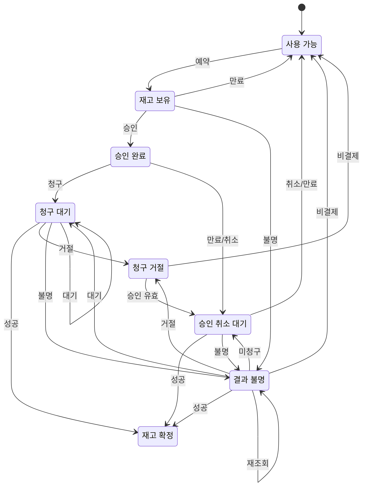

# 요구사항 인덱스

- 승인 기준: FR-001/FR-002/NFR-002의 Gate 2 Buyer 흐름. Seller-SKU 공유 재고·전역 FIFO는 [D-049](../00-governance/decision-log.md), V6 새로 시작 안전 조건은 [D-055](../00-governance/decision-log.md) 참조.
- 변경 원칙: Gate 2 기준은 소급 변경하지 않음.
- D-060의 단일 Seller Cart는 당시 범위 기록. 현재 Buyer-wide Cart·Seller별 주문은 [D-071](../00-governance/decision-log.md) 및 [ADR-0016](../02-decisions/adr/ADR-0016-buyer-wide-cart-multi-seller-checkout.md) 기준. Gate 2 baseline은 과거 검증 기준으로 보존.
- 미결 정책과 가정은 아래 [Q 목록](#assumptions-and-open-questions)에 기록.

| ID | 유형 | 상태 | 요구사항 | 우선순위 | 연결 |
|---|---|---|---|---|---|
| FR-001 | 기능 | ✓ Gate 2 기준 | Seller가 SKU를 소유합니다. Campaign은 Seller-SKU를 참조하고 재고·FIFO/K를 공유합니다. 초기 시나리오는 수량형 SKU, 예약당 1개, 판매 시작 후 적격 요청만 대기열에 진입하는 방식입니다. `sellerId`는 데이터 식별자이며 인증 수단이 아닙니다. | 미정 | [Q-002/Q-003/Q-007/Q-010](#assumptions-and-open-questions), [BR-001/002](#business-rules-and-domain-invariants), [Issue #89](https://github.com/Neo1228/ATLAS/issues/89) |
| FR-002 | 기능 | ✓ PayPal Sandbox 구현 | 재고 hold 이후 PayPal buyer approval 및 authorization/capture 수행. 확인된 capture만 재고 claim. 응답이 불명확하면 같은 payment attempt와 hold를 유지하고 provider 상태를 재조정. 주문·정산 원장은 KRW, PayPal 요청은 ADR-0030의 고정 USD 환율 스냅샷 사용. PayPal credential 또는 BOK ECOS API key가 없으면 요청을 명시적으로 거절. | P1 | [FR-017/BR-017/INV-014](requirements-index.md), [Q-004/Q-005/Q-008](#assumptions-and-open-questions), [D-081](../00-governance/decision-log.md), [ADR-0026](../02-decisions/adr/ADR-0026-paypal-sandbox-payments.md), [ADR-0030](../02-decisions/adr/ADR-0030-paypal-currency-boundary.md), [Issue #191](https://github.com/Neo1228/ATLAS/issues/191) |
| FR-003 | 기능 | ✓ 구현 | 확인된 `CAPTURED` attempt의 OrderItem snapshot gross KRW를 `PSP_CLEARING` 차변·`SELLER_PAYABLE` 대변으로 기록. Seller는 `recorded_at` 기준 `[from,to)` read-only statement 조회. BuyerCheckout capture는 Seller별 allocation, capture는 양수, local refund reversal은 음수. PSP/bank reconciliation, fee, reserve와 회계 정정 정책은 [Q-006](#assumptions-and-open-questions)에 기록. | P1 | [Q-006](#assumptions-and-open-questions), [D-066/D-068/D-075/D-081](../00-governance/decision-log.md), [ADR-0011](../02-decisions/adr/ADR-0011-gross-capture-settlement-ledger.md), [ADR-0013](../02-decisions/adr/ADR-0013-pre-shipment-refund-recording.md), [ADR-0020](../02-decisions/adr/ADR-0020-seller-settlement-statement.md), [Issue #115](https://github.com/Neo1228/ATLAS/issues/115), [Issue #163](https://github.com/Neo1228/ATLAS/issues/163) |
| FR-004 | 기능 | ✓ PR #90 초기 기준; SKU 정책 소유는 D-061로 조정 | Seller UUID와 V6 clean-start 조건 유지. 당시 Seller-SKU 등록이 `initialStock`과 전역 K를 설정했으나, D-061에 따라 Catalog는 Product/SKU를, Admission은 queue K policy를 소유. V1–V5 application table에 행이 있으면 DDL 전 실패; data mapping/backfill은 하지 않음. `sellerId`는 인증·인가 수단이 아님. | 미정 | [D-049/D-055/D-061](../00-governance/decision-log.md), [Q-002/Q-003/Q-007](#assumptions-and-open-questions), [Issue #89](https://github.com/Neo1228/ATLAS/issues/89) |
| FR-005 | 기능 | ✓ 구현·PostgreSQL CI 통과 (PR #150) | Buyer당 Cart 1개. Line key는 `(sellerId, skuId)`. Checkout은 `BuyerCheckout` 1건과 Seller별 `PurchaseOrder` 1건씩 생성. 현재 가격·상품 정보를 OrderItem에 snapshot하고 모든 Seller의 재고를 하나의 transaction에서 예약. 결제 attempt·capture는 checkout당 1회. Campaign은 별도 경로. | PostgreSQL CI 통과 | [D-060/D-071](../00-governance/decision-log.md), [ADR-0016](../02-decisions/adr/ADR-0016-buyer-wide-cart-multi-seller-checkout.md), [BR-004/INV-004](#business-rules-and-domain-invariants), [Issue #148](https://github.com/Neo1228/ATLAS/issues/148), [PR #150](https://github.com/Neo1228/ATLAS/pull/150), [Backend CI](https://github.com/Neo1228/ATLAS/actions/runs/42181356177) |
| FR-006 | 기능 | ✓ 2차 구현 기준 | Buyer는 이전 terminal Cart Order에서 Reorder 가능. 원본 Order는 변경하지 않음. 현재 Product/SKU와 stock을 한꺼번에 확인하고 Idempotency-Key로 Cart merge를 기록. 기존 Cart가 비어 있지 않으면 명시적 확인 후 같은 SKU quantity 합산, 다른 line 유지. 누락·판매 불가 SKU가 있으면 Cart 변경 없이 전체 거절. Reorder 자체는 재고를 예약하지 않음. | 미정 | [Q-011/Q-012](#assumptions-and-open-questions), [BR-005/INV-005](#business-rules-and-domain-invariants), [D-063](../00-governance/decision-log.md), [Issue #113](https://github.com/Neo1228/ATLAS/issues/113) |
| FR-007 | 기능 | ✓ 구현·PostgreSQL Testcontainers/full check 통과 | 결제 완료된 모든 PurchaseOrder에 `OrderFulfillment` 1건 생성. 결제·재고 claim transaction에서 `UNFULFILLED`로 시작하고 Seller가 이행을 시작하면 `IN_PROGRESS`. 실제 출고마다 `Shipment`를 기록하며 여러 Shipment에 OrderItem 수량 분할 가능. line별 `출고 누계 + 배송 전 직접 환불 수량 <= 주문 수량`. OrderItem seller와 PurchaseOrder seller는 V17 composite FK·service가 일치 검증. Summary는 `UNFULFILLED → IN_PROGRESS → PARTIALLY_SHIPPED → SHIPPED → DELIVERED`; 각 Shipment는 `SHIPPED → DELIVERED`. 외부 carrier 연동 없음. | PostgreSQL Testcontainers 대상 57 tests; 전체 Gradle check 154 tests/0 failures; bootJar 통과. GitHub CI 별도 확인 | [D-065/D-073](../00-governance/decision-log.md), [ADR-0010](../02-decisions/adr/ADR-0010-order-fulfillment-lifecycle.md), [ADR-0018](../02-decisions/adr/ADR-0018-seller-order-shipments.md), [Issue #117](https://github.com/Neo1228/ATLAS/issues/117), [Issue #159](https://github.com/Neo1228/ATLAS/issues/159), [PR #160](https://github.com/Neo1228/ATLAS/pull/160) |
| FR-008 | 기능 | ✓ 구현·PostgreSQL 동시성 통합 테스트 및 PR CI 통과 (PR #153) | Pre-shipment refund는 기존 경계를 유지. Delivered return은 Seller receipt 후 OrderItem별 PASSED/FAILED 검수. PASSED 수량만 local refund/restock, FAILED 수량은 claimed 유지. Idempotent; 재검수·write-off·임의 return window 없음. | PostgreSQL Testcontainers 통합 테스트·PR CI 통과 | [D-068/D-071](../00-governance/decision-log.md), [ADR-0013](../02-decisions/adr/ADR-0013-pre-shipment-refund-recording.md), [ADR-0016](../02-decisions/adr/ADR-0016-buyer-wide-cart-multi-seller-checkout.md), [Issue #148](https://github.com/Neo1228/ATLAS/issues/148), [PR #150](https://github.com/Neo1228/ATLAS/pull/150), [Issue #151](https://github.com/Neo1228/ATLAS/issues/151), [PR #153](https://github.com/Neo1228/ATLAS/pull/153) |
| FR-009 | 기능 | ✓ 구현·PostgreSQL CI 통과 (PR #130) | Seller는 SKU별 signed capacity delta와 reason으로 재고를 정정. Same idempotency key/same facts는 replay, key 재사용/다른 facts는 conflict. Audit와 pool 변경은 atomic. | PostgreSQL CI 통과 | [BR-009/INV-006](#business-rules-and-domain-invariants), [D-069](../00-governance/decision-log.md), [ADR-0014](../02-decisions/adr/ADR-0014-seller-inventory-capacity-adjustment.md), [Issue #126](https://github.com/Neo1228/ATLAS/issues/126), [PR #128](https://github.com/Neo1228/ATLAS/pull/128), [PR #130](https://github.com/Neo1228/ATLAS/pull/130), [Backend CI](https://github.com/Neo1228/ATLAS/actions/runs/41976338756) |
| FR-010 | 기능 | 대체됨·역사 기록 | 초기 payment-operation progression 요구사항. 현재 PayPal Sandbox provider·recovery 계약은 [FR-002/FR-017](requirements-index.md), [D-081](../00-governance/decision-log.md), [ADR-0026](../02-decisions/adr/ADR-0026-paypal-sandbox-payments.md)을 기준으로 함. | — | [D-070](../00-governance/decision-log.md), [ADR-0015](../02-decisions/adr/ADR-0015-initial-payment-progression.md), [Issue #127](https://github.com/Neo1228/ATLAS/issues/127), [PR #129](https://github.com/Neo1228/ATLAS/pull/129), [PR #131](https://github.com/Neo1228/ATLAS/pull/131) |
| FR-011 | 기능 | ✓ 승인·Issue #157 | Seller는 code/name, non-negative priority, active flag를 가진 fulfillment location을 관리합니다. Seller PurchaseOrder와 Campaign 주문은 모든 line을 충족하는 active location 하나를 priority ASC, UUID ASC로 선택하며 분할하지 않습니다. 기존 재고는 V16에서 DEFAULT로 매핑합니다. Reservation과 PurchaseOrder에 선택 location을 저장해 payment, release, return-restock에 재사용합니다. Reorder는 location 적합성을 사전 확인하고 checkout이 재검증합니다. 같은 Seller/SKU 간 available-only transfer는 atomic, idempotent, capacity-conserving입니다. | 통합 후 검증 | [D-072](../00-governance/decision-log.md), [ADR-0017](../02-decisions/adr/ADR-0017-seller-fulfillment-locations.md), [BR-011/INV-008](#business-rules-and-domain-invariants), [Issue #157](https://github.com/Neo1228/ATLAS/issues/157) |
| FR-012 | 기능 | ✓ 구현·local PostgreSQL Testcontainers/full Gradle check 통과 | Seller는 Seller-owned single-parent `ProductCategory` tree 관리. Seller별 `code` 고유·immutable, `name` 수정 가능. Product는 같은 Seller category 하나에 연결; 미지정 시 `UNCATEGORIZED` root. Seller-scoped filter는 선택 category와 descendants를 포함하며 기존 visibility·name query·UUID order 유지. V20은 기존 category를 root로 보존. 새 cursor v4; unfiltered legacy v1/v2/v3 유지, pre-v4 category-filtered cursor 거부. Global taxonomy, multi-category, archive, ranking·ML, stock filter 제외. | PostgreSQL Testcontainers/full Gradle check 통과: 40 suites, 200 tests, 0 failures/errors/skips; `bootJar` 성공 | [D-077](../00-governance/decision-log.md), [BR-012/INV-009/Q-010](#business-rules-and-domain-invariants), [ADR-0022](../02-decisions/adr/ADR-0022-seller-category-hierarchy.md), [Issue #168](https://github.com/Neo1228/ATLAS/issues/168), [PR #169](https://github.com/Neo1228/ATLAS/pull/169), [D-074](../00-governance/decision-log.md), [ADR-0019 이력](../02-decisions/adr/ADR-0019-seller-product-categories.md) |
| FR-013 | 기능 | ✓ PostgreSQL Testcontainers/full Gradle check 통과: 38 suites, 196 tests, 0 failures/errors/skips; `bootJar` 성공 | Catalog Product는 전역 `ACTIVE`/`INACTIVE`와 `ONLINE_STORE`/`CAMPAIGN`별 가용 여부를 관리. 새 Product와 V19 이전 Product는 ACTIVE·두 채널 사용 가능. 공개 목록·상세와 일반 구매는 ONLINE_STORE만, Campaign 생성·오픈·대기열 진입·주문은 CAMPAIGN만 확인. 비가용 신규 요청은 부작용 없이 거절; 기존 ticket은 주문 시도에서 slot 해제·terminal 실패. 기존 Order·예약은 유지. | PostgreSQL Testcontainers + 전체 Gradle check: 38 suites, 196 tests, 0 failures/errors/skips; bootJar 성공 | [Q-010](#assumptions-and-open-questions), [BR-013/INV-010](#business-rules-and-domain-invariants), [D-076](../00-governance/decision-log.md), [ADR-0021](../02-decisions/adr/ADR-0021-product-orderability-lifecycle.md), [Issue #165](https://github.com/Neo1228/ATLAS/issues/165), [PR #166](https://github.com/Neo1228/ATLAS/pull/166) |
| FR-014 | 기능 | ✓ local PostgreSQL Testcontainers/full Gradle check 통과: 42 suites, 207 tests, 0 failures/errors/skips; `bootJar` 성공 | Seller는 SKU별 기간 한정 sale price 설정·교체·취소. Cart는 현재 effective price 표시; Checkout은 하나의 pricing time으로 Catalog 가격을 재검증하고 OrderItem에 실제 단가 snapshot. Refund·settlement는 이 snapshot 사용. | 미정 | [BR-014/INV-011](requirements-index.md), [D-078](../00-governance/decision-log.md), [ADR-0023](../02-decisions/adr/ADR-0023-seller-sku-time-bounded-sale-price.md), [Issue #183](https://github.com/Neo1228/ATLAS/issues/183), [PR #184](https://github.com/Neo1228/ATLAS/pull/184) |
| FR-015 | 기능 | ✓ 구현 | Seller는 기간 한정 fixed-amount coupon을 관리. Checkout은 SellerOrder별 최대 1개를 적용하고 할인액을 line에 배분. Order snapshot 기준 partial refund·settlement. | JDK 25 + local PostgreSQL Testcontainers full Gradle check 통과: 41 suites, 212 tests, 0 failures/errors/skips; `bootJar` 성공 | [BR-015/INV-012](requirements-index.md), [D-079](../00-governance/decision-log.md), [ADR-0024](../02-decisions/adr/ADR-0024-seller-coupon-allocation.md), [Issue #186](https://github.com/Neo1228/ATLAS/issues/186) |
| FR-016 | 기능 | ✓ 구현 | Seller may set an optional global use cap and read its reserved/redeemed/remaining counts. Limited coupon redemption reserves during checkout, consumes only after confirmed capture, and releases only after definitive non-capture; uncertain payment holds the reservation until reconciliation. | JDK 25 + local PostgreSQL Testcontainers full Gradle check 통과: 42 suites, 218 tests, 0 failures/errors/skips; `bootJar` 성공. Local k6 comparison: [EXP-023](../03-experiments/EXP-023-coupon-redemption-capacity.md); no production capacity claim. | [BR-016/INV-013](requirements-index.md), [D-080](../00-governance/decision-log.md), [ADR-0025](../02-decisions/adr/ADR-0025-limited-coupon-redemption.md), [Issue #189](https://github.com/Neo1228/ATLAS/issues/189) |
| FR-017 | 기능 | ✓ 구현 | PayPal Sandbox buyer approval·authorization/capture/void/refund, KRW 원장과 USD 요청 간 고정 FX 스냅샷, provider 금액 대사, webhook signature verification과 unknown-result reconciliation. Settlement ledger는 확인된 외부 결과만 반영. | P1 | [BR-017/INV-014](requirements-index.md), [D-081](../00-governance/decision-log.md), [ADR-0026](../02-decisions/adr/ADR-0026-paypal-sandbox-payments.md), [ADR-0030](../02-decisions/adr/ADR-0030-paypal-currency-boundary.md), [Issue #191](https://github.com/Neo1228/ATLAS/issues/191) |
| FR-018 | 기능 | ✓ 구현 | Buyer·Seller account signup/login, 10분 JWT access, 7일 opaque refresh token·30일 family expiry, rotation·reuse revocation. 모든 protected operation에서 authenticated account의 Buyer/Seller ownership 검증. | P1 | [BR-018/INV-015](#업무-규칙과-도메인-불변조건), [Q-007](#가정과-미결정-사항), [D-082](../00-governance/decision-log.md), [ADR-0027](../02-decisions/adr/ADR-0027-account-jwt-authentication.md), [Issue #206](https://github.com/Neo1228/ATLAS/issues/206) |
| NFR-001 | 비기능 | ✓ 구현 | Authenticated Buyer·Seller 간 데이터·권한 격리. `buyerRef`·`sellerId`·resource UUID만으로 접근 허용 금지. | P1 | [BR-018/INV-015](#업무-규칙과-도메인-불변조건), [Q-007](#가정과-미결정-사항), [ADR-0027](../02-decisions/adr/ADR-0027-account-jwt-authentication.md), [Issue #206](https://github.com/Neo1228/ATLAS/issues/206) |
| NFR-002 | 비기능 | ✓ Gate 2 보고 profile | 전체 Buyer 흐름을 대상으로 60분간 합성 session 10,000건을 기준 부하로 사용하고, 2배·4배 부하도 기록합니다. 보고용이며 운영 SLO나 합격 기준은 아닙니다. metric 계약은 Q-008입니다. | 미정 | [Q-008](#assumptions-and-open-questions), [Issue #66](https://github.com/Neo1228/ATLAS/issues/66) |

<!-- markdownlint-disable MD033 -->

## 프로젝트 배경과 범위

### 목적과 장기 범위 — 목표 확정, 후속 업무 상세·순서 미정
- 목적: **PayPal AI Hackathon** 참가를 위해 full e-commerce platform의 Catalog·구매·결제·fulfillment 흐름과 transaction 정합성을 구현·검증.
- 현재 구현: Catalog/category/channel availability, Buyer-wide Cart와 multi-Seller Order, Campaign admission, location inventory, PayPal Sandbox, account/JWT, shipment/return, internal settlement ledger와 statement. 상세 계약은 아래 FR/BR/INV 항목.
- 미정 정책과 확장 순서: [Q-002](#assumptions-and-open-questions), [Q-003](#assumptions-and-open-questions), [Q-006](#assumptions-and-open-questions), [Q-010](#assumptions-and-open-questions).

| 영역 | 대표 흐름 | 구현 상태·남은 정책 |
|---|---|---|
| Catalog·Seller | Product/SKU, category hierarchy, channel availability, sale price, coupon | 핵심 흐름 구현. Global taxonomy·multi-category·ranking은 Q-010 |
| 구매·Order | Catalog browse, Buyer-wide Cart, multi-Seller checkout, Reorder, reservation, payment | 일반 구매 흐름 구현. 다수량·channel-specific inventory는 Q-002 |
| Campaign·Admission | FIFO queue, ticket, checkout slot, idempotency | 핵심 흐름 구현. 운영 K/TTL·tombstone/lock 복구는 Q-003 |
| Inventory | Location routing, reservation, transfer, capacity adjustment | 기본 흐름 구현. 재입고·판매 중 조정 정책은 Q-002 |
| Order 이후 | Shipment, Return/inspection, refund, internal ledger·Seller statement | 핵심 흐름 구현. return 기간·write-off·재검수와 accounting reconciliation은 Q-006/Q-010 |

장기 범위와 현재 경계:
- 결제 provider는 PayPal Sandbox; provider operation, order·fulfillment 상태는 분리. 확정 결과만 내부 ledger와 재고에 반영 ([D-081](../00-governance/decision-log.md), [ADR-0026](../02-decisions/adr/ADR-0026-paypal-sandbox-payments.md), [ADR-0029](../02-decisions/adr/ADR-0029-order-payment-recovery-contract.md)).

확정된 경계:
- `buyerRef`·`sellerId`는 resource ID이며 인증 정보가 아님. Account principal과 Buyer/Seller ownership을 검사 ([D-082](../00-governance/decision-log.md), [ADR-0027](../02-decisions/adr/ADR-0027-account-jwt-authentication.md)).
- 최초 판매 모델은 수량형 SKU. 지정 좌석·시간대 판매는 Q-002/Q-010에서 추가 정책 결정.
- 성능 profile은 Q-008의 합성 workload와 해당 data shape에 한정해 해석.

제안된 성공 기준:
- 정책·불변조건을 검증 가능한 시나리오에 연결.
- 장애·경합·복구 절차와 한계를 기록.
- 성능·복구 주장은 환경을 밝힌 반복 측정으로 뒷받침.
- SLO, RPS, p95/p99 목표는 미정.

## 가정과 미결정 사항
상태: `✓ 해결`, `? 미정`, `△ 가정`(미검증). 기준을 해결해도 세부 경계까지 확정된 것은 아닙니다.

| ID | 상태 | 질문·경계 |
|---|---|---|
| Q-002 | ? 미정 | 다수량 구매, channel-specific inventory, 판매 중 조정·재입고 및 claim 후 비환불 취소 정책 미정. Location routing은 D-072/FR-011로 해결했으며 channel별 재고는 미정. 배송 전 부분 환불 시 snapshot 수량만 재고 복원하는 정책은 D-068로 확정. V6 데이터 전환 안전은 D-055 참조. |
| Q-003 | ? 미정 | Seller-SKU 전역 FIFO/K, Campaign별 idempotency·ticket TTL, 판매 시작 후 자격 확인은 정함. 전역 K는 Admission 소유 policy로 구성. 운영 K/TTL, tombstone 정리, payload 필드, bot/auth, lock timeout/deadlock 복구는 미정. |
| Q-004 | ? 미정 | D-025~D-030: PSP 전 hold, AUTHORIZE → CAPTURE, capture 성공 후 재고 claim. 확인된 hold부터 첫 AUTHORIZE 제출까지 합성 10분, 연장 없음. 운영 TTL/SLO/분포는 미정. |
| Q-006 | ? 미정 | Internal capture/refund ledger와 Seller statement 구현. Confirmed PayPal Sandbox capture/refund만 기록. External PSP/bank reconciliation, fee/reserve, accounting correction 정책은 미정. Ledger는 provider/bank settlement evidence를 대신하지 않음. |
| Q-007 | ◐ 결정·구현 | `buyerRef`·`sellerId`는 인증 경계가 아님. Account당 Buyer identity 1개, Seller profile 여러 개. 신규 onboarding만 owner link 생성; 기존 synthetic identity 자동 claim 금지. MFA·account recovery·staff/admin role 정책은 별도 요구사항으로 남음. [D-082](../00-governance/decision-log.md), [ADR-0027](../02-decisions/adr/ADR-0027-account-jwt-authentication.md), [Issue #206](https://github.com/Neo1228/ATLAS/issues/206). |
| Q-008 | ? 미정 | 아래의 report-only load contract 참조. 합성 traffic profile이며, 결과를 SLO 또는 운영 traffic 목표로 해석하지 않음. |
| Q-009 | ✓ 로컬·CI 스택 확정 | JDK 25 LTS, CI Temurin 25, Spring Boot 4.1.2, PostgreSQL 18.6, Gradle Wrapper 9.8.2. Testcontainers 2.0.5와 ArchUnit 1.5.1은 test scope. Boot 4에서는 `spring-boot-starter-flyway` 사용. 선택 근거는 [결정 로그](../00-governance/decision-log.md) 참조. |
| Q-010 | ? 세부 순서 미정 | 전체 이커머스 플랫폼. Buyer-wide Cart·Seller별 주문·BuyerCheckout(D-071), Seller location(D-072), per-OrderItem return·partial shipment(D-073), Seller-owned category tree·subtree browse(D-077/FR-012), Product 전역 판매 상태·채널별 주문 가능성(D-076/FR-013) 구현. Global taxonomy·multi-category, ranking, return 기간·write-off·재검수 등 나머지 범위는 미정. |
| Q-011 | ✓ 해결 | 취소·기한 만료된 Cart 주문은 Cart를 자동 복원하지 않음. Buyer는 terminal Cart Order에서 명시적 Reorder를 실행; source lines는 현재 Catalog 기준으로 검증. 기존 Cart merge에는 사용자 확인 필요. (D-063/FR-006) |
| Q-012 | ? 미정 | Reorder idempotency record 보존·정리 정책 미정. 현재 record는 source Order를 참조하며 Order 삭제 기능/cleanup job은 없음. 보존 기간과 storage 영향은 실측 전 운영 규모로 해석하지 않음. |

### Q-006 1차 내부 캡처 원장 (승인 범위)

2026-11-04 D-066에서 capture gross 원장을 승인. 2026-11-06 D-071에서 BuyerCheckout 결제 1회와 SellerOrder별 allocation으로 범위 확장.

- Gross는 Cart checkout의 전체 Seller OrderItem snapshot 합계 또는 Campaign OrderItem snapshot 합계. KRW 금액만 사용.
- Source facts는 `attemptId`; Cart checkout은 `checkoutId`와 각 Seller Order allocation도 기록. 같은 attempt·동일 facts replay는 no-op, 다른 payload는 conflict.
- Ledger row는 capture 시점의 internal clearing receivable과 Seller payable을 기록하며, provider/bank statement reconciliation 결과를 뜻하지 않음.
- Journal entry, Seller allocation, 관련 PurchaseOrder의 `PAID`, 재고 claim과 초기 fulfillment row는 하나의 PostgreSQL transaction에서 기록. PaymentAttempt `CAPTURED`는 provider 응답 확인 후 commit되며, 후속 실패는 같은 attempt로 재조정.
- PayPal Sandbox capture/refund 실행 범위는 [D-081](../00-governance/decision-log.md), [ADR-0026](../02-decisions/adr/ADR-0026-paypal-sandbox-payments.md). Provider/bank reconciliation, fee, reserve, 회계 정정 정책은 Q-006에서 결정.

Q-006 관련 기록:
- 결정: [D-066/D-068/D-071/D-075/D-081](../00-governance/decision-log.md)
- 설계: [ADR-0011](../02-decisions/adr/ADR-0011-gross-capture-settlement-ledger.md) · [ADR-0013](../02-decisions/adr/ADR-0013-pre-shipment-refund-recording.md) · [ADR-0016](../02-decisions/adr/ADR-0016-buyer-wide-cart-multi-seller-checkout.md) · [ADR-0020](../02-decisions/adr/ADR-0020-seller-settlement-statement.md)
- 추적: [Issue #115](https://github.com/Neo1228/ATLAS/issues/115) · [Issue #163](https://github.com/Neo1228/ATLAS/issues/163)

### Q-008 부하 계약 — 보고 전용
- 기준 입력: D-033이 승인한 합성 workload 10,000 Buyer session/60분(약 2.8 session/s).
- 2×·4× 비교 단계는 약 5.6·11.1 session/s. 이는 측정용 workload이지 수요 예측이 아님. 전체 Buyer 흐름과 mixed arrival distribution 사용.
- Ingress·completed·dropped session/s와 반복 횟수 기록. 단계별 request RPS도 구분하며, DB QPS는 해당 query 범위를 직접 측정한 경우에만 기록.
- 완료된 Buyer session만 업무 TPS에 포함. `PENDING`/`UNKNOWN`은 진행 중 또는 backlog로 계산.
- p95/p99의 측정 경계, 오류, 만료·중단, 대기열·inventory hold, 자원 포화와 oversell invariant 기록. 해당 값은 합격 SLO나 처리 용량 목표가 아님.
- 미정: burst factor·duration, arrival curve·think time, 단계별 기간, concurrency, test environment와 data shape.

## 업무 규칙과 도메인 불변조건
상태: `✓ 확정 기준`, `? 미정`. 합성 시나리오의 계약이며 실험 결과가 아닙니다.

| ID | 규칙·불변조건 | 상태 | 미정 범위 |
|---|---|---|---|
| BR-001 / INV-002 | 판매 시작 후 자격이 있는 요청만 대기열에 진입. Seller-SKU 순번은 유일하고 작은 번호가 먼저 처리. 같은 `(sellerId, skuId)`를 쓰는 Campaign은 제한된 FIFO/K 공유. Queue key/K는 전역, idempotency와 ticket TTL은 Campaign별. 같은 key·payload는 기존 ticket 반환; payload가 다르면 거절. 만료 뒤 새 key로 재진입하면 전역 대기열 끝에 배치. `sellerId`는 인증 경계가 아님. | ✓ 로컬 기준 | 운영 K/TTL, tombstone 정리, payload 필드, bot/auth, lock timeout/deadlock 복구 (Q-003/Q-007) |
| BR-002 / INV-001 | Seller-SKU 공유 재고 pool, reservation당 1개. 확인된 전이 뒤 `available + reserved + claimed = initial capacity`, 각 값은 0 이상. Hold는 available→reserved, capture 성공은 reserved→claimed. 비결제와 필요한 authorization void/expiry 확인 뒤에만 release. | ✓ 로컬 기준 | 다수량·channel-specific inventory, 조정·재입고, claim 후 취소·환불 (Q-002). Location별 보존·routing·transfer 기준은 [BR-011/INV-008](requirements-index.md#business-rules-and-domain-invariants), [D-072](../00-governance/decision-log.md), [ADR-0017](../02-decisions/adr/ADR-0017-seller-fulfillment-locations.md). PostgreSQL guarded UPDATE/row lock은 로컬 기준이며 운영 성능 결론이 아님. |
| BR-003 / INV-003 | Inventory hold trước PayPal call. `CAPTURED` 확인 후에만 claim; `PENDING`/`UNKNOWN`/`VOID_PENDING`은 hold와 같은 attempt reconciliation 유지. 결과 확정 전 새 payment attempt 금지. 확인된 비결제·void 뒤에만 release. | ✓ PayPal Sandbox flow 구현 | Provider deadline·retry/key retention·escalation/compensation 세부 정책은 Q-004/Q-005/Q-008 참조. Seller resource owner는 D-082 기준 검증. |
| BR-004 | ✓ 확정 | Buyer당 Cart 1개, line identity `(sellerId, skuId)`. Cart 가격은 표시용. Checkout에서 Seller-SKU와 가격 재검증, 상품·SKU·KRW 단가·quantity snapshot. `BuyerCheckout` 1건과 Seller별 PurchaseOrder를 만들며 결제·재고 처리는 D-071 경계를 따름. | 상품 수정·비활성화 등은 Q-010 |
| INV-004 | ✓ 확정 | Checkout은 Seller·SKU 순으로 모든 line을 예약. 하나라도 부족하면 parent Checkout·Seller Orders·reservations·Cart 변경 전체 rollback. `available + reserved + claimed = initial capacity`. Capture unknown/pending이면 모든 child reservation 유지. Unsubmitted RESERVED checkout만 만료 처리. | 분산 보상·운영 TTL·성능 목표 미정 (Q-004/Q-008/Q-010) |
| BR-005 | ✓ 2차 구현 기준 | Reorder 대상은 `CART` source와 terminal Order (`PAID`, `FAILED`, `EXPIRED`, `CANCELLED`). Campaign·결제 진행 중 Order 제외. 원본 Order 변경 없음. 취소·만료 뒤 자동 Cart 복원 없음; 명시적 Reorder만 지원. | reorder 후 장기 보존과 주문 내역 조회 UX (Q-010/Q-012) |
| INV-005 | ✓ 2차 구현 기준 | Reorder 전 모든 OrderItem의 현재 Seller-SKU/Product mapping과 available quantity를 batch 조회. 하나라도 누락·불충분하면 Cart·idempotency record 전체 rollback. 성공 시 기존 Cart를 확인 후 merge; 같은 SKU quantity 합산, 기존 다른 SKU 유지. Key scope `(sellerId, buyerRef, idempotencyKey)`; 같은 source Order replay는 중복 적용 없음, 다른 source 재사용은 conflict. Reorder는 stock read point-in-time일 뿐 hold/예약 아님; 새 Checkout transaction이 최종 재고 보장. | stock 상태는 Reorder와 Checkout 사이에 변할 수 있음; checkout에서 재검증 |
| BR-006 | 결제된 SellerOrder당 `OrderFulfillment` summary 1건. Seller가 `IN_PROGRESS`로 이행을 시작하고 실제 출고마다 `Shipment`를 생성. 여러 Shipment로 OrderItem 수량 분할 가능; line별 출고 누계는 주문 수량에서 배송 전 직접 환불 수량을 뺀 값을 초과할 수 없음. Summary 전이는 `UNFULFILLED` → `IN_PROGRESS` → `PARTIALLY_SHIPPED` → `SHIPPED` → `DELIVERED`; 임의 status 변경 금지. `shipped_at`은 출고 가능 수량 전체 출고 시각, `delivered_at`은 전체 Shipment 배송 완료 시각. | ✓ 확정 | Carrier 연동·ETA·배송비·부분 배송 중 Return 제외; [D-065/D-073](../00-governance/decision-log.md), [ADR-0018](../02-decisions/adr/ADR-0018-seller-order-shipments.md), [Issue #159](https://github.com/Neo1228/ATLAS/issues/159), [PR #160](https://github.com/Neo1228/ATLAS/pull/160) |
| BR-007 | ✓ 확정 | Cart checkout capture는 checkout당 gross journal 1건: `PSP_CLEARING` 차변·`SELLER_PAYABLE` 대변. Seller별 allocation 합은 gross와 정확히 같아야 함. `attemptId`로 idempotent, journal·entries·allocations·child Orders·inventory는 atomic. Campaign capture는 기존 Order 기준 유지. | PSP evidence·fee·payout 미정 (Q-006) |
| BR-008 | 배송 전 직접 환불은 `UNFULFILLED`/`IN_PROGRESS`에서만 허용하고 해당 수량만큼 출고 가능 수량 감소. 첫 Shipment dispatch 뒤 직접 환불 금지. Return-linked 환불은 이미 출고된 수량이므로 shipment 합계에서 제외하지 않음. 출고 가능 수량 전체 배송 뒤 Return 허용; Seller 수령·OrderItem별 검수 필수. `PASSED`만 local refund/restock, `FAILED`는 claimed 유지. | ✓ PostgreSQL Testcontainers/full check 통과 | [D-068/D-073](../00-governance/decision-log.md), [ADR-0013](../02-decisions/adr/ADR-0013-pre-shipment-refund-recording.md), [ADR-0016](../02-decisions/adr/ADR-0016-buyer-wide-cart-multi-seller-checkout.md), [ADR-0018](../02-decisions/adr/ADR-0018-seller-order-shipments.md), [Issue #159](https://github.com/Neo1228/ATLAS/issues/159), [PR #160](https://github.com/Neo1228/ATLAS/pull/160) |
| BR-009 | ✓ 확정 | Seller 재고 조정 요청은 유효한 Seller-SKU, nonzero signed delta, reason, `Idempotency-Key`를 요구. 같은 key·같은 요청은 원래 결과를 반환하고 다른 요청의 재사용은 conflict. | 재시도·감사 가능; [FR-009](requirements-index.md), [D-069](../00-governance/decision-log.md) |
| INV-006 | ✓ 확정 | `initialCapacity = available + reserved + claimed`. 조정은 `reserved`·`claimed`를 건드리지 않으며 음수 delta는 available을 초과할 수 없음. pool update와 append-only audit는 한 transaction. | 재고 보존; [FR-009](requirements-index.md), [ADR-0014](../02-decisions/adr/ADR-0014-seller-inventory-capacity-adjustment.md) |
| BR-010 | PayPal endpoint가 지원하는 경우 provider idempotency key 사용. 지원하지 않거나 응답이 불명확한 operation은 내부 operation/resource ID로 저장하고 provider 상태를 확인한 뒤 재시도. 확인 전 blind retry 금지. | ✓ 구현 | [FR-017](requirements-index.md), [D-081](../00-governance/decision-log.md), [ADR-0026](../02-decisions/adr/ADR-0026-paypal-sandbox-payments.md) |
| INV-007 | Provider network call은 DB transaction 밖에서 수행. Provider operation state와 Order·Inventory·Settlement effect를 분리하며, 확인된 결과만 반영. `PENDING`/`UNKNOWN`은 같은 attempt로 reconciliation; webhook event ID와 ledger posting은 idempotent. | ✓ 구현 | [FR-017](requirements-index.md), [ADR-0026](../02-decisions/adr/ADR-0026-paypal-sandbox-payments.md), [ADR-0029](../02-decisions/adr/ADR-0029-order-payment-recovery-contract.md) |
| BR-011 | ✓ 승인 기준 | Seller PurchaseOrder마다 모든 line의 수량을 충족하는 active Seller location 하나를 priority 오름차순, 동률 UUID 오름차순으로 선택. Seller 주문을 location 간 분할하지 않는다. Campaign도 같은 선택 정책을 쓰며 후보가 없으면 Buyer-wide checkout 전체 rollback. | 주소·지리·carrier·channel 최적화 제외; [FR-011](requirements-index.md), [D-072](../00-governance/decision-log.md), [ADR-0017](../02-decisions/adr/ADR-0017-seller-fulfillment-locations.md), [Issue #157](https://github.com/Neo1228/ATLAS/issues/157) |
| INV-008 | ✓ 승인 기준 | Location별 `initialCapacity = available + reserved + claimed`. Reservation과 PurchaseOrder의 location은 선택 시 저장하고 claim/release/return-restock에서 재선택하지 않는다. Reorder는 모든 line에 대한 location preflight만 하며 checkout에서 재검증한다. Transfer는 같은 Seller/SKU의 available만 원자적으로 이동하고 source/destination capacity와 available을 함께 조정; audit와 pool update는 같은 transaction. Same-key/same-facts replay, changed-facts conflict. 기존 location 없는 데이터는 V16에서 DEFAULT로 매핑한다. | [FR-011](requirements-index.md), [D-072](../00-governance/decision-log.md), [ADR-0017](../02-decisions/adr/ADR-0017-seller-fulfillment-locations.md), [Issue #157](https://github.com/Neo1228/ATLAS/issues/157) |
| BR-012 | Category는 Seller별 소유. `code`는 Seller 안에서 고유·immutable, 표시명만 수정. Product는 같은 Seller의 Category 하나에 연결하며 `UNCATEGORIZED`는 root. Parent/child는 같은 Seller 소유; self-parent 금지, multi-node cycle은 Seller별 transaction lock과 service validation으로 차단. Category filter는 subtree 포함. | ✓ PostgreSQL Testcontainers/full Gradle check 통과 | 삭제/archive·global taxonomy·multi-category 제외; [FR-012](requirements-index.md), [D-077](../00-governance/decision-log.md), [ADR-0022](../02-decisions/adr/ADR-0022-seller-category-hierarchy.md), [Issue #168](https://github.com/Neo1228/ATLAS/issues/168), [PR #169](https://github.com/Neo1228/ATLAS/pull/169) |
| INV-009 | `Product(seller_id, category_id)`는 같은 Seller의 `ProductCategory`를 참조하는 composite FK. V18은 기본 Category 생성과 기존 Product backfill; V20은 `parent_category_id` same-Seller FK와 self-parent CHECK 추가. 기존 Category는 root로, Product 연결은 그대로 보존. Multi-node cycle은 DB constraint가 아니라 transaction 내 service validation으로 차단. Category cursor v4; unfiltered v1/v2/v3 legacy 유지, pre-v4 category-filtered cursor 거부. | ✓ V18/V20 PostgreSQL Testcontainers·full check 통과: 40 suites, 200 tests | Clean/upgrade migration·기존 데이터·cross-Seller/self-parent·cycle/concurrency·subtree pagination 검증; [FR-012](requirements-index.md), [D-077](../00-governance/decision-log.md), [ADR-0022](../02-decisions/adr/ADR-0022-seller-category-hierarchy.md), [Issue #168](https://github.com/Neo1228/ATLAS/issues/168), [PR #169](https://github.com/Neo1228/ATLAS/pull/169) |
| BR-013 | ✓ 승인 기준 | Product 전역 상태 `ACTIVE`/`INACTIVE`와 `ONLINE_STORE`/`CAMPAIGN`별 가용 여부를 분리. 신규·기존 Product 기본은 ACTIVE, 두 채널 사용 가능. INACTIVE는 전체 차단; 채널 비활성은 해당 채널만 차단. 기존 idempotency key는 기존 결과를 재생하고, 신규 구매 진입만 현재 가용 여부로 제한. | 상태 종류·채널 확장·관리 권한은 미정; [FR-013](requirements-index.md), [D-076](../00-governance/decision-log.md), [ADR-0021](../02-decisions/adr/ADR-0021-product-orderability-lifecycle.md) |
| BR-014 | ✓ full Gradle check 통과 | SellerSku는 정가와 seller-funded sale window 하나를 소유. Sale price는 정가 미만·양수이며 `[startsAt, endsAt)`에서만 effective. ONLINE_STORE/CAMPAIGN은 같은 SKU effective price 사용. | SKU 하나당 window 하나; Seller coupon은 [BR-015](requirements-index.md)로 별도 정의하며 active sale price와 stacking 금지. Channel별 가격·platform subsidy는 제외; [FR-014](requirements-index.md), [INV-011](requirements-index.md), [D-078](../00-governance/decision-log.md), [ADR-0023](../02-decisions/adr/ADR-0023-seller-sku-time-bounded-sale-price.md) |
| BR-015 | ✓ full Gradle check 통과 (41 suites/212 tests) | Seller-owned reusable fixed-amount coupon, `[startsAt, endsAt)`, SellerOrder별 1개. Coupon은 seller-funded, active SKU sale price와 stacking 금지, discount는 subtotal보다 작아야 함. 정수 비례 배분·remainder 내림차순·동률 `skuId` 오름차순. 각 unit refund는 양수여야 함. | V1 usage limit/redemption state는 [BR-016](requirements-index.md)·[ADR-0025](../02-decisions/adr/ADR-0025-limited-coupon-redemption.md)에서 확장; percentage/platform/shipping discount는 제외; [FR-015](requirements-index.md), [INV-012](requirements-index.md), [D-079](../00-governance/decision-log.md), [ADR-0024](../02-decisions/adr/ADR-0024-seller-coupon-allocation.md) |
| BR-016 | ✓ full Gradle check 통과 (42 suites/218 tests) | `maxRedemptions`는 optional global cap; `null`은 unlimited. Seller-scoped GET은 capped coupon의 cap/reserved/redeemed/remaining을 표시하고 unlimited coupon usage counts는 null. Checkout은 SellerOrder별 reserved redemption 1건을 기록. Confirmed capture만 redeemed로 전환. Definitive non-capture는 release, pending/unknown/void-pending는 hold. Refund는 cap을 복원하지 않음. Per-customer cap은 buyer identity 미정으로 제외. | [FR-016](requirements-index.md), [INV-013](requirements-index.md), [D-080](../00-governance/decision-log.md), [ADR-0025](../02-decisions/adr/ADR-0025-limited-coupon-redemption.md), [Issue #189](https://github.com/Neo1228/ATLAS/issues/189) |
| BR-017 | PayPal operation은 endpoint별 idempotency contract를 적용. 응답이 불명확하면 provider resource 조회 후 재조정하며 무조건 재시도하지 않음. Ledger posting은 확인된 capture/refund에서만 수행. | ✓ 구현 | — |
| BR-018 | Authentication은 verified account principal로 식별. Client-supplied `buyerRef`·`sellerId`만으로 ownership을 인정하지 않음. Protected operation은 principal-resource ownership 일치 필수이며, 명시되지 않은 route는 default deny. | ✓ 구현·filter-chain/ownership tests 통과 | Multi-Buyer persona와 staff/admin role matrix는 미정 |
| INV-010 | ✓ 승인 기준 | 신규 Cart checkout·Reorder·Campaign ticket은 Catalog 가용 여부 확인 뒤에만 쓰기 진행. 비가용 SKU가 하나라도 있으면 신규 Order·reservation·idempotency·Cart 변경 없음. Campaign 주문의 기존 ticket은 unavailable 상태에서 주문 시도 시 slot 해제와 `CHECKOUT_FAILED`를 같은 transaction으로 commit한 뒤 HTTP 409; 기존 RESERVED/PAID Order·Inventory·Payment·Settlement는 변경하지 않음. | 동시 비활성화 경합의 강한 serialization은 보장하지 않음; [FR-013](requirements-index.md), [D-076](../00-governance/decision-log.md), [ADR-0021](../02-decisions/adr/ADR-0021-product-orderability-lifecycle.md) |
| INV-011 | ✓ full Gradle check 통과 | Checkout은 모든 line에 하나의 `pricingAt`을 적용. OrderItem은 그 시점의 effective SKU unit price를 불변 snapshot으로 보존하며 이후 promotion 변경은 capture·refund·settlement 금액에 영향 없음. | `[startsAt, endsAt)` 경계, full/partial refund 및 settlement 금액 검증; [FR-014](requirements-index.md), [BR-014](requirements-index.md), [D-078](../00-governance/decision-log.md), [ADR-0023](../02-decisions/adr/ADR-0023-seller-sku-time-bounded-sale-price.md) |
| INV-013 | ✓ full Gradle check 통과 (42 suites/218 tests) | Capped coupon의 `reserved_count + redeemed_count <= max_redemptions`. Counter와 unique SellerOrder redemption ledger는 같은 DB transaction에서 갱신. Reserve/redeem/release는 idempotent. Unknown payment capacity held; multi-Seller checkout reservation atomic. | PostgreSQL concurrency/failure tests 통과; [FR-016](requirements-index.md), [BR-016](requirements-index.md), [D-080](../00-governance/decision-log.md), [ADR-0025](../02-decisions/adr/ADR-0025-limited-coupon-redemption.md), [EXP-023](../03-experiments/EXP-023-coupon-redemption-capacity.md) |
| INV-014 | Provider 결과 확인 전 order·inventory·coupon·ledger를 완료 상태로 바꾸지 않음. 같은 provider operation/webhook replay로 외부 payment effect 또는 내부 posting을 중복하지 않음. | ✓ 구현 | — |
| INV-015 | Password는 encoded hash만 저장. Access JWT는 `iss`·`aud`·signature/algorithm·`exp` 검증. Refresh token은 hash 저장·rotation; consumed token reuse 시 family revoke. Logout은 family revoke; disabled account의 refresh 시도는 family revoke. | ✓ 구현·auth unit tests 통과 | MFA, account recovery, production key rotation은 외부 사용자 범위 검토 시 재평가 |

로컬 복구·잠금의 한계가 적용되며 운영 환경에 대한 주장은 아닙니다.

- Buyer에게 표시하는 timer는 첫 AUTHORIZE 제출 시 끝납니다. 결제 대조나 PSP 작업 deadline은 정의하지 않습니다. 운영 TTL·복구 deadline은 미정.
