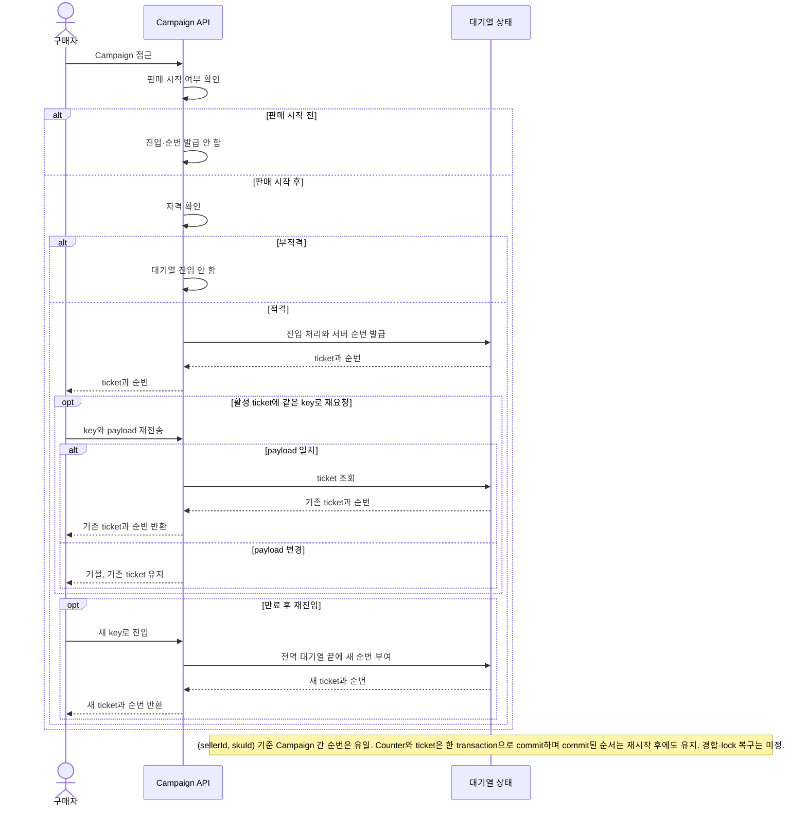
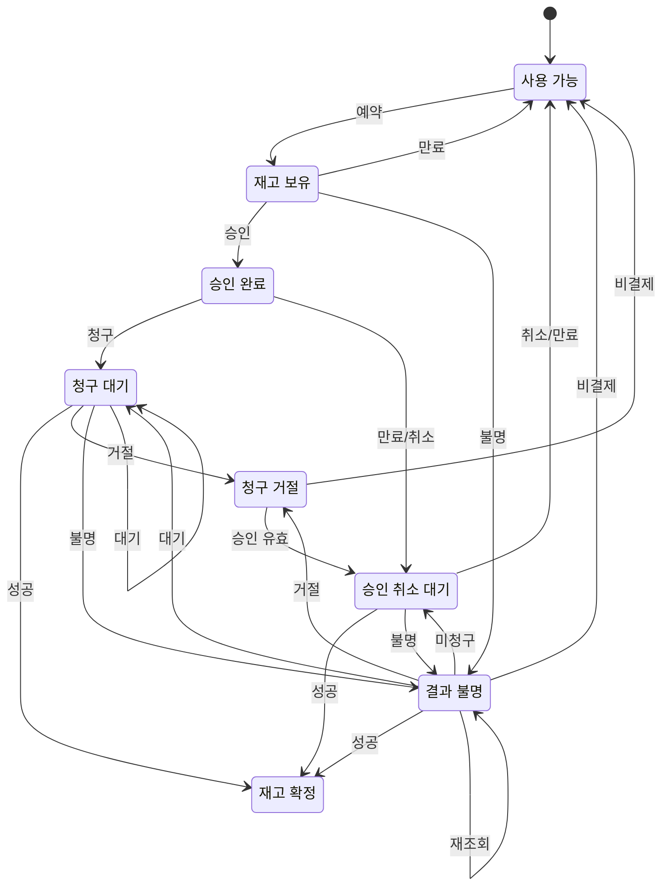

# 요구사항 인덱스

- 승인 기준: FR-001/FR-002/NFR-002의 Gate 2 Buyer 흐름. Seller-SKU 공유 재고·전역 FIFO는 [D-049](../00-governance/decision-log.md), V6 새로 시작 안전 조건은 [D-055](../00-governance/decision-log.md) 참조.
- 변경 원칙: Gate 2 기준은 소급 변경하지 않음.
- 미정: 운영 목표·우선순위. FR-003 정산과 NFR-001 보안은 제안 상태.

| ID | 유형 | 상태 | 요구사항 | 우선순위 | 연결 |
|---|---|---|---|---|---|
| FR-001 | 기능 | ✓ Gate 2 기준 | Seller가 SKU를 소유합니다. Campaign은 Seller-SKU를 참조하고 재고·FIFO/K를 공유합니다. 초기 시나리오는 수량형 SKU, 예약당 1개, 판매 시작 후 적격 요청만 대기열에 진입하는 방식입니다. `sellerId`는 데이터 식별자이며 인증 수단이 아닙니다. | 미정 | [Q-002/Q-003/Q-007/Q-010](#assumptions-and-open-questions), [BR-001/002](#business-rules-and-domain-invariants), [Issue #89](https://github.com/Neo1228/ATLAS/issues/89) |
| FR-002 | 기능 | ✓ Gate 2 기준 | PSP 요청 전에 재고를 hold합니다. AUTHORIZE → CAPTURE 순서이며, capture 성공이 확인된 뒤 재고를 claim합니다. 결과가 미확정이면 재고 hold와 같은 attempt를 유지합니다. 로컬 시험 시간은 10분이며 Fake PSP만 사용합니다. | 미정 | [Q-004/Q-005/Q-008](#assumptions-and-open-questions), [BR-003/INV-003](#business-rules-and-domain-invariants), [Issue #72](https://github.com/Neo1228/ATLAS/issues/72) |
| FR-003 | 기능 | ✓ Gross capture 원장 1차 범위; △ 전체 정산 제안 | 확인된 `CAPTURED` attempt의 OrderItem snapshot gross KRW를 `PSP_CLEARING` 차변·`SELLER_PAYABLE` 대변으로 기록. 내부 원장에 한정; 외부 PSP 대조·수수료·보류·판매자 지급·환불·정정은 제외. | 미정 | [Q-006](#assumptions-and-open-questions), [D-066](../00-governance/decision-log.md), [ADR-0011](../02-decisions/adr/ADR-0011-gross-capture-settlement-ledger.md), [Issue #115](https://github.com/Neo1228/ATLAS/issues/115) |
| FR-004 | 기능 | ✓ PR #90 초기 기준; SKU 정책 소유는 D-061로 조정 | Seller UUID와 V6 clean-start 조건 유지. 당시 Seller-SKU 등록이 `initialStock`과 전역 K를 설정했으나, D-061에 따라 Catalog는 Product/SKU를, Admission은 queue K policy를 소유. V1–V5 application table에 행이 있으면 DDL 전 실패; data mapping/backfill은 하지 않음. `sellerId`는 인증·인가 수단이 아님. | 미정 | [D-049/D-055/D-061](../00-governance/decision-log.md), [Q-002/Q-003/Q-007](#assumptions-and-open-questions), [Issue #89](https://github.com/Neo1228/ATLAS/issues/89) |
| FR-005 | 기능 | ✓ 1차 구현 범위 승인 | 판매자는 Product와 Seller-SKU variant를 등록·조회. 합성 Buyer는 같은 Seller의 여러 SKU/수량을 담은 Cart를 관리하고 한 Order로 checkout. Checkout 시 현재 KRW 가격을 확인해 Order line에 snapshot하고 재고 전체를 원자적으로 예약. 한정판매 Campaign은 별도 판매 경로. | 미정 | [Q-010/Q-011](#assumptions-and-open-questions), [D-060/D-061](../00-governance/decision-log.md), [BR-004/INV-004](#business-rules-and-domain-invariants), [Issue #109](https://github.com/Neo1228/ATLAS/issues/109) |
| FR-006 | 기능 | ✓ 2차 구현 기준 | Buyer는 이전 terminal Cart Order에서 Reorder 가능. 원본 Order는 변경하지 않음. 현재 Product/SKU와 stock을 한꺼번에 확인하고 Idempotency-Key로 Cart merge를 기록. 기존 Cart가 비어 있지 않으면 명시적 확인 후 같은 SKU quantity 합산, 다른 line 유지. 누락·판매 불가 SKU가 있으면 Cart 변경 없이 전체 거절. Reorder 자체는 재고를 예약하지 않음. | 미정 | [Q-011/Q-012](#assumptions-and-open-questions), [BR-005/INV-005](#business-rules-and-domain-invariants), [D-063](../00-governance/decision-log.md), [Issue #113](https://github.com/Neo1228/ATLAS/issues/113) |
| FR-007 | 기능 | ✓ 3차 구현 범위 승인 | `PAID` 상태의 모든 Order(`CART`·`CAMPAIGN`)는 주문당 fulfillment 1건을 가짐. 결제 성공·재고 claim과 같은 transaction에서 `UNFULFILLED` 시작. Seller 상태 전이: `IN_PROGRESS` → `SHIPPED` → `DELIVERED`; 건너뛰기·역행 거절, 현재 상태 재요청은 멱등 처리. Buyer는 상태 조회 가능. 수동 local simulation이며 실제 운송사·운송장·인증 없음. | 미정 | [Q-007/Q-010](#assumptions-and-open-questions), [BR-006](#business-rules-and-domain-invariants), [D-065](../00-governance/decision-log.md), [ADR-0010](../02-decisions/adr/ADR-0010-order-fulfillment-lifecycle.md), [Issue #117](https://github.com/Neo1228/ATLAS/issues/117) |
| NFR-001 | 비기능 | △ 제안 | Tenant 간 데이터·권한 격리를 검증해야 합니다. 위협 경계는 미정입니다. | 미정 | [Q-007](#assumptions-and-open-questions) |
| NFR-002 | 비기능 | ✓ Gate 2 보고 profile | 전체 Buyer 흐름을 대상으로 60분간 합성 session 10,000건을 기준 부하로 사용하고, 2배·4배 부하도 기록합니다. 보고용이며 운영 SLO나 합격 기준은 아닙니다. metric 계약은 Q-008입니다. | 미정 | [Q-008](#assumptions-and-open-questions), [Issue #66](https://github.com/Neo1228/ATLAS/issues/66) |

<!-- markdownlint-disable MD033 -->

## 프로젝트 배경과 범위

### 목적과 장기 범위 — 목표 확정, 후속 업무 상세·순서 미정
- 목적: 전체 이커머스 플랫폼의 구매·판매 흐름과 거래 정합성·장애 복구를 단계적으로 설계·검증하는 학습 프로젝트.
- 현재 범위: Seller-SKU 대기열·공유 재고 기반 한정판매와 단일 Seller Cart 구매. 일반 구매는 Checkout·Fake PSP·explicit Reorder 및 PAID 주문의 수동 fulfillment까지 포함. 전체 이커머스 흐름 중 로컬 검증 단위.
- 한계: 실제 사용자·시장 수요·운영 성능을 입증하지 않음.

| 장기 업무 영역(후보) | 예시 흐름 | 상태 |
|---|---|---|
| 상품·판매 | 판매자, 상품·SKU, 판매 조건·가격, 판매 가능 재고 | 상세 범위·순서 미정 |
| 구매·거래 | 상품 탐색, 장바구니, 주문, 재고 예약, 결제 | 현재 일반 구매 및 한정판매의 첫 검증 흐름을 구현 |
| 주문 이후·운영 | 배송·이행, 취소·반품·환불, 거래 대조·정산 | 주문당 1건의 결제 후 fulfillment 승인(D-065); 나머지 상세 범위·순서 미정 |

장기 범위와 현재 경계:
- 각 영역은 단계적으로 다룰 장기 범위. 향후 PSP 후보는 PayPal Sandbox이며 Fake PSP는 장애 상황을 흉내 낼 뿐 PayPal 동작을 재현하지 않음.
- Gate 2의 단일 SKU 구매 흐름은 첫 검증 시나리오이지 전체 제품 범위가 아님.
- 실제 인터뷰·거래·시장 검증은 없음. 인물 유형은 합성 설정이며 Buyer/Seller 공통 목표도 사용자 선택이지 조사 결과가 아님.

확정된 경계:
- 합성 또는 가명 데이터만 사용. 실제 결제·고객 개인정보·판매사 지급 제외.
- 주문 상태와 PSP 작업 상태를 분리. Fulfillment 상태도 별도로 관리하며, 내부 정산과 실제 자금 이동도 분리.
- Gate 2 Buyer 기준과 로컬 흐름은 승인. 실제 결제·carrier 연동·인증·tenant 격리·cloud 배포·운영 schema/lock 복구·처리 용량/SLO는 별도 결정 필요.
- 현재 시나리오는 수량형 SKU. 지정 좌석·시간대 판매는 제외; 다른 판매 유형과 확장 순서는 미정.
- `sellerId`는 데이터 식별자일 뿐 인증·인가·Tenant 격리 경계가 아님.

제안된 성공 기준:
- 정책·불변조건을 검증 가능한 시나리오에 연결.
- 장애·경합·복구 절차와 한계를 기록.
- 성능·복구 주장은 환경을 밝힌 반복 측정으로 뒷받침.
- SLO, RPS, p95/p99 목표는 미정.

## 가정과 미결정 사항
상태: `✓ 해결`, `? 미정`, `△ 가정`(미검증). 기준을 해결해도 세부 경계까지 확정된 것은 아닙니다.

| ID | 상태 | 질문·경계 |
|---|---|---|
| Q-001 | ✓ 해결 | 합성 학습 시나리오로 시작. 실제 시장·사용자 검증 없음. Buyer/Seller 목표는 D-015~D-017에 기록. |
| Q-002 | ? 미정 | 다수량 구매, 위치·판매 채널별 재고, 판매 중 조정·재입고, claim 후 취소·환불 정책 미정. V6 데이터 전환 안전은 별도 결정 D-055 참조. |
| Q-003 | ? 미정 | Seller-SKU 전역 FIFO/K, Campaign별 idempotency·ticket TTL, 판매 시작 후 자격 확인은 정함. 전역 K는 Admission 소유 policy로 구성. 운영 K/TTL, tombstone 정리, payload 필드, bot/auth, lock timeout/deadlock 복구는 미정. |
| Q-004 | ? 미정 | D-025~D-030: PSP 전 hold, AUTHORIZE → CAPTURE, capture 성공 후 재고 claim. 확인된 hold부터 첫 AUTHORIZE 제출까지 합성 10분, 연장 없음. 운영 TTL/SLO/분포는 미정. |
| Q-005 | ? 미정 | UNKNOWN은 실패가 아닙니다. 새 attempt 전에 같은 attempt를 대조하며 PENDING/UNKNOWN이면 재고 hold를 유지합니다. 비결제와 필요한 authorization void/expiry가 확인된 뒤 release합니다. Fake PSP 대조는 `POST /reconcile`로 호출하며 자동 복구 worker는 없습니다. 앱 재시작 시 Fake PSP 상태는 초기화됩니다. `OrderService`/`PaymentService`의 striped monitor는 한 JVM 안에서만 같은 주문 호출을 조정합니다. ID 충돌로 무관한 호출이 직렬화될 수 있고, 여러 인스턴스 간 lock 공유는 없습니다. 실제 provider idempotency, 자동 retry/복구 책임, 다중 인스턴스 조정, 기한, key 보존, escalation, compensation은 미정. D-042의 합성 Buyer guard는 인증이나 구매 한도가 아닙니다. |
| Q-006 | ? 미정 | D-066으로 확인된 gross capture의 내부 원장 기록만 승인. PSP 증빙 대조, 수수료·보류·지급·환불·회계 정정·재고 처리 및 실제 송금은 미정. FR-003은 외부 PSP settlement 확인이 아님. |
| Q-007 | ? 미정 | `sellerId`는 데이터 식별자이며 인증·인가·Tenant 격리를 제공하지 않습니다. 위협 경계, 개인정보·규제, 지역·통화·세금, 합성 데이터 정책, 외부 노출은 미정. |
| Q-008 | ? 미정 | 아래 부하 계약 참조. 합성·보고용이며 운영 수요·처리 용량을 뜻하지 않습니다. |
| Q-009 | ? 미정 | 현재 로컬 stack: Java 25 LTS, Spring Boot 4.1.2/MVC, PostgreSQL 18.6, Gradle Wrapper 9.8.2. Testcontainers 2.0.5와 ArchUnit 1.5.1은 test-scope. Boot 4는 `spring-boot-starter-flyway` 사용. 대안은 결정 로그 참조. CI는 Temurin 25; 운영 JDK vendor/license, database/deployment, PayPal 제품/API는 미정. |
| Q-010 | ? 미정 | 전체 이커머스 플랫폼의 세부 업무 흐름·경계·우선순위는 계속 구체화. 첫 개발 흐름은 Product→Cart→Order, 단일 Seller, Product-SKU variants, KRW 가격 snapshot으로 승인(D-060/D-061). 모든 PAID Cart·Campaign 주문의 주문당 1건 fulfillment는 D-065로 승인; 상품 탐색·다중 Seller·반품·환불·정산의 세부 범위는 미정. |
| Q-011 | ✓ 해결 | 취소·기한 만료된 Cart 주문은 Cart를 자동 복원하지 않음. Buyer는 terminal Cart Order에서 명시적 Reorder를 실행; source lines는 현재 Catalog 기준으로 검증. 기존 Cart merge에는 사용자 확인 필요. (D-063/FR-006) |
| Q-012 | ? 미정 | Reorder idempotency record 보존·정리 정책 미정. 현재 record는 source Order를 참조하며 Order 삭제 기능/cleanup job은 없음. 보존 기간과 storage 영향은 실측 전 운영 규모로 해석하지 않음. |

### Q-006 1차 내부 캡처 원장 (승인 범위)

2026-11-04 소유자 결정(D-066): 확인된 `CAPTURED` attempt마다 원장에 두 항목 기록. **PSP_CLEARING 차변과 SELLER_PAYABLE 대변에 동일 gross KRW 금액** 사용.

- 금액은 OrderItem의 `unitPriceWon × quantity` snapshot 합계이며, 현재 계약의 단일 Seller 주문을 전제로 합니다.
- 기록에는 `orderId`, `attemptId`, `sellerId`, KRW 총액과 기록 시각을 남깁니다. `attemptId`는 유일한 원천 키이며, 같은 값의 재시도는 무시하고 payload가 다르면 거절합니다.
- 이 기록은 캡처 시점의 내부 PSP clearing receivable과 Seller payable을 나타낼 뿐, PSP가 자금을 실제 정산했거나 Seller에게 송금했다는 뜻이 아닙니다.
- Journal·두 entry·Order `PAID`·inventory claim·fulfillment 초기 row는 같은 post-capture PostgreSQL transaction. PaymentAttempt의 `CAPTURED`는 PSP 응답 후 이미 커밋된 사실; downstream 실패 시 attempt는 유지되고 동일 시도 reconciliation으로 재적용합니다.
- **비범위:** PSP 거래 증빙 수집·대조, 수수료, 보류금, 지급 일정·실행, 환불, 회계 정정 및 재고 변경. 실제 송금이나 정산 완료 표시는 제공하지 않습니다.

Q-006의 남은 정책은 미정. Ledger 근거와 모듈 경계는 [ADR-0011](../02-decisions/adr/ADR-0011-gross-capture-settlement-ledger.md), [Issue #115](https://github.com/Neo1228/ATLAS/issues/115)를 참조합니다.

### Q-008 부하 계약 — 보고 전용
- 기준 부하: 소유자 승인 합성 시험 입력([D-033](../00-governance/decision-log.md)) 10,000 session/60분(약 2.8 session/s), 2배·4배(약 5.6/11.1 session/s). 실제 사용자 수요나 운영 부하 예측이 아님. 전체 Buyer 흐름과 혼합 도착 모델 사용.
- 유입·처리 session/s와 부하 생성기가 놓친 session/반복 횟수를 기록. 단계별 request RPS도 구분. DB QPS는 query 범위를 측정한 경우에만 기록.
- 완료된 Buyer session만 업무 TPS에 포함. PENDING/UNKNOWN은 진행 중 또는 backlog로 계산.
- p95/p99의 측정 경계, 오류, 만료·중단, 대기열·hold 점유, 자원 포화, oversell 불변조건 기록. 합격 SLO나 운영 처리 용량 주장은 없음.
- 미정: burst 배수·기간, 도착 곡선·think time, 단계별 기간, 동시성, 환경, 수요 근거, 운영 목표.

## 업무 규칙과 도메인 불변조건
상태: `✓ 확정 기준`, `? 미정`. 합성 시나리오의 계약이며 실험 결과가 아닙니다.

| ID | 규칙·불변조건 | 상태 | 미정 범위 |
|---|---|---|---|
| BR-001 / INV-002 | 판매 시작 후 자격이 있는 요청만 대기열에 진입. Seller-SKU 순번은 유일하고 작은 번호가 먼저 처리. 같은 `(sellerId, skuId)`를 쓰는 Campaign은 제한된 FIFO/K 공유. Queue key/K는 전역, idempotency와 ticket TTL은 Campaign별. 같은 key·payload는 기존 ticket 반환; payload가 다르면 거절. 만료 뒤 새 key로 재진입하면 전역 대기열 끝에 배치. `sellerId`는 인증 경계가 아님. | ✓ 로컬 기준 | 운영 K/TTL, tombstone 정리, payload 필드, bot/auth, lock timeout/deadlock 복구 (Q-003/Q-007) |
| BR-002 / INV-001 | Seller-SKU 공유 재고 pool, reservation당 1개. 확인된 전이 뒤 `available + reserved + claimed = initial capacity`, 각 값은 0 이상. Hold는 available→reserved, capture 성공은 reserved→claimed. 비결제와 필요한 authorization void/expiry 확인 뒤에만 release. | ✓ 로컬 기준 | 다수량·위치·채널, 조정·재입고, claim 후 취소·환불 (Q-002). PostgreSQL guarded UPDATE/주문별 transaction lock/예약 row lock은 로컬 기준이며 운영 성능 결론이 아님. |
| BR-003 / INV-003 | PSP 요청 전 hold, capture 성공 후에만 재고 claim. 확인된 hold부터 첫 AUTHORIZE 제출까지 시험 시간 10분, 연장 없음. Capture/void의 PENDING/UNKNOWN이면 재고 hold와 같은 attempt 대조를 유지하며 결과 전 새 attempt 금지. 비결제와 필요한 void/expiry 확인 뒤 release. Fake PSP만 사용. | ✓ Gate 2 복구 기준 | 운영 TTL/SLO, provider deadline, retry/key 보존, escalation/compensation (Q-004/Q-005/Q-008). D-042의 Campaign별 합성 Buyer guard는 신원·보안 기능이 아님. |
| BR-004 | ✓ 1차 구현 기준 | Catalog의 현재 판매 가격은 Cart 표시용. Checkout에서 Seller·SKU·가격을 다시 검증하고 Order line에 상품명·SKU·KRW 단가·quantity snapshot. Cart는 `(buyerRef, sellerId)` 기준이며 같은 Seller의 여러 SKU 허용. 다른 Seller 상품은 별도 Cart·Order. | 가격 변경 확인 UX, 상품 수정·비활성화, 여러 Seller 주문 분할 (Q-010) |
| INV-004 | ✓ 1차 구현 기준 | Checkout은 SKU별 재고를 정렬된 순서로 검사·예약. 모든 line 예약이 성공하거나 전체 transaction rollback. `available + reserved + claimed = initial capacity`; quantity는 양수. 10분은 synthetic local checkout window이며 운영 TTL 아님. `RESERVED` Cart 주문 취소는 모든 reserved line을 해제하고 terminal 상태로 멱등 처리. 기한 만료는 `EXPIRED` 전이와 전체 line release. PENDING/UNKNOWN 결제는 결과 확인 전 hold 유지. 취소/만료 뒤 Cart 복원은 Q-011 기준에 따름. | 여러 통화·단위별 재고, 보상·복구 자동화, 운영 TTL·성능 목표 (Q-002/Q-005/Q-008/Q-010/Q-011) |
| BR-005 | ✓ 2차 구현 기준 | Reorder 대상은 `CART` source와 terminal Order (`PAID`, `FAILED`, `EXPIRED`, `CANCELLED`). Campaign·결제 진행 중 Order 제외. 원본 Order 변경 없음. 취소·만료 뒤 자동 Cart 복원 없음; 명시적 Reorder만 지원. | reorder 후 장기 보존과 주문 내역 조회 UX (Q-010/Q-012) |
| INV-005 | ✓ 2차 구현 기준 | Reorder 전 모든 OrderItem의 현재 Seller-SKU/Product mapping과 available quantity를 batch 조회. 하나라도 누락·불충분하면 Cart·idempotency record 전체 rollback. 성공 시 기존 Cart를 확인 후 merge; 같은 SKU quantity 합산, 기존 다른 SKU 유지. Key scope `(sellerId, buyerRef, idempotencyKey)`; 같은 source Order replay는 중복 적용 없음, 다른 source 재사용은 conflict. Reorder는 stock read point-in-time일 뿐 hold/예약 아님; 새 Checkout transaction이 최종 재고 보장. | stock 상태는 Reorder와 Checkout 사이에 변할 수 있음; checkout에서 재검증 |
| BR-006 | ✓ 3차 구현 범위 승인 | 결제 성공·재고 claim과 같은 transaction에서 모든 `PAID` Order에 주문당 fulfillment 1건 생성. 초기 `UNFULFILLED`, Seller 진행은 `IN_PROGRESS → SHIPPED → DELIVERED`. 현재 상태 재요청은 상태·timestamp를 바꾸지 않으며 역행·건너뛰기는 거절. 배송 상태는 `OrderState`와 분리; `PAID` terminal 의미와 inventory claim 유지. `sellerId` 소유 일치 확인은 인증·인가가 아님. `DELIVERED`는 수동 local simulation, 실제 carrier 연동 없음. | 부분 배송, 복수 shipment, 운송사 상태, 고객 확인 및 이후 반품·환불 미정 (Q-002/Q-006/Q-007/Q-010) |
| BR-007 | ✓ 초기 원장 범위 승인 | 한 `CAPTURED` attempt의 OrderItem snapshot gross KRW에 대해 journal 1건과 동일 금액의 `PSP_CLEARING` 차변·`SELLER_PAYABLE` 대변 각 1건 생성. `source_attempt_id` unique; 동일 capture facts replay는 no-op, 다른 facts 재사용은 conflict. PaymentAttempt `CAPTURED`는 PSP 응답 이후 별도 commit; journal·entry·Order `PAID`·inventory claim·fulfillment 초기화는 한 transaction. 실패 시 downstream 변경 rollback 후 동일 attempt로 재조정. | PSP 증빙·fees·reserve·payout·refund·correction, 다중 통화·Seller 정책은 미정 (Q-006) |

로컬 복구·잠금의 한계가 적용되며 운영 환경에 대한 주장은 아닙니다.

- Buyer에게 표시하는 timer는 첫 AUTHORIZE 제출 시 끝납니다. 결제 대조나 PSP 작업 deadline은 정의하지 않습니다. 운영 TTL·복구 deadline은 미정.
