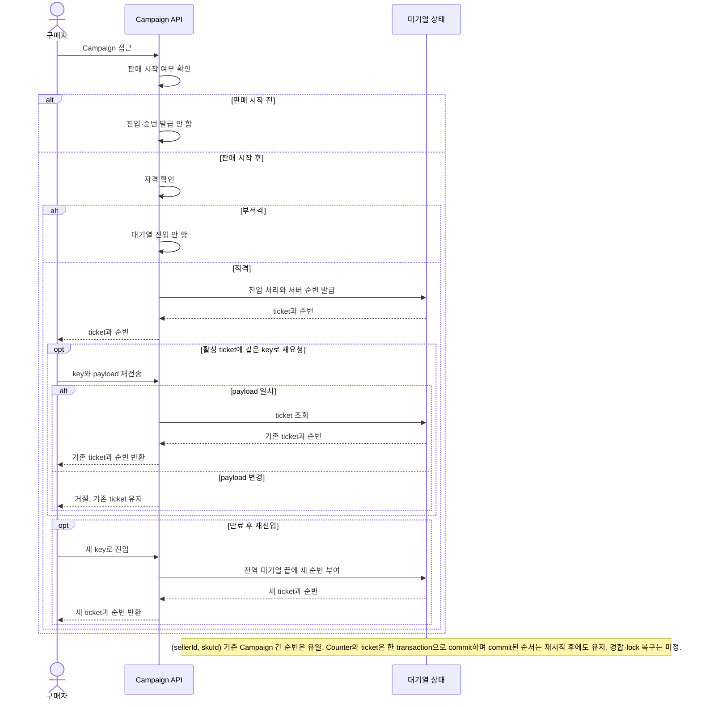
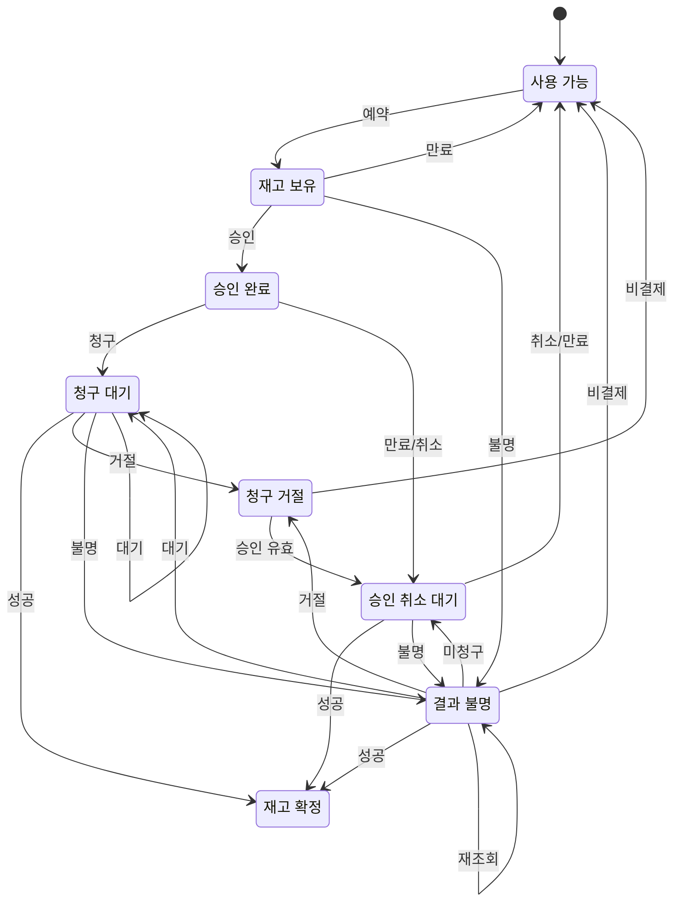

# 요구사항 인덱스

- 승인 기준: FR-001/FR-002/NFR-002의 Gate 2 Buyer 흐름. Seller-SKU 공유 재고·전역 FIFO는 [D-049](../00-governance/decision-log.md), V6 새로 시작 안전 조건은 [D-055](../00-governance/decision-log.md) 참조.
- 변경 원칙: Gate 2 기준은 소급 변경하지 않음.
- D-060의 단일 Seller Cart는 당시 범위 기록. 현재 Buyer-wide Cart·Seller별 주문은 [D-071](../00-governance/decision-log.md) 및 [ADR-0016](../02-decisions/adr/ADR-0016-buyer-wide-cart-multi-seller-checkout.md) 기준. Gate 2 baseline은 과거 검증 기준으로 보존.
- 미정: 운영 목표·우선순위. FR-003 정산과 NFR-001 보안은 제안 상태.

| ID | 유형 | 상태 | 요구사항 | 우선순위 | 연결 |
|---|---|---|---|---|---|
| FR-001 | 기능 | ✓ Gate 2 기준 | Seller가 SKU를 소유합니다. Campaign은 Seller-SKU를 참조하고 재고·FIFO/K를 공유합니다. 초기 시나리오는 수량형 SKU, 예약당 1개, 판매 시작 후 적격 요청만 대기열에 진입하는 방식입니다. `sellerId`는 데이터 식별자이며 인증 수단이 아닙니다. | 미정 | [Q-002/Q-003/Q-007/Q-010](#assumptions-and-open-questions), [BR-001/002](#business-rules-and-domain-invariants), [Issue #89](https://github.com/Neo1228/ATLAS/issues/89) |
| FR-002 | 기능 | ✓ Gate 2 기준 | PSP 요청 전에 재고를 hold합니다. AUTHORIZE → CAPTURE 순서이며, capture 성공이 확인된 뒤 재고를 claim합니다. 결과가 미확정이면 재고 hold와 같은 attempt를 유지합니다. 로컬 시험 시간은 10분이며 Fake PSP만 사용합니다. | 미정 | [Q-004/Q-005/Q-008](#assumptions-and-open-questions), [BR-003/INV-003](#business-rules-and-domain-invariants), [Issue #72](https://github.com/Neo1228/ATLAS/issues/72) |
| FR-003 | 기능 | ✓ Gross capture 원장 1차 범위; △ 전체 정산 제안 | 확인된 `CAPTURED` attempt의 OrderItem snapshot gross KRW를 `PSP_CLEARING` 차변·`SELLER_PAYABLE` 대변으로 기록. 내부 원장에 한정; 외부 PSP 대조·수수료·보류·판매자 지급·환불·정정은 제외. | 미정 | [Q-006](#assumptions-and-open-questions), [D-066](../00-governance/decision-log.md), [ADR-0011](../02-decisions/adr/ADR-0011-gross-capture-settlement-ledger.md), [Issue #115](https://github.com/Neo1228/ATLAS/issues/115) |
| FR-004 | 기능 | ✓ PR #90 초기 기준; SKU 정책 소유는 D-061로 조정 | Seller UUID와 V6 clean-start 조건 유지. 당시 Seller-SKU 등록이 `initialStock`과 전역 K를 설정했으나, D-061에 따라 Catalog는 Product/SKU를, Admission은 queue K policy를 소유. V1–V5 application table에 행이 있으면 DDL 전 실패; data mapping/backfill은 하지 않음. `sellerId`는 인증·인가 수단이 아님. | 미정 | [D-049/D-055/D-061](../00-governance/decision-log.md), [Q-002/Q-003/Q-007](#assumptions-and-open-questions), [Issue #89](https://github.com/Neo1228/ATLAS/issues/89) |
| FR-005 | 기능 | ✓ 구현·PostgreSQL CI 통과 (PR #150) | Buyer당 Cart 1개. Line key는 `(sellerId, skuId)`. Checkout은 `BuyerCheckout` 1건과 Seller별 `PurchaseOrder` 1건씩 생성. 현재 가격·상품 정보를 OrderItem에 snapshot하고 모든 Seller의 재고를 하나의 transaction에서 예약. 결제 attempt·capture는 checkout당 1회. Campaign은 별도 경로. | PostgreSQL CI 통과 | [D-060/D-071](../00-governance/decision-log.md), [ADR-0016](../02-decisions/adr/ADR-0016-buyer-wide-cart-multi-seller-checkout.md), [BR-004/INV-004](#business-rules-and-domain-invariants), [Issue #148](https://github.com/Neo1228/ATLAS/issues/148), [PR #150](https://github.com/Neo1228/ATLAS/pull/150), [Backend CI](https://github.com/Neo1228/ATLAS/actions/runs/42181356177) |
| FR-006 | 기능 | ✓ 2차 구현 기준 | Buyer는 이전 terminal Cart Order에서 Reorder 가능. 원본 Order는 변경하지 않음. 현재 Product/SKU와 stock을 한꺼번에 확인하고 Idempotency-Key로 Cart merge를 기록. 기존 Cart가 비어 있지 않으면 명시적 확인 후 같은 SKU quantity 합산, 다른 line 유지. 누락·판매 불가 SKU가 있으면 Cart 변경 없이 전체 거절. Reorder 자체는 재고를 예약하지 않음. | 미정 | [Q-011/Q-012](#assumptions-and-open-questions), [BR-005/INV-005](#business-rules-and-domain-invariants), [D-063](../00-governance/decision-log.md), [Issue #113](https://github.com/Neo1228/ATLAS/issues/113) |
| FR-007 | 기능 | ✓ 구현·PostgreSQL Testcontainers/full check 통과 | 결제 완료된 모든 PurchaseOrder에 `OrderFulfillment` 1건 생성. 결제·재고 claim transaction에서 `UNFULFILLED`로 시작하고 Seller가 이행을 시작하면 `IN_PROGRESS`. 실제 출고마다 `Shipment`를 기록하며 여러 Shipment에 OrderItem 수량 분할 가능. line별 `출고 누계 + 배송 전 직접 환불 수량 <= 주문 수량`. OrderItem seller와 PurchaseOrder seller는 V17 composite FK·service가 일치 검증. Summary는 `UNFULFILLED → IN_PROGRESS → PARTIALLY_SHIPPED → SHIPPED → DELIVERED`; 각 Shipment는 `SHIPPED → DELIVERED`. 외부 carrier 연동 없음. | PostgreSQL Testcontainers 대상 57 tests; 전체 Gradle check 154 tests/0 failures; bootJar 통과. GitHub CI 별도 확인 | [D-065/D-073](../00-governance/decision-log.md), [ADR-0010](../02-decisions/adr/ADR-0010-order-fulfillment-lifecycle.md), [ADR-0018](../02-decisions/adr/ADR-0018-seller-order-shipments.md), [Issue #117](https://github.com/Neo1228/ATLAS/issues/117), [Issue #159](https://github.com/Neo1228/ATLAS/issues/159) |
| FR-008 | 기능 | ✓ 구현·PostgreSQL 동시성 통합 테스트 및 PR CI 통과 (PR #153) | Pre-shipment refund는 기존 경계를 유지. Delivered return은 Seller receipt 후 OrderItem별 PASSED/FAILED 검수. PASSED 수량만 local refund/restock, FAILED 수량은 claimed 유지. Idempotent; 재검수·write-off·임의 return window 없음. | PostgreSQL Testcontainers 통합 테스트·PR CI 통과 | [D-068/D-071](../00-governance/decision-log.md), [ADR-0013](../02-decisions/adr/ADR-0013-pre-shipment-refund-recording.md), [ADR-0016](../02-decisions/adr/ADR-0016-buyer-wide-cart-multi-seller-checkout.md), [Issue #148](https://github.com/Neo1228/ATLAS/issues/148), [PR #150](https://github.com/Neo1228/ATLAS/pull/150), [Issue #151](https://github.com/Neo1228/ATLAS/issues/151), [PR #153](https://github.com/Neo1228/ATLAS/pull/153) |
| FR-009 | 기능 | ✓ 구현·PostgreSQL CI 통과 (PR #130) | Seller는 SKU별 signed capacity delta와 reason으로 재고를 정정. Same idempotency key/same facts는 replay, key 재사용/다른 facts는 conflict. Audit와 pool 변경은 atomic. | PostgreSQL CI 통과 | [BR-009/INV-006](#business-rules-and-domain-invariants), [D-069](../00-governance/decision-log.md), [ADR-0014](../02-decisions/adr/ADR-0014-seller-inventory-capacity-adjustment.md), [Issue #126](https://github.com/Neo1228/ATLAS/issues/126), [PR #128](https://github.com/Neo1228/ATLAS/pull/128), [PR #130](https://github.com/Neo1228/ATLAS/pull/130), [Backend CI](https://github.com/Neo1228/ATLAS/actions/runs/41976338756) |
| FR-010 | 기능 | ✓ 구현·PostgreSQL CI 통과 (PR #131) | Fake PSP의 scripted progression과 operation result를 PostgreSQL에 저장. 같은 operation key는 기존 결과 replay, 새 key는 다음 결과 진행. provider result commit과 Order·Inventory·Settlement 후속 transaction 분리. 수동 reconcile/cancel만 지원; 실제 PSP·자금 이동·자동 polling 제외. | PostgreSQL CI 통과 | [BR-010/INV-007](#business-rules-and-domain-invariants), [D-070](../00-governance/decision-log.md), [ADR-0015](../02-decisions/adr/ADR-0015-durable-fake-psp-progression.md), [Issue #127](https://github.com/Neo1228/ATLAS/issues/127), [PR #129](https://github.com/Neo1228/ATLAS/pull/129), [PR #131](https://github.com/Neo1228/ATLAS/pull/131), [Backend CI](https://github.com/Neo1228/ATLAS/actions/runs/41975263122) |
| FR-011 | 기능 | ✓ 승인·Issue #157 | Seller는 code/name, non-negative priority, active flag를 가진 fulfillment location을 관리합니다. Seller PurchaseOrder와 Campaign 주문은 모든 line을 충족하는 active location 하나를 priority ASC, UUID ASC로 선택하며 분할하지 않습니다. 기존 재고는 V16에서 DEFAULT로 매핑합니다. Reservation과 PurchaseOrder에 선택 location을 저장해 payment, release, return-restock에 재사용합니다. Reorder는 location 적합성을 사전 확인하고 checkout이 재검증합니다. 같은 Seller/SKU 간 available-only transfer는 atomic, idempotent, capacity-conserving입니다. | 통합 후 검증 | [D-072](../00-governance/decision-log.md), [ADR-0017](../02-decisions/adr/ADR-0017-seller-fulfillment-locations.md), [BR-011/INV-008](#business-rules-and-domain-invariants), [Issue #157](https://github.com/Neo1228/ATLAS/issues/157) |
| NFR-001 | 비기능 | △ 제안 | Tenant 간 데이터·권한 격리를 검증해야 합니다. 위협 경계는 미정입니다. | 미정 | [Q-007](#assumptions-and-open-questions) |
| NFR-002 | 비기능 | ✓ Gate 2 보고 profile | 전체 Buyer 흐름을 대상으로 60분간 합성 session 10,000건을 기준 부하로 사용하고, 2배·4배 부하도 기록합니다. 보고용이며 운영 SLO나 합격 기준은 아닙니다. metric 계약은 Q-008입니다. | 미정 | [Q-008](#assumptions-and-open-questions), [Issue #66](https://github.com/Neo1228/ATLAS/issues/66) |

<!-- markdownlint-disable MD033 -->

## 프로젝트 배경과 범위

### 목적과 장기 범위 — 목표 확정, 후속 업무 상세·순서 미정
- 목적: 전체 이커머스 플랫폼의 구매·판매 흐름과 거래 정합성·장애 복구를 단계적으로 설계·검증하는 학습 프로젝트.
- 현재 구현 범위: Seller-SKU 한정판매와 Buyer-wide Cart 구매. Cart checkout은 parent `BuyerCheckout`, Seller별 `PurchaseOrder`, checkout당 Fake PSP attempt/capture 1건. Seller별 fulfillment과 Delivered return·OrderItem inspection도 포함; 실제 PSP·carrier·인증 없음.
- 한계: 실제 사용자·시장 수요·운영 성능을 입증하지 않음.

| 장기 업무 영역(후보) | 예시 흐름 | 상태 |
|---|---|---|
| 상품·판매 | 판매자, 상품·SKU, 판매 조건·가격, 판매 가능 재고 | 상세 범위·순서 미정 |
| 구매·거래 | 상품 탐색, 장바구니, 주문, 재고 예약, 결제 | 현재 일반 구매 및 한정판매의 첫 검증 흐름을 구현 |
| 주문 이후·운영 | fulfillment, return/inspection, local refund·settlement | Seller별 fulfillment 구현. Delivered 이후 return·Seller inspection 정책은 승인(D-071); partial shipment·write-off·reinspection과 return 기간은 미정·비범위 |

장기 범위와 현재 경계:
- 각 영역은 단계적으로 다룰 장기 범위. 향후 PSP 후보는 PayPal Sandbox이며 Fake PSP는 장애 상황을 흉내 낼 뿐 PayPal 동작을 재현하지 않음.
- Gate 2의 단일 SKU 구매 흐름은 첫 검증 시나리오이지 전체 제품 범위가 아님.
- 실제 인터뷰·거래·시장 검증은 없음. 인물 유형은 합성 설정이며 Buyer/Seller 공통 목표도 사용자 선택이지 조사 결과가 아님.

확정된 경계:
- 합성 또는 가명 데이터만 사용. 실제 결제·고객 개인정보·판매사 지급 제외.
- 주문 상태와 PSP 작업 상태를 분리. Fulfillment 상태도 별도로 관리하며, 내부 정산과 실제 자금 이동도 분리.
- Gate 2 Buyer 기준과 로컬 흐름은 승인. 실제 결제·carrier 연동·인증·tenant 격리·cloud 배포·운영 schema/lock 복구·처리 용량/SLO는 별도 결정 필요.
- 현재 시나리오는 수량형 SKU. 지정 좌석·시간대 판매는 제외; 다른 판매 유형과 확장 순서는 미정.
- `sellerId`는 데이터 식별자일 뿐 인증·인가·Tenant 격리 경계가 아님.

제안된 성공 기준:
- 정책·불변조건을 검증 가능한 시나리오에 연결.
- 장애·경합·복구 절차와 한계를 기록.
- 성능·복구 주장은 환경을 밝힌 반복 측정으로 뒷받침.
- SLO, RPS, p95/p99 목표는 미정.

## 가정과 미결정 사항
상태: `✓ 해결`, `? 미정`, `△ 가정`(미검증). 기준을 해결해도 세부 경계까지 확정된 것은 아닙니다.

| ID | 상태 | 질문·경계 |
|---|---|---|
| Q-002 | ? 미정 | 다수량 구매, channel-specific inventory, 판매 중 조정·재입고 및 claim 후 비환불 취소 정책 미정. Location routing은 D-072/FR-011로 해결했으며 channel별 재고는 미정. 배송 전 부분 환불 시 snapshot 수량만 재고 복원하는 정책은 D-068로 확정. V6 데이터 전환 안전은 D-055 참조. |
| Q-003 | ? 미정 | Seller-SKU 전역 FIFO/K, Campaign별 idempotency·ticket TTL, 판매 시작 후 자격 확인은 정함. 전역 K는 Admission 소유 policy로 구성. 운영 K/TTL, tombstone 정리, payload 필드, bot/auth, lock timeout/deadlock 복구는 미정. |
| Q-004 | ? 미정 | D-025~D-030: PSP 전 hold, AUTHORIZE → CAPTURE, capture 성공 후 재고 claim. 확인된 hold부터 첫 AUTHORIZE 제출까지 합성 10분, 연장 없음. 운영 TTL/SLO/분포는 미정. |
| Q-006 | ? 미정 | 확인된 capture gross와 배송 전 local refund reversal 기록만 승인(D-066/D-068). 이 기록은 PSP evidence reconciliation, fee·reserve·payout, 실제 환불·송금이나 accounting correction이 아님. 외부 provider 사실 대조와 자금 이동은 미정. |
| Q-007 | ? 미정 | `sellerId`는 데이터 식별자이며 인증·인가·Tenant 격리를 제공하지 않습니다. 위협 경계, 개인정보·규제, 지역·통화·세금, 합성 데이터 정책, 외부 노출은 미정. |
| Q-008 | ? 미정 | 아래 부하 계약 참조. 합성·보고용이며 운영 수요·처리 용량을 뜻하지 않습니다. |
| Q-009 | ? 미정 | 현재 로컬 stack: Java 25 LTS, Spring Boot 4.1.2/MVC, PostgreSQL 18.6, Gradle Wrapper 9.8.2. Testcontainers 2.0.5와 ArchUnit 1.5.1은 test-scope. Boot 4는 `spring-boot-starter-flyway` 사용. 대안은 결정 로그 참조. CI는 Temurin 25; 운영 JDK vendor/license, database/deployment, PayPal 제품/API는 미정. |
| Q-010 | ? 세부 순서 미정 | 전체 이커머스 플랫폼. Buyer-wide Cart·Seller별 주문·BuyerCheckout(D-071), Seller location(D-072), per-OrderItem return 구현. D-073으로 package별 partial shipment과 전체 net shippable quantity delivery 후 Return 허용을 확정. 상품 ranking·return 기간·write-off·재검수는 미정. |
| Q-011 | ✓ 해결 | 취소·기한 만료된 Cart 주문은 Cart를 자동 복원하지 않음. Buyer는 terminal Cart Order에서 명시적 Reorder를 실행; source lines는 현재 Catalog 기준으로 검증. 기존 Cart merge에는 사용자 확인 필요. (D-063/FR-006) |
| Q-012 | ? 미정 | Reorder idempotency record 보존·정리 정책 미정. 현재 record는 source Order를 참조하며 Order 삭제 기능/cleanup job은 없음. 보존 기간과 storage 영향은 실측 전 운영 규모로 해석하지 않음. |

### Q-006 1차 내부 캡처 원장 (승인 범위)

2026-11-04 D-066에서 capture gross 원장을 승인. 2026-11-06 D-071에서 BuyerCheckout 결제 1회와 SellerOrder별 allocation으로 범위 확장.

- Gross는 Cart checkout의 전체 Seller OrderItem snapshot 합계 또는 Campaign OrderItem snapshot 합계. KRW 금액만 사용.
- Source facts는 `attemptId`; Cart checkout은 `checkoutId`와 각 Seller Order allocation도 기록. 같은 attempt·동일 facts replay는 no-op, 다른 payload는 conflict.
- 이 기록은 캡처 시점의 내부 PSP clearing receivable과 Seller payable을 나타낼 뿐, PSP가 자금을 실제 정산했거나 Seller에게 송금했다는 뜻이 아닙니다.
- Journal·entries·Seller allocations·관련 PurchaseOrder의 `PAID`·inventory claim·fulfillment 초기 row는 같은 PostgreSQL transaction. PaymentAttempt의 `CAPTURED`는 PSP 응답 후 이미 commit; 후속 실패 시 동일 attempt로 재조정.
- 캡처 원장 범위 제외: PSP 증빙 대조, fee, reserve, payout 실행, 회계 정정. Refund는 D-068/D-071의 별도 local reversal 규칙이며 실제 PSP refund·자금 이동은 없음.

Q-006 remaining policy is open. Ledger boundary: [D-066/D-071](../00-governance/decision-log.md), [ADR-0011](../02-decisions/adr/ADR-0011-gross-capture-settlement-ledger.md), [ADR-0016](../02-decisions/adr/ADR-0016-buyer-wide-cart-multi-seller-checkout.md), [Issue #115](https://github.com/Neo1228/ATLAS/issues/115).

### Q-008 부하 계약 — 보고 전용
- 기준 부하: 소유자 승인 합성 시험 입력([D-033](../00-governance/decision-log.md)) 10,000 session/60분(약 2.8 session/s), 2배·4배(약 5.6/11.1 session/s). 실제 사용자 수요나 운영 부하 예측이 아님. 전체 Buyer 흐름과 혼합 도착 모델 사용.
- 유입·처리 session/s와 부하 생성기가 놓친 session/반복 횟수를 기록. 단계별 request RPS도 구분. DB QPS는 query 범위를 측정한 경우에만 기록.
- 완료된 Buyer session만 업무 TPS에 포함. PENDING/UNKNOWN은 진행 중 또는 backlog로 계산.
- p95/p99의 측정 경계, 오류, 만료·중단, 대기열·hold 점유, 자원 포화, oversell 불변조건 기록. 합격 SLO나 운영 처리 용량 주장은 없음.
- 미정: burst 배수·기간, 도착 곡선·think time, 단계별 기간, 동시성, 환경, 수요 근거, 운영 목표.

## 업무 규칙과 도메인 불변조건
상태: `✓ 확정 기준`, `? 미정`. 합성 시나리오의 계약이며 실험 결과가 아닙니다.

| ID | 규칙·불변조건 | 상태 | 미정 범위 |
|---|---|---|---|
| BR-001 / INV-002 | 판매 시작 후 자격이 있는 요청만 대기열에 진입. Seller-SKU 순번은 유일하고 작은 번호가 먼저 처리. 같은 `(sellerId, skuId)`를 쓰는 Campaign은 제한된 FIFO/K 공유. Queue key/K는 전역, idempotency와 ticket TTL은 Campaign별. 같은 key·payload는 기존 ticket 반환; payload가 다르면 거절. 만료 뒤 새 key로 재진입하면 전역 대기열 끝에 배치. `sellerId`는 인증 경계가 아님. | ✓ 로컬 기준 | 운영 K/TTL, tombstone 정리, payload 필드, bot/auth, lock timeout/deadlock 복구 (Q-003/Q-007) |
| BR-002 / INV-001 | Seller-SKU 공유 재고 pool, reservation당 1개. 확인된 전이 뒤 `available + reserved + claimed = initial capacity`, 각 값은 0 이상. Hold는 available→reserved, capture 성공은 reserved→claimed. 비결제와 필요한 authorization void/expiry 확인 뒤에만 release. | ✓ 로컬 기준 | 다수량·channel-specific inventory, 조정·재입고, claim 후 취소·환불 (Q-002). Location별 보존·routing·transfer 기준은 [BR-011/INV-008](requirements-index.md#business-rules-and-domain-invariants), [D-072](../00-governance/decision-log.md), [ADR-0017](../02-decisions/adr/ADR-0017-seller-fulfillment-locations.md). PostgreSQL guarded UPDATE/row lock은 로컬 기준이며 운영 성능 결론이 아님. |
| BR-003 / INV-003 | PSP 요청 전 hold, capture 성공 후에만 재고 claim. 확인된 hold부터 첫 AUTHORIZE 제출까지 시험 시간 10분, 연장 없음. Capture/void의 PENDING/UNKNOWN이면 재고 hold와 같은 attempt 대조를 유지하며 결과 전 새 attempt 금지. 비결제와 필요한 void/expiry 확인 뒤 release. Fake PSP만 사용. | ✓ Gate 2 복구 기준 | 운영 TTL/SLO, provider deadline, retry/key 보존, escalation/compensation (Q-004/Q-005/Q-008). D-042의 Campaign별 합성 Buyer guard는 신원·보안 기능이 아님. |
| BR-004 | ✓ 확정 | Buyer당 Cart 1개, line identity `(sellerId, skuId)`. Cart 가격은 표시용. Checkout에서 Seller-SKU와 가격 재검증, 상품·SKU·KRW 단가·quantity snapshot. `BuyerCheckout` 1건과 Seller별 PurchaseOrder를 만들며 결제·재고 처리는 D-071 경계를 따름. | 상품 수정·비활성화 등은 Q-010 |
| INV-004 | ✓ 확정 | Checkout은 Seller·SKU 순으로 모든 line을 예약. 하나라도 부족하면 parent Checkout·Seller Orders·reservations·Cart 변경 전체 rollback. `available + reserved + claimed = initial capacity`. Capture unknown/pending이면 모든 child reservation 유지. Unsubmitted RESERVED checkout만 만료 처리. | 분산 보상·운영 TTL·성능 목표 미정 (Q-004/Q-008/Q-010) |
| BR-005 | ✓ 2차 구현 기준 | Reorder 대상은 `CART` source와 terminal Order (`PAID`, `FAILED`, `EXPIRED`, `CANCELLED`). Campaign·결제 진행 중 Order 제외. 원본 Order 변경 없음. 취소·만료 뒤 자동 Cart 복원 없음; 명시적 Reorder만 지원. | reorder 후 장기 보존과 주문 내역 조회 UX (Q-010/Q-012) |
| INV-005 | ✓ 2차 구현 기준 | Reorder 전 모든 OrderItem의 현재 Seller-SKU/Product mapping과 available quantity를 batch 조회. 하나라도 누락·불충분하면 Cart·idempotency record 전체 rollback. 성공 시 기존 Cart를 확인 후 merge; 같은 SKU quantity 합산, 기존 다른 SKU 유지. Key scope `(sellerId, buyerRef, idempotencyKey)`; 같은 source Order replay는 중복 적용 없음, 다른 source 재사용은 conflict. Reorder는 stock read point-in-time일 뿐 hold/예약 아님; 새 Checkout transaction이 최종 재고 보장. | stock 상태는 Reorder와 Checkout 사이에 변할 수 있음; checkout에서 재검증 |
| BR-006 | 결제된 SellerOrder당 `OrderFulfillment` summary 1건. Seller가 `IN_PROGRESS`로 이행을 시작하고 실제 출고마다 `Shipment`를 생성. 여러 Shipment로 OrderItem 수량 분할 가능; line별 출고 누계는 주문 수량에서 배송 전 직접 환불 수량을 뺀 값을 초과할 수 없음. Summary 전이는 `UNFULFILLED` → `IN_PROGRESS` → `PARTIALLY_SHIPPED` → `SHIPPED` → `DELIVERED`; 임의 status 변경 금지. `shipped_at`은 출고 가능 수량 전체 출고 시각, `delivered_at`은 전체 Shipment 배송 완료 시각. | ✓ 확정 | Carrier 연동·ETA·배송비·부분 배송 중 Return 제외; [D-065/D-073](../00-governance/decision-log.md), [ADR-0018](../02-decisions/adr/ADR-0018-seller-order-shipments.md), [Issue #159](https://github.com/Neo1228/ATLAS/issues/159) |
| BR-007 | ✓ 확정 | Cart checkout capture는 checkout당 gross journal 1건: `PSP_CLEARING` 차변·`SELLER_PAYABLE` 대변. Seller별 allocation 합은 gross와 정확히 같아야 함. `attemptId`로 idempotent, journal·entries·allocations·child Orders·inventory는 atomic. Campaign capture는 기존 Order 기준 유지. | PSP evidence·fee·payout 미정 (Q-006) |
| BR-008 | 배송 전 직접 환불은 `UNFULFILLED`/`IN_PROGRESS`에서만 허용하고 해당 수량만큼 출고 가능 수량 감소. 첫 Shipment dispatch 뒤 직접 환불 금지. Return-linked 환불은 이미 출고된 수량이므로 shipment 합계에서 제외하지 않음. 출고 가능 수량 전체 배송 뒤 Return 허용; Seller 수령·OrderItem별 검수 필수. `PASSED`만 local refund/restock, `FAILED`는 claimed 유지. | ✓ PostgreSQL Testcontainers/full check 통과 | [D-068/D-073](../00-governance/decision-log.md), [ADR-0013](../02-decisions/adr/ADR-0013-pre-shipment-refund-recording.md), [ADR-0016](../02-decisions/adr/ADR-0016-buyer-wide-cart-multi-seller-checkout.md), [ADR-0018](../02-decisions/adr/ADR-0018-seller-order-shipments.md), [Issue #159](https://github.com/Neo1228/ATLAS/issues/159) |
| BR-009 | ✓ 확정 | Seller 재고 조정 요청은 유효한 Seller-SKU, nonzero signed delta, reason, `Idempotency-Key`를 요구. 같은 key·같은 요청은 원래 결과를 반환하고 다른 요청의 재사용은 conflict. | 재시도·감사 가능; [FR-009](requirements-index.md), [D-069](../00-governance/decision-log.md) |
| INV-006 | ✓ 확정 | `initialCapacity = available + reserved + claimed`. 조정은 `reserved`·`claimed`를 건드리지 않으며 음수 delta는 available을 초과할 수 없음. pool update와 append-only audit는 한 transaction. | 재고 보존; [FR-009](requirements-index.md), [ADR-0014](../02-decisions/adr/ADR-0014-seller-inventory-capacity-adjustment.md) |
| BR-010 | ✓ 확정 | Fake PSP operation key는 `(phase, requestId, idempotencyKey)`. 같은 key는 결과를 재사용하고 progression을 소비하지 않음. 다음 결과는 새 key로만 진행. HTTP reconcile/cancel은 key 필요; 내부 suffix 공간 확보를 위해 입력 key는 최대 221자. | 재시도 결과 고정; [FR-010](requirements-index.md), [D-070](../00-governance/decision-log.md) |
| INV-007 | ✓ 확정 | Fake PSP operation result는 `(phase, requestId, idempotencyKey)` unique. Provider 결과는 독립 DB transaction에서 먼저 저장. 이후 Order·Inventory·Settlement·fulfillment transaction rollback 뒤 같은 key는 결과 replay; downstream side effect는 재시도에서 중복 생성되지 않음. | provider outcome과 business effects의 failure boundary; [FR-010](requirements-index.md), [ADR-0015](../02-decisions/adr/ADR-0015-durable-fake-psp-progression.md) |
| BR-011 | ✓ 승인 기준 | Seller PurchaseOrder마다 모든 line의 수량을 충족하는 active Seller location 하나를 priority 오름차순, 동률 UUID 오름차순으로 선택. Seller 주문을 location 간 분할하지 않는다. Campaign도 같은 선택 정책을 쓰며 후보가 없으면 Buyer-wide checkout 전체 rollback. | 주소·지리·carrier·channel 최적화 제외; [FR-011](requirements-index.md), [D-072](../00-governance/decision-log.md), [ADR-0017](../02-decisions/adr/ADR-0017-seller-fulfillment-locations.md), [Issue #157](https://github.com/Neo1228/ATLAS/issues/157) |
| INV-008 | ✓ 승인 기준 | Location별 `initialCapacity = available + reserved + claimed`. Reservation과 PurchaseOrder의 location은 선택 시 저장하고 claim/release/return-restock에서 재선택하지 않는다. Reorder는 모든 line에 대한 location preflight만 하며 checkout에서 재검증한다. Transfer는 같은 Seller/SKU의 available만 원자적으로 이동하고 source/destination capacity와 available을 함께 조정; audit와 pool update는 같은 transaction. Same-key/same-facts replay, changed-facts conflict. 기존 location 없는 데이터는 V16에서 DEFAULT로 매핑한다. | [FR-011](requirements-index.md), [D-072](../00-governance/decision-log.md), [ADR-0017](../02-decisions/adr/ADR-0017-seller-fulfillment-locations.md), [Issue #157](https://github.com/Neo1228/ATLAS/issues/157) |

로컬 복구·잠금의 한계가 적용되며 운영 환경에 대한 주장은 아닙니다.

- Buyer에게 표시하는 timer는 첫 AUTHORIZE 제출 시 끝납니다. 결제 대조나 PSP 작업 deadline은 정의하지 않습니다. 운영 TTL·복구 deadline은 미정.
