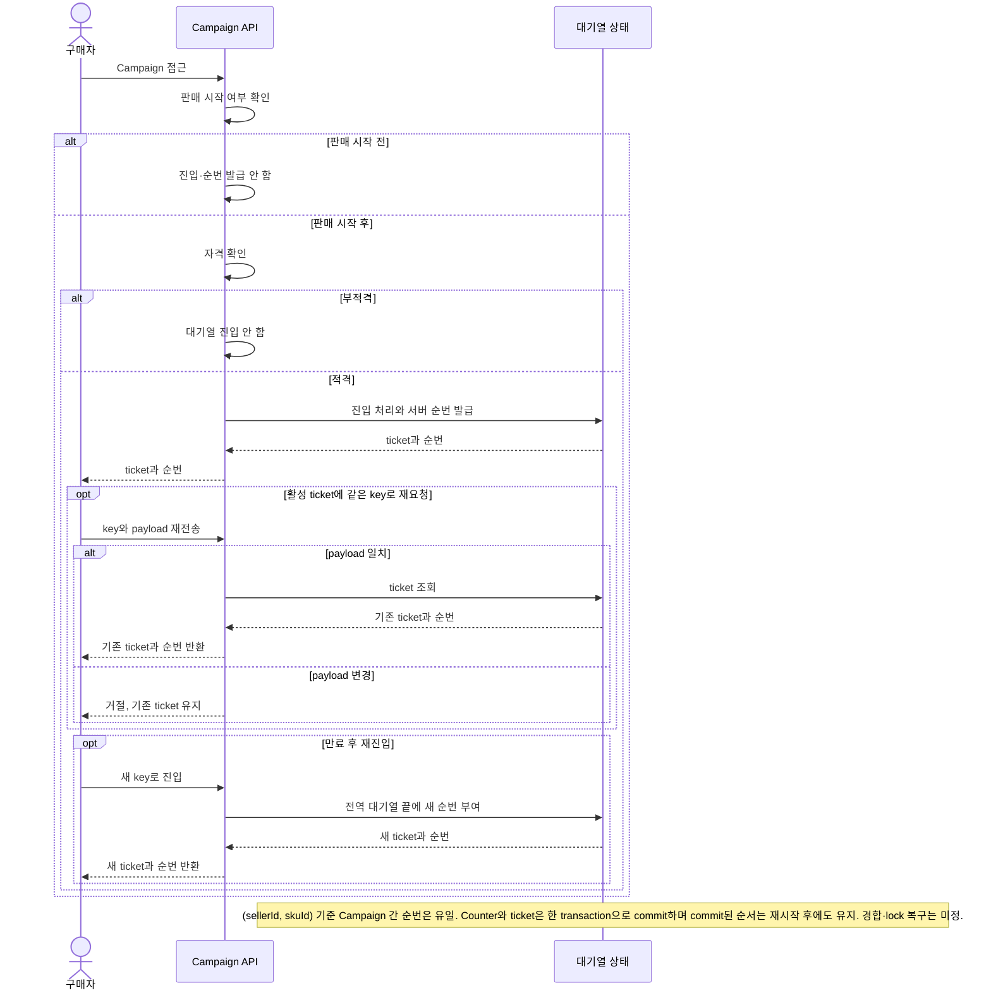
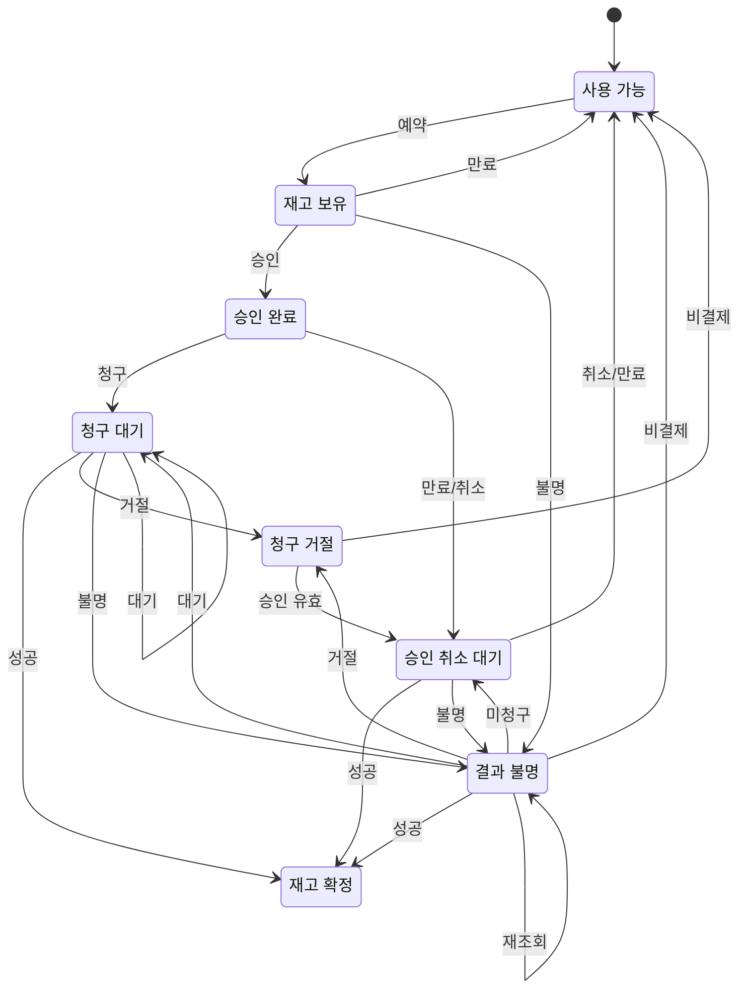

# 요구사항 인덱스

- 승인 기준: FR-001/FR-002/NFR-002의 Gate 2 Buyer 흐름. Seller-SKU 공유 재고·전역 FIFO는 [D-049](../00-governance/decision-log.md), V6 새로 시작 안전 조건은 [D-055](../00-governance/decision-log.md) 참조.
- 변경 원칙: Gate 2 기준 소급 변경 금지.
- D-060의 단일 Seller Cart는 당시 범위 기록. 현재 Buyer-wide Cart·Seller별 주문은 [D-071](../00-governance/decision-log.md) 및 [ADR-0016](../02-decisions/adr/ADR-0016-buyer-wide-cart-multi-seller-checkout.md) 기준. Gate 2 baseline은 과거 검증 기준으로 보존.
- 미결 정책과 가정은 아래 [Q 목록](#assumptions-and-open-questions)에 기록.

| ID | 유형 | 상태 | 요구사항 | 우선순위 | 연결 |
|---|---|---|---|---|---|
| FR-001 | 기능 | ✓ Gate 2 기준 | Seller 소유 SKU. Campaign은 Seller-SKU를 참조해 재고·FIFO/K 공유. 초기 시나리오는 수량형 SKU, 예약당 1개, 판매 시작 뒤 적격 요청만 대기열 진입. `sellerId`는 데이터 식별자이며 인증 수단으로 사용 금지. | 미정 | [Q-002/Q-003/Q-007/Q-010](#assumptions-and-open-questions), [BR-001/002](#business-rules-and-domain-invariants), [Issue #89](https://github.com/Neo1228/ATLAS/issues/89) |
| FR-002 | 기능 | ✓ PayPal Sandbox 구현 | 재고 hold 이후 PayPal buyer approval 및 authorization/capture 수행. 확인된 capture만 재고 claim. 응답이 불명확하면 같은 payment attempt와 hold를 유지하고 provider 상태를 재조정. 주문·정산 원장은 KRW, PayPal 요청은 ADR-0030의 고정 USD 환율 스냅샷 사용. PayPal credential 또는 선택한 환율 provider의 유효한 최신 quote가 없으면 요청을 거절한다. 기본 BOK ECOS는 API key가 필요하고 local/Sandbox는 무가입 Frankfurter를 명시 선택할 수 있다. | P1 | [FR-017/BR-017/INV-014](requirements-index.md), [Q-004/Q-005/Q-008](#assumptions-and-open-questions), [D-081/D-128](../00-governance/decision-log.md), [ADR-0026](../02-decisions/adr/ADR-0026-paypal-sandbox-payments.md), [ADR-0030](../02-decisions/adr/ADR-0030-paypal-currency-boundary.md), [ADR-0065](../02-decisions/adr/ADR-0065-frankfurter-sandbox-fx-provider.md), [Issue #191](https://github.com/Neo1228/ATLAS/issues/191) |
| FR-003 | 기능 | ✓ 구현 | 확인된 `CAPTURED` attempt의 OrderItem snapshot gross KRW를 `PSP_CLEARING` 차변·`SELLER_PAYABLE` 대변으로 기록. Seller는 `recorded_at` 기준 `[from,to)` read-only statement 조회. BuyerCheckout capture는 Seller별 allocation, capture는 양수, local refund reversal은 음수. PSP/bank reconciliation, fee, reserve와 회계 정정 정책은 [Q-006](#assumptions-and-open-questions)에 기록. | P1 | [Q-006](#assumptions-and-open-questions), [D-066/D-068/D-075/D-081](../00-governance/decision-log.md), [ADR-0011](../02-decisions/adr/ADR-0011-gross-capture-settlement-ledger.md), [ADR-0013](../02-decisions/adr/ADR-0013-pre-shipment-refund-recording.md), [ADR-0020](../02-decisions/adr/ADR-0020-seller-settlement-statement.md), [Issue #115](https://github.com/Neo1228/ATLAS/issues/115), [Issue #163](https://github.com/Neo1228/ATLAS/issues/163) |
| FR-004 | 기능 | ✓ PR #90 초기 기준; SKU 정책 소유는 D-061로 조정 | Seller UUID와 V6 clean-start 조건 유지. 당시 Seller-SKU 등록이 `initialStock`과 전역 K를 설정했으나, D-061에 따라 Catalog는 Product/SKU를, Admission은 queue K policy를 소유. V1–V5 application table에 행이 있으면 DDL 전 실패; data mapping/backfill 미수행. `sellerId`는 인증·인가 수단에서 제외. | 미정 | [D-049/D-055/D-061](../00-governance/decision-log.md), [Q-002/Q-003/Q-007](#assumptions-and-open-questions), [Issue #89](https://github.com/Neo1228/ATLAS/issues/89) |
| FR-005 | 기능 | ✓ 구현·PostgreSQL CI 통과 (PR #150) | Buyer당 Cart 1개. Line key는 `(sellerId, skuId)`. Checkout은 `BuyerCheckout` 1건과 Seller별 `PurchaseOrder` 1건씩 생성. 현재 가격·상품 정보를 OrderItem에 snapshot하고 모든 Seller의 재고를 하나의 transaction에서 예약. 결제 attempt·capture는 checkout당 1회. Campaign은 별도 경로. | PostgreSQL CI 통과 | [D-060/D-071](../00-governance/decision-log.md), [ADR-0016](../02-decisions/adr/ADR-0016-buyer-wide-cart-multi-seller-checkout.md), [BR-004/INV-004](#business-rules-and-domain-invariants), [Issue #148](https://github.com/Neo1228/ATLAS/issues/148), [PR #150](https://github.com/Neo1228/ATLAS/pull/150), [Backend CI](https://github.com/Neo1228/ATLAS/actions/runs/42181356177) |
| FR-006 | 기능 | ✓ 2차 구현 기준 | Buyer는 이전 terminal Cart Order에서 Reorder 가능. 원본 Order 불변. 현재 Product/SKU와 stock을 일괄 확인하고 Idempotency-Key로 Cart merge 기록. 기존 Cart가 비어 있지 않으면 명시적 확인 후 같은 SKU quantity 합산, 다른 line 유지. 누락·판매 불가 SKU가 있으면 Cart 변경 없이 전체 거절. Reorder 자체는 재고 예약 비대상. | 미정 | [Q-011/Q-012](#assumptions-and-open-questions), [BR-005/INV-005](#business-rules-and-domain-invariants), [D-063](../00-governance/decision-log.md), [Issue #113](https://github.com/Neo1228/ATLAS/issues/113) |
| FR-007 | 기능 | ✓ 구현·PostgreSQL Testcontainers/full check 통과 | 결제 완료된 모든 PurchaseOrder에 `OrderFulfillment` 1건 생성. 결제·재고 claim transaction에서 `UNFULFILLED`로 시작하고 Seller가 이행을 시작하면 `IN_PROGRESS`. 실제 출고마다 `Shipment`를 기록하며 여러 Shipment에 OrderItem 수량 분할 가능. line별 `출고 누계 + 배송 전 직접 환불 수량 <= 주문 수량`. OrderItem seller와 PurchaseOrder seller는 V17 composite FK·service가 일치 검증. Summary는 `UNFULFILLED → IN_PROGRESS → PARTIALLY_SHIPPED → SHIPPED → DELIVERED`; 각 Shipment는 `SHIPPED → DELIVERED`. 외부 carrier 연동 미지원. | PostgreSQL Testcontainers 대상 57 tests; 전체 Gradle check 154 tests/0 failures; bootJar 통과. GitHub CI 별도 확인 | [D-065/D-073](../00-governance/decision-log.md), [ADR-0010](../02-decisions/adr/ADR-0010-order-fulfillment-lifecycle.md), [ADR-0018](../02-decisions/adr/ADR-0018-seller-order-shipments.md), [Issue #117](https://github.com/Neo1228/ATLAS/issues/117), [PR #118](https://github.com/Neo1228/ATLAS/pull/118) |
| FR-008 | 기능 | ✓ 구현·PostgreSQL 동시성 통합 테스트 및 PR CI 통과 (PR #153) | Pre-shipment refund는 기존 경계 유지. Delivered return은 Seller receipt 후 OrderItem별 PASSED/FAILED 검수. PASSED 수량만 local refund/restock, FAILED 수량은 claimed 유지. Idempotent; 재검수·write-off·임의 return window 미지원. | PostgreSQL Testcontainers 통합 테스트·PR CI 통과 | [D-068/D-071](../00-governance/decision-log.md), [ADR-0013](../02-decisions/adr/ADR-0013-pre-shipment-refund-recording.md), [ADR-0016](../02-decisions/adr/ADR-0016-buyer-wide-cart-multi-seller-checkout.md), [Issue #148](https://github.com/Neo1228/ATLAS/issues/148), [PR #150](https://github.com/Neo1228/ATLAS/pull/150), [Issue #151](https://github.com/Neo1228/ATLAS/issues/151), [PR #153](https://github.com/Neo1228/ATLAS/pull/153) |
| FR-009 | 기능 | ✓ 구현·PostgreSQL CI 통과 (PR #130) | Seller는 SKU별 signed capacity delta와 reason으로 재고를 정정. Same idempotency key/same facts는 replay, key 재사용/다른 facts는 conflict. Audit와 pool 변경은 atomic. | PostgreSQL CI 통과 | [BR-009/INV-006](#business-rules-and-domain-invariants), [D-069](../00-governance/decision-log.md), [ADR-0014](../02-decisions/adr/ADR-0014-seller-inventory-capacity-adjustment.md), [Issue #126](https://github.com/Neo1228/ATLAS/issues/126), [PR #128](https://github.com/Neo1228/ATLAS/pull/128), [PR #130](https://github.com/Neo1228/ATLAS/pull/130), [Backend CI](https://github.com/Neo1228/ATLAS/actions/runs/41976338756) |
| FR-010 | 기능 | 대체됨·역사 기록 | 초기 payment-operation progression 요구사항. 현재 PayPal Sandbox provider·recovery 계약의 기준: [FR-002/FR-017](requirements-index.md), [D-081](../00-governance/decision-log.md), [ADR-0026](../02-decisions/adr/ADR-0026-paypal-sandbox-payments.md). | — | [D-070](../00-governance/decision-log.md), [ADR-0015](../02-decisions/adr/ADR-0015-initial-payment-progression.md), [Issue #127](https://github.com/Neo1228/ATLAS/issues/127), [PR #129](https://github.com/Neo1228/ATLAS/pull/129), [PR #131](https://github.com/Neo1228/ATLAS/pull/131) |
| FR-011 | 기능 | ✓ 구현·PostgreSQL Testcontainers 통합 검증 | Seller 소유 fulfillment location의 code/name, non-negative priority, active flag 관리. Seller PurchaseOrder와 Campaign 주문은 모든 line을 충족하는 active location 하나를 priority ASC, UUID ASC로 선택; Seller 주문 분할 금지. 기존 재고의 V16 DEFAULT 매핑. Reservation과 PurchaseOrder에 선택 location을 저장해 payment, release, return-restock에 재사용. Reorder의 location 적합성 사전 확인과 checkout 재검증. 같은 Seller/SKU 간 available-only transfer의 atomic·idempotent·capacity-conserving 처리. | PostgreSQL Testcontainers 통합 테스트 7건·실패 0건. 동시 same-key/same-facts replay, changed-facts conflict, capacity 보존 확인. | [D-072](../00-governance/decision-log.md), [ADR-0017](../02-decisions/adr/ADR-0017-seller-fulfillment-locations.md), [BR-011/INV-008](#business-rules-and-domain-invariants), [Issue #157](https://github.com/Neo1228/ATLAS/issues/157), [PR #158](https://github.com/Neo1228/ATLAS/pull/158) |
| FR-012 | 기능 | 계층 구현·다중 분류 코드 반영; 신규 PostgreSQL 통합 검증 대기 | Seller는 Seller-owned single-parent `ProductCategory` tree 관리. Seller별 `code` 고유·immutable, `name` 수정 가능. Product는 같은 Seller의 category 하나 이상에 연결; 생성 시 category 미지정·빈 목록은 `UNCATEGORIZED` 단독 지정. 수정 요청은 비어 있지 않은 목록 필수; 중복·`UNCATEGORIZED` 혼합은 거절. 응답의 `categoryIds`는 UUID 오름차순. Seller-scoped filter는 지정 category와 descendants 중 하나라도 연결된 상품을 한 번만 반환하며 기존 visibility·name query·UUID order 유지. V20 계층과 cursor v4 계약 유지; V29는 기존 category를 primary로 보존. Global taxonomy, tag, archive, ranking·ML, stock filter 제외. | Catalog unit test 통과; application `compileTestJava` 통과. 신규 Testcontainers 통합 검증은 Docker 초기화 실패로 미완료. | [D-077/D-083](../00-governance/decision-log.md), [BR-012/INV-009/Q-010](#business-rules-and-domain-invariants), [ADR-0022](../02-decisions/adr/ADR-0022-seller-category-hierarchy.md), [Issue #168](https://github.com/Neo1228/ATLAS/issues/168), [PR #169](https://github.com/Neo1228/ATLAS/pull/169), [D-074](../00-governance/decision-log.md), [ADR-0019 이력](../02-decisions/adr/ADR-0019-seller-product-categories.md) |
| FR-013 | 기능 | ✓ PostgreSQL Testcontainers/full Gradle check 통과: 38 suites, 196 tests, 0 failures/errors/skips; `bootJar` 성공 | Catalog Product는 전역 `ACTIVE`/`INACTIVE`와 `ONLINE_STORE`/`CAMPAIGN`별 가용 여부를 관리. 새 Product와 V19 이전 Product는 ACTIVE·두 채널 사용 가능. 공개 목록·상세와 일반 구매는 ONLINE_STORE만, Campaign 생성·오픈·대기열 진입·주문은 CAMPAIGN만 확인. 비가용 신규 요청은 부작용 없이 거절; 기존 ticket은 주문 시도에서 slot 해제·terminal 실패. 기존 Order·예약은 유지. | PostgreSQL Testcontainers + 전체 Gradle check: 38 suites, 196 tests, 0 failures/errors/skips; bootJar 성공 | [Q-010](#assumptions-and-open-questions), [BR-013/INV-010](#business-rules-and-domain-invariants), [D-076](../00-governance/decision-log.md), [ADR-0021](../02-decisions/adr/ADR-0021-product-orderability-lifecycle.md), [Issue #165](https://github.com/Neo1228/ATLAS/issues/165), [PR #166](https://github.com/Neo1228/ATLAS/pull/166) |
| FR-014 | 기능 | ✓ local PostgreSQL Testcontainers/full Gradle check 통과: 42 suites, 207 tests, 0 failures/errors/skips; `bootJar` 성공 | Seller는 SKU별 기간 한정 sale price 설정·교체·취소. Cart는 현재 effective price 표시; Checkout은 하나의 pricing time으로 Catalog 가격을 재검증하고 OrderItem에 실제 단가 snapshot. Refund·settlement는 이 snapshot 사용. | 미정 | [BR-014/INV-011](requirements-index.md), [D-078](../00-governance/decision-log.md), [ADR-0023](../02-decisions/adr/ADR-0023-seller-sku-time-bounded-sale-price.md), [Issue #183](https://github.com/Neo1228/ATLAS/issues/183), [PR #184](https://github.com/Neo1228/ATLAS/pull/184) |
| FR-015 | 기능 | ✓ 구현 | Seller는 기간 한정 fixed-amount coupon을 관리. Checkout은 SellerOrder별 최대 1개를 적용하고 할인액을 line에 배분. Order snapshot 기준 partial refund·settlement. | JDK 25 + local PostgreSQL Testcontainers full Gradle check 통과: 41 suites, 212 tests, 0 failures/errors/skips; `bootJar` 성공 | [BR-015/INV-012](requirements-index.md), [D-079](../00-governance/decision-log.md), [ADR-0024](../02-decisions/adr/ADR-0024-seller-coupon-allocation.md), [Issue #186](https://github.com/Neo1228/ATLAS/issues/186) |
| FR-016 | 기능 | ✓ 구현 | Seller는 선택적으로 전체 사용 한도를 설정하고 예약·사용 완료·잔여 횟수를 조회. 사용량 제한 쿠폰은 Checkout 중 예약하고, capture 확정 후에만 사용 완료 처리. 비결제가 확정된 경우에만 예약 해제; 결제 결과가 불명확하면 대조 완료까지 예약 유지. | JDK 25 + local PostgreSQL Testcontainers full Gradle check 통과: 42 suites, 218 tests, 0 failures/errors/skips; `bootJar` 성공. Local k6 비교: [EXP-023](../03-experiments/EXP-023-coupon-redemption-capacity.md); 운영 용량으로 해석 금지. | [BR-016/INV-013](requirements-index.md), [D-080](../00-governance/decision-log.md), [ADR-0025](../02-decisions/adr/ADR-0025-limited-coupon-redemption.md), [Issue #189](https://github.com/Neo1228/ATLAS/issues/189) |
| FR-017 | 기능 | ✓ 구현 | PayPal Sandbox buyer approval·authorization/capture/void/refund, KRW 원장과 USD 요청 간 고정 FX 스냅샷, provider 금액 대사, webhook signature verification과 unknown-result reconciliation. Settlement ledger는 확인된 외부 결과만 반영. | P1 | [BR-017/INV-014](requirements-index.md), [D-081](../00-governance/decision-log.md), [ADR-0026](../02-decisions/adr/ADR-0026-paypal-sandbox-payments.md), [ADR-0030](../02-decisions/adr/ADR-0030-paypal-currency-boundary.md), [Issue #191](https://github.com/Neo1228/ATLAS/issues/191) |
| FR-018 | 기능 | ◐ 구현·통합 검증 필요 | Buyer·Seller account email verification, password login, 10분 JWT access, 7일 opaque refresh token·30일 family expiry, rotation·reuse revocation. Password reset은 30분 단기 token·기존 session revoke. 선택형 TOTP MFA와 5분 login challenge, 단회 recovery code. 모든 protected operation에서 authenticated account의 Buyer/Seller ownership 검증. | P1 | [BR-018/INV-015](#업무-규칙과-도메인-불변조건), [Q-007](#가정과-미결정-사항), [D-082](../00-governance/decision-log.md), [ADR-0027](../02-decisions/adr/ADR-0027-account-jwt-authentication.md), [Issue #206](https://github.com/Neo1228/ATLAS/issues/206) |
| FR-019 | 기능 | ◐ 로컬 `check`·PostgreSQL 검증 완료; PayPal Sandbox E2E 대기 | Seller는 active verified account와 operator-reviewed 국가의 payout profile로 지급을 요청하며, 금액은 원장 잔액에서만 산출한다. 승인과 durable PostgreSQL outbox는 원자적이며 provider call은 transaction 밖에서 실행한다. UNKNOWN/UNCLAIMED/미확정 refund는 예약을 유지하고, refund는 미전송 payout보다 우선한다. Provider item 성공과 수령 통화 근거를 검증한 경우만 balanced payout journal을 만들며 1% FX rounding cap을 넘는 소액은 자동 전송하지 않는다. V1은 feature-off Sandbox·USD·지원 profile 한정, audited manual fallback 허용; 정기 지급·KRW 자동 환전·payout webhook 소비는 제외한다. | P1 | [BR-019/INV-016/INV-017](#business-rules-and-domain-invariants), [Q-013](#assumptions-and-open-questions), [ADR-0057](../02-decisions/adr/ADR-0057-financial-operation-outbox-and-payout-reconciliation.md), [Issue #456](https://github.com/Neo1228/ATLAS/issues/456) |
| NFR-001 | 비기능 | ✓ 구현 | Authenticated Buyer·Seller 간 데이터·권한 격리. `buyerRef`·`sellerId`·resource UUID만으로 접근 허용 금지. | P1 | [BR-018/INV-015](#업무-규칙과-도메인-불변조건), [Q-007](#가정과-미결정-사항), [ADR-0027](../02-decisions/adr/ADR-0027-account-jwt-authentication.md), [Issue #206](https://github.com/Neo1228/ATLAS/issues/206) |
| NFR-002 | 비기능 | ✓ Gate 2 보고 profile | 전체 Buyer 흐름의 60분 합성 session 10,000건 기준 부하와 2배·4배 비교 부하 기록. 보고 전용이며 운영 SLO·합격 기준에서 제외. metric 계약은 Q-008 기준. | 미정 | [Q-008](#assumptions-and-open-questions), [Issue #66](https://github.com/Neo1228/ATLAS/issues/66) |

<!-- markdownlint-disable MD033 -->

## 프로젝트 배경과 범위

### 목적과 장기 범위 — 목표 확정, 후속 업무 상세·순서 미정
- 목적: **PayPal AI Hackathon** 참가를 위해 full e-commerce platform의 Catalog·구매·결제·fulfillment 흐름과 transaction 정합성을 구현·검증.
- 현재 구현: Catalog/category/channel availability, Buyer-wide Cart와 multi-Seller Order, Campaign admission, location inventory, PayPal Sandbox, account/JWT, shipment/return, internal settlement ledger와 statement. 상세 계약은 아래 FR/BR/INV 항목.
- 미정 정책과 확장 순서: [Q-002](#assumptions-and-open-questions), [Q-003](#assumptions-and-open-questions), [Q-006](#assumptions-and-open-questions), [Q-010](#assumptions-and-open-questions).

| 영역 | 대표 흐름 | 구현 상태·남은 정책 |
|---|---|---|
| Catalog·Seller | Product/SKU, category hierarchy, channel availability, sale price, coupon | 핵심 흐름 구현. Global taxonomy·multi-category·ranking은 Q-010 |
| 구매·Order | Catalog browse, Buyer-wide Cart, multi-Seller checkout, Reorder, reservation, payment | 일반 구매 흐름 구현. 다수량·channel-specific inventory는 Q-002 |
| Campaign·Admission | FIFO queue, ticket, checkout slot, idempotency | 핵심 흐름 구현. 운영 K/TTL·tombstone/lock 복구는 Q-003 |
| Inventory | Location routing, reservation, transfer, capacity adjustment | 기본 흐름 구현. 재입고·판매 중 조정 정책은 Q-002 |
| Order 이후 | Shipment, Return/inspection, refund, internal ledger·Seller statement | 핵심 흐름 구현. return 기간·write-off·재검수와 accounting reconciliation은 Q-006/Q-010 |

장기 범위와 현재 경계:
- 결제 provider는 PayPal Sandbox; provider operation, order·fulfillment 상태는 분리. 확정 결과만 내부 ledger와 재고에 반영 ([D-081](../00-governance/decision-log.md), [ADR-0026](../02-decisions/adr/ADR-0026-paypal-sandbox-payments.md), [ADR-0029](../02-decisions/adr/ADR-0029-order-payment-recovery-contract.md)).

확정된 경계:
- `buyerRef`·`sellerId`는 resource ID이며 인증 정보로 사용 금지. Account principal과 Buyer/Seller ownership 검사 ([D-082](../00-governance/decision-log.md), [ADR-0027](../02-decisions/adr/ADR-0027-account-jwt-authentication.md)).
- 최초 판매 모델은 수량형 SKU. 지정 좌석·시간대 판매는 Q-002/Q-010에서 추가 정책 결정.
- 성능 profile은 Q-008의 합성 workload와 해당 data shape에 한정해 해석.

제안된 성공 기준:
- 정책·불변조건을 검증 가능한 시나리오에 연결.
- 장애·경합·복구 절차와 한계를 기록.
- 성능·복구 주장은 환경을 명시한 반복 측정 근거 필수.
- SLO, RPS, p95/p99 목표는 미정.

## 가정과 미결정 사항
상태: `✓ 해결`, `? 미정`, `△ 가정`(미검증). 기준 해결과 세부 경계 확정은 별도.

| ID | 상태 | 질문·경계 |
|---|---|---|
| Q-002 | ? 미정 | Cart 다수량 주문은 OrderItem·Reservation 수량으로 지원; Campaign ticket 주문은 주문당 1개. Inventory pool key는 Seller·SKU·location이며 판매 채널 구분 없이 재고 공유; channel-specific allocation 정책은 미정. Seller capacity adjustment와 D-068의 배송 전 부분 환불·검수 완료 반품 재고 복원은 구현. 판매 중 조정·재입고 통제와 claim 후 취소·환불 경계는 미정. Location routing은 D-072/FR-011, V6 데이터 전환 안전은 D-055 참조. |
| Q-003 | ? 미정 | Seller-SKU 전역 FIFO/K, Campaign별 idempotency·ticket TTL, 판매 시작 후 자격 확인은 확정. 전역 K는 Admission 소유 policy로 구성. 운영 K/TTL, tombstone 정리, payload 필드, bot/auth, lock timeout/deadlock 복구는 미정. |
| Q-004 | ? 미정 | D-025~D-030: PSP 전 hold, AUTHORIZE → CAPTURE, capture 성공 후 재고 claim. 확인된 hold부터 첫 AUTHORIZE 제출까지 합성 10분, 연장 미허용. 운영 TTL/SLO/분포는 미정. |
| Q-006 | ◐ exact provider-ID 대사 구현·focused unit/PostgreSQL test 통과; 실 merchant report 확인 대기 | PayPal Balance Reconciliation report를 선택. 수동 단일 CSV 업로드, header-driven `RH`/`RD`/`RF` parsing, 단일 파일 footer·detail 수 검증. 응답은 Record/Related/Original ID, type/subtype, currency, gross, 제공된 fee/net amount와 Transfer ID를 보존. Sale은 report `Record ID == provider_capture_id`; Refund는 `Record ID == provider_refund_id`와 `Related Record ID == refund.capture_id == provider_capture_id`를 exact equality로 대조. 확인된 capture/refund 상태, currency와 signed gross amount까지 일치할 때만 `MATCHED`; top-level Order ID, fuzzy·amount-only matching 금지. 누락·미확정은 `UNMATCHED`, ID/type/parent/amount/currency conflict 또는 ambiguous ID는 `MISMATCH`. 공개 문서는 필드 의미를 설명하지만 보편적 crosswalk을 보증하지 않으므로 실 merchant report entitlement·version·실제 ID 행 확인은 별도 대기. 내부 attempt/refund ID·ledger value 미노출. `DUPLICATE`는 report 내부 반복 ID, `MISMATCH`는 report 사실 또는 provider facts 충돌. 10 MiB·10,000 detail 행 제한; multi-file report와 자동 SFTP 수집은 미지원. `Transfer ID`만으로 은행 입금 수령 증명 불가. 조회는 provider ID·amount/currency·confirmation state에 한정; FX snapshot·settlement·ledger 조회와 payment/order/inventory/settlement mutation 금지. [D-085/D-086/D-087](../00-governance/decision-log.md), [ADR-0026](../02-decisions/adr/ADR-0026-paypal-sandbox-payments.md), [REF-123/124/125/126](../00-governance/reference-register.md), [PayPal Balance report](https://developer.paypal.com/reports/balance), [DRR](https://developer.paypal.com/platforms/reports/partner-merchant-reconciliation/disbursement-reconciliation-report/) |
| Q-007 | ✓ 구현·PostgreSQL 통합 검증 완료; SMTP delivery는 mock 검증 | `buyerRef`·`sellerId`는 인증 경계에서 제외. Account당 Buyer identity 1개, Seller profile 여러 개. 신규 onboarding만 owner link 생성; 기존 synthetic identity 자동 claim 금지. Signup·verification·reset 요청은 유효한 주소 여부와 무관하게 같은 HTTP status/body 반환; 처리 시간의 constant-time 보장은 미정. 가입 email verification, 24시간 verification token, 30분 password-reset token; reset 시 refresh family와 미소비 MFA challenge revoke. Login은 token/challenge 발급 전 row-locked password hash 재검증. MFA는 모든 account에서 선택형 TOTP; 5분 2차 인증 challenge와 10개 단회 recovery code. TOTP secret은 외부 32-byte Base64 key로 AES-GCM 암호화; SMTP와 암호화 key는 환경 설정. Staff/admin role은 미정. [D-082](../00-governance/decision-log.md), [ADR-0027](../02-decisions/adr/ADR-0027-account-jwt-authentication.md), [Issue #206](https://github.com/Neo1228/ATLAS/issues/206). |
| Q-008 | ? 미정 | 아래의 report-only load contract 참조. 합성 traffic profile이며 결과를 SLO·운영 traffic 목표로 해석 금지. |
| Q-009 | ✓ 로컬·CI 스택 확정 | JDK 25 LTS, CI Temurin 25, Spring Boot 4.1.2, PostgreSQL 18.6, Gradle Wrapper 9.8.2. Testcontainers 2.0.5와 ArchUnit 1.5.1은 test scope. Boot 4에서는 `spring-boot-starter-flyway` 사용. 선택 근거는 [결정 로그](../00-governance/decision-log.md) 참조. |
| Q-010 | ? 잔여 범위·순서 미정 | 전체 이커머스 플랫폼. Buyer-wide Cart·Seller별 주문·BuyerCheckout(D-071), Seller location(D-072), per-OrderItem return·partial shipment(D-073), Seller-owned category tree·subtree browse(D-077/FR-012), multi-category product assignment(D-083/FR-012), Product 전역 판매 상태·채널별 주문 가능성(D-076/FR-013) 구현. Global taxonomy, ranking, return 기간·write-off·재검수 등 나머지 범위는 미정. |
| Q-011 | ✓ 해결 | 취소·기한 만료된 Cart 주문의 자동 복원 비지원. Buyer는 terminal Cart Order에서 명시적 Reorder 실행; source lines는 현재 Catalog 기준 검증. 기존 Cart merge에는 사용자 확인 필요. (D-063/FR-006) |
| Q-012 | ? 미정 | Reorder idempotency record 보존·정리 정책 미정. 현재 record는 source Order를 참조하며 Order 삭제 기능·cleanup job 미구현. 보존 기간과 storage 영향은 실측 전 운영 규모로 해석 금지. |
| Q-013 | △ V1 Sandbox 정책; production gate 미결 | PayPal Payouts 상인 권한·funding source, 수취 국가/통화 적격성, USD wallet·환율·provider fee, profile review evidence, operator maker-checker/MFA와 payout schedule은 production 전 검증 필요. V1은 feature-flagged Sandbox, 명시적으로 적격한 USD profile만 허용하며 South Korea KRW 자동 환전을 주장하지 않는다. Recipient encryption-key rotation은 overlap keyring 절차를 따른다. Live money movement는 compliance/treasury와 provider account 검증 gate 이후 별도 승인한다. [ADR-0057](../02-decisions/adr/ADR-0057-financial-operation-outbox-and-payout-reconciliation.md), [Issue #456](https://github.com/Neo1228/ATLAS/issues/456) |

### Q-006 1차 내부 캡처 원장 (승인 범위)

2026-11-04 D-066에서 capture gross 원장을 승인. 2026-11-06 D-071에서 BuyerCheckout 결제 1회와 SellerOrder별 allocation으로 범위 확장.

- Gross는 Cart checkout의 전체 Seller OrderItem snapshot 합계 또는 Campaign OrderItem snapshot 합계. KRW 금액만 사용.
- Source facts는 `attemptId`; Cart checkout은 `checkoutId`와 각 Seller Order allocation도 기록. 같은 attempt·동일 facts replay는 no-op, 다른 payload는 conflict.
- Ledger row는 capture 시점의 internal clearing receivable과 Seller payable 기록이며 provider/bank statement 대조 결과와 별개.
- Journal entry, Seller allocation, 관련 PurchaseOrder의 `PAID`, 재고 claim과 초기 fulfillment row는 하나의 PostgreSQL transaction에서 기록. PaymentAttempt `CAPTURED`는 provider 응답 확인 후 commit되며, 후속 실패는 같은 attempt로 재조정.
- PayPal Sandbox capture/refund 실행 범위는 [D-081](../00-governance/decision-log.md), [ADR-0026](../02-decisions/adr/ADR-0026-paypal-sandbox-payments.md). Provider/bank reconciliation, fee, reserve, 회계 정정 정책은 Q-006에서 결정.

Q-006 관련 기록:
- 결정: [D-066/D-068/D-071/D-075/D-081/D-085/D-086/D-087](../00-governance/decision-log.md)
- 설계: [ADR-0011](../02-decisions/adr/ADR-0011-gross-capture-settlement-ledger.md) · [ADR-0013](../02-decisions/adr/ADR-0013-pre-shipment-refund-recording.md) · [ADR-0016](../02-decisions/adr/ADR-0016-buyer-wide-cart-multi-seller-checkout.md) · [ADR-0020](../02-decisions/adr/ADR-0020-seller-settlement-statement.md)
- 추적: [Issue #115](https://github.com/Neo1228/ATLAS/issues/115) · [Issue #163](https://github.com/Neo1228/ATLAS/issues/163)

### Q-008 부하 계약 — 보고 전용
- 기준 입력: D-033이 승인한 합성 workload 10,000 Buyer session/60분(약 2.8 session/s).
- 2×·4× 비교 단계는 약 5.6·11.1 session/s. 측정용 workload이며 수요 예측 근거에서 제외. 전체 Buyer 흐름과 mixed arrival distribution 사용.
- Ingress·completed·dropped session/s와 반복 횟수 기록. 단계별 request RPS도 구분하며, DB QPS는 해당 query 범위를 직접 측정한 경우에만 기록.
- 완료된 Buyer session만 업무 TPS에 포함. `PENDING`/`UNKNOWN`은 진행 중 또는 backlog로 계산.
- p95/p99 측정 경계, 오류, 만료·중단, 대기열·inventory hold, 자원 포화와 oversell invariant 기록. 해당 값은 합격 SLO·처리 용량 목표에서 제외.
- 미정: burst factor·duration, arrival curve·think time, 단계별 기간, concurrency, test environment와 data shape.

## 업무 규칙과 도메인 불변조건
상태: `✓ 확정 기준`, `? 미정`. 합성 시나리오 계약과 실험 결과의 구분.

| ID | 규칙·불변조건 | 상태 | 미정 범위 |
|---|---|---|---|
| BR-001 / INV-002 | 판매 시작 후 자격이 있는 요청만 대기열에 진입. Seller-SKU 순번은 유일하고 작은 번호가 먼저 처리. 같은 `(sellerId, skuId)`를 쓰는 Campaign은 제한된 FIFO/K 공유. Queue key/K는 전역, idempotency와 ticket TTL은 Campaign별. 같은 key·payload는 기존 ticket 반환; payload가 다르면 거절. 만료 뒤 새 key로 재진입하면 전역 대기열 끝에 배치. `sellerId`는 인증 경계에서 제외. | ✓ 로컬 기준 | 운영 K/TTL, tombstone 정리, payload 필드, bot/auth, lock timeout/deadlock 복구 (Q-003/Q-007) |
| BR-002 / INV-001 | Seller-SKU 공유 재고 pool, reservation당 1개. 확인된 전이 뒤 `available + reserved + claimed = initial capacity`, 각 값은 0 이상. Hold는 available→reserved, capture 성공은 reserved→claimed. 비결제와 필요한 authorization void/expiry 확인 뒤에만 release. | ✓ 로컬 기준 | 다수량·channel-specific inventory, 조정·재입고, claim 후 취소·환불 (Q-002). Location별 보존·routing·transfer 기준은 [BR-011/INV-008](requirements-index.md#business-rules-and-domain-invariants), [D-072](../00-governance/decision-log.md), [ADR-0017](../02-decisions/adr/ADR-0017-seller-fulfillment-locations.md). PostgreSQL guarded UPDATE/row lock은 로컬 기준이며 운영 성능 근거로 해석 금지. |
| BR-003 / INV-003 | Inventory hold trước PayPal call. `CAPTURED` 확인 후에만 claim; `PENDING`/`UNKNOWN`/`VOID_PENDING`은 hold와 같은 attempt reconciliation 유지. 결과 확정 전 새 payment attempt 금지. 확인된 비결제·void 뒤에만 release. | ✓ PayPal Sandbox flow 구현 | Provider deadline·retry/key retention·escalation/compensation 세부 정책은 Q-004/Q-005/Q-008 참조. Seller resource owner는 D-082 기준 검증. |
| BR-004 | ✓ 확정 | Buyer당 Cart 1개, line identity `(sellerId, skuId)`. Cart 가격은 표시용. Checkout에서 Seller-SKU와 가격 재검증, 상품·SKU·KRW 단가·quantity snapshot. `BuyerCheckout` 1건과 Seller별 PurchaseOrder 생성; 결제·재고 처리는 D-071 경계 적용. | 상품 수정·비활성화 등은 Q-010 |
| INV-004 | ✓ 확정 | Checkout은 Seller·SKU 순으로 모든 line을 예약. 하나라도 부족하면 parent Checkout·Seller Orders·reservations·Cart 변경 전체 rollback. `available + reserved + claimed = initial capacity`. Capture unknown/pending이면 모든 child reservation 유지. Unsubmitted RESERVED checkout만 만료 처리. | 분산 보상·운영 TTL·성능 목표 미정 (Q-004/Q-008/Q-010) |
| BR-005 | ✓ 2차 구현 기준 | Reorder 대상은 `CART` source와 terminal Order (`PAID`, `FAILED`, `EXPIRED`, `CANCELLED`). Campaign·결제 진행 중 Order 제외. 원본 Order 불변. 취소·만료 뒤 자동 Cart 복원 비지원; 명시적 Reorder만 지원. | reorder 후 장기 보존과 주문 내역 조회 UX (Q-010/Q-012) |
| INV-005 | ✓ 2차 구현 기준 | Reorder 전 모든 OrderItem의 현재 Seller-SKU/Product mapping과 available quantity를 batch 조회. 하나라도 누락·불충분하면 Cart·idempotency record 전체 rollback. 성공 시 기존 Cart를 확인 후 merge; 같은 SKU quantity 합산, 기존 다른 SKU 유지. Key scope `(sellerId, buyerRef, idempotencyKey)`; 같은 source Order replay는 중복 적용 0건, 다른 source 재사용은 conflict. Reorder는 stock read point-in-time이며 hold/예약과 별도; 새 Checkout transaction이 최종 재고 보장. | Reorder와 Checkout 사이 stock 상태 변동 가능; checkout에서 재검증 |
| BR-006 | 결제된 SellerOrder당 `OrderFulfillment` summary 1건. Seller가 `IN_PROGRESS`로 이행을 시작하고 실제 출고마다 `Shipment`를 생성. 여러 Shipment로 OrderItem 수량 분할 가능; line별 출고 누계는 주문 수량에서 배송 전 직접 환불 수량을 뺀 값 이하. Summary 전이는 `UNFULFILLED` → `IN_PROGRESS` → `PARTIALLY_SHIPPED` → `SHIPPED` → `DELIVERED`; 임의 status 변경 금지. `shipped_at`은 출고 가능 수량 전체 출고 시각, `delivered_at`은 전체 Shipment 배송 완료 시각. | ✓ 확정 | Carrier 연동·ETA·배송비·부분 배송 중 Return 제외; [D-065/D-073](../00-governance/decision-log.md), [ADR-0018](../02-decisions/adr/ADR-0018-seller-order-shipments.md), [Issue #159](https://github.com/Neo1228/ATLAS/issues/159), [PR #160](https://github.com/Neo1228/ATLAS/pull/160) |
| BR-007 | ✓ 확정 | Cart checkout capture는 checkout당 gross journal 1건: `PSP_CLEARING` 차변·`SELLER_PAYABLE` 대변. Seller별 allocation 합계는 gross와 동일. `attemptId`로 idempotent, journal·entries·allocations·child Orders·inventory는 atomic. Campaign capture는 기존 Order 기준 유지. | PSP evidence·fee·payout 미정 (Q-006) |
| BR-008 | 배송 전 직접 환불은 `UNFULFILLED`/`IN_PROGRESS`에서만 허용하고 해당 수량만큼 출고 가능 수량 감소. 첫 Shipment dispatch 뒤 직접 환불 금지. Return-linked 환불은 이미 출고된 수량이므로 shipment 합계에 포함. 출고 가능 수량 전체 배송 뒤 Return 허용; Seller 수령·OrderItem별 검수 필수. `PASSED`만 local refund/restock, `FAILED`는 claimed 유지. | ✓ PostgreSQL Testcontainers/full check 통과 | [D-068/D-073](../00-governance/decision-log.md), [ADR-0013](../02-decisions/adr/ADR-0013-pre-shipment-refund-recording.md), [ADR-0016](../02-decisions/adr/ADR-0016-buyer-wide-cart-multi-seller-checkout.md), [ADR-0018](../02-decisions/adr/ADR-0018-seller-order-shipments.md), [Issue #159](https://github.com/Neo1228/ATLAS/issues/159), [PR #160](https://github.com/Neo1228/ATLAS/pull/160) |
| BR-009 | ✓ 확정 | Seller 재고 조정 요청은 유효한 Seller-SKU, nonzero signed delta, reason, `Idempotency-Key`를 요구. 같은 key·같은 요청은 원래 결과를 반환하고 다른 요청의 재사용은 conflict. | 재시도·감사 가능; [FR-009](requirements-index.md), [D-069](../00-governance/decision-log.md) |
| INV-006 | ✓ 확정 | `initialCapacity = available + reserved + claimed`. 조정은 `reserved`·`claimed`를 건드리지 않으며 음수 delta의 절댓값은 available 이하. pool update와 append-only audit는 한 transaction. | 재고 보존; [FR-009](requirements-index.md), [ADR-0014](../02-decisions/adr/ADR-0014-seller-inventory-capacity-adjustment.md) |
| BR-010 | PayPal endpoint가 지원하는 경우 provider idempotency key 사용. 지원하지 않거나 응답이 불명확한 operation은 내부 operation/resource ID로 저장하고 provider 상태 확인 후 재시도. 확인 전 blind retry 금지. 고정 FX 스냅샷의 USD 금액·통화와 provider 결과 대조. | ✓ 구현 | [FR-017](requirements-index.md), [D-081](../00-governance/decision-log.md), [ADR-0026](../02-decisions/adr/ADR-0026-paypal-sandbox-payments.md), [ADR-0030](../02-decisions/adr/ADR-0030-paypal-currency-boundary.md) |
| INV-007 | Provider network call은 DB transaction 밖에서 수행. Provider operation state와 Order·Inventory·Settlement effect를 분리하며, 확인된 결과만 반영. `PENDING`/`UNKNOWN`은 같은 attempt로 reconciliation; webhook event ID와 ledger posting은 idempotent. | ✓ 구현 | [FR-017](requirements-index.md), [ADR-0026](../02-decisions/adr/ADR-0026-paypal-sandbox-payments.md), [ADR-0029](../02-decisions/adr/ADR-0029-order-payment-recovery-contract.md), [ADR-0030](../02-decisions/adr/ADR-0030-paypal-currency-boundary.md) |
| BR-011 | ✓ 승인 기준 | Seller PurchaseOrder마다 모든 line의 수량을 충족하는 active Seller location 하나를 priority 오름차순, 동률 UUID 오름차순으로 선택. Seller 주문의 location 간 분할 금지. Campaign도 같은 선택 정책을 쓰며 후보가 없으면 Buyer-wide checkout 전체 rollback. | 주소·지리·carrier·channel 최적화 제외; [FR-011](requirements-index.md), [D-072](../00-governance/decision-log.md), [ADR-0017](../02-decisions/adr/ADR-0017-seller-fulfillment-locations.md), [Issue #157](https://github.com/Neo1228/ATLAS/issues/157) |
| INV-008 | ✓ PostgreSQL Testcontainers 검증 | Location별 `initialCapacity = available + reserved + claimed`. Reservation·PurchaseOrder location은 선택 시 저장; claim/release/return-restock에서 재선택 금지. Reorder location preflight는 모든 line의 적격 location 확인에 한정; checkout에서 재검증. Transfer는 같은 Seller/SKU의 available만 원자적으로 이동; source/destination capacity·available 동시 조정; audit와 pool update는 단일 transaction. Same-key/same-facts replay, changed-facts conflict. Concurrent same-key/same-facts replay는 한 이동·동일 결과; same-key/changed-facts 경합은 한 이동·한 conflict. 두 경로 모두 capacity 보존. 기존 location 부재 pool의 V16 DEFAULT 매핑. | [FR-011](requirements-index.md), [D-072](../00-governance/decision-log.md), [ADR-0017](../02-decisions/adr/ADR-0017-seller-fulfillment-locations.md), [Issue #157](https://github.com/Neo1228/ATLAS/issues/157), [PR #158](https://github.com/Neo1228/ATLAS/pull/158) |
| BR-012 | Category는 Seller별 소유. `code`는 Seller 안에서 고유·immutable, 표시명만 수정. Product는 같은 Seller의 category 하나 이상에 연결. `UNCATEGORIZED`는 root이자 단독 지정 category. 생성 시 category 목록 생략·빈 목록은 `UNCATEGORIZED`; 수정 시 비어 있지 않은 목록 필수. 수정 집합에 현재 primary가 포함되면 유지; 제거되면 UUID 오름차순 첫 Category를 primary로 승격. 중복 ID·`UNCATEGORIZED` 혼합은 `INVALID_REQUEST`; 다른 Seller category는 `NOT_FOUND`. Parent/child는 같은 Seller 소유; self-parent 금지, multi-node cycle은 Seller별 transaction lock과 service validation으로 차단. Category filter는 지정 category subtree의 primary·additional assignment를 포함하고 상품 중복을 제거. 응답 `categoryIds`는 UUID 오름차순. | 구현 반영·PostgreSQL 통합 검증 대기 | 삭제/archive·global taxonomy 제외; [FR-012](requirements-index.md), [D-077/D-083](../00-governance/decision-log.md), [ADR-0022](../02-decisions/adr/ADR-0022-seller-category-hierarchy.md), [Issue #168](https://github.com/Neo1228/ATLAS/issues/168), [PR #169](https://github.com/Neo1228/ATLAS/pull/169) |
| INV-009 | `Product(seller_id, primary_category_id)`는 같은 Seller의 `ProductCategory`를 참조하는 non-null composite FK. 추가 category는 `product_category_assignment`의 `(seller_id, product_id, category_id)` composite PK와 Product·Category 양쪽 same-Seller FK로 관리. Catalog service는 각 Product의 category 하나 이상 유지, 중복·`UNCATEGORIZED` 혼합 차단. 수정 시 기존 primary가 요청 집합에 남으면 보존; 제거 시 UUID 오름차순 첫 Category를 승격. Seller-scoped Product row `PESSIMISTIC_WRITE` lock으로 primary·assignment 전체 교체 직렬화. V18은 기본 Category 생성·기존 Product backfill; V20은 same-Seller hierarchy FK·self-parent CHECK 추가; V29는 기존 연결을 primary로 유지하고 추가 연결 table 생성. Multi-node cycle 검사는 transaction 내 service 책임. Category cursor v4; unfiltered v1/v2/v3 유지, pre-v4 category-filtered cursor 거부. | 코드·migration 반영; Testcontainers 초기화 실패로 PostgreSQL 검증 미완료 | [FR-012](requirements-index.md), [D-077/D-083](../00-governance/decision-log.md), [ADR-0022](../02-decisions/adr/ADR-0022-seller-category-hierarchy.md), [Issue #168](https://github.com/Neo1228/ATLAS/issues/168), [PR #169](https://github.com/Neo1228/ATLAS/pull/169) |
| BR-013 | ✓ 승인 기준 | Product 전역 상태 `ACTIVE`/`INACTIVE`와 `ONLINE_STORE`/`CAMPAIGN`별 가용 여부를 분리. 신규·기존 Product 기본은 ACTIVE, 두 채널 사용 가능. INACTIVE는 전체 차단; 채널 비활성은 해당 채널만 차단. 기존 idempotency key는 기존 결과를 재생하고, 신규 구매 진입만 현재 가용 여부로 제한. | 상태 종류·채널 확장·관리 권한은 미정; [FR-013](requirements-index.md), [D-076](../00-governance/decision-log.md), [ADR-0021](../02-decisions/adr/ADR-0021-product-orderability-lifecycle.md) |
| BR-014 | ✓ full Gradle check 통과 | SellerSku는 정가와 seller-funded sale window 하나를 소유. Sale price는 정가 미만·양수이며 `[startsAt, endsAt)`에서만 effective. ONLINE_STORE/CAMPAIGN은 같은 SKU effective price 사용. | SKU 하나당 window 하나; Seller coupon은 [BR-015](requirements-index.md)로 별도 정의하며 active sale price와 stacking 금지. Channel별 가격·platform subsidy는 제외; [FR-014](requirements-index.md), [INV-011](requirements-index.md), [D-078](../00-governance/decision-log.md), [ADR-0023](../02-decisions/adr/ADR-0023-seller-sku-time-bounded-sale-price.md) |
| BR-015 | ✓ full Gradle check 통과 (41 suites/212 tests) | Seller-owned reusable fixed-amount coupon, `[startsAt, endsAt)`, SellerOrder별 1개. Coupon은 seller-funded, active SKU sale price와 stacking 금지, discount는 subtotal 미만 필수. 정수 비례 배분·remainder 내림차순·동률 `skuId` 오름차순. 각 unit refund는 양수 필수. | V1 usage limit/redemption state는 [BR-016](requirements-index.md)·[ADR-0025](../02-decisions/adr/ADR-0025-limited-coupon-redemption.md)에서 확장; percentage/platform/shipping discount는 제외; [FR-015](requirements-index.md), [INV-012](requirements-index.md), [D-079](../00-governance/decision-log.md), [ADR-0024](../02-decisions/adr/ADR-0024-seller-coupon-allocation.md) |
| BR-016 | ✓ full Gradle check 통과 (42 suites/218 tests) | `maxRedemptions`는 optional global cap; `null`은 unlimited. Seller-scoped GET은 capped coupon의 cap/reserved/redeemed/remaining을 표시하고 unlimited coupon usage counts는 null. Checkout은 SellerOrder별 reserved redemption 1건을 기록. Confirmed capture만 redeemed로 전환. Definitive non-capture는 release, pending/unknown/void-pending는 hold. Refund로 cap 복원 금지. Per-customer cap은 buyer identity 미정으로 제외. | [FR-016](requirements-index.md), [INV-013](requirements-index.md), [D-080](../00-governance/decision-log.md), [ADR-0025](../02-decisions/adr/ADR-0025-limited-coupon-redemption.md), [Issue #189](https://github.com/Neo1228/ATLAS/issues/189) |
| BR-017 | PayPal operation별 idempotency contract 적용. 응답 불명확 시 provider resource 조회 후 재조정. Blind retry 금지. PaymentAttempt 고정 FX 스냅샷의 USD 금액·통화와 provider 응답 대조. 확인된 capture/refund만 ledger posting. | ✓ 구현 | [D-081](../00-governance/decision-log.md), [ADR-0026](../02-decisions/adr/ADR-0026-paypal-sandbox-payments.md), [ADR-0029](../02-decisions/adr/ADR-0029-order-payment-recovery-contract.md), [ADR-0030](../02-decisions/adr/ADR-0030-paypal-currency-boundary.md) |
| BR-018 | Authentication은 verified account principal로 식별. Client-supplied `buyerRef`·`sellerId`는 ownership 판단에서 제외. Protected operation은 principal-resource ownership 일치 필수이며, 명시되지 않은 route는 default deny. | ✓ 구현·filter-chain/ownership tests 통과 | Multi-Buyer persona와 staff/admin role matrix는 미정 |
| BR-019 | payout 금액은 원장 잔액에서 산출한다. 운영자 승인과 immutable outbox intent는 원자적으로 commit하며 provider call은 DB transaction 밖에서 실행한다. Payout UUID에서 만든 안정된 sender batch/item ID와 PayPal-Request-Id를 모든 retry에 재사용한다. UNKNOWN/UNCLAIMED/PROCESSING은 예약 잔액을 유지하며, provider item의 검증된 성공만 payout journal 1건을 만든다. Refund commitment와 payout dispatch는 같은 seller advisory lock으로 직렬화하고 미전송 payout은 환불이 선점한다. Provider가 no-transfer를 증명하지 않는 SENT 이후 일반 실패·수동 취소는 금지한다. | ◐ Sandbox workflow 구현 중 | [FR-019/Q-013](requirements-index.md), [INV-016/INV-017](requirements-index.md), [ADR-0057](../02-decisions/adr/ADR-0057-financial-operation-outbox-and-payout-reconciliation.md), [Issue #456](https://github.com/Neo1228/ATLAS/issues/456) |
| INV-010 | ✓ 승인 기준 | 신규 Cart checkout·Reorder·Campaign ticket은 Catalog 가용 여부 확인 뒤에만 쓰기 진행. 비가용 SKU가 하나라도 있으면 신규 Order·reservation·idempotency·Cart 변경 0건. Campaign 주문의 기존 ticket은 unavailable 상태에서 주문 시도 시 slot 해제와 `CHECKOUT_FAILED`를 같은 transaction으로 commit한 뒤 HTTP 409; 기존 RESERVED/PAID Order·Inventory·Payment·Settlement는 변경 대상에서 제외. | 동시 비활성화 경합의 강한 serialization 비보장; [FR-013](requirements-index.md), [D-076](../00-governance/decision-log.md), [ADR-0021](../02-decisions/adr/ADR-0021-product-orderability-lifecycle.md) |
| INV-011 | ✓ full Gradle check 통과 | Checkout은 모든 line에 하나의 `pricingAt`을 적용. OrderItem은 그 시점의 effective SKU unit price를 불변 snapshot으로 보존하며 이후 promotion 변경과 capture·refund·settlement 금액은 독립. | `[startsAt, endsAt)` 경계, full/partial refund 및 settlement 금액 검증; [FR-014](requirements-index.md), [BR-014](requirements-index.md), [D-078](../00-governance/decision-log.md), [ADR-0023](../02-decisions/adr/ADR-0023-seller-sku-time-bounded-sale-price.md) |
| INV-013 | ✓ full Gradle check 통과 (42 suites/218 tests) | Capped coupon의 `reserved_count + redeemed_count <= max_redemptions`. Counter와 unique SellerOrder redemption ledger는 같은 DB transaction에서 갱신. Reserve/redeem/release는 idempotent. Unknown payment capacity held; multi-Seller checkout reservation atomic. | PostgreSQL concurrency/failure tests 통과; [FR-016](requirements-index.md), [BR-016](requirements-index.md), [D-080](../00-governance/decision-log.md), [ADR-0025](../02-decisions/adr/ADR-0025-limited-coupon-redemption.md), [EXP-023](../03-experiments/EXP-023-coupon-redemption-capacity.md) |
| INV-014 | PaymentAttempt 고정 USD 금액·통화와 provider 결과의 일치 확인 전 order·inventory·coupon·ledger 완료 상태 전환 금지. 같은 provider operation/webhook replay에 따른 외부 payment effect·내부 posting 중복 금지. | ✓ 구현 | [D-081](../00-governance/decision-log.md), [ADR-0026](../02-decisions/adr/ADR-0026-paypal-sandbox-payments.md), [ADR-0029](../02-decisions/adr/ADR-0029-order-payment-recovery-contract.md), [ADR-0030](../02-decisions/adr/ADR-0030-paypal-currency-boundary.md) |
| INV-015 | Password는 encoded hash만 저장. 미검증 account는 login 불가. Signup·verification·reset의 HTTP status/body는 account/email existence를 노출하지 않음; 응답 시간 평준화는 제공하지 않음. Verification·password-reset token은 hash 저장, 단회 소비, 각각 24시간·30분 만료. Password reset은 refresh family와 미소비 MFA challenge를 revoke. Login은 발급 전 row-locked current password hash 재검증. Access JWT는 `iss`·`aud`·signature/algorithm·`exp` 검증. Refresh token은 hash 저장·rotation; consumed token reuse 시 family revoke. TOTP secret은 external key 기반 AES-GCM ciphertext로 저장; TOTP time step은 account별 단회 소비. Recovery code는 hash 저장·단회 소비. | ✓ Full Gradle check 통과 (V30 migration·account integration); SMTP는 mock 검증 | SMTP live delivery와 production signing-key rotation은 별도 검증 범위 |
| INV-016 | 각 자동 payout은 provider batch/item identity를 최대 하나만 가진다. Seller lock 아래 신규 payout 예약액은 `max(0, SELLER_PAYABLE − pending payout − full pending refund commitments)`를 넘지 않는다. Dispatch 이후 확정되는 refund가 이미 in-flight payout보다 먼저 payable을 줄이면 기존 payout을 취소/실패로 꾸미지 않고 negative payable을 risk metric으로 노출한다. payout·amount·USD currency·fee facts가 일치하는 item `SUCCESS`와 (응답에 있으면) USD→USD, 송금액과 동일한 양쪽 금액, 환율 1인 `currency_conversion` 근거만 `source_payout_id` journal 1건을 만든다. Provider fee/FX expense를 포함한 차변·대변 합은 일치해야 한다. UNKNOWN/UNCLAIMED/NEEDS_REVIEW에서 evidence 없이 예약 해제나 새 provider ID 생성 금지. | ✓ PostgreSQL/Testcontainers fault matrix 통과; Sandbox E2E 별도 | [FR-019/BR-019/INV-017](requirements-index.md), [ADR-0057](../02-decisions/adr/ADR-0057-financial-operation-outbox-and-payout-reconciliation.md), [Issue #456](https://github.com/Neo1228/ATLAS/issues/456) |
| INV-017 | Provider refund request 전에 refundId/sellerId/amount별 full-amount reservation을 Settlement에 기록한다. 신규 payout 가능액은 `max(0, SELLER_PAYABLE − pending payout reservations − pending refund reservations)`이며 final refund journal은 SELLER_RESERVE를 먼저 소비한다. Refund와 payout dispatch는 같은 seller advisory lock으로 직렬화한다: 새 hold는 기존 REQUESTED/APPROVED payout을 한 번 preempt하며 동일 refundId/facts replay는 이후 net-available payout을 취소하지 않는다. `recordRefund`는 facts가 일치하는 기존 RESERVED/POSTED hold만 소비하고 hold 누락·불일치는 conflict다. Dispatch가 먼저면 refund 진행과 negative payable exposure 관측. Hold는 provider success/journal 소비 또는 definitive no-transfer 이후에만 정리한다. | ✓ PostgreSQL cross-domain race·hold replay/posting regression 통과 | [FR-019/BR-019](requirements-index.md), [ADR-0057](../02-decisions/adr/ADR-0057-financial-operation-outbox-and-payout-reconciliation.md), [Issue #456](https://github.com/Neo1228/ATLAS/issues/456) |

로컬 복구·잠금 범위 한정; 운영 환경 주장 제외.

- Buyer 표시 timer는 첫 AUTHORIZE 제출 시점에 종료. 결제 대조·PSP 작업 deadline 미정. 운영 TTL·복구 deadline 미정.
