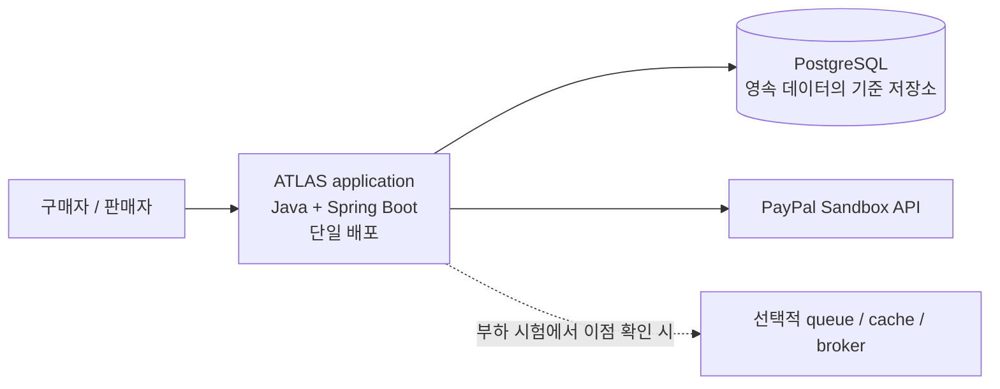
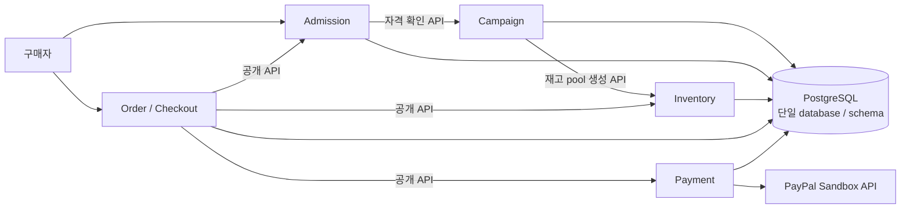

# ADR-0001: 초기 아키텍처 방향
- 상태: ✓ 구조·기술 방향 승인. 구현·배포는 별도 승인 대상.
- 결정일: 2026-11-02
- 담당: 프로젝트 책임자
- 관련 요구사항: [FR-001~003](../../01-requirements/requirements-index.md), [NFR-001~002](../../01-requirements/requirements-index.md)

## 배경
- 주문·재고·결제·정산의 정합성과 장애 복구를 검증할 구조 필요.
- 팀 규모, 부하, 배포 제약은 미정. 독립 서비스를 운영할 근거 없음.

## 판단 기준
- 모듈별 데이터 소유권과 transaction 경계를 검증할 수 있는가.
- 운영 부담이 낮고 통합·장애 시험을 재현할 수 있는가.
- 별도 queue/cache/broker는 병목을 측정하고 비교 가능한 이점을 확인한 뒤 검토.
- A/B/C 장기 범위 유지.

## 근거와 대안

| 대안 | 설명 | 이점 | 비용·위험 |
|---|---|---|---|
| A. Modular Monolith First — 선택 | 한 번의 배포 안에서 모듈 경계와 데이터 소유권을 유지 | transaction·test 단순화, 경계 명확화 | 독립 확장·배포 제한, 경계 약화 위험 |
| B. Microservices | 도메인별 service·배포·저장소 분리 | 독립 배포·확장 | network failure, distributed transaction, 운영 부담 증가 |
| C. 단순 monolith | 단일 application, 명시적 모듈·데이터 경계 없음 | 시작이 단순 | 결합 증가, 변경·검증 어려움 |

## 결정
- **아키텍처:** Modular Monolith First. 한 번의 배포 안에서 모듈 경계와 데이터 소유권 유지.
- **Runtime:** JDK 25 LTS, Spring Boot 4.1.2, PostgreSQL 18.6, Gradle Wrapper 9.8.2.
- **Test tooling:** Testcontainers 2.0.5 verifies PostgreSQL behavior; ArchUnit 1.5.1 checks package dependencies without `package-info` markers.
- **Build:** Boot 4 Flyway uses the dedicated starter. Versions and rationale: [D-040](../../00-governance/decision-log.md), [REF-065~067/098](../../00-governance/reference-register.md).
- **CI:** Temurin 25. The deployment JDK distribution and licensing remain undecided.
- PostgreSQL은 영속 데이터의 기준 저장소입니다. 모듈 소유권·짧은 transaction은 [D-038](../../00-governance/decision-log.md), campaign counter 순번 발급은 [D-039](../../00-governance/decision-log.md) 참조. 로컬 schema/migration은 [Issue #72](https://github.com/Neo1228/ATLAS/issues/72)에서 구현. 운영 isolation·lock 복구는 미정.
- 별도 queue/cache/broker는 기본 구성에 포함하지 않습니다. 부하 시험에서 병목과 비교 가능한 이점을 확인할 때만 검토합니다 (D-037, Q-008).
- Gate 2의 Buyer 흐름 기준과 Gate 3 설계 승인. 초기 실행 작업은 [Issue #72](https://github.com/Neo1228/ATLAS/issues/72)에서 추적.

## 상위 아키텍처

## Gate 3 초기 모듈·데이터 설계
모듈 범위는 현재 Buyer 흐름에 한정합니다. 이름·경계는 실제 불변조건과 의존 관계에 따라 검토하며 장기 기능 전체를 미리 모듈로 고정하지 않습니다.

| 모듈 | 현재 범위의 책임 | 경계 |
|---|---|---|
| Campaign | 현재 Campaign/SKU와 판매 시작 상태 | 자격 정책은 미정 |
| Admission | Ticket, key, sequence, retry·재진입 | 순번 기록은 D-039 참조 |
| Inventory | 재고 pool·예약·claim/release·수량 보존 | PostgreSQL 전용 동시성 SQL은 [ADR-0004](ADR-0004-jpa-and-sql-boundary.md) 참조. 성능 비교 없음 |
| Order/Checkout | Buyer 흐름 조정, test window, 주문 상태 전이 | PSP operation 상태는 Payment 모듈 소유 |
| Payment | PayPal Sandbox authorization/capture/refund, webhook과 recovery | provider 경계와 상태는 [ADR-0026](ADR-0026-paypal-sandbox-payments.md), [ADR-0029](ADR-0029-order-payment-recovery-contract.md) 참조 |

> [!NOTE]
> 이 ADR은 초기 modular-monolith와 transaction 경계를 결정한 기록입니다. 현재 Catalog·Account·Payment·Settlement 계약은 [ADR-0019](ADR-0019-seller-product-categories.md), [ADR-0027](ADR-0027-account-jwt-authentication.md), [ADR-0026](ADR-0026-paypal-sandbox-payments.md), [ADR-0020](ADR-0020-seller-settlement-statement.md)에서 구체화했습니다.

- **데이터 소유권:** PostgreSQL database/schema 하나 사용. 모듈별 table과 쓰기 소유권을 분리하고 모듈 간 호출은 공개 API로 제한. 다른 모듈의 repository에 직접 접근 금지.
- **Transaction:** 도메인 불변조건을 지키는 데 필요한 짧은 transaction 사용. 같은 local transaction에 모듈 API가 참여할 수 있으나 PSP network call은 transaction 밖에서 수행. isolation, 실제 경계·schema·lock 복구는 미정.
- **Queue 순번:** Admission은 Campaign counter row를 초기화·잠근 뒤 같은 transaction에서 ticket을 기록 ([D-039](../../00-governance/decision-log.md)).
- 첫 적격 join 시 row를 생성하며, commit 순서는 PostgreSQL이 보존.
- 같은 Campaign의 경합은 승인된 측정 대상이며 아직 실측 결과가 아님. PostgreSQL sequence는 gap이 생기고 commit 순서를 보장하지 않음 ([REF-057](../../00-governance/reference-register.md)).
- **경계 검사:** ArchUnit 1.5.1 test-scope 규칙이 `package-info` annotation 없이 Gradle 모듈 간 허용 package 의존을 검사 ([REF-098](../../00-governance/reference-register.md)). 검사 결과는 작성한 규칙만 확인하며 도메인 정확성·성능을 보장하지 않음.
- 승인된 Q-008 부하 profile 사용. 단위·계산·미정 입력은 아래 표에 기록하며 운영 목표는 없음.
- 로컬 재고 기준: 조건부 atomic `UPDATE`와 주문별 transaction lock. 운영 lock 방식·성능은 미측정. 비교는 승인된 부하에서 수행하며 처리 용량을 추정하지 않음.
- 초기 구현 작업은 [Issue #72](https://github.com/Neo1228/ATLAS/issues/72)에서 추적. 현재 PayPal Sandbox operation과 payment recovery는 [ADR-0026](ADR-0026-paypal-sandbox-payments.md), [ADR-0029](ADR-0029-order-payment-recovery-contract.md) 참조.

## 처리 용량 계산 틀 — 합성·보고 전용

| 항목 | 입력·계산 | 해석 |
|---|---|---|
| Session 유입률 | 10,000 sessions/60m ≈ 2.8 sessions/s; 2×/4× ≈ 5.6/11.1 sessions/s ([D-031~D-033](../../00-governance/decision-log.md)) | 합성 입력. 운영 수요나 처리량 목표 아님 |
| 단계별 요청률 | 단계별 offered/achieved RPS 측정 | sessions/s만으로 계산 불가. session당 request 수와 단계별 분포 필요 |
| 완료 session TPS | 측정 구간의 완료 Buyer session 수 / 초 | 유입률과 별도. PENDING/UNKNOWN은 미완료·진행 중 |
| 진행 중 동시성 | 안정 구간에서 `L ≈ λ × W` ([REF-022](../../00-governance/reference-register.md)) | 같은 단계의 유입률 λ와 지연시간 W 필요. W 미측정으로 계산 불가 |
| DB QPS | 선언한 query 범위의 초당 query만 기록 | API RPS와 다른 단위. 현재 실측 없음 |

Q-008 합성 workload:
- 기준: Buyer session 10,000/60분(약 2.8 session/s), 2×·4× 단계.
- 미정: burst 구간, think time, 동시성, request mix, 실행 환경, 자원 설정 ([Q-008](../../01-requirements/requirements-index.md#assumptions-and-open-questions)).
- EXP-013은 로컬 20분 측정이며 대기열 경합을 확인하지 못함 ([보고서](../../03-experiments/EXP-013-gate4-20-minute-calibration.md)).
- **저장소 경계:** 저장소와 배포 단위는 각각 하나. 배포 주기·팀·데이터·보안 책임 또는 측정된 확장성 제약이 독립될 때만 분리 검토.
- **의존성 선택:** 유지관리 중인 라이브러리와 직접 구현을 기능·운영·보안·라이선스 비용으로 비교. 대안과 실행·테스트·빌드 적용 범위를 기록 ([Issue #75](https://github.com/Neo1228/ATLAS/issues/75)).

## 재검토 조건
- 독립된 team/deployment가 필요해짐.
- 모듈 간 변경·장애 결합이 커짐.
- 부하 시험에서 단일 deployment 또는 PostgreSQL 병목이 반복 확인됨.
- 데이터 소유권이 바뀌거나 실측 결과가 현재 가설과 맞지 않음.

## 판단 근거
- [REF-023](../../00-governance/reference-register.md): Shopify 재고 사례는 MySQL·Shopify 환경에 한정. PostgreSQL schema나 처리량 목표로 일반화하지 않음.
- [REF-050/052~055/098](../../00-governance/reference-register.md): modular monolith와 경계 검사 사례. Shopify는 의미상 package 이름과 runtime 의존이 어긋날 수 있다고 지적. ArchUnit은 ATLAS가 정한 package 규칙만 검사하며 도메인 경계를 보증하지 않음.
- [REF-056~058](../../00-governance/reference-register.md): PostgreSQL lock/sequence 의미와 vendor 재고 사례. 운영 PostgreSQL 버전은 미정. Vendor 성능 주장은 독립 검증되지 않음.
