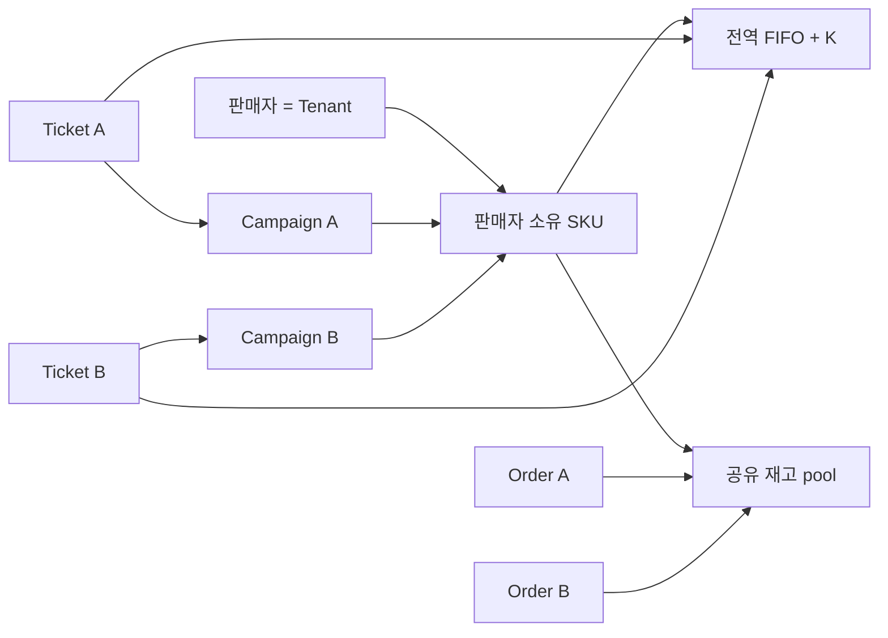

# ADR-0005: Seller-SKU 공유 재고와 전역 FIFO/K

- 상태: ✓ 확정
- 날짜: 2026-11-03
- 담당: 프로젝트 책임자
- 관련 결정: [D-049](../../00-governance/decision-log.md)
- 관련 요구사항: [FR-001/FR-004](../../01-requirements/requirements-index.md)
- 추적: [Issue #89](https://github.com/Neo1228/ATLAS/issues/89), [PR #90](https://github.com/Neo1228/ATLAS/pull/90)
> 기존 데이터 전환 방식은 [D-055](../../00-governance/decision-log.md)·[ADR-0006](ADR-0006-v6-clean-start.md)에서 대체했습니다. Seller-SKU 소유권, 공유 재고, 전역 FIFO/K, Campaign 호환성 결정은 계속 유효합니다.
> Catalog·Cart·Order 확장에 따라 모듈 책임, Seller-SKU 등록 경로, K policy 소유는 [D-061](../../00-governance/decision-log.md)·[ADR-0008](ADR-0008-catalog-cart-order-boundaries.md)에서 대체했습니다. 아래 내용은 D-049 당시 결정을 보존하며 현재 구현의 모듈 구조를 설명하지 않습니다.

## 배경과 문제

초기에는 Campaign마다 같은 SKU의 inventory pool과 admission queue를 따로 만들었습니다. Seller 식별자가 없어 Campaign 간 재고 공유와 전역 FIFO를 표현하지 못했습니다. 소유자는 Seller=Tenant, Seller 소유 SKU, Seller-SKU 단위 공유 재고와 전역 FIFO를 선택했습니다.

## 판단 기준·제약

- 로컬 시나리오만 포함. Cloud 배포, 운영 처리 용량, 부하 시험 제외.
- Seller/SKU 식별자와 재고를 Campaign마다 중복 생성하지 않음.
- 재고 보존, 주문 idempotency, 결제 hold·복구 유지.
- 추가 Gradle module·framework·authentication은 현재 필요하지 않음.
- 기존 Campaign data migration은 별도 [D-055](../../00-governance/decision-log.md) 결정에 따름. 이 ADR의 당시 migration 금지·보존 방향은 대체됨.

## 검토한 대안

### A. Campaign별 stock과 queue 유지

현재 모델과 변경량이 최소다. 같은 실제 Seller-SKU가 여러 Campaign에 등록되면 재고가 중복·분리되어 공유 판매 계약을 표현하지 못한다.

### B. Seller-SKU stock, Campaign별 queue

Oversell은 막을 수 있으나 Owner가 선택한 Campaign 간 global FIFO를 구현하지 못한다. 서로 다른 queue의 순서와 active slot은 독립적이다.

### C. Seller-SKU shared stock과 global FIFO — 선택

하나의 `(sellerId, skuId)` inventory pool, sequence counter, lock, active K와 FIFO를 공유합니다. Campaign은 판매 상태·ticket TTL·ticket attribution을 유지합니다.

## 결정

- **식별자:** Seller=Tenant. Seller가 SKU를 소유하며 `(sellerId, skuId)`가 Seller-SKU 식별자입니다.
- **Seller API:** 로컬 Seller 등록은 server-generated UUID를 반환합니다. 다른 요청은 `sellerId`를 전달합니다. 인증·인가는 없으며 이 값은 데이터 식별자일 뿐 Tenant 보안 경계가 아닙니다.
- **재고:** Seller-SKU 등록 때 `initialStock`을 설정하고 pool을 한 번 생성합니다. Campaign 생성은 재고를 만들거나 늘리지 않습니다. 재고 pool/reservation은 `inventory-module` 소유입니다.
- **대기열:** 모든 Campaign이 Seller-SKU 전역 FIFO와 K를 공유합니다. 새 Seller-SKU 등록 때 `maxActiveCheckouts`를 설정합니다.
- **K 값:** Seller-SKU 등록 때 새 값을 설정합니다. 과거 Campaign의 K를 합산하거나 보존하지 않습니다 ([D-055](../../00-governance/decision-log.md)).
- **모듈:** Seller, SKU, Campaign은 기존 `campaign-module` 소유입니다. 별도 Catalog/Seller module을 추가하지 않습니다.
- **호환성:** Ticket TTL과 `(campaignId, idempotencyKey)` 재요청 범위는 Campaign별로 유지합니다. `campaignId`는 ticket/order 귀속 정보로 보존합니다.
- **기존 데이터:** V6는 새로 시작하는 방식만 지원합니다. V1–V5 application table에 행이 있으면 DDL 전에 실패하며 data/schema를 변경하지 않습니다. 비어 있을 때만 이전 schema를 제거하고 현재 Seller-SKU schema를 만듭니다. mapping·aggregate·backfill·기존 data 보존은 하지 않습니다. 필요한 local data는 앱 밖에서 보관·초기화해야 하며 앱은 조용히 삭제하지 않습니다 ([D-055](../../00-governance/decision-log.md), [ADR-0006](ADR-0006-v6-clean-start.md)). D-049의 공유 재고·전역 FIFO/K는 유지합니다.

## 흐름 도식

## 결과·영향

- Campaign 간 동시 주문은 하나의 Seller-SKU 재고 잔량을 사용하며 conditional stock update로 oversell을 방지합니다.
- Admission counter/sequence/hold slot 수/만료/승격의 기준을 Seller-SKU로 통일합니다. Slot release 시 다음 전역 FIFO ticket을 승격합니다.
- Campaign별 FIFO보다 transaction lock 범위가 넓어져 같은 Seller-SKU 진입이 직렬화됩니다. 이는 correctness test 대상이며 처리량·용량 주장이 아닙니다.
- `Campaign.inventoryCapacity`와 Campaign `maxActiveCheckouts`를 제거합니다. Seller-SKU 등록 API가 `initialStock`과 K를 소유합니다.
- `sellerId`는 인증 주체가 아닙니다. bind address를 외부로 바꾸거나 인증 없이 외부 network에 노출하는 것은 승인 범위 밖입니다.
- 기존 mapping template은 사용하지 않습니다. V6는 기존 데이터를 변환·보존하지 않으며 새로 시작하는 조건은 [ADR-0006](ADR-0006-v6-clean-start.md)에 따릅니다.

## 검증·완료 기준

- PostgreSQL/Testcontainers에서 두 Campaign의 동시 진입이 전역 순번/K/FIFO를 공유하는지 확인.
- Campaign 간 reserve/claim/release 뒤에도 재고 보존식이 유지되는지 확인.
- V6 빈 DB 시작과 데이터가 있는 DB의 fail-safe는 [D-055](../../00-governance/decision-log.md)·[ADR-0006](ADR-0006-v6-clean-start.md) 기준으로 검증. 기존 data mapping/aggregate test는 요구하지 않음.
- `./gradlew --no-daemon check :application-module:bootJar` 통과. 부하 시험은 하지 않음.

## 재검토 조건

- `sellerId`의 의미는 인증, Tenant 격리, Seller membership 요구가 승인될 때 재검토.
- 위치·채널별 재고, 다수량 구매, 재입고·조정, 환불·claim 후 재고 정책이 승인되면 Inventory model 재검토.
- 측정된 로컬 병목이나 운영 환경이 생긴 뒤 queue key/K/lock 재검토. 현재 결과는 처리 용량 주장이 아님.

## 참고 자료

- [REF-023](../../00-governance/reference-register.md): Shopify의 예약·claim 일관성 사례. MySQL·location·대규모 운영 구조를 그대로 가져오지 않음.
- [REF-101](../../00-governance/reference-register.md): Alibaba Cloud Community의 Redis Snap-Up 사례에서 재고 차감 시점과 timeout release 절충을 살펴봄. Redis 구조·규모 수치는 적용하지 않음.
- [REF-102/103](../../00-governance/reference-register.md): Meituan 대기열 모델 글에서 순서·병렬 처리 절충을 참고. Campaign 간 전역 FIFO/K는 외부 권고가 아니라 소유자 결정.
