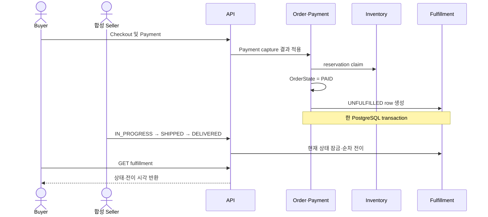

# ADR-0010: 주문 이행·배송 상태 관리

- 상태: ✓ 확정
- 날짜: 2026-11-04
- 담당자: Project Owner
- 관련 결정: [D-065/D-071](../../00-governance/decision-log.md)
- 관련 Issue: [Issue #117](https://github.com/Neo1228/ATLAS/issues/117)

## 배경

ATLAS는 Seller-SKU 구매 흐름을 결제 성공까지 구현했습니다. 다음 단계는 결제 완료 주문의 Seller 처리와 Buyer 수령 상태를 추적하는 것.

현재 `OrderState.PAID`는 terminal 상태이며 Reorder 적격성에도 사용됩니다. 주문·결제 lifecycle에 배송 상태까지 합치면 결제 완료 의미와 배송 진행 의미가 섞입니다.

## 근거와 대안

| 선택 | 장점 | 비용·위험 |
|---|---|---|
| 배송 상태를 `OrderState`에 추가 | 새 테이블·엔티티가 필요 없음 | `PAID` terminal 의미가 바뀌며 Reorder·취소·결제 처리와 충돌 가능 |
| Order별 fulfillment record를 별도로 관리 — 선택 | 주문·결제 상태와 이행 상태를 독립적으로 유지. 주문당 1건 제약을 DB에서 보장 | 테이블·조회 API 추가. 동일 트랜잭션 생성이 필요 |
| 여러 shipment, 부분 수량, 운송사 연동을 한 번에 도입 | 위치별·부분 이행과 실제 운송 상태까지 표현 | 현재 확정 범위보다 넓고 배송 위치·분할·외부 연동 정책이 미정 |

## 결정

`order-module` 안에서 주문·결제와 분리된 fulfillment lifecycle을 관리. 새 Gradle 모듈이나 별도 서비스는 추가하지 않습니다.

- 모든 `PAID` Order에 fulfillment record 1건. `CART`와 `CAMPAIGN` 주문 모두 대상.
- V9 migration은 기존 `PAID` Order를 `UNFULFILLED`로 backfill. Order·inventory 데이터는 변경하지 않음.
- 결제 성공 시 inventory claim, `OrderState.PAID`, 초기 fulfillment row를 같은 PostgreSQL transaction에 저장.
- `OrderState.PAID`와 기존 terminal/Reorder 규칙은 유지.
- 배송 단위는 Order당 1건. 부분 배송·복수 shipment 제외.
- 상태 흐름: `UNFULFILLED → IN_PROGRESS → SHIPPED → DELIVERED`.
- 다음 상태로만 전이. 이미 현재 상태인 재요청은 timestamp를 바꾸지 않음. 상태 건너뛰기·역행은 conflict.
- Seller 상태 변경은 Order의 `sellerId` 일치 여부를 확인. `sellerId` 검사는 인증·인가가 아님.
- Buyer 조회: `GET /api/orders/{orderId}/fulfillment`.
- Seller 작업: `PUT /api/sellers/{sellerId}/orders/{orderId}/fulfillment`와 `status` 요청값 사용.
- `DELIVERED`는 외부 운송사 확인이 아닌 local simulation에서의 수동 기록.

## 현재 적용 범위와 연관 결정

> [!NOTE]
> 이 ADR은 Fulfillment 상태와 Order/Payment 상태 분리의 초기 기준. Shipment·location·return·identity는 후속 결정으로 확장.

| 흐름 | 현재 기준 |
|---|---|
| Shipment·부분 출고 | SellerOrder별 여러 Shipment와 OrderItem 수량 분할: [D-073](../../00-governance/decision-log.md), [ADR-0018](ADR-0018-seller-order-shipments.md) |
| Inventory location | SellerOrder마다 모든 line을 처리할 active location 하나 선택: [D-072](../../00-governance/decision-log.md), [ADR-0017](ADR-0017-seller-fulfillment-locations.md) |
| Return·refund | Delivered 이후 Seller receipt와 OrderItem inspection 기준: [D-071](../../00-governance/decision-log.md), [ADR-0013](ADR-0013-pre-shipment-refund-recording.md), [ADR-0026](ADR-0026-paypal-sandbox-payments.md) |
| Identity·ownership | Buyer/Seller resource 권한은 authenticated account로 검증: [D-082](../../00-governance/decision-log.md), [ADR-0027](ADR-0027-account-jwt-authentication.md) |

## 검증

- fulfillment 상태가 주문·결제 상태를 변경하지 않음.
- `order_fulfillment.order_id` PK/FK로 주문당 하나의 fulfillment를 강제.
- 현재 상태와 단계별 시각만 저장. Event sourcing이나 별도 transition history는 추가하지 않음.
- Testcontainers PostgreSQL에서 PAID transaction 초기화, 기존 PAID order backfill, 순차·중복·역행 전이, Seller 소유 일치, Buyer 조회를 검증.
- 사용자·업무 경계의 자동화는 synthetic API 시나리오. 실제 carrier·인증 구현으로 해석하지 않음.

## 판단 근거
- 美团技术团队, [美团外卖订单中心的演进](https://tech.meituan.com/2016/09/09/mt-waimai-order-evolution.html): 결제→판매자 처리→배송→수령→사후 처리로 이어지는 주문 여정을 설명합니다. 결제 뒤 이행을 별도 상태로 관리하는 업무 순서만 참고합니다. 2016년 대규모 음식 배달 사례이므로 아키텍처·SLO·용량 수치는 ATLAS에 적용하지 않습니다.
- Shopify Help Center, [Fulfilling your own orders individually](https://help.shopify.com/en/manual/fulfillment/fulfilling-orders/single-fulfillment): manual `In progress`/`Fulfilled` states, carrier tracking constraints for `Delivered`, and multiple fulfillment examples.
- ATLAS accepts idempotent retries of the same state, one shipment per order, and manual local delivery. Shopify shipment/carrier policies are not adopted.

## 재검토 조건

- 한 Order에 여러 위치·분할 수량이 필요한 구매 시나리오가 승인될 때 partial fulfillment 검토.
- 실제 carrier 연동이나 인증은 별도 요구·위협 모델·업무 정책 승인 이후 검토.
- Return and inspection after `DELIVERED` are defined by [D-071/ADR-0016](../../00-governance/decision-log.md) and [ADR-0016](ADR-0016-buyer-wide-cart-multi-seller-checkout.md). Partial outbound shipments and carrier integration remain deferred.
