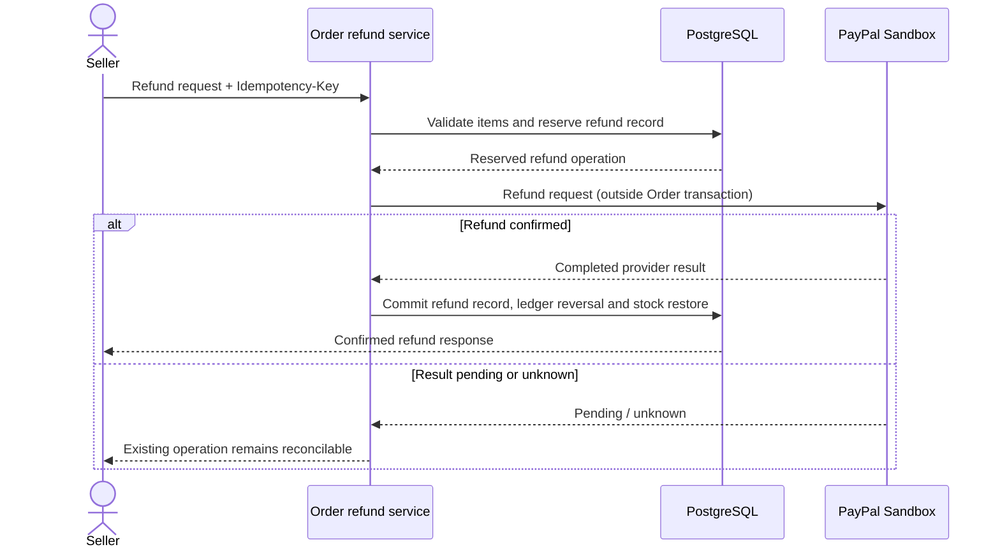

# ADR-0013 — 배송 전 OrderItem 환불 정책

| 항목 | 내용 |
|---|---|
| 상태 | 확정·구현 |
| 결정 ID | [D-068](../../00-governance/decision-log.md) |
| 관련 요구사항 | [FR-008 / BR-008 / Q-002 / Q-006](../../01-requirements/requirements-index.md) |
| 연결 결정 | [ADR-0011 capture ledger](ADR-0011-gross-capture-settlement-ledger.md), [ADR-0026 PayPal Sandbox](ADR-0026-paypal-sandbox-payments.md), [ADR-0029 payment recovery](ADR-0029-order-payment-recovery-contract.md) |

## 배경

Buyer 부분 수량 환불 시 금액 계산과 재고 복원량의 OrderItem 단위 정합 필요. PayPal refund 결과와 내부 refund record·ledger·inventory 상태의 분리 transaction 경계 간 정합 필요.

초기 D-068 범위: 내부 환불 기록과 reversal journal. PayPal provider 호출과 확인된 결과 반영은 [D-081](../../00-governance/decision-log.md) 및 [ADR-0026](ADR-0026-paypal-sandbox-payments.md)로 확장.

## 결정

- `UNFULFILLED` 또는 `IN_PROGRESS` SellerOrder만 배송 전 환불 허용. `SHIPPED` 이후 요청은 반품·검수 흐름 사용.
- Refund amount는 구매 당시 OrderItem unit-price snapshot × 환불 수량에서 coupon allocation snapshot을 차감해 산출. Coupon 잔여 할인액은 [ADR-0024](ADR-0024-seller-coupon-allocation.md)에 따라 앞선 수량부터 배정. 각 OrderItem의 누적 환불 수량은 주문 수량 이하.
- 요청은 `Idempotency-Key`로 식별. 동일 key·동일 facts는 기존 결과 반환; 다른 facts 재사용은 conflict.
- PayPal refund request는 Order 업무 transaction 밖에서 실행. Provider 응답이 `PENDING`·`UNKNOWN`이면 완료로 처리하지 않고 동일 refund operation으로 재조정.
- PayPal refund가 확인된 뒤 refund record·ledger reversal·inventory restoration을 하나의 PostgreSQL transaction에서 commit.
- 원 capture journal 수정 0건. Refund journal은 `SELLER_PAYABLE` debit과 `PSP_CLEARING` credit으로 기록.
- `OrderState.PAID` 유지. Refund record는 별도 상태로 관리. 전 수량이 refund된 SellerOrder는 추가 fulfillment 거부.
- Delivered return은 Seller receipt·OrderItem inspection을 선행하는 별도 흐름 ([D-071](../../00-governance/decision-log.md), [ADR-0016](ADR-0016-buyer-wide-cart-multi-seller-checkout.md)).

## 환불 처리 흐름

## 근거와 대안

- Quantity-based request ties refundable money directly to the purchase-time price snapshot and stock quantity.
- Provider call inside the Order transaction would hold database locks during network latency and permit provider/local state divergence on rollback; confirmed provider outcome is applied in a later local transaction.
- Append-only reversal preserves the original capture evidence and refund history.
- Refund operation idempotency and provider-resource reconciliation prevent duplicate provider effects and local postings.

## 결과와 한계

- Repeated same-facts request reuses its operation; changed facts with the same key are rejected.
- Provider result unconfirmed: do not restore stock or post the refund reversal until reconciliation confirms the refund.
- Delivered return continues to use receipt and inspection; refund window, write-off and reinspection remain open in [Q-010](../../01-requirements/requirements-index.md).
- Provider execution, webhook and recovery behavior: [ADR-0026](ADR-0026-paypal-sandbox-payments.md), [ADR-0029](ADR-0029-order-payment-recovery-contract.md).

## 검증

- PostgreSQL tests cover partial/full quantity limits, captured-order eligibility, idempotent replay, concurrent refund requests, rollback and stock conservation.
- PayPal integration tests cover refund request, duplicate operation, pending/unknown reconciliation and confirmed-result handling.

## 참고 자료

- [D-068 / D-081](../../00-governance/decision-log.md)
- [FR-008 / BR-008 / INV-014 / Q-002 / Q-006](../../01-requirements/requirements-index.md)
- [Issue #122](https://github.com/Neo1228/ATLAS/issues/122), [Issue #191](https://github.com/Neo1228/ATLAS/issues/191)
