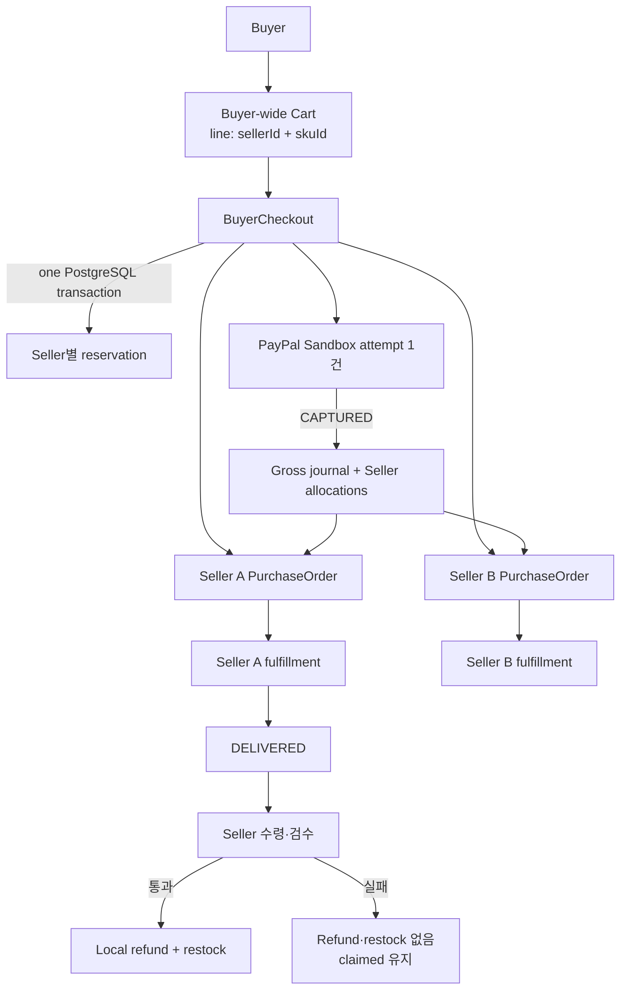

# ADR-0016: Buyer-wide Cart와 Seller별 주문

- 상태: 확정
- 결정일: 2026-11-06
- 결정: [D-071](../../00-governance/decision-log.md)
- 관련 요구사항: [FR-005, FR-007, FR-008](../../01-requirements/requirements-index.md)
- 추적: [Issue #148](https://github.com/Neo1228/ATLAS/issues/148)

## 배경

ATLAS의 목표는 한정판매 기능에 한정되지 않는 이커머스 플랫폼. 기존 [D-060](../../00-governance/decision-log.md)은 첫 일반 구매 시나리오를 단일 Seller Cart·Order로 제한했으나, Buyer가 여러 Seller의 상품을 한 Cart에서 한 번에 구매하는 흐름으로 범위 확장.

Seller별 재고·주문 이후 처리는 독립적으로 유지하면서 Buyer 관점의 checkout과 결제 결과는 하나로 다룰 필요.

## 근거와 대안

| 대안 | 장점 | 비용·한계 |
|---|---|---|
| Seller마다 Cart와 checkout 분리 | 기존 모델 재사용, 실패 범위 단순 | Buyer의 한 번의 구매 행위가 Seller 수만큼 분리 |
| Buyer-wide Cart와 Seller별 독립 결제 | Seller별 상태 격리 | 일부 Seller만 결제되는 partial success와 추가 보상 규칙 필요 |
| Buyer-wide Cart, 부모 Checkout, Seller별 하위 Order — 선택 | Buyer 결제는 하나, 주문·이행·정산 배분은 Seller별 유지 | 단일 PostgreSQL transaction 내 다수 재고 reservation과 parent/child 상태 일관성 필요 |

## 결정

- **Cart**
  - Buyer당 하나의 Cart
  - Line identity: `(sellerId, skuId)`
  - Cart는 현재 표시 데이터. Checkout 시 Seller-SKU·가격 재검증
- **Checkout과 주문**
  - `BuyerCheckout` 1건과 Seller별 `PurchaseOrder` 1건씩 생성
  - 각 OrderItem에 상품명·SKU·KRW 단가·수량 snapshot
  - 모든 Seller/SKU reservation과 Cart 비우기를 하나의 PostgreSQL transaction으로 처리
  - 한 line이라도 재고 부족 시 Checkout·하위 Order·reservation·Cart 변경 전체 rollback
- **결제와 settlement**
  - BuyerCheckout당 PayPal payment attempt 하나와 capture lifecycle 하나
  - `PENDING`/`UNKNOWN`은 같은 attempt로 재조정하며 결과 확정 전 reservation 유지
  - Capture journal에는 checkout gross 1건 기록. Seller payable은 하위 Order별 allocation으로 배분하며 합계는 checkout total과 일치
  - PayPal HTTP call은 DB transaction 밖에서 수행. 확인된 provider 결과만 내부 상태에 반영 ([D-081](../../00-governance/decision-log.md), [ADR-0026](ADR-0026-paypal-sandbox-payments.md))
  - Cancellation과 confirmed capture가 경합하면 capture가 우선하며 settlement·inventory claim·`PAID` 반영. Checkout-level compensation 없음; SellerOrder 환불은 별도 흐름
- **Fulfillment와 return**
  - fulfillment는 Seller별 하위 Order당 1건
  - Return 접수는 해당 Order의 `DELIVERED` 이후에만 허용
  - Seller는 반품을 수령한 뒤 각 OrderItem의 검수 결과(`PASSED`/`FAILED`)를 한 번에 기록.
  - `PASSED` 수량만 PayPal refund 확인 후 재고 복원과 ledger reversal. `FAILED` 수량은 refund/restock 없이 claimed 유지; 재검수 불가.
  - Partial shipment는 [D-073](../../00-governance/decision-log.md)·[ADR-0018](ADR-0018-seller-order-shipments.md) 기준. Write-off, reinspection, return window는 Q-010에서 결정.

## 책임과 실패 경계

- Seller별 reservation 중 하나라도 실패하면 전체 checkout transaction rollback
- Capture 결과가 미확정이면 모든 Seller Order의 재고 hold 유지
- PSP capture 이후 settlement/fulfillment 저장 실패 시 후속 DB 작업 rollback; 동일 attempt 재조정으로 적용
- Return 검수 결과는 Seller별 하위 Order에 귀속. 실제 carrier·PSP API 연동 없음

## 결과와 한계

- 단일 Seller Cart·Order에서 Buyer-wide Cart·Seller별 Order로 범위 변경. [ADR-0008](ADR-0008-catalog-cart-order-boundaries.md)의 모듈 소유권과 단순 계층을 유지.
- 기존 모듈 소유권과 계층을 유지. 이 흐름 전용 모듈·추상화 계층·별도 배포 단위는 추가하지 않음.
- V14는 Buyer-wide Cart·Checkout의 clean-start migration, V15는 return case·item schema 추가. 기존 checkout data mapping/backfill은 지원하지 않음.
- 검수 결과는 OrderItem 단위. Return 기간은 숫자로 정하지 않으며, failed item의 write-off·재검수는 비범위.
- 운영 트래픽·SLO·capacity를 의미하지 않음

## 판단 근거

- [Meituan: Trade System Design Practice](https://tech.meituan.com/2024/05/09/DDD-Practice-Trading-System.html) — 거래 lifecycle과 업무 경계 비교에 한정. 구현·구조·규모를 복제하지 않음.
- [Shopify Engineering: Deconstructing the Monolith](https://shopify.engineering/shopify-monolith) — 모듈화된 단일 시스템 운영 사례. Shopify의 규모·팀 구조·기술 구성을 ATLAS의 용량 근거로 사용하지 않음

## 재검토 조건

- 사용자 업무 규칙 변경으로 Seller별 독립결제 또는 partial success가 필요해질 때
- Return 기간·부분 반품·write-off의 정책 근거가 확보될 때
- 로컬 PostgreSQL 검증에서 transaction 범위나 잠금의 한계가 반복 재현될 때
