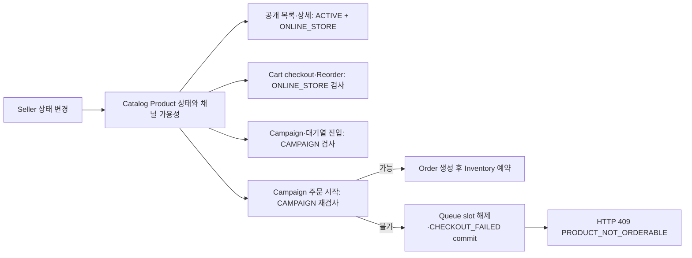

# ADR-0021 — 상품 판매 상태와 채널별 주문 가능성

- 상태: 승인
- 결정: D-076
- 추적: [Issue #165](https://github.com/Neo1228/ATLAS/issues/165), [PR #166](https://github.com/Neo1228/ATLAS/pull/166)
- 요구사항: [FR-013 / BR-013 / INV-010 / Q-010](../../01-requirements/requirements-index.md)
- 관련 결정: [D-061 / D-074](../../00-governance/decision-log.md)
- 관련 ADR: [ADR-0008](ADR-0008-catalog-cart-order-boundaries.md), [ADR-0019](ADR-0019-seller-product-categories.md)

## 맥락

Catalog에는 Product와 Seller-SKU가 있지만, 전체 상품 판매 중단과 특정 구매 경로의 판매 제한을 표현하는 상태가 없음. Category는 탐색 분류이며 판매 가능 여부와 별개. Inventory는 수량 예약·보존을 담당하므로 판매 노출 정책을 소유하지 않음.

## 결정

- Catalog Product에 전역 상태 `ACTIVE` / `INACTIVE`와 채널별 가용 여부를 둠.
- 현재 채널 범위: `ONLINE_STORE`, `CAMPAIGN`. 범용 채널 registry는 만들지 않음.
- 신규 Product 및 V19 이전 Product의 기본값: `ACTIVE`; 두 채널 모두 사용 가능.
- `INACTIVE`는 모든 채널을 차단. 채널별 비활성은 해당 채널만 차단.
- Seller는 Product 상태와 채널별 가용 여부를 변경 가능. 공개 `GET /api/products`(sellerId filter 포함)·상세는 `ACTIVE`이며 `ONLINE_STORE` 사용 가능한 Product만 노출; Seller 관리 경로 `GET /api/sellers/{sellerId}/products`는 모든 상태 노출.
- Catalog Service가 주문 가능 여부의 단일 판정 경로. 다른 모듈은 공개 Service/DTO 계약 사용; Catalog persistence 직접 참조 금지. `SellerSkuResponse` 형식은 변경하지 않음.
- Cart checkout·Reorder는 요청의 모든 SKU를 확인한 뒤 Order 생성·재고 예약·멱등 기록·Cart 변경 진행. 신규 비가용 요청은 전체 거절.
- Campaign 생성·오픈·신규 대기열 진입은 `CAMPAIGN` 가용 여부 확인. 기존 idempotency key는 기존 ticket을 재생하고, 상품 비가용으로 신규 ticket을 만들지 않음.
- 기존 admitted ticket의 상품이 비가용한 상태에서 Campaign 주문을 시도하면 slot 해제와 `CHECKOUT_FAILED`를 commit한 뒤 `PRODUCT_NOT_ORDERABLE` HTTP 409 반환. 재시도 ticket은 만들지 않으며, 재판매 후 새 ticket/key 사용.
- Product 상태 변경은 기존 `RESERVED` / `PAID` Order, Inventory reservation, Payment, Settlement를 변경·취소하지 않음.
- V19에서 Product 상태와 `product_channel_availability`를 추가하고, 기존 Product마다 두 채널의 `available=true` row를 backfill.
- 새 목록 cursor는 v3로 공개 조회와 Seller 관리 범위를 바인딩. 기존 v1/v2는 scope 미포함 legacy cursor로 수용; 신규 v3의 scope 간 재사용은 `INVALID_REQUEST`.
- 신규 검색·cache·broker·index는 추가하지 않음. 공개 목록 query 계획과 대표 데이터에서 필요성이 확인될 때 index 검토.

## 이유와 대안

| 선택 | 대안 | 이유·절충 |
|---|---|---|
| 전역 상태와 채널별 가용성 분리 | 하나의 `isActive` flag | 상품 전체 중단과 특정 구매 경로 제한을 구분. 두 구매 경로의 현재 요구에 한정 |
| Catalog 소유 | Order/Inventory 상태에 판매 flag 추가 | 상품 수명주기의 단일 소유자를 유지하고 재고 수량 의미와 분리 |
| 채널 가용 테이블 | `Product`에 채널별 boolean column | channel/value를 명시하고 V19에서 기존 상품을 같은 규칙으로 초기화. 현 채널 수만 고려해 범용 registry는 추가하지 않음 |
| 비가용 신규 진입 거절, 기존 주문 보존 | 이미 생성된 주문·ticket 일괄 취소 | 예약·결제 경계를 소급 변경하지 않고 새 거래 진입만 차단 |
| PostgreSQL 단일 모듈 경로 | Search·cache·broker 도입 | 현재 외부 서비스 필요성을 입증할 실측 자료가 없음 |

## 데이터 흐름

## 결과와 한계

- 페이지 상품의 채널 목록은 대상 Product ID를 묶어 한 번에 조회. Product별 lazy query를 방지하며, DB 실행 계획·latency·처리용량 개선은 실측하지 않음.
- Product, Seller 목록 응답, 공개 조회 결과가 확장됨. `SellerSkuResponse`와 기존 OrderItem snapshot은 유지.
- 가용 여부 확인은 신규 구매 진입에서 수행. 확인 뒤 상태 변경과 구매가 경합하는 경우의 강한 serialization은 보장하지 않음; 동시 비활성화 정책은 별도 검증 대상.
- `sellerId`는 데이터 식별자일 뿐 인증·인가나 tenant isolation이 아님.
- `DRAFT`, `ARCHIVED`, 예약판매, variant별 채널 게시, 재고 기반 자동 비활성화, campaign 자동 종료, 기존 ticket 일괄 취소는 미지원.
- 사용자 수, traffic, RPS/TPS, 운영 용량·SLO에 대한 주장은 하지 않음. 이 변경은 부하 시험 대상이 아님.
- 검증 환경: macOS 27.2 arm64, JDK 25.0.5, Colima·PostgreSQL 18.6 Testcontainers. `./gradlew --no-daemon --rerun-tasks check :application-module:bootJar` 통과; 38 suites, 196 tests, 실패·오류·skip 0, `bootJar` 성공.

## 외부 참고자료

- [REF-122](../../00-governance/reference-register.md): Shopify 문서는 Product status와 sales-channel availability를 별도 개념으로 설명. Shopify 고유 상태·정책을 ATLAS에 복사하지 않고 구분 방식만 비교.
