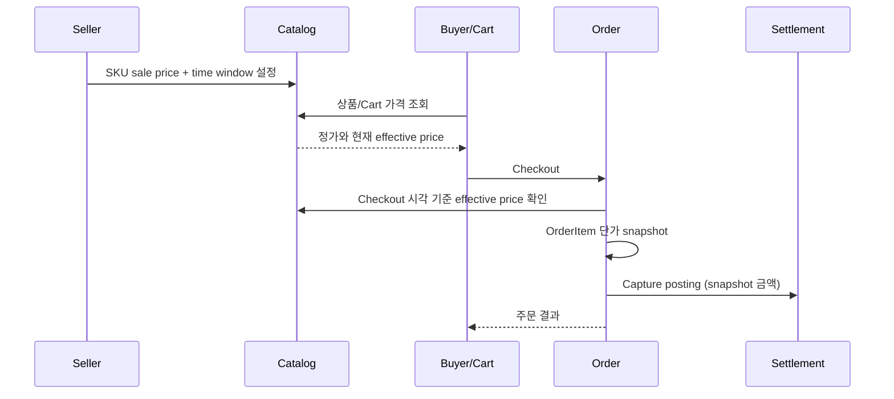

# ADR-0023 — Seller SKU 기간 한정 판매가

- 상태: ✓ 구현·로컬 JDK 25/Testcontainers full Gradle check 통과 (42 suites, 207 tests, 0 failures/errors/skips); merge 전
- 결정: D-078
- 요구사항: FR-014
- 추적: [Issue #183](https://github.com/Neo1228/ATLAS/issues/183)
- 기존 범위: [ADR-0008](ADR-0008-catalog-cart-order-boundaries.md)는 당시 promotion·가격 이력을 미지원으로 기록. 본 ADR은 SKU 가격에 제한된 판매가 규칙을 추가하며 전체 가격 이력이나 할인 엔진을 도입하지 않음.

## 배경

`SellerSku`가 정가를 소유하고, Cart는 안내 가격을 표시하며 Checkout에서 Catalog의 현재 가격을 다시 확인. `OrderItem`에는 구매 시점의 단가 snapshot 저장. Seller 운영 할인이나 기간 한정 판매가는 미지원.

일반적인 할인 엔진은 상품·주문·배송 discount 조합, 다중 할인 우선순위, 주문 단위 할인 allocation, partial refund 시 금액 배분까지 포함. 현재 필요한 범위를 넘어서는 복잡도와 금전 정책 미정.

## 결정

- `SellerSku`마다 한 건의 sale-price window 저장. 정가는 유지하고 sale price와 `[startsAt, endsAt)` 구간 추가.
- 유효 조건: `0 < salePriceWon < regularPriceWon`; `startsAt < endsAt`. 시작 시각 포함, 종료 시각 제외.
- 한 SKU에 동시에 한 window만 허용. Seller의 새 설정은 기존 window 교체 또는 취소.
- Seller-funded 단가 할인. 한 SKU의 effective price는 `startsAt <= pricingAt < endsAt`일 때 sale price, 그 외 정가.
- V1은 `ONLINE_STORE`와 `CAMPAIGN`에 같은 SellerSku effective price 적용. Channel별 가격 차등 없음.
- Coupon code, 주문 단위 discount, stacking, platform-funded discount, 배송비·세금 계산, 전체 price history는 범위에서 제외.
- Cart 조회는 현재 effective price를 안내. Checkout은 모든 line에 하나의 `pricingAt`을 적용해 Catalog 가격을 재확인하고 `OrderItem`에 실제 단가 snapshot 저장.
- Settlement capture와 refund는 기존 OrderItem snapshot 기준. Promotion 변경·만료는 이미 생성된 주문의 가격에 영향 없음.

## 흐름

## 대안과 절충

- Coupon/stacking engine: 상품·주문·배송 간 결합과 부분 환불 allocation 제공 가능. 할인 우선순위·동일 주문 분배·쿠폰 재사용/반환 정책이 추가로 필요하므로 후속 범위.
- Channel별 promotion: 판매 채널별 가격 제어 가능. 동일 SKU의 buyer 가격과 seller 관리 복잡도가 증가하므로 보류.
- 즉시 sale price만 지원: 기간 경계가 단순하지만 예약된 promotion을 지원하지 못함. 한 window만 허용해 제한된 시간 정책을 선택.

## 결과와 한계

- Catalog가 정가와 sale window의 단일 소유자. Order·Settlement는 effective price 계산을 복제하지 않고 snapshot만 사용.
- Base price 변경으로 기존 sale price가 정가 이상이 되는 경우 해당 변경을 거부. Seller가 sale window를 먼저 취소·수정해야 함.
- 시간 경계, 다중 line 일관 가격, cart 조회와 checkout 재가격, 기존 주문 refund/settlement 보존을 PostgreSQL 통합 테스트로 검증.
- 실제 사용자별 쿠폰, platform subsidy, 외부 promotion provider, 판매 채널별 rule engine, 가격 이력은 미지원.
- local PostgreSQL만 사용. Cache, scheduler, cloud service, 새 dependency 도입 없음.

## 참고자료

- [Taobao Open Platform — 주문 금액 구성](https://developer.alibaba.com/docs/doc.htm?articleId=108471&docType=1&treeId=796): 상품별 할인과 주문 단위 할인/주문 금액 구분. V1을 SKU 단위 할인으로 제한하는 비교 기준.
- [Shopify — Discount combinations](https://help.shopify.com/en/manual/discounts/discount-combinations): 상품·주문·배송 할인 조합 및 제한. Stacking 제외 근거.
- [「退一件，到底该退多少钱？」](https://www.woshipm.com/operate/6414206.html): user-contributed product analysis. Order-level discount allocation과 coupon lifecycle이 partial refund에 미치는 영향의 보조 사례; 기술 규칙의 단독 근거로 사용하지 않음.
