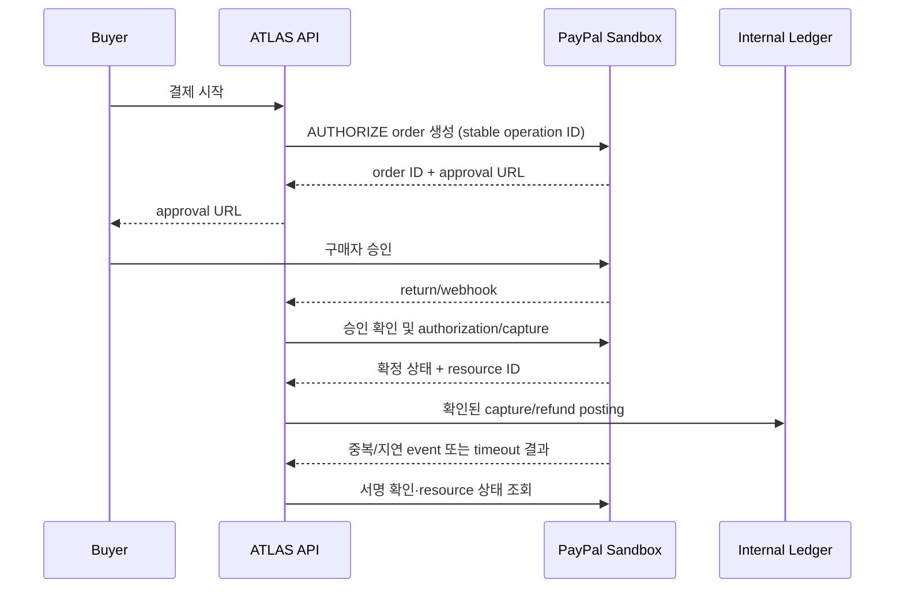

# ADR-0026: PayPal Sandbox 결제와 내부 정산 원장 연동

- 상태: ✓ 확정
- 결정일: 2026-11-09
- 결정 ID: [D-081](../../00-governance/decision-log.md)
- 관련 요구사항: [FR-017/BR-017/INV-014](../../01-requirements/requirements-index.md)
- 관련 Issue: [Issue #191](https://github.com/Neo1228/ATLAS/issues/191)
- 선행 결정: [ADR-0011 원장](ADR-0011-gross-capture-settlement-ledger.md), [ADR-0013 환불](ADR-0013-pre-shipment-refund-recording.md), [ADR-0015 Fake PSP](ADR-0015-durable-fake-psp-progression.md)

## 배경

이번 변경 전 runtime 결제는 PostgreSQL에 결과를 저장하는 `FakePsp` 기반. PayPal 승인·capture·void·refund·provider 조회·webhook은 미구현. `settlement-module`은 현재도 내부 이중기입 원장만 담당하며 실제 판매자 송금은 없음.

## 결정

- PayPal Orders API Sandbox를 결제 provider로 연결. 구매자 승인 후 authorization, capture, void 및 capture refund 지원.
- 결제 금액·통화는 저장된 주문 snapshot 기준. Client 요청값으로 금액을 결정하지 않음.
- Provider order/authorization/capture/refund ID와 operation 결과를 저장. HTTP provider 호출은 업무 DB transaction 밖에서 수행.
- PayPal `PayPal-Request-Id`는 각 endpoint의 공식 지원이 확인된 경우에만 사용. 지원하지 않거나 응답이 불명확한 operation은 내부 operation ID와 PayPal resource 상태 조회로 복구. 무조건 재시도 금지.
- Webhook은 PayPal 서명 확인 후 event ID 중복을 제거. Provider 결과 확인 뒤 checkout, coupon, inventory 및 원장 변경 적용.
- 모듈 책임:
  - `payment-module`: PayPal API, provider operation 및 PaymentAttempt 상태
  - `order-module`: 구매자 승인/결제 상태와 환불 정책
  - `settlement-module`: 확인된 capture/refund의 내부 원장 기록
  - `application-module`: HTTP 경로, 설정, Flyway migration
- `FakePsp` runtime fallback 금지. 자격 증명 미설정 상태에서 결제 요청은 명시적인 provider unavailable로 실패하며 비결제 기능은 계속 실행 가능.
- settlement 원장은 PayPal에서 확인된 capture/refund만 반영. 원장 posting은 판매자 지급을 의미하지 않음.
- 실제 seller payout은 비범위. PayPal Payouts 또는 Multiparty 권한, seller onboarding, 수취 계정 연결 및 지급 상태 대사가 별도 필요.
- `PAYPAL_CLIENT_ID`, `PAYPAL_CLIENT_SECRET`, `PAYPAL_WEBHOOK_ID`는 비밀 저장소나 환경 변수로만 전달. Sandbox URL은 `PAYPAL_BASE_URL`로 구성. GitHub Actions Secret은 로컬 컴퓨터로 자동 전달되지 않음.

## 선택 이유와 대안

- Fake PSP 유지: 외부 결제·환불 및 실제 provider timeout/replay를 검증할 수 없어 제외.
- 외부 호출을 주문 transaction에 포함: PayPal 응답 지연이 DB lock을 늘리고, 외부 성공 뒤 rollback 시 실제 결제와 내부 상태가 불일치하므로 제외.
- capture/refund 요청 뒤 즉시 내부 원장 반영: provider 상태가 `PENDING`/unknown일 수 있어 중복 지급·원장 오기록 위험으로 제외.
- 판매자 지급까지 일반 client credentials로 가정: seller 수취 계정과 PayPal Payouts/Multiparty 권한이 확인되지 않아 제외. 현재 내부 원장과 외부 자금 이동을 명확히 분리.
- Spring `RestClient`와 Spring Security OAuth2 Client를 사용해 PayPal HTTP 요청과 client-credentials token 수명주기를 처리. SDK 자체 구현이나 token cache 수작업은 피함. Provider interface는 결제 경계 한 곳에만 유지.

## 흐름과 복구

- Timeout/연결 끊김은 성공·실패로 단정하지 않고 `UNKNOWN` 상태 보존.
- 재조정은 PayPal resource 상태를 조회한 뒤 같은 내부 operation의 결과를 적용. 새로운 operation key로 무조건 다시 결제하지 않음.
- Webhook signature verification은 PayPal API에 위임. Event 처리와 업무 상태 전이는 idempotent.

## 검증과 한계

- HTTP stub 기반 테스트: approval, authorize/capture/void/refund, duplicate request/event, invalid signature, timeout/unknown recovery, 원장 posting 중복 방지.
- Sandbox smoke test는 GitHub Actions Secrets 또는 로컬 `.env.local`의 개발용 credential로 실행. 현재 실제 PayPal Sandbox 요청은 아직 미실행; live 결제는 범위 밖.
- Webhook signature 검증에는 Sandbox `PAYPAL_WEBHOOK_ID` 필요. 계정에 webhook 등록 후 별도 설정.
- PayPal Sandbox 결과는 production 처리량·가용성·정산 시각을 증명하지 않음.
- 현재 API는 `127.0.0.1` loopback 전용. `buyerRef`·`checkoutId`는 auth/tenant 경계가 아니므로 공개망 노출 금지; 인증·인가·tenant isolation은 [Q-007](../../01-requirements/requirements-index.md#assumptions-and-open-questions) 후속.
- Seller payout, dispute/chargeback, buyer account onboarding, live credentials는 별도 결정과 검증 대상.

- Webhook 서명 검증은 PayPal이 보낸 payload의 진위만 증명한다. 서명된 이벤트가 우리 결제에 해당하는지 또는 재무 사실이 맞는지까지 보증하지 않으므로, capture 완료 이벤트는 provider order/capture ID, `COMPLETED`, 저장된 결제 총액, `KRW`를 대조한다. 미확인 주문이나 금액·통화 불일치는 PaymentAttempt를 변경하지 않고 event ID도 선점하지 않는다.
- 상관관계·금액 검증 후에만 기존 DB의 unique event ID와 PaymentAttempt를 같은 transaction에서 기록한다. DB row lock과 event ID 제약으로 동시 처리와 재전달을 다루므로 분산 lock은 중복된 조정 수단이다. 현재 변경 효과는 한 DB 안의 상태 전이뿐이므로 outbox, 별도 inbox, 비동기 worker/queue도 추가하지 않는다. 다른 시스템에 별도 side effect를 발행하게 되면 outbox를 다시 검토한다.
- 서명 검증은 PayPal API 왕복을 포함해 동기 처리하므로 요청 latency가 늘고, 검증/일시적 상관관계 실패의 재시도는 PayPal 재전달에 의존한다. 별도 비동기 재시도 계층을 두지 않는 대신 흐름을 단순하게 유지한다. 거절 이벤트를 저장하지 않으므로 동일 event ID의 수정된/재전달된 payload가 나중에 검증되면 처리할 수 있다.
- PayPal endpoint는 공식 sandbox를 기본값으로 한다. 공식 sandbox/live hostname과 로컬 loopback 테스트만 허용해 임의 host 사용을 막는다. live hostname은 별도 `ATLAS_PAYMENT_PAYPAL_LIVE_ENABLED=true` 명시가 없으면 거절하여 실결제 오구성 및 임의 endpoint로의 서버 요청을 예방한다.

## 참고 자료

- [PayPal OAuth 2.0](https://developer.paypal.com/api/rest/authentication/)
- [PayPal authorization status](https://developer.paypal.com/api/orders/v2/definitions/authorization_status)
- [PayPal REST API idempotency](https://developer.paypal.com/api/rest/reference/idempotency/)
- [PayPal webhook signature verification](https://developer.paypal.com/api/rest/webhooks/rest)
- [PayPal Multiparty seller onboarding](https://developer.paypal.com/docs/multiparty/get-started)
- [PayPal Payouts account setup](https://developer.paypal.com/payouts/use-payouts/set-up)
- [Spring Security OAuth2 Client](https://docs.spring.io/spring-security/reference/servlet/oauth2/client/core.html)
