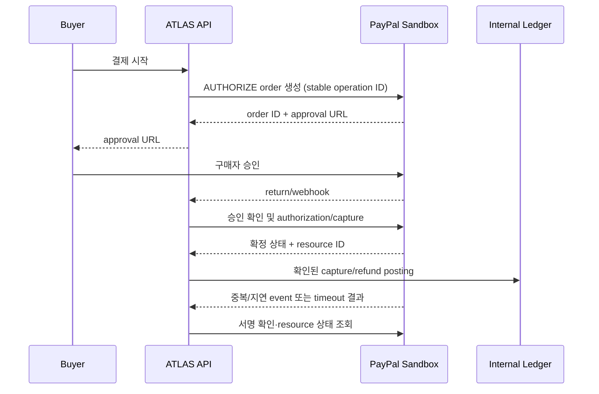

# ADR-0026: PayPal Sandbox 결제와 내부 정산 원장 연동

- 상태: ✓ 확정
- 날짜: 2026-11-09
- 결정 ID: [D-081](../../00-governance/decision-log.md), [D-085](../../00-governance/decision-log.md), [D-086](../../00-governance/decision-log.md), [D-170](../../00-governance/decision-log.md)
- 관련 요구사항: [FR-017/BR-017/INV-014](../../01-requirements/requirements-index.md), [Q-006](../../01-requirements/requirements-index.md#assumptions-and-open-questions)
- 통화 경계: [ADR-0030](ADR-0030-paypal-currency-boundary.md)
- 관련 Issue: [Issue #191](https://github.com/Neo1228/ATLAS/issues/191)
- 선행 결정: [ADR-0011 원장](ADR-0011-gross-capture-settlement-ledger.md), [ADR-0013 환불](ADR-0013-pre-shipment-refund-recording.md), [ADR-0015 초기 payment progression (대체된 결정)](ADR-0015-initial-payment-progression.md).

## 배경

PayPal AI Hackathon 결제 흐름에서 PayPal Orders API Sandbox를 사용. Provider operation, order 상태, inventory와 내부 ledger 간 일관성 확보가 핵심 설계 문제.

## 결정

- PayPal Orders API Sandbox를 결제 provider로 연결. 구매자 승인 후 authorization, capture, void 및 capture refund 지원.
- Order·Settlement 원장은 KRW 유지. PayPal 요청은 [ADR-0030](ADR-0030-paypal-currency-boundary.md)의 PaymentAttempt 고정 FX 스냅샷에 저장된 USD 금액·통화 사용. Client 입력 금액은 결제 근거에서 제외.
- Provider order/authorization/capture/refund ID와 operation 결과를 저장. HTTP provider 호출은 업무 DB transaction 밖에서 수행.
- PayPal `PayPal-Request-Id`는 각 endpoint의 공식 지원이 확인된 경우에만 사용. 지원하지 않거나 응답이 불명확한 operation은 내부 operation ID와 PayPal resource 상태 조회로 복구. 무조건 재시도 금지.
- Webhook은 PayPal 서명 확인 후 event ID 중복을 제거. Provider 결과 확인 뒤 checkout, coupon, inventory 및 원장 변경 적용.
- 모듈 책임:
  - `atlas-payment`: PayPal API, provider operation 및 PaymentAttempt 상태
  - `atlas-order`: 구매자 승인/결제 상태와 환불 정책
  - `atlas-settlement`: 확인된 capture/refund의 내부 원장 기록
  - `atlas-application`: HTTP 경로, 설정, Flyway migration
- PayPal credentials가 없으면 payment request는 `PROVIDER_UNAVAILABLE`로 실패. 비결제 기능은 계속 사용할 수 있음.
- Settlement ledger에는 PayPal에서 확인된 capture/refund만 기록. Ledger entry는 provider-confirmed event에 대응하는 내부 회계 기록.
- `PAYPAL_CLIENT_ID`, `PAYPAL_CLIENT_SECRET`, `PAYPAL_WEBHOOK_ID`, `BOK_ECOS_API_KEY`는 비밀 저장소나 환경 변수로만 전달. Sandbox URL은 `PAYPAL_BASE_URL`로 구성. GitHub Actions Secret의 로컬 자동 전달 미지원.

## 근거와 대안

- Runtime payment request는 PayPal Sandbox provider로 처리. HTTP stub은 반복 가능한 contract test에만 사용.
- PayPal call을 Order transaction 안에서 실행하면 network delay가 DB lock을 늘리고, provider 성공 후 local rollback 시 provider·DB 상태가 달라질 수 있음. Provider call은 transaction 밖에서 수행하고 결과를 reconciliation.
- Capture/refund 제출 직후 ledger posting 금지. Provider 상태가 `PENDING`/unknown이면 확인 전까지 hold를 유지해 중복 posting 방지.
- Spring `RestClient`와 Spring Security OAuth2 Client를 사용해 PayPal HTTP 요청과 client-credentials token 수명주기를 처리. SDK 자체 구현이나 token cache 수작업은 피함. Provider interface는 결제 경계 한 곳에만 유지.

## 흐름과 복구

- Timeout/연결 끊김은 성공·실패로 단정하지 않고 `UNKNOWN` 상태 보존.
- 재조정은 PayPal resource 상태를 조회한 뒤 같은 내부 operation의 결과를 적용. 새로운 operation key로 무조건 다시 결제하지 않음.
- Webhook signature verification은 PayPal API에 위임. Event 처리와 업무 상태 전이는 idempotent.

## 검증

- HTTP stub contract test는 approval, authorization/capture/void/refund, 중복 request/event, invalid signature, timeout·unknown-result recovery, 중복 ledger posting 방지를 검증.
- Sandbox smoke test는 GitHub Actions Secrets 또는 환경 변수로 credential 전달. `.env.local`은 ignore 대상이며 commit·log 금지.
- Webhook signature verification에는 PayPal developer account에 등록한 Sandbox `PAYPAL_WEBHOOK_ID` 필요.
- Protected API는 JWT와 principal/resource ownership을 검증. `buyerRef`·`checkoutId`는 식별자이며 권한 증거가 아님 ([ADR-0027](ADR-0027-account-jwt-authentication.md)).

> [!NOTE]
> Webhook signature는 provider payload의 진위를 확인하지만, 해당 event가 local payment 또는 ledger entry에 대응하는지는 별도 확인 필요.

| Webhook 조건 | 처리 | 결과 |
|---|---|---|
| Provider resource가 아직 local operation에 연결되지 않음 | 검증된 event의 최소 정규화 필드를 retry queue에 저장하고 제한된 backoff로 재시도. Queue 저장 실패 시 provider redelivery에 의존. | 저장 성공 `204`, 저장 실패 `5xx` |
| 연결된 resource의 amount·currency·status·order·capture ID가 다름 | Order와 ledger를 변경하지 않고 event를 `FAILED`로 기록해 재시도 중단 | `204` |
| 이미 처리된 event ID | Unique event ID와 row lock으로 중복 effect 방지 | 중복으로 판정 |

- correlation을 아직 확인할 수 없는 검증된 webhook 이벤트는 최소 정규화 필드만 queue에 저장하고 유한 횟수 재시도한다([ADR-0032](ADR-0032-paypal-webhook-retry-queue.md), [#277](https://github.com/Neo1228/ATLAS/issues/277)). raw payload와 signature는 저장하지 않으며, 영구적인 amount·currency·order·capture 불일치와 서명 실패는 재시도하지 않는다.
- `PAYPAL_BASE_URL`은 공식 Sandbox hostname과 loopback test host만 허용. 다른 host는 SSRF와 잘못된 provider 설정 방지를 위해 거절.

## D-085 — Balance report matching without payout proof

- PayPal Balance Reconciliation report 선택. 공식 안내상 merchant portal과 SFTP에서 CSV report 제공, `RH`·`RD`·`RF` row type, column-header 기반 parsing, single/multi-file footer, transaction·fee·withdrawal 활동 포함. 구현은 수동 단일 CSV 업로드만 지원하며 10 MiB와 10,000 detail 행을 제한. 행 결과는 Record/Related/Original ID, type/subtype, currency, gross, 제공된 fee/net amount, Transfer ID 보존. 자동 SFTP 수집·multi-file merge·원본 보존 미지원.
- PayPal 문서는 `Record ID`를 transaction unique ID, `Related Record ID`를 prior transaction reference로 정의하지만 Orders API capture ID와의 직접 mapping을 보장하지 않음. Mapping을 독립적으로 검증하기 전 `Sale`·`Refund`는 모두 `UNMATCHED`와 `PROVIDER_ID_MAPPING_UNVERIFIED`로 응답하며 internal attempt/refund ID나 journal amount를 노출하지 않음. `MATCHED`는 mapping 검증 뒤 별도 결정으로만 허용.
- 현재 처리 가능한 `DUPLICATE`·`MISMATCH`는 Balance report 안에서 같은 Record ID가 반복되거나 보고서 행 사실이 충돌하는 경우에 한정. Gross·제공된 fee/net 금액 차이도 행 사실 충돌로 분류. Payment·Settlement module 조회나 `REPEATABLE_READ` cross-module snapshot 없음. Report를 통한 payment, FX, order, inventory, settlement mutation 금지.
- `Transfer ID`는 PayPal 문서상 merchant bank statement에 표시되는 transfer identifier이며 별도 bank statement line과의 correlation 후보. PayPal report만으로 은행 계좌의 실제 입금 수령을 증명하지 않으며 응답에 `NOT_VERIFIED_FROM_PAYPAL_REPORT_ALONE` 표시. PayPal Disbursement Reconciliation Report는 embedded integration 범위; Transaction Detail Report 접근·목적도 별도 문서 기준. 내부 KRW journal은 provider 또는 bank receipt evidence가 아님.

## D-086 — Dedicated read-only operator access

- Account-sensitive report 결과 경로는 `ATLAS_SETTLEMENT_REPORT_OPERATOR_ENABLED=true`일 때만 등록. 전용 stateless HTTP Basic user, 32자 이상 비밀번호와 기존 PBKDF2 encoder 사용; 일반 Buyer/Seller JWT role로 접근 불가.
- 활성화 환경은 external TLS termination, secret vault·rotation, `Authorization` header log redaction을 필수 배포 경계로 관리. 기본 비활성화 상태에서는 operator credential bean과 report route 미등록.

## D-087 — Exact provider-ID report reconciliation

- Sale rows match only when Balance report `Record ID` exactly equals the persisted PayPal capture ID (`provider_capture_id`), the payment attempt is `CAPTURED`, and report currency/gross amount equal the stored provider currency/amount.
- Refund rows match only when `Record ID` exactly equals the persisted PayPal refund ID (`provider_refund_id`), the refund is `COMPLETED`, `Related Record ID` equals the refund operation’s capture ID and a confirmed persisted capture ID, and currency/negative gross amount equal the stored provider refund facts. Top-level Order ID, fuzzy matching, amount-only matching, and missing parent links never match.
- The Payment-owned query selects only provider record IDs, capture IDs, amounts, currencies, and confirmation booleans in one read-only query. It does not read FX snapshots, settlement journals, or ledger state and cannot mutate payment, inventory, order, settlement, ledger, or payout state. Internal attempt/refund identifiers are not included in the operator response.
- Official sources define each field/ID but do not guarantee a universal Balance `Record ID` crosswalk to Orders/Payments IDs. A `MATCHED` result is therefore an exact row-level equality check plus fact validation, not a claim that every merchant report uses that mapping. Merchant-specific entitlement/version and real report verification are Live gate LG-1 in [ADR-0095](ADR-0095-balance-report-id-crosswalk-evidence-and-live-gate.md); the ID side of the rule was cross-checked against real Sandbox transaction records ([EXP-103](../../03-experiments/EXP-103-balance-report-id-crosswalk-real-sandbox.md)). `Transfer ID` and report rows do not prove bank receipt or execute payouts.

## 참고 자료

- [PayPal Balance Reconciliation report](https://developer.paypal.com/reports/balance) 및 [공개 CSV sample](https://www.paypalobjects.com/ppdevdocs/Sample-Balance%20Report-CCOP.csv): `Record ID`·`Related Record ID`·`Transfer ID`, major-currency amount, negative refund, file/footer contract. 실제 merchant 설정에 따라 sample과 report가 다를 수 있음 ([REF-123/124](../../00-governance/reference-register.md)).
- [Orders v2 capture example](https://developer.paypal.com/api/orders-v2/track-orders/use/)와 [Payments v2 refund details](https://developer.paypal.com/api/payments/v2/refunds-get): order ID와 capture ID 구분, `refund_id`의 PayPal-generated refund identifier 의미. 두 API ID와 Balance report `Record ID` 간 universal crosswalk은 공식 자료에서 확인되지 않음 ([REF-125/126](../../00-governance/reference-register.md)).
- [PayPal Transaction Detail Report](https://developer.paypal.com/reports/transaction-detail/)와 [Disbursement Reconciliation Report](https://developer.paypal.com/platforms/reports/partner-merchant-reconciliation/disbursement-reconciliation-report/): report access와 embedded-integration scope 비교.

- [PayPal OAuth 2.0](https://developer.paypal.com/api/rest/authentication/)
- [PayPal authorization status](https://developer.paypal.com/api/orders/v2/definitions/authorization_status)
- [PayPal REST API idempotency](https://developer.paypal.com/api/rest/reference/idempotency/)
- [PayPal webhook signature verification](https://developer.paypal.com/api/rest/webhooks/rest)
- [PayPal Multiparty seller onboarding](https://developer.paypal.com/docs/multiparty/get-started)
- [PayPal Payouts account setup](https://developer.paypal.com/payouts/use-payouts/set-up)
- [PayPal Transaction Detail Report](https://developer.paypal.com/reports/transaction-detail/)
- [PayPal Disbursement Reconciliation Report](https://developer.paypal.com/platforms/reports/partner-merchant-reconciliation/disbursement-reconciliation-report/)
- [Spring Security OAuth2 Client](https://docs.spring.io/spring-security/reference/servlet/oauth2/client/core.html)

## Issue #277: transient webhook correlation

서명 검증된 PayPal 웹훅이 일시적으로 상관관계를 만들 수 없는 경우, 정규화한 최소 재시도 레코드를 영속화한 뒤에만 성공 응답한다. 원본 payload나 signature는 저장하지 않는다. 영구 amount, currency, status, provider identifier 불일치는 terminal로 처리하고 queue에 넣지 않는다. 재시도 및 lease 상태 머신은 [ADR-0032](ADR-0032-paypal-webhook-retry-queue.md)에 기록한다. Issue [#277](https://github.com/Neo1228/ATLAS/issues/277).
