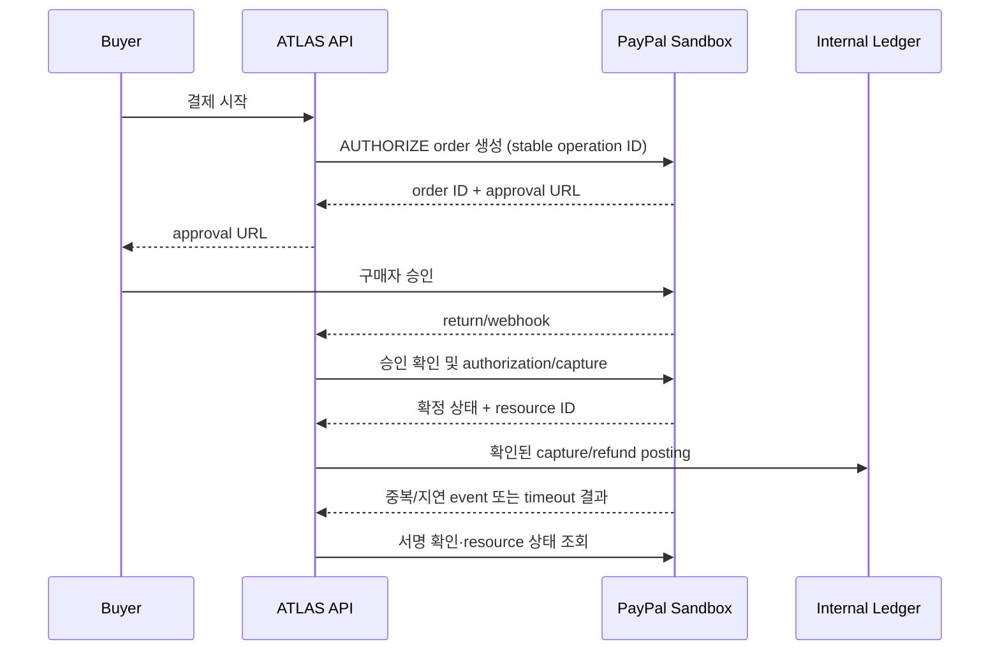

# ADR-0026: PayPal Sandbox 결제와 내부 정산 원장 연동

- 상태: ✓ 확정
- 결정일: 2026-11-09
- 결정 ID: [D-081](../../00-governance/decision-log.md)
- 관련 요구사항: [FR-017/BR-017/INV-014](../../01-requirements/requirements-index.md), [Q-006](../../01-requirements/requirements-index.md#assumptions-and-open-questions)
- 통화 경계: [ADR-0030](ADR-0030-paypal-currency-boundary.md)
- 관련 Issue: [Issue #191](https://github.com/Neo1228/ATLAS/issues/191)
- 선행 결정: [ADR-0011 원장](ADR-0011-gross-capture-settlement-ledger.md), [ADR-0013 환불](ADR-0013-pre-shipment-refund-recording.md), [ADR-0015 초기 payment progression (대체된 결정)](ADR-0015-initial-payment-progression.md).

## 배경

PayPal AI Hackathon 결제 흐름에서 PayPal Orders API Sandbox를 사용. Provider operation, order 상태, inventory와 내부 ledger 간 일관성 확보가 핵심 설계 문제.

## 결정

- PayPal Orders API Sandbox를 결제 provider로 연결. 구매자 승인 후 authorization, capture, void 및 capture refund 지원.
- Order·Settlement 원장은 KRW 유지. PayPal 요청은 [ADR-0030](ADR-0030-paypal-currency-boundary.md)의 PaymentAttempt 고정 FX 스냅샷에 저장된 USD 금액·통화 사용. Client 입력 금액은 결제 근거에서 제외.
- Provider order/authorization/capture/refund ID와 operation 결과를 저장. HTTP provider 호출은 업무 DB transaction 밖에서 수행.
- PayPal `PayPal-Request-Id`는 각 endpoint의 공식 지원이 확인된 경우에만 사용. 지원하지 않거나 응답이 불명확한 operation은 내부 operation ID와 PayPal resource 상태 조회로 복구. 무조건 재시도 금지.
- Webhook은 PayPal 서명 확인 후 event ID 중복을 제거. Provider 결과 확인 뒤 checkout, coupon, inventory 및 원장 변경 적용.
- 모듈 책임:
  - `payment-module`: PayPal API, provider operation 및 PaymentAttempt 상태
  - `order-module`: 구매자 승인/결제 상태와 환불 정책
  - `settlement-module`: 확인된 capture/refund의 내부 원장 기록
  - `application-module`: HTTP 경로, 설정, Flyway migration
- PayPal credentials가 없으면 payment request는 `PROVIDER_UNAVAILABLE`로 실패. 비결제 기능은 계속 사용할 수 있음.
- Settlement ledger에는 PayPal에서 확인된 capture/refund만 기록. Ledger entry는 provider-confirmed event에 대응하는 내부 회계 기록.
- `PAYPAL_CLIENT_ID`, `PAYPAL_CLIENT_SECRET`, `PAYPAL_WEBHOOK_ID`, `BOK_ECOS_API_KEY`는 비밀 저장소나 환경 변수로만 전달. Sandbox URL은 `PAYPAL_BASE_URL`로 구성. GitHub Actions Secret의 로컬 자동 전달 미지원.

## 근거와 대안

- Runtime payment request는 PayPal Sandbox provider로 처리. HTTP stub은 반복 가능한 contract test에만 사용.
- PayPal call을 Order transaction 안에서 실행하면 network delay가 DB lock을 늘리고, provider 성공 후 local rollback 시 provider·DB 상태가 달라질 수 있음. Provider call은 transaction 밖에서 수행하고 결과를 reconciliation.
- Capture/refund 제출 직후 ledger posting 금지. Provider 상태가 `PENDING`/unknown이면 확인 전까지 hold를 유지해 중복 posting 방지.
- Spring `RestClient`와 Spring Security OAuth2 Client를 사용해 PayPal HTTP 요청과 client-credentials token 수명주기를 처리. SDK 자체 구현이나 token cache 수작업은 피함. Provider interface는 결제 경계 한 곳에만 유지.

## 흐름과 복구

- Timeout/연결 끊김은 성공·실패로 단정하지 않고 `UNKNOWN` 상태 보존.
- 재조정은 PayPal resource 상태를 조회한 뒤 같은 내부 operation의 결과를 적용. 새로운 operation key로 무조건 다시 결제하지 않음.
- Webhook signature verification은 PayPal API에 위임. Event 처리와 업무 상태 전이는 idempotent.

## 검증

- HTTP stub contract test는 approval, authorization/capture/void/refund, 중복 request/event, invalid signature, timeout·unknown-result recovery, 중복 ledger posting 방지를 검증.
- Sandbox smoke test는 GitHub Actions Secrets 또는 환경 변수로 credential 전달. `.env.local`은 ignore 대상이며 commit·log 금지.
- Webhook signature verification에는 PayPal developer account에 등록한 Sandbox `PAYPAL_WEBHOOK_ID` 필요.
- Protected API는 JWT와 principal/resource ownership을 검증. `buyerRef`·`checkoutId`는 식별자이며 권한 증거가 아님 ([ADR-0027](ADR-0027-account-jwt-authentication.md)).

> [!NOTE]
> Webhook signature는 provider payload의 진위를 확인하지만, 해당 event가 local payment 또는 ledger entry에 대응하는지는 별도 확인 필요.

| Webhook 조건 | 처리 | 결과 |
|---|---|---|
| Provider resource가 아직 local operation에 연결되지 않음 | Payment state와 event ID를 저장하지 않아 provider retry 후 연결 가능 | `503` |
| 연결된 resource의 amount·currency·status·order·capture ID가 다름 | Order와 ledger를 변경하지 않고 event를 `FAILED`로 기록해 재시도 중단 | `204` |
| 이미 처리된 event ID | Unique event ID와 row lock으로 중복 effect 방지 | 중복으로 판정 |

- Correlation state와 event ID는 같은 transaction에서 기록. `FAILED`는 정상 처리와 구분. Reconciliation은 동기식으로 수행하며 queue/worker/retry layer를 추가하지 않음. 새 external side effect가 생기면 outbox를 재검토.
- `PAYPAL_BASE_URL`은 공식 Sandbox hostname과 loopback test host만 허용. 다른 host는 SSRF와 잘못된 provider 설정 방지를 위해 거절.

## 참고 자료

- [PayPal OAuth 2.0](https://developer.paypal.com/api/rest/authentication/)
- [PayPal authorization status](https://developer.paypal.com/api/orders/v2/definitions/authorization_status)
- [PayPal REST API idempotency](https://developer.paypal.com/api/rest/reference/idempotency/)
- [PayPal webhook signature verification](https://developer.paypal.com/api/rest/webhooks/rest)
- [PayPal Multiparty seller onboarding](https://developer.paypal.com/docs/multiparty/get-started)
- [PayPal Payouts account setup](https://developer.paypal.com/payouts/use-payouts/set-up)
- [Spring Security OAuth2 Client](https://docs.spring.io/spring-security/reference/servlet/oauth2/client/core.html)
