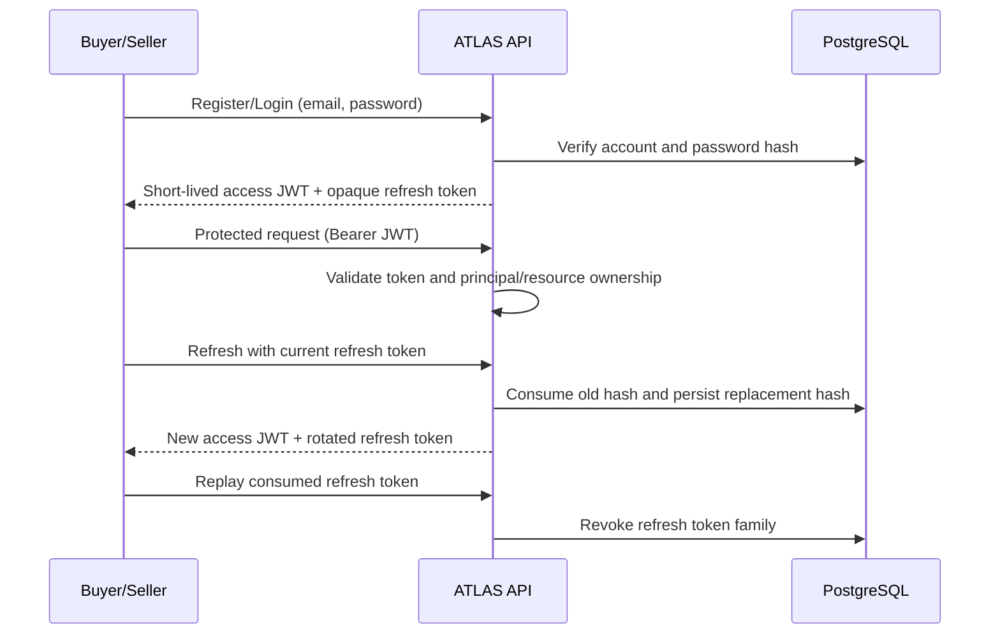

# ADR-0027: Buyer·Seller 계정 인증과 JWT session

- 상태: D-082 확정; D-084 후속 결정·구현 및 PostgreSQL/SMTP 통합 검증 대기
- 결정일: 2026-11-10
- 결정 ID: [D-082](../../00-governance/decision-log.md), [D-084](../../00-governance/decision-log.md)
- 관련 요구사항: [FR-018/BR-018/INV-015/Q-007](../../01-requirements/requirements-index.md)
- 관련 Issue: [Issue #206](https://github.com/Neo1228/ATLAS/issues/206)
- 선행 결정: [ADR-0026 PayPal](ADR-0026-paypal-sandbox-payments.md)

## 배경

ADR-0027 결정 전 baseline:
- API route는 `permitAll`; `buyerRef`와 `sellerId`는 Account·인증 정보와 연결되지 않은 요청 값.
- Seller는 UUID만 보유. Buyer account, password, login, role, ownership relation은 미구현.
- JWT 발급만 추가해도 요청 경로의 타인 ID 미검증 시 IDOR 잔존.

## 결정

- Buyer·Seller를 하나의 Account에 연결하는 first-party identity model. Account는 immutable UUID, normalized unique email, password hash, status를 소유.
- Buyer registration은 account와 Buyer identity를 atomic하게 생성. Account당 Buyer identity 1개. Authenticated account는 Seller onboarding으로 Seller profile을 추가할 수 있으며 account-to-seller relation은 명시적으로 보유; Account당 Seller profile은 여러 개 허용.
- Existing synthetic `buyerRef`·Seller rows의 account 자동 연결 미지원. 신규 Buyer/Seller onboarding만 인증 접근 가능. 기존 Cart/Order/Seller data는 owner claim 경로가 없어 인증 사용자에게 공개하지 않으며, local data cleanup은 별도 수동 작업.
- Login uses email/password. Password hashing uses Spring Security `DelegatingPasswordEncoder` with PBKDF2 v5.8 defaults and supports the 128-character input contract.
- The stored algorithm ID supports a future encoder migration. Unknown email uses a process-generated dummy hash to reduce account-enumeration timing differences.
- Custom cryptography is prohibited. Passwords and tokens must not appear in responses, logs, or errors; login failure uses a generic error.
- Spring Security OAuth2 Resource Server/Nimbus JWT support 사용. Access token은 서명 검증, 고정 algorithm allow-list, `iss`, `aud`, `sub`, `iat`, `exp` 검증. Initial access lifetime 10분; amount는 운영 SLA가 아닌 보수적인 초기 개발 선택. Private signing key는 환경별 ignored local secret file/env로 주입, Git·docs·Actions 일반 log에 기록 금지.
- Refresh token은 고엔트로피 opaque random value. DB에는 token hash·family/session ID·account ID·expiry·consumed/revoked state만 저장. Refresh token은 7일, family absolute expiry는 30일. Refresh 성공 시 매번 rotate. 이전 token 재사용 시 family revoke. Logout은 현재 family revoke.
- 모든 protected controller operation에서 authenticated account와 Buyer/Seller resource owner 일치 검증. Client가 보낸 `buyerRef`·`sellerId`는 principal 증거에서 제외.
- Ownership interceptor의 Seller·Campaign 관리 route 분류 기준은 Spring MVC가 매칭한 route pattern(`HandlerMapping.BEST_MATCHING_PATTERN_ATTRIBUTE`). 원시 request URI 문자열 비교는 servlet context path와 percent-encoded literal segment(예: `/api/%73ellers/...`)로 우회 가능하므로 제외.
- Default deny. 공개 route는 login/register/refresh 및 명시적으로 검토된 catalog browse만. PayPal return/cancel callback과 서명 검증 webhook은 필요한 경로만 anonymous로 허용; provider callback은 내부 persisted state와 signature/provider token 검증을 계속 요구.
- Checkout PayPal cancel URL에 PaymentAttempt의 create-order 요청 ID를 `state` query로 포함. Anonymous cancel callback은 `state`가 저장값과 일치할 때만 checkout 취소 실행. 누락·불일치는 400 `INVALID_REQUEST`이며 checkout·order·reservation·payment 상태 변경 0건. `state`는 attempt ID 기반 결정적 값이므로 checkoutId와 attemptId를 함께 아는 주체의 재계산 가능; 무작위 nonce·HMAC 전환은 후속 범위.
- 배포 전 생성된 checkout attempt의 cancel URL에는 `state` 부재. 해당 PayPal 취소 redirect는 400이며, reservation은 인증된 `POST /api/checkouts/{checkoutId}/cancel`·reconcile, 승인 완료, 서명 검증 webhook 등 확정 결과 반영 시점까지 유지.
- API는 refresh token을 refresh/logout request body와 token response body로 전달; URL·query·log 금지. Client는 secure storage 사용. Browser storage integration은 미구현; browser cookie 도입 시 HttpOnly/Secure/SameSite와 CSRF 방어를 별도 구현.
- Core authentication/authorization behavior는 stateless access JWT + stateful refresh session. 별도 IdP/social login/MFA는 범위 외.

## 근거와 대안

- `permitAll` 유지: 다른 사용자 데이터에 대한 임의 ID 접근이 가능해 제외.
- Access JWT만: logout·강제 revoke가 `exp`까지 지연되어 계정 정지·token 탈취 대응에 부적합.
- Long-lived JWT / refresh token rotation 없음: 탈취된 bearer credential replay window가 길어 제외.
- Cookie session만: 단일 monolith에서는 간결하고 즉시 revoke 가능. 현재 요구는 JWT를 명시하므로 access API에는 JWT를 사용하되 refresh session을 DB에 두어 revoke와 replay detection을 확보. JWT의 완전 무상태성은 비선택.
- Home-grown JWT, password hashing, Spring Security filter: 검증이 불완전해지기 쉬워 제외. Spring Security Resource Server, Nimbus, `PasswordEncoder`, JDK `SecureRandom` 사용.
- BCrypt 기본 72-byte input 한계가 128자 입력 계약과 충돌. 추가 runtime dependency 없이 Spring Security PBKDF2 encoder를 사용해 입력 잘림·요청 실패 방지. Cost 증가는 실제 local workload 측정 후 검토.
- Buyer persona는 account당 1개, Seller profile은 account당 여러 개 허용. Multi-buyer personas, staff roles, permissions matrix는 후속 범위.

## 흐름

## 검증

- Registration/login: duplicate normalized email, invalid password, generic unknown-account response, disabled account.
- JWT: wrong signature/algorithm/issuer/audience, expired token, missing claims, key rotation configuration.
- Refresh: single-use rotation, concurrent refresh race, replay-family revoke, expired/revoked session, logout.
- Ownership: Buyer A→Buyer B cart/order/checkout/return/shipment denial; Seller A→Seller B product/inventory/coupon/order/settlement denial.
- Security boundary: anonymous protected endpoint denied; explicitly public catalog/login/callback/webhook routes still obey route-specific validation; authenticated role cannot bypass ownership.
- Testcontainers PostgreSQL for account/session uniqueness, transaction rollback, rotation race, and migration. ArchUnit verifies application/security dependency boundaries.
- 미구현 정책: 이메일 인증, 비밀번호 재설정, MFA. 도입 시 요구사항과 위협 모델 별도 검토.
- Account workflow: [AccountService](../../../ATLAS-account/src/main/java/com/atlas/account/service/AccountService.java) · [AccountController](../../../ATLAS-application/src/main/java/com/atlas/application/controller/account/AccountController.java)
- Ownership/schema: [AccountOwnershipInterceptor](../../../ATLAS-application/src/main/java/com/atlas/application/security/AccountOwnershipInterceptor.java) · [V25 account migration](../../../ATLAS-application/src/main/resources/db/migration/V25__account_identity.sql)
- Unit tests: [AccountServiceTest](../../../ATLAS-account/src/test/java/com/atlas/account/service/AccountServiceTest.java) · [AccountSecurityConfigurationTest](../../../ATLAS-account/src/test/java/com/atlas/account/security/AccountSecurityConfigurationTest.java)
- Security tests: [AccountJwtConfigurationTest](../../../ATLAS-application/src/test/java/com/atlas/application/AccountJwtConfigurationTest.java) · [AccountOwnershipInterceptorTest](../../../ATLAS-application/src/test/java/com/atlas/application/security/AccountOwnershipInterceptorTest.java)

## 참고 자료

- [Spring Security OAuth2 Resource Server JWT](https://docs.spring.io/spring-security/reference/servlet/oauth2/resource-server/jwt.html)
- [OWASP JSON Web Token Cheat Sheet](https://cheatsheetseries.owasp.org/cheatsheets/JSON_Web_Token_Cheat_Sheet.html)
- [Auth0 Token Best Practices](https://auth0.com/docs/secure/tokens/token-best-practices)
- [OpenReplay — Choosing an Authentication Strategy for a New Web App](https://blog.openreplay.com/authentication-strategy-web-app)

## D-084 — Email verification·password recovery·선택형 TOTP MFA

- 신규 account는 24시간 유효 email-verification token 소비 전까지 login 불가. Verification·password-reset token 원문은 DB에 저장하지 않으며 SHA-256 hash와 단회 소비 시각만 기록.
- SMTP 전송은 transaction commit 뒤 수행. Delivery 실패는 인증 비밀을 노출하지 않고 일반 응답 유지; 사용자는 verification/reset 요청 재시도 가능.
- Password reset token 유효 기간은 30분. 성공한 reset은 password hash 갱신, 전체 refresh family revoke, 미소비 MFA login challenge revoke를 같은 transaction에서 수행.
- Login은 초기 password 검증 뒤 `user_account`의 현재 hash를 `FOR UPDATE`로 다시 조회·검증한 뒤 access/refresh token 또는 MFA challenge 발급. Concurrent password reset과 로그인 발급을 account row lock으로 직렬화해 stale password에서 새 credential 발급 방지.
- Buyer·Seller 모든 account에서 TOTP MFA 선택 가능. Enrollment secret은 DB에 AES-GCM ciphertext로 저장하며 32-byte Base64 encryption key는 `ATLAS_ACCOUNT_MFA_ENCRYPTION_KEY` 환경 설정으로 제공.
- MFA login challenge 유효 기간은 5분. TOTP time step은 account별 단회 소비; drift 허용은 ±1 step. 복구 코드는 10개 발급, hash 저장, 단회 소비.
- SMTP host·credential과 MFA encryption key는 local environment/deployment secret 관리 대상. Repository, documentation sample, CI log에는 비밀값 미포함.
- Password encoder, access JWT, refresh token rotation/family expiry, resource ownership, PayPal recovery, FX snapshot, KRW ledger, payment idempotency 계약 유지.
- Signup·verification request·password-reset request는 account 존재 여부와 무관하게 동일한 HTTP status/body 반환. SMTP action delivery에 따른 response timing 평준화는 제공하지 않으므로 constant-time 비노출 주장 금지.
- Unit tests는 token replay·expiry·refresh-family/MFA challenge revoke·stale-password login·MFA challenge·recovery-code 소비를 검증. PostgreSQL migration과 실제 transaction 경합 검증은 Testcontainers 통합 테스트 대상.
