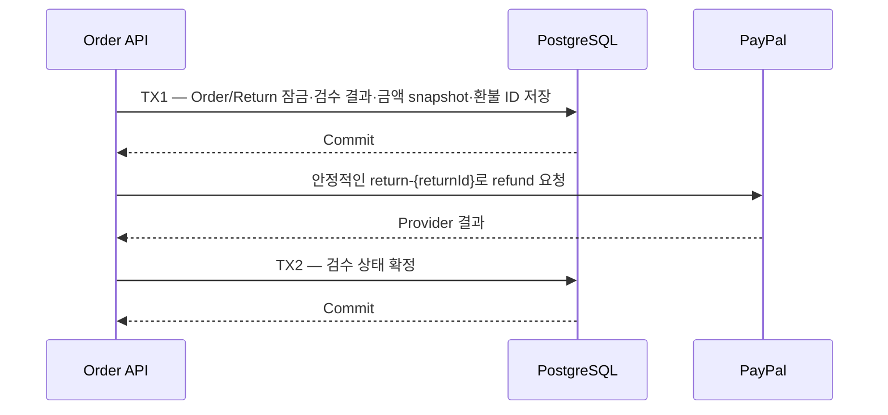
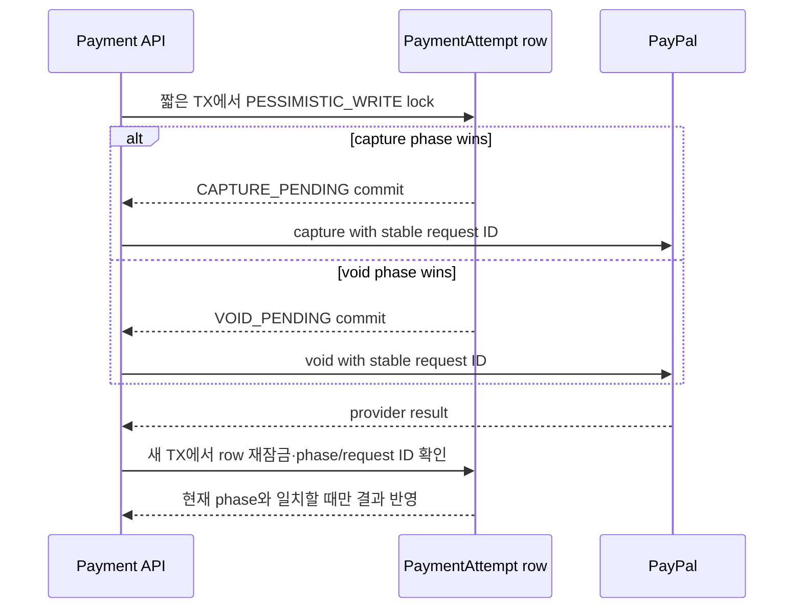

# ADR-0029: 주문 결제·재고 복구 계약

- 상태: Accepted
- 날짜: 2026-11-10

## 배경

주문, payment provider, inventory, refund, settlement는 서로 다른 상태를 소유한다. 특히 외부 provider timeout은 결제 미실행을 뜻하지 않으며, 여러 모듈의 상태를 하나의 `success/failure` 값으로 축약하면 중복 청구 또는 재고 조기 해제 위험이 있다. 이 문서는 기존 구현과 선행 ADR의 계약을 한곳에서 연결해 설명한다. 현재 구현을 넘어서는 분산 workflow 인프라를 새로 결정하지 않는다.

## 현재 계약

| 대상 | 상태/권한 계약 | 근거 |
|---|---|---|
| 결제 요청 중복 | 동일 order/checkout payment attempt는 로컬 owner별 1건이다. PayPal create/authorize/capture/void/refund 각 provider operation은 별도 고정 request ID를 재사용해 동일 작업을 replay한다. 새 업무 작업은 새 operation/key를 사용한다. | `PaymentAttemptRepository`, `PaymentServiceImpl`; ADR-0026 |
| 결제 결과 불명 | `PENDING`/`UNKNOWN`은 완료나 거절이 아니다. 같은 attempt와 provider request ID로 대조/재요청해야 하며, 결과 확인 전 두 번째 결제 attempt를 만들지 않는다. | `PaymentState`, `PaymentServiceImpl`, `OrderServiceImpl`; BR-003/INV-004 |
| 재고 hold | checkout 시 예약 후 capture 확정 시 claim한다. capture 결과가 불명확하면 reservation은 유지한다. 재고는 definitive non-payment/required void confirmation 뒤에만 반환한다. | `InventoryServiceImpl`, `CheckoutPaymentServiceImpl`, BR-002/BR-003/INV-004 |
| 금액과 통화 | order item snapshot과 checkout total이 청구 근거다. Provider 경계의 현재 통화는 KRW, amount는 won의 정수 단위다. Capture settlement는 provider capture 확인 뒤 gross order snapshot 금액으로 기록한다. Refund는 원 주문 item의 snapshot 할인 배분/환불 가능 수량을 사용한다. | `PurchaseOrder`, `OrderItem`, `PaymentAttempt.totalWon`, `PaymentServiceImpl`, ADR-0011/ADR-0013/ADR-0024 |
| 환불 소유권 | Order는 환불 eligibility, item quantity, return inspection 및 고객 노출 상태를 결정한다. Payment은 provider refund operation, provider request/refund ID, pending/unknown/completed/failed 상태를 소유한다. Provider timeout은 환불 완료가 아니다. | `OrderRefundServiceImpl`, `PaymentRefundOperation`, `CheckoutPaymentServiceImpl`, ADR-0013/ADR-0026 |
| Settlement | Settlement ledger는 capture/refund posting의 회계 기록이며 order/payment operational status의 대체물이 아니다. 동일 posting replay는 facts가 같을 때만 idempotent하다. | `SettlementServiceImpl`, ADR-0011, D-066/D-068 |
| Checkout expiry | Unsubmitted `RESERVED` checkout만 expiry sweep 대상이다. 이미 provider 작업이 submitted/pending/unknown이면 단순 TTL만으로 inventory를 해제하지 않는다. Fulfillment/shipment state는 payment/order state를 대체하지 않는다. | `OrderServiceImpl`, `CheckoutPaymentServiceImpl`, ADR-0010/ADR-0016; INV-004 |
| Webhook | Signature verification은 sender authenticity만 보장한다. 이벤트는 local provider operation ID와 stored financial facts에 대조한다. 일시적 resource 미매칭은 retryable이며, local operation과 연결된 영구 facts mismatch는 FAILED로 기록하고 acknowledgement한다. Duplicate event ID는 한 번만 처리한다. | `PayPalWebhookService`, `PaymentServiceImpl`, `PaymentWebhookEventRepository`; ADR-0026 |

## 결정

- 각 모듈은 위 표의 자기 상태를 소유한다. 한 모듈의 성공 응답만으로 다른 모듈의 상태가 완료됐다고 해석하지 않는다.
- Request/correlation ID는 진단용이며 idempotency key가 아니다. Idempotency key는 업무 작업의 재전송 식별자이고 provider request ID와 같은 범위의 키가 아니다.
- Caller와 operator에는 pending/unknown을 terminal failure/success로 표시하지 않는다. Reconciliation 결과를 반영한 뒤에만 definitive state를 반환한다.
- Order/payment owner lock은 같은 owner의 상충 작업을 프로세스 안에서 직렬화합니다.
  기존 256개 hash stripe는 다른 owner까지 같은 monitor로 묶어 provider 응답을 기다리게 했습니다.
  이제 holder/waiter 참조 수를 추적하는 UUID별 registry를 쓰고 마지막 사용 뒤 항목을 회수합니다.
  같은 owner의 직렬화는 유지합니다.
- 이 registry는 JVM 내부 owner lock으로, 같은 프로세스의 중복 owner 작업만 직렬화합니다. 여러 instance 간 조정은 하지 않습니다.
- Cross-instance capture/void arbitration은 아래의 PaymentAttempt row lock과 DB 상태 전이를 사용합니다. Provider request ID는 같은 operation의 재전송 식별자이며 서로 다른 phase의 우선순위를 정하지 않습니다.
- 새 `saga`, `outbox`, queue, 분산 lock은 도입하지 않습니다.
  현재 DB transaction, row lock, unique constraint, durable operation row, provider retry ID를 사용합니다.
  추가 운영 인프라는 장애·지연 근거가 생길 때 별도 결정합니다.
### 반품 검수와 PayPal 환불

- TX1은 order/return row를 잠그고 검수 결과와 durable refund request를 함께 저장. Provider 응답 전까지 반품 상태는 `RECEIVED`.
- PayPal 호출은 TX1 commit 후 실행. Provider 지연 중 DB lock과 connection을 점유하지 않으며, 후속 DB 실패에도 refund ID 보존.
- 준비 메서드는 `MANDATORY`; 검수 transaction 밖의 호출을 거부해 검수 사실과 refund request의 분리 commit 방지.
- `V15__order_returns.sql`의 `order_return_item_refund` CHECK는 `refund_id`와 `refund_amount_won`을 모두 비우거나 양수 금액과 ID를 함께 저장하도록 강제.
- 첫 flush는 검수 결과만 저장. 준비된 refund ID를 받은 뒤 금액과 ID를 같은 transaction에서 기록.
- `RECEIVED` 상태의 동일 검수 재시도는 저장된 검수 결과와 refund request 재사용. `PENDING`/`UNKNOWN`은 완료로 처리하거나 새 ID로 재호출하지 않고 기존 결제 대사·webhook 경로에서 처리.
- Provider 호출 전 준비된 refund는 같은 검수 요청을 다시 보내 복구. 근거 없이 자동 worker/outbox를 추가하지 않음.
- `REFUND_RECORDED`/`PARTIALLY_RECORDED`는 로컬 refund request와 검수 결과 기록이며 provider 자금 이동 완료를 뜻하지 않음. 별도 `paymentStatus`는 durable refund record의 최신 상태를 반환: 환불 전 `NOT_APPLICABLE`, 이후 `PENDING`/`UNKNOWN`/`COMPLETED`/`FAILED`. Return 상태와 payment 실행 결과를 혼동하지 않음.

## 근거와 대안

### 절충과 후속 도입 기준

동기 DB 처리와 provider retry는 운영 인프라가 단순하고 현재 단일 서비스 배포 모델에 맞는다. 그 대가로 request latency가 provider/API/DB 처리 시간에 좌우되고, webhook 처리 실패는 provider retry에 의존한다. 이는 별도의 dispatcher와 queue 운영 부담보다 현재 증거상 낮은 비용으로 선택됐다.

Outbox/worker 또는 durable saga는 다음 증거가 생길 때 별도 ADR로 재평가한다: webhook/provider retry만으로 unresolved operation age/SLO를 만족하지 못함, reconciliation 작업이 지속 누락됨, burst/latency 측정에서 동기 처리 한계가 확인됨, 여러 독립 배포/DB 경계가 생겨 현재 transaction이 원자성을 보장하지 못함. 그때 지표·장애모드·복구 운영과 migration plan을 함께 제출한다.

## 검증

- CI PostgreSQL integration tests cover DB transaction/idempotency and capture-vs-void phase arbitration across service instances.
- PayPal contract tests use an HTTP stub. They do not verify provider sandbox delivery, simultaneous requests with the same request ID, or endpoint-specific retention periods.
- This ADR separates the database contract verified by tests from provider behavior that remains unverified; do not claim the latter as established.

## 다중 인스턴스 결제 단계 중재

- Capture/void는 `AUTHORIZED` row에서 짧은 transaction과 `PESSIMISTIC_WRITE` lock으로 먼저 선택된 phase를 기록. 반대 phase 요청은 기존 pending 상태를 따르고 상충 PSP 요청을 보내지 않음.
- PSP 호출은 commit 후 실행해 외부 HTTP 동안 DB lock/connection을 점유하지 않음. 결과 반영은 새 transaction에서 row를 reload하고 phase와 stable request ID를 확인. 더 앞선 terminal/advanced state는 늦은 응답으로 덮어쓰지 않음.
- Authorization에는 create-order와 approval-authorize에 서로 다른 request ID가 있으므로 두 operation을 구분.
- Durable retry identity는 기존 pending state, phase, deterministic request ID의 조합. 재시작 후 같은 phase는 같은 ID 사용. 같은 ID의 동시 요청은 provider에서 거부될 수 있으므로 결과를 ambiguity로 처리하고 finalizer는 확인된 선행 성공 상태를 보존.
- PayPal [idempotency 안내](https://developer.paypal.com/reference/guidelines/idempotency)는 중복 제거가 provider의 ID 보유 기간에 한정되며 endpoint별 보존 기간을 해당 API 문서에서 확인해야 한다고 설명. Create/authorize/capture/void의 정확한 보존 기간은 아직 확인되지 않음.
- `PayPalRestClient`는 order/refund 조회는 제공하지만 authorization/capture 상태 조회는 제공하지 않음. Create-order 응답 유실 전에 `providerOrderId`가 저장되지 않았다면 resource ID 조회 불가. 오래된 capture/void `UNKNOWN`도 authorization 상태 확인 필요. 무기한 자동 retry는 안전하다고 주장하지 않음.
- JVM 내부 owner lock은 최적화일 뿐. 구버전은 DB phase arbitration을 지원하지 않으므로 첫 전환 때 기존 결제 인스턴스와 진행 중 owner 작업을 drain. 모든 활성 인스턴스가 새 상태 전이를 지원한 뒤 다중 인스턴스 traffic 허용.
