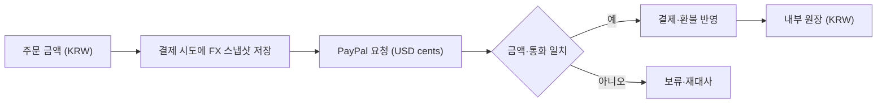

# ADR-0030: PayPal 통화 경계

- 상태: 채택
- 날짜: 2026-11-13

## Context

- 주문·결제·환불·정산 원장은 KRW를 유지한다. PayPal은 USD를 지원하지만 KRW는 지원하지 않는다.
- 외부 결제 통화 변환은 재시도와 환불에서도 동일한 환율 근거를 재현해야 한다.
- 구현 추적: [Issue #254](https://github.com/Neo1228/ATLAS/issues/254).

## Decision

- PayPal 경계에서만 한국은행 ECOS 일별 기준환율(731Y001, 항목 0000001)의 KRW-per-USD 값을 사용한다.
- 결제 시도(PaymentAttempt)에 환율, 출처, 기준일, USD 금액과 통화를 저장한 뒤 PayPal 주문을 생성한다. 재시도와 환불은 저장된 동일 스냅샷을 사용한다.
- 계산식은 `KRW / KRW-per-USD`이며 USD는 소수 둘째 자리까지 HALF_UP 반올림한다.
- 환율 누락·유효하지 않음·기준일로부터 7일 초과 시 거부하고, USD 0.01 미만 금액도 거부한다. 1:1 또는 고정/모의 환율 대체는 허용하지 않는다.
- 환불은 동일한 환율 스냅샷으로 계산하고, 센트 반올림으로 초과 환불되지 않도록 잔여 캡처 USD 센트 이하로 제한한다.
- PayPal return/cancel URL은 `ATLAS_PUBLIC_BASE_URL` 기준. Compose host port와 callback URL의 일치 필수.
- Capture 결과가 `UNKNOWN`이면 PayPal order 재조회. Capture ID·금액·통화가 저장된 스냅샷과 일치할 때만 `CAPTURED` 반영.
- 승인 상태 확인 후에만 기존 PayPal request ID로 capture 재시도. 불명확한 결과는 `UNKNOWN` 유지.
- `BOK_ECOS_API_KEY`는 환경 변수로만 제공한다. 공개 샘플 키는 개발용 임시 테스트 키이며 프로덕션 자격 증명이 아니다.
- BOK 기준환율은 가격 산정 참고값이지 PayPal FXaaS 또는 실현환율 회계가 아니다. 환차손익 원장은 없다.

## 흐름

## Consequences

- 내부 원장 금액은 계속 KRW이며 PayPal 요청에 한해 USD 금액을 사용한다.
- 결제 시점에 환율 스냅샷을 고정하므로 이후 환율 변동이 기존 재시도·환불 금액을 바꾸지 않는다.

## 참고 자료

- [PayPal 지원 통화](https://developer.paypal.com/reference/currency-codes/)
- [한국은행 ECOS API](https://ecos.bok.or.kr/api)
