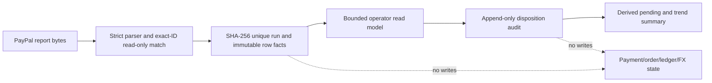

# ADR-0033: PayPal 대사 report 이력과 감사 전용 예외 처리

- 상태: 채택
- 결정일: 2026-11-16
- 관련 이슈: [#283](https://github.com/Neo1228/ATLAS/issues/283)
- 관련 결정: D-085, D-086, D-087, Q-006

## 맥락

PayPal Balance Reconciliation report는 D-085의 report-only 계약에 따라 읽고 대사한다. 기존 계산은 업로드 요청 동안만 결과를 반환해 과거 run과 예외 disposition을 추적할 수 없었다. 반면 report 자체만으로 bank receipt evidence를 확정할 수 없으며, D-087의 exact provider ID 및 amount/currency 검증 경계도 유지해야 한다.

운영자는 반복 업로드의 중복을 식별하고, 이전 결과를 재현하며, 예외 검토 의견을 감사 가능한 형태로 기록할 필요가 있다. 이 목적은 내부 재무 상태를 자동 정정하거나 bank settlement 정책(Q-006)을 결정하는 것과 분리한다.

## 결정

1. **Fingerprint 단위 run 멱등성**: 업로드 bytes의 SHA-256을 고유 식별자로 사용한다. 같은 fingerprint는 기존 run과 저장된 결과를 반환하며 새로운 run을 만들지 않는다. 기존 결과는 현재의 provider 상태로 재계산하지 않는다.
2. **안전한 사실만 영속화**: run timestamp/format/집계와 파서가 허용한 행별 ID, 분류, 통화, gross/fee/net, transfer ID 및 대사 상태·사유 코드를 저장한다. 원본 CSV, 파일명, 헤더, 인증 정보, 고객 PII, 원시 오류를 저장하지 않는다. run과 행 결과는 삽입 후 수정·삭제·truncate할 수 없다.
3. **감사 전용 disposition**: `CONFIRMED_EXTERNAL`, `DEFERRED`, `NEEDS_REVIEW`는 승인된 operator의 판단 이력이다. `Idempotency-Key`와 요청 payload가 일치하는 재시도만 기존 결과를 반환하며 키 재사용으로 payload가 달라지면 충돌을 반환한다. disposition 이력도 append-only이다.
4. **격리된 operator 조회**: D-086의 기본 비활성 HTTP Basic 경계와 `SETTLEMENT_REPORT_OPERATOR` 전용 역할을 재사용한다. 조회는 제한된 페이지 및 허용 목록 DTO를 사용하고, report/run/row/disposition API는 원본 파일이나 provider/payment 상세를 노출하지 않는다.
5. **재무 상태 불변**: upload, deduplication, read, disposition 경로는 settlement journal, payment/refund/order/inventory/FX 상태를 쓰지 않는다. `CONFIRMED_EXTERNAL`은 외부 증빙에 관한 operator 표기일 뿐 내부 결제·원장 posting 또는 bank receipt의 증명이 아니다.
6. **대사 판정 경계 유지**: D-085/D-087의 exact provider-ID mapping 및 amount/currency 검증만 `MATCHED`를 뒷받침한다. Top-level ID, fuzzy, amount-only match는 허용하지 않는다. Q-006의 bank reconciliation·ledger 정정 정책은 이 ADR에서 결정하지 않는다.

## 결과

- SHA-256 unique 제약과 DB transaction으로 동일 report run의 경합 생성도 하나로 제한한다.
- 미완료 disposition 수는 아직 disposition 이력이 없는 예외 행을 센다. `DEFERRED`와 `NEEDS_REVIEW`는 별도 미해결 disposition으로 이력을 보존하며, 추후 새 키의 disposition 이벤트로 상태를 변경한다.
- 원본 report를 보존하지 않으므로 이후 parser 변경으로 과거 행을 다시 해석할 수 없다. 이는 raw financial report를 장기 저장하지 않는 최소 보존 선택이다.
- 향후 bank statement 자동 매칭, FX snapshot, journal posting/정정은 Q-006에 대한 별도 결정·승인 없이 추가하지 않는다.

## 데이터 흐름

## 검증

V34 PostgreSQL integration tests validate run/count constraints, row/disposition foreign keys, immutable triggers and truncation protection. Workflow tests cover duplicate fingerprint replay, concurrent uploads, disposition idempotency/conflict, bounded exception search, redaction and operator authentication. Financial-state write paths are excluded by design; Q-006 remains an explicit policy boundary.
