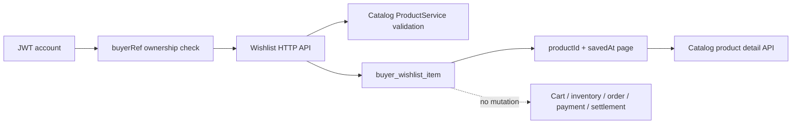

# ADR-0034: 구매자 product wishlist

- 상태: 채택
- 날짜: 2026-11-16
- 관련 이슈: [#285](https://github.com/Neo1228/ATLAS/issues/285)
- 관련 결정: D-086, D-092

## 맥락

ATLAS는 장바구니와 구매 흐름을 제공하지만 관심 상품을 checkout 대상과 분리해 저장할 기능이 없다. 장바구니는 수량·seller별 주문·checkout과 재고 예약에 연결되므로 관심 목록으로 재사용하면 의미와 생명주기가 섞인다.

## 결정

1. **구매자 소유 wishlist**: `/api/buyers/{buyerRef}/wishlist`를 사용하고 `AccountOwnershipInterceptor`가 JWT account와 buyerRef 소유권을 확인한다. 다른 계정의 buyerRef 접근은 거부한다.
2. **상품 식별자 저장**: 상품의 현재 상세·가격 snapshot을 복사하지 않고 `productId`와 `savedAt`만 보존한다. 기존 catalog `ProductService.findProduct`로 상품 존재·공개 조회 가능성을 확인하고 상세 정보는 기존 catalog product API에서 읽는다.
3. **멱등성·제약**: `(buyer_ref, product_id)` 복합 primary key로 중복을 막는다. 추가는 `ON CONFLICT DO NOTHING`, 삭제는 행 부재 시에도 성공하는 멱등 동작이다. product FK는 삭제된 상품의 찌꺼기 참조를 cascade로 정리한다.
4. **제한된 조회**: 기본 limit 20, 최대 100, offset 최대 10,000. 정렬은 `saved_at DESC, product_id DESC`로 동률에도 안정적이다. 페이지 응답은 `productId`, `savedAt`, `hasMore`만 반환하며 상품·가격 정보는 기존 catalog API로 조회한다.
5. **장바구니와 분리**: wishlist 변경은 cart, admission, inventory reservation, order, payment, settlement에 쓰지 않는다. 저장이 재고 예약이나 구매 약속을 뜻하지 않는다.

## 결과

- 구매자는 나중에 살 후보를 로그인 기기 간 보존하고 catalog 상세는 최신 값을 볼 수 있다.
- `buyerRef`는 기존 계정 식별 계약을 따른다. wishlist 테이블에서 계정 도메인 내부 buyer FK를 직접 참조하지 않고, HTTP 소유권은 interceptor에서 강제한다.
- 가격·상품명 snapshot을 보존하지 않아 저장 당시 상태를 재현하지 않는다. 과거 가격 추적이나 가격 하락 알림은 이 결정에 포함하지 않는다.
- 결과 테이블은 V35 migration에서 생성되며 복합 key, product FK, buyerRef 비공백 제약과 페이지 인덱스를 사용한다.

## 데이터 흐름

## 검증 기준

- 같은 buyer/product 저장을 반복해도 한 행만 남고 최초 `savedAt`은 보존된다.
- 잘못된 product FK와 공백 buyerRef는 PostgreSQL 제약으로 거부된다.
- 저장/삭제/조회는 본인 buyerRef에 한정하고, page size·offset은 제한된다.
- page order는 저장 시각 내림차순, productId 내림차순으로 안정적이며 `hasMore`가 정확하다.
- migration 및 Testcontainers PostgreSQL 통합 검증이 통과한다.
