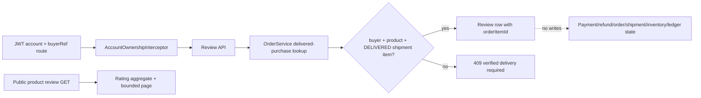

# ADR-0035: 배송 완료 구매자 상품 리뷰

- 상태: 채택
- 날짜: 2026-11-16
- 관련 이슈: [#287](https://github.com/Neo1228/ATLAS/issues/287)
- 관련 결정: D-086, D-092, D-093

## 맥락

ATLAS에는 상품 catalog, 주문, 배송 흐름이 있으나 구매 경험을 반영할 review/rating 기능이 없다. 구매 사실을 검증하지 않는 공개 review는 상품 평점 신뢰를 손상시킬 수 있다. 결제 완료만으로는 실제 상품 수령을 증명하지 못하므로 기존 배송 상태가 구매 자격의 기준이어야 한다.

## 결정

1. **서버가 자격을 확인**: 인증된 JWT account가 buyerRef를 소유해야 한다. 요청은 productId/rating/body만 제공하고 buyer identity, order ownership, delivery status를 지정할 수 없다.
2. **배송된 상품만 review 허용**: Order 모듈 public service가 `purchase_order.buyer_ref`, `order_item.product_id`, `order_shipment_item` 및 `order_shipment.status = DELIVERED`를 조회해 실제 delivered OrderItem ID를 반환한다. 미배송·다른 buyer·다른 product는 review 생성이 거부된다.
3. **구매 근거를 연결**: review row는 productId와 verified `order_item_id`를 보존한다. `(buyer_ref, product_id)` unique 제약으로 buyer/product당 하나, `order_item_id` unique/FK로 같은 구매 line의 재사용을 막는다.
4. **한 번 작성하는 검증 리뷰**: rating은 1–5 정수, body는 trim 후 1–2,000자다. POST 후 수정·삭제·seller reply·사진·투표·moderation 기능은 별도 결정까지 제공하지 않는다. duplicate는 HTTP 409다.
5. **읽기 전용 public catalog API**: GET product reviews는 공개 상품 detail 경계를 따르고 평균 rating·review count·createdAt/reviewId 내림차순의 제한된 페이지를 반환한다. buyerRef/orderId/orderItemId는 공개 응답에서 제외한다.
6. **금전 상태 불변**: review create/read는 payment, refund, order state, shipment, inventory, settlement journal을 바꾸지 않는다. create는 기존 Order 모듈에서 delivered-purchase 사실만 읽는다.

## 결과

- 구매 전 고객은 실제 배송을 받은 구매자의 평점·텍스트를 참고한다.
- 한 구매자가 같은 상품을 여러 번 구매해도 review는 하나만 보존한다. 별도 수정 API가 없으므로 rating/text 변경 요청은 새로운 issue/decision이 필요하다.
- buyerRef는 공개 응답에 노출되지 않지만 review body는 작성자가 입력한 plain text다. UI는 HTML로 렌더링할 때 escape해야 하며 abuse moderation은 본 결정의 범위 밖이다.
- Order public contract에 delivered product purchase lookup을 추가하고 application adapter가 review write eligibility를 조정한다. JPA entity/repository는 모듈 밖으로 노출하지 않는다.

## 데이터 흐름

## 검증 기준

- Order integration test proves a paid order has no eligible item before shipment and gains exactly the matching item after delivery; wrong buyer and product return no evidence.
- PostgreSQL tests prove review requires verified order item, rejects missing/duplicate/invalid review data, and returns correct aggregate/page results.
- Ownership tests cover buyerRef not owned by the authenticated account; public product GET remains read-only.
- Full application/order migration, module boundary, checkstyle and Markdown validation pass.
