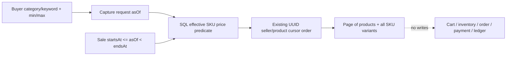

# ADR-0036: Catalog 상품 목록의 SKU 유효 가격 범위 필터

- 상태: 채택
- 날짜: 2026-11-17
- 관련 이슈: [#289](https://github.com/Neo1228/ATLAS/issues/289)
- 관련 결정: D-078, D-092, D-094

## 맥락

Buyer catalog browse는 category·keyword·bounded cursor를 제공하지만 가격 범위가 없다. ProductListingResponse는 한 상품의 여러 Seller SKU variant를 반환하고 SKU는 regular price와 기간 한정 sale price를 가질 수 있다. ProductService의 effectivePriceAt 규칙과 다른 가격 계산을 filter에서 사용하면 search result와 표시 가격이 다를 수 있다. 또 결과를 페이지 조회 후 메모리에서 거르면 page에 누락·빈 결과가 생긴다.

## 결정

1. **범위 계약**: public GET /api/products에 optional minPriceWon/maxPriceWon을 추가한다. 음수 값과 minPriceWon > maxPriceWon은 INVALID_REQUEST로 거부한다.
2. **SKU 유효 가격**: 요청 단위 asOf Instant를 한 번 캡처해 SQL filter와 반환 SellerSkuResponse에 공유한다. sale_price_won이 존재하고 sale_starts_at <= asOf < sale_ends_at이면 sale price, 그 외에는 regular price다. 시작 시각은 포함하고 종료 시각은 제외한다.
3. **상품 포함 규칙**: 한 상품의 SKU 중 적어도 하나의 effective price가 inclusive bounds 내에 있으면 상품을 포함한다. 응답 variants는 기존처럼 상품의 전체 SKU를 반환한다. campaign admission price나 inventory availability를 catalog filter에 암묵적으로 섞지 않는다.
4. **Database-side filtering**: effective SKU price CTE/EXISTS predicate를 UUID seller/product cursor predicate보다 먼저 적용해 DB LIMIT 이전에 범위를 제한한다. 기존 seller/product natural ordering은 바꾸지 않는다.
5. **Cursor scope binding**: v5 cursor는 seller/category/keyword와 min/max bounds를 보존한다. 다른 bounds로 cursor를 재사용하면 INVALID_REQUEST다. v1–v4 cursor는 가격 filter가 없는 요청에 대해 계속 읽을 수 있고 다음 응답부터 v5를 발급한다.
6. **Seller management 경로**: seller product 관리 API에는 price filter를 추가하지 않는다. 필터는 public buyer browse 범위에만 적용한다.

## 결과

- Buyer는 일정 budget 범위의 상품을 DB pagination 이전에 필터링하고 active sale 기간에는 effective promotional price를 기준으로 검색한다.
- 같은 cursor를 변경된 price bounds로 재사용해 페이지를 건너뛰거나 중복하는 것을 막는다.
- 한 SKU만 범위에 들어오는 상품도 결과에 포함되지만 응답에는 전체 variants가 남는다. UI는 variant별 표시 가격을 계속 사용한다.
- inventory stock 상태와 campaign-specific price는 이 API의 가격 의미가 아니다. 가격 필터는 읽기 전용이며 cart, inventory, order, payment, settlement를 수정하지 않는다.

## 데이터 흐름

## 검증 기준

- lower-only, upper-only, inclusive two-sided bounds와 negative/reversed input을 검증한다.
- active, future, expired sale window에서 effective price filter가 regular/sale price 선택 규칙과 일치한다.
- product는 적어도 한 SKU가 범위에 들어올 때 포함되고 pagination/cursor는 필터 조건에 안정적이다.
- same asOf가 결과 filter와 response variant effectivePriceWon에 사용된다.
- ProductService cursor migration, Controller parameter binding 및 PostgreSQL catalog integration checks가 통과한다.
