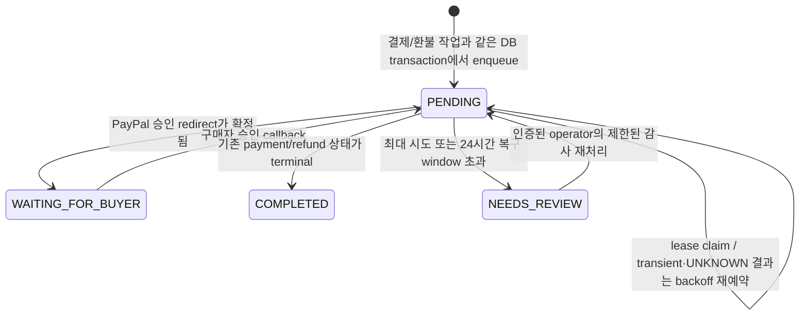

# ADR-0038: 결제·환불의 PostgreSQL 기반 내구성 복구 워크플로우

- 상태: Proposed
- 날짜: 2026-11-16
- 추적: [Issue #293](https://github.com/Neo1228/ATLAS/issues/293)

## 맥락

`PaymentAttempt`와 `PaymentRefundOperation`은 provider 요청 식별자와 `PENDING`/`UNKNOWN` 상태를 DB에 보존합니다. 그러나 worker가 없으면 API 프로세스가 provider 요청 전후에 종료되었을 때 구매자 재조정 요청이나 별도 운영 조치가 복구를 시작해야 합니다. 결제 미확정 상태를 TTL만으로 실패 처리하지 않고 재고 예약을 보존하는 기존 계약은 유지해야 합니다([ADR-0029](ADR-0029-order-payment-recovery-contract.md)).

이미 영속 webhook 재시도 큐가 있지만 그 책임은 **들어오는 webhook 이벤트의 상관관계 재시도**입니다([ADR-0032](ADR-0032-paypal-webhook-retry-queue.md)). 결제·환불 provider operation을 복구하는 작업은 다른 상태와 idempotency 경계를 가져 별도 모델로 둡니다. Scheduler는 webhook retry worker와 같은 bounded scheduler 정책을 따릅니다([ADR-0031](ADR-0031-bounded-application-scheduler.md)).

## 결정

### 영속 작업과 진실의 원천

- `payment_recovery_job`은 `PAYMENT_ATTEMPT` 또는 `PAYMENT_REFUND`를 가리키는 단일 작업 행입니다. `(payment_attempt_id)`와 `(payment_refund_operation_id)`의 unique constraint는 operation별 작업 중복을 막고, FK·CHECK constraint는 잘못된 참조/종류 조합을 차단합니다.
- 결제/환불 aggregate가 진실의 원천이고 queue row는 재실행 일정·lease·시도 횟수·마지막 안전 오류 코드만 보유합니다. 작업을 claim할 때 매번 현재 payment/refund 상태를 다시 읽습니다.
- 작업은 payment attempt 또는 refund operation을 provider 호출 단계로 전환하는 동일한 DB transaction에서 enqueue합니다. 이로써 “상태는 미확정인데 재시도 의도는 기록되지 않은” DB crash gap을 닫습니다. 기존 보류 operation은 V38 migration에서 backfill합니다.
- 대기 중인 고객 승인 redirect가 provider order ID와 approval URL로 확인되면 `WAITING_FOR_BUYER`로 둡니다. Worker는 새 결제 요청을 만들지 않습니다. 승인 callback이 시작되면 기존 작업을 다시 활성화합니다.

### Claim, lease 및 실행

- PostgreSQL `FOR UPDATE SKIP LOCKED`로 due 작업을 atomically claim하고 UUID lease token과 만료 시각을 기록합니다. DB transaction은 claim 직후 끝나며 provider/network 작업을 row lock이나 DB connection 안에서 실행하지 않습니다.
- Worker는 operation별로 한 건씩 claim한 뒤 처리합니다. 다른 인스턴스는 서로 다른 행을 병렬 claim하고, 만료 lease는 crash 후 회수할 수 있습니다. 완료·재예약은 recovery job ID와 현재 lease token을 조건으로 갱신하여 오래된 worker의 ack를 거부합니다.
- Application 모듈의 전용 scheduler는 기존 예약 작업과 thread를 공유하지 않습니다. Worker는 설정된 batch 크기·poll 간격·lease 기간을 넘지 않도록 동작합니다.
- Application 계층은 `com.atlas.payment.service.PaymentRecoveryService`와 `com.atlas.payment.dto.response`만 의존합니다. Repository와 projection은 payment 모듈 내부에 남고 facade가 DTO로 변환하므로 `ModuleBoundaryTest`의 계층 경계를 예외 없이 유지합니다.
- Payment attempt는 기존 `OrderService` 또는 `CheckoutPaymentService` 재조정 경로를, refund는 `OrderRefundService` 재조정 경로를 사용합니다. 별도 worker에서 금액·order·재고 상태를 직접 갱신하지 않습니다.

### 재시도, 검토 및 금전 안전성

- Semantics는 at-least-once입니다. exactly-once provider 실행을 보장한다고 주장하지 않습니다. 매 재시도는 attempt/phase 또는 refund operation에 이미 저장된 동일 provider request ID를 사용하고, 현재 상태·phase를 재검증하며, 기존 row lock/상태 전이를 재사용합니다.
- `UNKNOWN`은 성공 또는 실패로 추정하지 않습니다. 확정 결과가 반환되지 않으면 bounded 지수 backoff+jitter를 적용합니다. 기본 최대 자동 시도는 8회, 복구 window는 24시간이며 한도를 넘으면 `NEEDS_REVIEW`로 격리합니다.
- 결제·refund가 확정되기 전 order/재고 reservation을 해제하지 않습니다. 승인 대기, 미확정 provider 응답, operation 복구 실패는 서로 다른 상태입니다.
- Operator 재처리는 기본 비활성화됩니다. 활성화할 때 32자 이상 비밀번호가 필요한 별도 Basic-auth security chain을 사용합니다. 조회는 bounded pagination이고 재처리는 task별 Idempotency-Key·사유·actor를 append-only audit table에 남기며 task당 최대 3회로 제한합니다. Provider response body, credential, raw webhook 또는 payment secret은 작업 행·로그·operator read model에 저장하지 않습니다.

## 상태 흐름

## 실패 동작

| 실패 시점 | 결과와 복구 |
| --- | --- |
| DB 상태/작업 enqueue 전 transaction rollback | 둘 다 rollback되어 worker가 부분 작업을 실행하지 않음 |
| operation이 commit된 뒤 API 프로세스 종료 | due job이 저장된 request ID를 기준으로 복구 |
| provider 응답 뒤 local 결과 commit 전 종료 | lease 만료 후 at-least-once 재실행; 동일 provider ID와 상태 재검증 사용 |
| worker가 lease 만료 뒤 늦게 완료 | lease token compare-and-set 실패; 오래된 worker는 queue 상태를 덮어쓰지 못함 |
| 복구 window·시도 한도 초과 또는 결과가 계속 UNKNOWN | `NEEDS_REVIEW`; 결제·재고를 추정해 확정하지 않음 |
| 구매자 승인 redirect를 기다리는 중 | `WAITING_FOR_BUYER`; 자동 provider 재호출 없음 |

## 대안과 절충

- **요청 시에만 재조정:** 현재 구조를 유지하지만 사용자가 오류를 인지하고 다시 요청해야 하며 process crash 이후 자동 복구 신호가 없습니다.
- **payment row 직접 polling:** 별도 broker 없이 가능하지만 lease·backoff·operator 감사 상태가 business row에 섞이고 phase별 복구 정책을 표현하기 어렵습니다. 전용 작업 행을 선택합니다.
- **Kafka/RabbitMQ 등 broker:** 다중 consumer routing을 제공하지만 DB operation과 broker publish 사이의 이중 쓰기/추가 인프라를 해결하지 않습니다. 현재 단일 application과 PostgreSQL 규모에서는 transactional DB 작업 큐가 더 단순하며 broker 도입은 별도 근거가 생길 때 재검토합니다.

선택한 방식은 DB polling과 추가 테이블 비용이 있고 provider idempotency 계약에 의존합니다. `SKIP LOCKED`, due/needs-review partial index, bounded batch, lease 만료, 안전한 오류 코드 및 queue 상태 metrics로 운영 비용을 제한합니다. Network/provider latency가 lease보다 길면 중복 시도가 가능하므로 lease token은 provider exactly-once 대체물이 아니며, 같은 stored request ID와 operation-level state check가 필수입니다.

## 운영 및 검증

기본 설정은 poll interval 1초, initial enqueue delay 30초, batch 최대 10(건별 claim), lease 60초, exponential backoff 1초–15분, 최대 8회/24시간입니다. `atlas.payment.recovery.worker.enabled`로 worker를 중지할 수 있고 operator 경계는 별도 기본 비활성 설정입니다.

Prometheus에는 상태별 queue gauge, `oldest_due_age_seconds`, operation type별 claim/failure/retry/completion counter와 처리 duration timer를 노출합니다. 운영자는 `/api/internal/payment/recovery/needs-review`를 bounded 조회하고, 사유와 Idempotency-Key를 포함한 `POST /api/internal/payment/recovery/{recoveryJobId}/requeue`로만 재처리합니다.

PostgreSQL 통합 테스트는 V38 backfill, 동시 다중 worker claim, stale lease fencing, operator 재처리 멱등성/감사, 구매자 승인 대기 분리, payment/refund reconciliation routing을 검증합니다. 로컬 테스트와 성능 결과는 운영 부하/SLA 증거로 일반화하지 않습니다.
