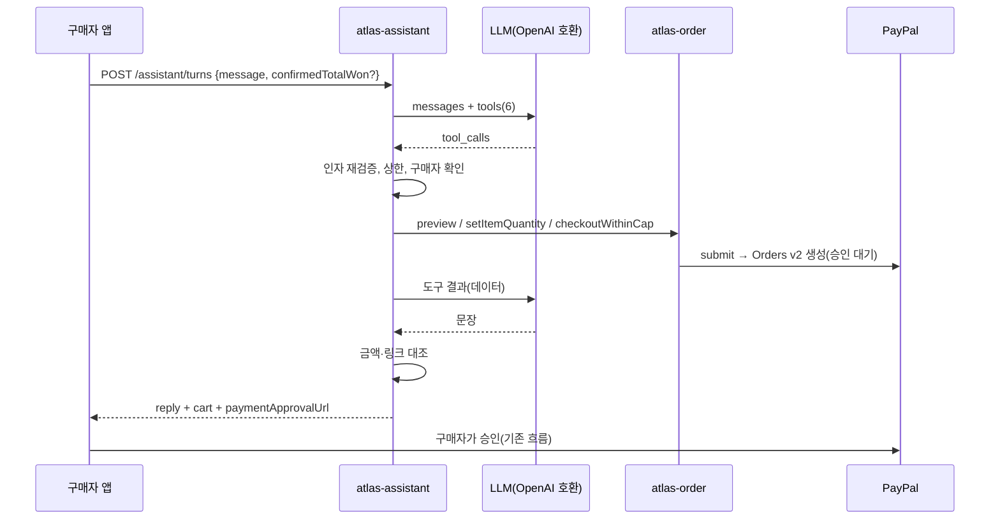

# ADR-0109: 대화형 쇼핑 비서는 서버가 정한 도구 6개, 구매자 지출 상한, 구매자 확인 아래에서만 장바구니와 PayPal 승인 링크를 다루고, 상품 검색은 LC_CTYPE에 의존하지 않는 n-gram으로 한다

- 상태: Accepted(사용자 지시 "조사 문서 후보 1위를 만든다, 최선안은 에이전트가 고른다"에 따른 에이전트 결정. 사용자 승인 여부는 확인하지 못함)
- 날짜: 2026-11-28
- 관련 결정: [ADR-0030](ADR-0030-paypal-currency-boundary.md)(PayPal 통화 경계), [ADR-0069](ADR-0069-layered-naming-and-runtime-configuration.md)(계층 패키지 어휘)
- 근거: [EXP-120](../../03-experiments/EXP-120-shopping-assistant-search-and-tool-safety.md), 이슈 [#736](https://github.com/Neo1228/ATLAS/issues/736), [EXP-123](../../03-experiments/EXP-123-product-search-candidate-pruning-at-scale.md)(규모 측정과 후보 탐색, 2026-11-29 갱신, 이슈 [#759](https://github.com/Neo1228/ATLAS/issues/759))

## 문제

구매자가 자연어로 상품을 찾고 장바구니를 채워 PayPal 승인까지 가는 경로가 없었다. 코드에서 센 사실은 이렇다.

- 상품 검색: `GET /api/products?query=`가 이미 있지만 상품명 소문자 부분 문자열(`LIKE '%q%'`)만 보고 순위가 없다. 라벨 질의 64건에서 recall@5 0.360, 결과 없음 39건이다(EXP-120). 조사 문서의 "검색 질의 기능 없음"은 `ILIKE`·`tsvector`만 센 결과라 틀렸다.
- `pg_trgm`은 데이터베이스 `LC_CTYPE`이 `C`이면 한글을 단어 문자로 보지 않는다. `postgres:18.6`에서 `show_trgm('검은색 운동화를')`이 `en_US.utf8`에서는 9개, `C`에서는 `{}`다. compose와 Testcontainers는 같은 이미지라 둘 다 `en_US.utf8`(`pg_database.datctype`)이지만, 운영 데이터베이스의 ctype은 이 저장소가 정하지 않는다. PostgreSQL 18에서 `SHOW lc_ctype`은 없는 설정이라 오류다.
- LLM 연동 코드, 대화 상태, 구매자 지출 상한이 없다.

## 결정

1. **검색은 V14의 n-gram 함수와 생성 열로 한다.** `catalog_search_grams(text)`가 한글 음절 2-gram과 영숫자 3-gram(앞뒤 공백 패딩)을 만들고, `product.search_grams`(이름+설명)와 `search_name_grams`(이름) 생성 열과 GIN 인덱스를 둔다. 검색어는 `catalog_search_terms(text)`가 3음절 이상 어절 끝 조사 하나와 요청 동사("찾아줘", "싶어" 등 16개)를 뗀다. 검색어 n-gram의 40% 이상이 상품에 있어야 후보가 되고, `2 × 이름 겹침 + 전체 겹침` 내림차순, 동점은 이름 n-gram이 적은(짧은) 상품, 그다음 `product_id` 순이다.
   - ctype 무관: 문자 범위(`[가-힣]`, `[0-9a-z]`)는 PostgreSQL 정규식이 코드 포인트로 비교하고, 결과에 ASCII 영숫자와 한글 음절만 남으므로 `lower()`의 ctype 차이가 결과에 닿지 않는다. 같은 컨테이너의 `en_US.utf8`·`C` 데이터베이스에서 64건의 상위 5건이 모두 같다(`ProductSearchRelevanceIntegrationTest`).
   - 후보 탐색(EXP-123, 2026-11-29 추가): 겹침이 `min_hits = ⌈2n/5⌉` 이상인 상품은 비둘기집 원리로 아무 `n − min_hits + 1`개 n-gram 중 하나를 반드시 가지므로, GIN 조회는 `pg_stats.most_common_elems` 빈도가 낮은 그만큼의 n-gram(`probe`)으로만 한다. 결과는 전체 n-gram 조회와 같고(라벨 64건 상위 5건이 1만·10만·30만 카탈로그에서 모두 같음), 겹치지 않는 합성 카탈로그 30만 개에서 p50 201→65 ms, p95 851→475 ms다. 통계가 없거나 낡으면 덜 줄일 뿐 결과는 같다. 정확한 빈도 테이블(V17)은 읽은 행 차이가 0.3%라 두지 않았고, 후보 상한은 30만 개에서 상위 5건을 62/64 질의에서 바꿔 기각했다.
   - API: `GET /api/products/search?q=&minPriceWon=&maxPriceWon=&limit=`(공개, 1~20건, 기본 10, 커서 없음). LLM이 꺼져 있어도 쓴다. 기존 목록 API(`query=`)는 바꾸지 않는다(커서 페이지 계약이 관련도 순서와 맞지 않는다).
   - compose·Testcontainers의 ctype을 고정하는 안은 쓰지 않는다. 운영 데이터베이스를 고정하지 못하고, 고정해도 같은 SQL이 다른 환경에서 다른 결과를 내는 조건이 남는다.
2. **LLM 클라이언트는 새 모듈 `atlas-llm`에 둔다.** OpenAI 호환 `POST /chat/completions` 하나를 기존 `RestClient`(JDK `HttpClient`)로 부르고 SDK는 쓰지 않는다. 쓰는 기능이 tool calling이 있는 chat completions 하나라 SDK가 줄이는 코드가 작고, SDK를 넣으면 HTTP 스택·JSON 라이브러리·재시도 정책이 둘이 된다.
   - 계약: `ChatCompletionService`(`enabled()`, `complete(ChatCompletionRequest)`), 값 타입은 `ChatCompletionRequest.Message/ToolCall/Tool`, `ChatCompletionResponse.Usage`, 오류는 `LlmException`(`DISABLED`, `BUDGET_EXHAUSTED`, `TIMEOUT`, `UNAVAILABLE`, `INVALID_RESPONSE`).
   - 설정: `ATLAS_LLM_ENABLED`(기본 false), `ATLAS_LLM_BASE_URL`, `ATLAS_LLM_MODEL`, `ATLAS_LLM_API_KEY`(선택, 헤더에만 쓰고 로그·예외에 남기지 않음), 연결 2초, 응답 30초, 시도 2회.
   - 재시도: 연결 실패·연결 시간 초과·429·502·503·504만. 응답 시간 초과는 공급자가 이미 처리·과금했을 수 있어 재시도하지 않는다.
   - 예산: 호출자가 대화별 남은 토큰을 넘기면 0 이하일 때 호출하지 않고 `max_tokens`를 남은 토큰으로 줄인다. 공급자가 `usage`를 보내지 않으면 프롬프트 문자 수 + `max_tokens`로 과대 추정한다. 프롬프트 토큰은 호출 전에 모르므로 상한은 호출 한 번의 프롬프트만큼 넘을 수 있다.
   - 모듈 위치: 도메인 모듈에 의존하지 않으므로 `atlas-order`(반품 판정 보조 같은 다음 AI 기능)와 `atlas-assistant`가 순환 없이 함께 쓴다. `ModuleBoundaryTest`가 `com.atlas.llm..`의 의존을 Java·Spring·Jackson으로 묶는다.
3. **쇼핑 비서는 새 모듈 `atlas-assistant`에 둔다.** catalog 검색, order 장바구니·checkout, llm을 함께 쓰는 기능이고 대화·상한 테이블을 소유한다. `atlas-order`에 넣으면 order가 LLM 대화 상태와 프롬프트까지 소유하고, `atlas-application`에 넣으면 SQL과 도메인 규칙이 진입점 모듈로 들어간다. `ModuleBoundaryTest`는 이 모듈이 다른 모듈의 `service`·`dto`·`model`·`exception`만 쓰게 묶는다.
4. **도구는 6개이고 모두 서버가 다시 검증한다.** `search_products`, `get_product`, `add_to_cart`, `update_cart`, `preview_checkout`, `start_checkout`.
   - 구매자는 HTTP 경로 `/api/buyers/{buyerRef}/assistant/...`에서 정하고 `AccountOwnershipInterceptor`가 인증 주체 소유를 확인한다. 도구 인자로는 구매자를 받지 않는다.
   - 인자는 JSON Schema를 모델에 주되 믿지 않는다. 서버가 모르는 키(`price_won`, `buyer_ref` 등), 정수가 아닌 수량, 범위 밖 값(수량 1~10), UUID·SKU 형식 위반을 거절한다. 가격은 인자로 받지 않고 판매 가능한 SKU에서 다시 읽는다.
   - 공개 판매(`ONLINE_STORE`)로 주문할 수 없는 SKU는 거절한다. 캠페인 대기열로만 파는 SKU가 여기에 걸리므로 비서가 admission 대기열을 우회하지 못한다.
   - 돈을 움직이는 도구(capture, refund)와 상한을 바꾸는 도구는 없다. 차례당 도구 호출 8회, 모델 호출 5회가 상한이다.
5. **구매자 지출 상한과 구매자 확인.** 상한은 구매자 HTTP(`PUT .../assistant/spending-cap`, 1~1억 원)로만 정한다. 장바구니를 늘려 합계가 상한을 넘게 하는 도구 호출은 거절한다(미리보기 기준 검사라 같은 구매자의 동시 요청이나 일반 장바구니 API 변경까지 막지는 않는다. 최종 관문은 아래 checkout 트랜잭션의 검사다). `start_checkout`은 상한이 있고, 구매자가 이번 차례 요청에 `confirmedTotalWon`으로 보낸 금액이 현재 서버 합계와 같을 때만, 차례당 한 번 실행한다. 실행은 기존 `CartCheckoutService`에 더한 `checkoutWithinCap(buyer, key, min(상한, 확인 금액))`이 장바구니 잠금을 잡은 checkout 트랜잭션 안에서 서버 합계로 다시 판정하고, 넘으면 주문·재고 예약 없이 `SPENDING_CAP_EXCEEDED`(409)다. 통과하면 기존 `CheckoutPaymentService.submit`이 PayPal Orders v2 주문을 만들고 승인 링크를 돌려준다. 결제는 구매자가 PayPal에서 승인한 뒤 기존 흐름(authorize·capture)으로만 진행된다.
6. **응답 금액과 링크는 서버 값과 대조한다.** 모델 문장에 통화 표시가 붙은 금액("39,000원", "₩39,000", "39000 KRW", "3만 9천원")이 이 대화의 도구 결과 `*_won` 값에 없거나, 달러 표기가 있거나, 서버가 이번 차례에 발급한 승인 링크가 아닌 URL이 있으면 문장 전체를 서버 문장으로 바꾸고 `replyReplaced=true`로 알린다. 금액·장바구니·승인 링크는 응답의 구조화 필드(`cart`, `paymentApprovalUrl`)가 정본이다.
7. **대화 기록은 서버에 저장한다(V14 `assistant_conversation`, `assistant_message`).** 클라이언트가 기록을 보내는 무상태 방식은 클라이언트가 이전 도구 결과(가격)나 assistant 메시지를 위조할 수 있고, 대화별 토큰 상한을 새 기록으로 초기화할 수 있다. 실패한 차례의 토큰도 저장한다. 모델에 보내는 기록은 최근 40개다.
8. **MCP는 도구 목록만 같은 모양으로 낸다.** `GET /api/assistant/tools`가 MCP `tools/list`의 Tool 객체 모양(`name`, `description`, `inputSchema`)을 돌려준다. MCP 서버(JSON-RPC 실행 경로)는 만들지 않는다. 지금 소비자가 없고, 실행 경로를 하나 더 두면 위 4~6의 정책과 구매자 인증을 두 곳에서 지켜야 한다.
9. **개인정보.** 프롬프트에 `buyerRef`, 주소, 이메일을 넣지 않는다(`ShoppingAssistantIntegrationTest`가 모든 LLM 요청 본문에 `buyerRef`가 없음을 확인). 구매자가 메시지에 직접 쓴 내용은 그대로 공급자에게 간다.

## 대안과 기각 이유

| 안 | 근거 | 결정 |
|---|---|---|
| 검색: 기존 `LIKE` 유지 | recall@5 0.360, nDCG@5 0.304, 결과 없음 39/64 | ✗ 기각 |
| 검색: 전문 검색 `simple`(모든 단어 AND / 접두 OR) | recall@5 0.604 / 0.726. 오타·조사 붙은 한국어를 못 찾음. 검색어 정규화를 더해도 0.850 | ✗ 기각 |
| 검색: `pg_trgm` 이름 가중 `word_similarity` | `en_US.utf8`에서 0.881(정규화 0.936)이지만 `C`에서 0.323, 한국어 recall 0 | ✗ 기각 |
| 검색: `pg_trgm` + compose·Testcontainers ctype 고정 | 운영 데이터베이스 ctype을 저장소가 정하지 못함 | ✗ 기각 |
| 검색: pgvector 임베딩 | `postgres:18.6`에 확장이 없고(`pg_available_extensions` 0행), 상품·검색어마다 임베딩 모델 호출이 필요해 LLM 없이 쓰는 검색이 아니게 됨. 어휘 방식이 recall@5 0.956이고, recall이 1 미만인 7건은 동의어(검정·블랙 vs 검은색, 백팩 vs 가방), 설명에만 검색어가 있는 상품의 순위 밀림, 한글 오타(운동하, 백펙) | ✗ 기각 |
| 검색: n-gram, 패딩 없음 | 영어 오타 recall 1.00 → 0.75 | ✗ 기각 |
| 검색: n-gram + 정규화(출시안) | 두 ctype에서 recall@5 0.956, nDCG@5 0.771 | ✓ 채택 |
| LLM: SDK 의존 추가 | 엔드포인트 하나. HTTP·JSON·재시도 경로가 둘이 됨 | ✗ 기각 |
| LLM 클라이언트를 `atlas-assistant` 안에 | order의 다음 AI 기능이 assistant에 의존하면 assistant → order → assistant 순환 | ✗ 기각 |
| 비서를 `atlas-order`·`atlas-application`에 | 위 결정 3 | ✗ 기각 |
| 무상태 대화(클라이언트가 기록 전송) | 위 결정 7 | ✗ 기각 |
| 상한 검사를 도구에만 | 미리보기와 checkout 사이 가격 상승을 놓침(EXP-120 변이 M1) | ✗ 기각 |
| 구매자 확인 없이 상한만 | 상품 설명 속 주입이 모델에게 결제를 시작하게 할 수 있음. 돈은 PayPal 승인 전까지 움직이지 않지만 재고 예약과 장바구니 비우기가 일어남 | ✗ 기각 |
| MCP 서버(JSON-RPC 실행) | 위 결정 8 | ✗ 기각 |

## 결과

- LLM이 꺼져 있어도 검색 API가 생긴다. 상품 쓰기 경로는 그대로이고 생성 열이 같은 규칙으로 갱신된다.
- 비서는 기본 꺼짐이다. 켜면 차례마다 최대 5회 LLM을 부른다(동기 HTTP 요청 안, 호출당 응답 30초 상한).
- V14의 생성 열 추가는 `product`를 다시 쓴다. 상품 200,040개에서 걸린 시간은 EXP-120 "지연과 마이그레이션 비용" 절에 있다. 대량 데이터 환경은 배포 창에 적용한다.
- 검색 지연(EXP-123, 겹치지 않는 합성 카탈로그, 측정 잠금): 30만 개에서 p50 65 ms, p95 475 ms(데이터베이스 실행 시간). 두 단어가 모두 흔한 질의("검은색 운동화" 등)는 실제로 조건을 채우는 상품이 많아 0.3~0.7초가 남는다.
- 구매자가 확인한 금액보다 비싼 주문은 만들어지지 않는다. 더 싸지면(가격 인하) 그대로 진행한다.

## 롤백

- 기능: `ATLAS_LLM_ENABLED=false`(기본). 대화 API는 503 `ASSISTANT_DISABLED`, 검색 API는 계속 동작한다.
- 스키마: V14는 열·함수·테이블 추가만 한다. 이전 jar로 돌려도 생성 열과 새 테이블은 쓰이지 않을 뿐 동작을 막지 않는다. 지우려면 `assistant_*` 테이블, `product_search_grams_idx`, 두 생성 열, 두 함수 순서로 지운다.
- 후보 탐색(EXP-123): 스키마 변경이 없다. `searchPublic`의 `probe` CTE를 빼고 `p.search_grams && q.grams`로 되돌리면 된다(결과는 같고 지연만 EXP-123 A0로 돌아간다).

## 재검토 조건

- 실제 검색 로그에서 결과 없음 비율이 10%를 넘거나 동의어 실패가 반복되면: 동의어 사전 또는 임베딩(pgvector)을 같은 라벨 집합에 더해 다시 잰다.
- 상품 수가 200만에 닿거나 검색 p95가 EXP-123 측정(30만 개 475 ms)의 3배를 넘으면: `load-tests/catalog-search/product-search-scale.sql`로 다시 재고, 흔한 두 단어 질의를 줄이려면 관련도 문턱(40%)이나 상위 K 조기 종료, 별도 역색인 테이블을 같은 라벨로 잰다.
- 실제 키로 종단 평가를 돌릴 수 있게 되면: EXP-120의 주입 문구 20건을 실제 모델에 넣어 정책 밖 호출 시도 수와 응답 교체 비율을 잰다(현재는 대본 모델로 서버 정책만 확인).
- 응답 교체가 정상 대화의 5%를 넘으면: 금액 표기 해석 규칙을 넓힌다.
- 다른 AI 기능이 `atlas-llm`을 쓰기 시작하면: 대화별 예산 외에 전역 비용 상한(일별)이 필요한지 본다.
