# 요구사항 인덱스

FR-001/FR-002/NFR-002 Gate 2 Buyer journey 기준 승인. Seller-SKU shared stock/global FIFO는 [D-049](../00-governance/decision-log.md), V6 clean-start safety는 [D-055](../00-governance/decision-log.md)에 따른다. Gate 2 범위는 소급 변경하지 않으며 production objectives/priority는 미정. FR-003 settlement와 NFR-001 security는 △ Proposed.

| ID | 유형 | 상태 | 요구사항 후보 | 우선순위 | 연결 |
|---|---|---|---|---|---|
| FR-001 | 기능 | ✓ Gate 2 기준 | Seller owns SKU; Campaigns reference Seller-SKU and share stock/FIFO/K. Initial scenario: quantity SKU, one-unit reservation, eligible admission after sale open. `sellerId` is data identity, not authorization. | 미정 | [Q-002/Q-003/Q-007/Q-010](#assumptions-and-open-questions), [BR-001/002](#business-rules-and-domain-invariants), [Issue #89](https://github.com/Neo1228/ATLAS/issues/89) |
| FR-002 | 기능 | ✓ Gate 2 기준 | Hold before PSP; AUTHORIZE → CAPTURE; only confirmed capture claims inventory. Unresolved outcome keeps the hold and uses the same attempt. Ten-minute local test window; Fake PSP only. | 미정 | [Q-004/Q-005/Q-008](#assumptions-and-open-questions), [BR-003/INV-003](#business-rules-and-domain-invariants), [Issue #72](https://github.com/Neo1228/ATLAS/issues/72) |
| FR-003 | 기능 | △ Proposed | PSP transaction reconciliation, internal settlement ledger, fees, corrections and audit trail. Not approval for refund execution or seller payout. | 미정 | [Q-002/Q-006](#assumptions-and-open-questions) |
| FR-004 | 기능 | ✓ PR #90 병합 완료 | Seller UUID; Seller-SKU registration sets `initialStock` and global `maxActiveCheckouts`. V6 clean-start only: non-empty V1–V5 application tables fail before DDL without changing data/schema. No mapping/backfill; archive/reset needed data outside the app. `sellerId` is not authentication or tenant isolation. | 미정 | [D-049/D-055](../00-governance/decision-log.md), [Q-002/Q-003/Q-007](#assumptions-and-open-questions), [Issue #89](https://github.com/Neo1228/ATLAS/issues/89) |
| NFR-001 | 비기능 | △ Proposed | Verify tenant data/authorization isolation; threat boundary remains open. | 미정 | [Q-007](#assumptions-and-open-questions) |
| NFR-002 | 비기능 | ✓ Gate 2 report profile | Full Buyer journey; 10k sessions/60m baseline and 2×/4× synthetic stress. Report-only; no production SLO/threshold. Metric contract is Q-008. | 미정 | [Q-008](#assumptions-and-open-questions), [Issue #66](https://github.com/Neo1228/ATLAS/issues/66) |

## Project context and scope

### Purpose and long-term scope — ✓ Confirmed
ATLAS is a learning project to validate, through design and experiments, order/reservation/payment/refund/settlement consistency and failure recovery under constrained-stock contention. This is not evidence of production performance or validated market demand.

| Long-term area | Scope |
|---|---|
| A. Payment Reliability | Authorization/capture, webhook, retry, idempotency, refund, uncertain payment outcomes and recovery |
| B. Flash Commerce | Tenant/seller, campaign, queue admission, reservation, order |
| C. Settlement & Reconciliation | Transaction reconciliation, fees, internal ledger, corrections, audit trail |

All areas are long-term scope, pursued by milestone. PayPal Sandbox is the preferred eventual PSP; Fake PSP reproduces failures, not PayPal behavior. Gate 2's single-SKU flow is the first validation scenario, not full product scope. No actual interviews, transactions, or market validation have occurred; personas are synthetic and their shared Buyer/Seller goals are user-selected, not research findings.

Confirmed boundaries: use synthetic/pseudonymous data only; exclude real payments, customer personal information, and seller payouts. Keep order state separate from PSP operation state, and internal settlement separate from real funds movement. Gate 2 Buyer criteria and local current-flow runtime are approved; live payments, cloud deployment, production schema/lock recovery, capacity and SLO require separate approval. Current scenario is quantity-based SKU; assigned-seat/time-slot are excluded; other sale types and expansion order are OPEN. `sellerId` is data identity, not authentication, authorization, or tenant-isolation boundary.

Success criteria are proposed: connect policies/invariants to verifiable scenarios; record failure, contention, recovery procedures and limitations; support performance/recovery claims with repeated measurements in a named environment. SLO, RPS, and p95/p99 targets are unset.

## Assumptions and open questions
Status: `✓ Resolved`, `? OPEN`, `△ ASSUMPTION` (unverified). A resolved baseline does not close remaining detailed boundaries.

| ID | Status | Question / boundary |
|---|---|---|
| Q-001 | ✓ Resolved | Begin with a synthetic learning scenario; no real market/user validation. Buyer/Seller goals are recorded in D-015–D-017. |
| Q-002 | ? OPEN | Multi-quantity, location/channel stock, in-sale adjustment/restock, and post-claim cancellation/refund policy remain open. V6 migration safety is the separate D-055 decision. |
| Q-003 | ? OPEN | Seller-SKU global FIFO/K; Campaign-scoped idempotency and ticket TTL; eligibility after sale open. Production K/TTL, tombstone cleanup, payload fields, bot/auth, and lock-timeout/deadlock recovery remain open. |
| Q-004 | ? OPEN | D-025–D-030: hold before PSP; AUTHORIZE → CAPTURE; claim after capture success. Synthetic 10-minute timer from confirmed hold; initial AUTHORIZE must be submitted before expiry, no extension. Production TTL/SLO/distribution open. |
| Q-005 | ? OPEN | UNKNOWN is not failure. Reconcile same attempt before any new attempt; PENDING/UNKNOWN keeps inventory held. Release requires confirmed non-payment and required authorization void/expiry. Fake PSP reconciliation is caller-triggered via `POST /reconcile`, no automatic provider-recovery worker exists, and Fake PSP state resets on app restart. `OrderService`/`PaymentService` striped monitors coordinate same-order calls only within one JVM; collisions may serialize unrelated IDs and multiple instances do not share locks. Live-provider idempotency, automatic retry/recovery ownership, multi-instance serialization, deadlines, key retention, escalation and compensation remain open. D-042's synthetic-buyer guard is neither authentication nor a purchase limit. |
| Q-006 | ? OPEN | PSP transaction reconciliation, internal settlement ledger, fee/payout cycle, holds and accounting correction. Provider refund execution and settlement-ledger correction are separate capabilities; their relationship, owner, post-claim stock effect and policies are open. FR-003 is proposed settlement, not refund-support approval. |
| Q-007 | ? OPEN | `sellerId` provides data identity only, not authentication/authorization or tenant isolation. Threat boundary, privacy/regulation, region/currency/tax, synthetic-data policy and external exposure remain open. |
| Q-008 | ? OPEN | Workload contract below; synthetic, report-only, not production demand/capacity. |
| Q-009 | ? OPEN | User-selected local stack: Java 25 LTS, Spring Boot 4.1.2/MVC, PostgreSQL 18.6, Gradle Wrapper 9.8.2; Testcontainers 2.0.5 and ArchUnit 1.5.1 test-scope. Boot 4 uses `spring-boot-starter-flyway`. Alternatives are in the Decision Log. CI uses Temurin 25; production JDK vendor/license, database/deployment and PayPal product/API remain open. |

### Q-008 workload contract — report-only
- Baseline: 10,000 synthetic Buyer sessions / 60 minutes (~2.8 sessions/s), with 2×/4× stress (~5.6/11.1 sessions/s); full Buyer journey and hybrid arrivals.
- Record offered/admitted sessions/s and generator-missed sessions/iterations; stage offered/achieved request RPS. Report DB QPS only if measuring DB query scope.
- Count only resolved Buyer sessions as business TPS. PENDING/UNKNOWN remains in-flight/backlog.
- Report p95/p99 with boundary, errors, expiry/abandonment, queue/hold occupancy, resource saturation and oversell invariant. No pass/fail SLO or production capacity claim.
- OPEN: burst multiplier/duration, arrival curve/think time, phase duration, concurrency, environment, audience evidence and production target.

## Business rules and domain invariants
Statuses: `✓ Confirmed baseline`, `? OPEN`. Synthetic scenario, not experiment results.

| IDs | Rule / invariant | Status | Open boundary |
|---|---|---|---|
| BR-001 / INV-002 | Only eligible requests after sale open are admitted. Seller-SKU sequence is unique, lower first; Campaigns sharing `(sellerId, skuId)` share bounded FIFO/K. Queue key/K global; idempotency and ticket TTL Campaign-scoped. Same key/payload reuses ticket; mismatch rejected; after expiry a new key joins global tail. `sellerId` is not an auth boundary. | ✓ Local baseline | Production K/TTL, tombstone cleanup, payload fields, bot/auth, lock timeout/deadlock recovery open (Q-003/Q-007). |
| BR-002 / INV-001 | Shared Seller-SKU inventory pool; one unit per reservation. After each confirmed transition `available + reserved + claimed = initial capacity`, all values ≥ 0. Hold moves available→reserved; capture success reserved→claimed. Release only after confirmed non-payment and required authorization void/expiry. | ✓ Local baseline | Multi-quantity, location/channel, adjustment/restock, post-claim cancellation/refund open (Q-002). PostgreSQL guarded UPDATE/per-order transaction lock/reservation row lock are local baseline, not production performance conclusion. |
| BR-003 / INV-003 | Hold before PSP; only capture success claims stock. Ten-minute test window from confirmed hold to initial AUTHORIZE submission; no extension. PENDING/UNKNOWN capture/void keeps stock unavailable and requires same-attempt reconciliation; no new attempt before resolution. Release after confirmed non-payment and required void/expiry. Fake PSP only. | ✓ Gate 2 recovery baseline | Production TTL/SLO, provider deadline, retry/key retention, escalation/compensation open (Q-004/Q-005/Q-008); same-Campaign synthetic buyer guard per D-042 is not identity/security. |

Local recovery/locking limitations apply; no production claim is implied.

```mermaid
sequenceDiagram
    actor Buyer as Buyer
    participant API as Campaign API
    participant Queue as Queue state
    Buyer->>API: campaign access
    API->>API: check sale-open
    alt before sale open
        API->>API: no admission, entry or sequence
    else sale open
        API->>API: check eligibility
        alt ineligible
            API->>API: no admission
        else eligible
            API->>Queue: admit and assign server sequence
            Queue-->>API: ticket and sequence
            API-->>Buyer: ticket and sequence
            opt active-ticket retry with same key
                Buyer->>API: resend key and payload
                alt payload matches
                    API->>Queue: lookup ticket
                    Queue-->>API: same ticket and sequence
                    API-->>Buyer: same ticket and sequence
                else payload changed
                    API-->>Buyer: reject; retain existing ticket
                end
            end
            opt re-entry after expiry
                Buyer->>API: join with new key
                API->>Queue: admit at unique global tail sequence
                Queue-->>API: new ticket and sequence
                API-->>Buyer: new ticket and sequence
            end
        end
    end
    Note over Queue: Sequence unique across Campaigns for (sellerId, skuId); counter and ticket commit in one transaction; committed order survives restart. Contention/lock recovery details OPEN.
```

```mermaid
stateDiagram-v2
    state "UNKNOWN operation" as Unknown
    state "Capture pending" as CapturePending
    state "Capture declined" as CaptureDeclined
    state "Authorization void pending" as VoidPending
    state "Reserved (inventory hold)" as Held
    state "Claimed (capture confirmed)" as Claimed
    [*] --> Available
    Available --> Held: confirm one-unit hold; start fixed timer
    Held --> Available: TTL expires before AUTHORIZE submission
    Held --> Authorized: AUTHORIZE confirmed
    Held --> Unknown: submitted before expiry; outcome unknown
    Authorized --> CapturePending: request capture
    Authorized --> VoidPending: TTL/cancel; capture incomplete
    CapturePending --> Claimed: capture completes
    CapturePending --> CaptureDeclined: decline confirmed
    CapturePending --> Unknown: outcome unknown
    CapturePending --> CapturePending: remains pending; stock unavailable
    CaptureDeclined --> VoidPending: authorization remains valid
    CaptureDeclined --> Available: non-payment confirmed; no active authorization
    Unknown --> Claimed: capture success confirmed
    Unknown --> CapturePending: capture pending confirmed
    Unknown --> CaptureDeclined: capture decline confirmed
    Unknown --> VoidPending: not captured; authorization valid
    Unknown --> Available: non-payment confirmed; no active authorization
    Unknown --> Unknown: reconcile same operation/attempt
    VoidPending --> Available: void/expiry and non-payment confirmed
    VoidPending --> Claimed: capture success confirmed
    VoidPending --> Unknown: void outcome unknown
```



Buyer-facing timer ends on first AUTHORIZE submission; it does not impose reconciliation or PSP-operation deadline. Production TTL/recovery deadlines remain open.
