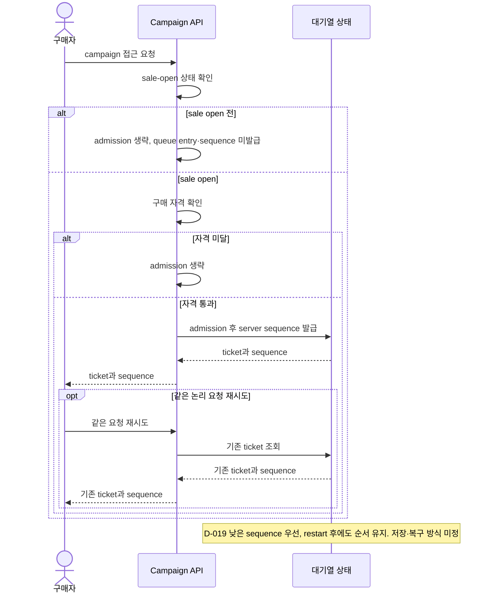

# 비즈니스 규칙
문서 유형: 기준 자료

규칙 상태: `✓ Confirmed baseline`, `△ Proposed`, `? OPEN`. 내용은 합성 scenario이며 구현·실험 결과 아님. Queue admission, ticket, idempotency key 용어는 [Glossary](../01-discovery/glossary.md) 참조.

| ID | 규칙 | 상태 | 미정 경계 |
|---|---|---|---|
| BR-001 | 초기 시나리오: sale open 후 자격 통과 요청만 대기열에 등록. 등록 시 sequence 발급 ([D-020](../00-governance/decision-log.md)), 낮은 순번 우선 ([D-019](../00-governance/decision-log.md)), 같은 요청 retry ticket 재사용 ([D-021](../00-governance/decision-log.md)), restart 후 순서 보존 ([D-022](../00-governance/decision-log.md)). | ✓ Baseline (D-019~D-024) | [Q-003](../00-governance/assumptions-and-open-questions.md): storage/key/payload/expiry/re-entry/tie/bot/다른 유형 정책 ? OPEN. [Issue #24](https://github.com/Neo1228/ATLAS/issues/24), [Issue #33](https://github.com/Neo1228/ATLAS/issues/33). |
| BR-002 | 초기 시나리오: 대체 가능한 수량형 SKU 1종과 campaign별 독립 pool ([D-023](../00-governance/decision-log.md)). 예약·판매 수량은 pool capacity 이내. | △ Proposed ([D-017/D-023](../00-governance/decision-log.md)) | [Q-002/Q-004](../00-governance/assumptions-and-open-questions.md): 재고 생명주기, 조정·취소·환불·결제 경합 ? OPEN. |
| BR-003 | [D-025~D-030](../00-governance/decision-log.md): PSP 요청 전 inventory hold; capture success 후 claim. Confirmed hold부터 initial AUTHORIZE 제출까지 10분 fixed window. Production TTL/SLO 미정. 만료 시 checkout 종료, 연장 없음. 제출된 PENDING/UNKNOWN은 D-027에 따라 같은 attempt를 reconcile; 결과 전 새 attempt 금지. | ✓ Baseline | Production TTL/completion SLO, 측정 분포, provider deadline, retry/key retention, escalation/compensation OPEN ([Q-004/Q-005/Q-008](../00-governance/assumptions-and-open-questions.md)); [Issue #48](https://github.com/Neo1228/ATLAS/issues/48). |

## 기준 흐름 — 합성 scenario
1. Seller가 campaign 하나에 수량형 SKU 1종과 독립 inventory pool을 설정. 실제 수량은 test profile에서 선택.
2. Sale open 전에는 queue admission이나 sequence 발급 없음 ([D-024](../00-governance/decision-log.md)).
3. Sale open 후 자격을 통과한 Buyer 요청만 admission. Server sequence 부여, 낮은 순서 우선 ([D-019/D-020](../00-governance/decision-log.md)).
4. 같은 queue 요청 retry는 기존 ticket/sequence 재사용. Service/worker restart 후 순서 유지 ([D-021/D-022](../00-governance/decision-log.md)).
5. Inventory hold 확정 시 Buyer-facing timer 시작 ([D-028/D-029](../00-governance/decision-log.md)).
6. Buyer는 만료 전 initial AUTHORIZE 요청 제출. 미제출이면 checkout 종료, payment attempt 없음.
7. 만료 전 제출한 AUTHORIZE는 만료 뒤에도 resolve 가능. Capture/void가 PENDING/UNKNOWN이면 stock을 hold하고 같은 attempt를 reconcile; 새 attempt 금지 ([D-027](../00-governance/decision-log.md)).
8. Capture success 후 inventory claim. 그 외에는 non-payment와 authorization void/expiry가 확인된 뒤 release ([D-027](../00-governance/decision-log.md)).

첫 sequence diagram은 [D-019~D-024](../00-governance/decision-log.md)의 queue 규칙. 남은 경계는 [Q-003](../00-governance/assumptions-and-open-questions.md).

## 결제 중 재고 hold 흐름 — 초기 시나리오
[D-025~D-029](../00-governance/decision-log.md)에서 정한 inventory/payment 상태 경계. PSP API, DB transaction, 재고 저장 방식은 미정. TTL·recovery deadline도 OPEN ([Q-004/Q-005](../00-governance/assumptions-and-open-questions.md)).

```mermaid
stateDiagram-v2
    state "UNKNOWN operation" as Unknown
    state "Capture pending" as CapturePending
    state "Capture declined" as CaptureDeclined
    state "Authorization void pending" as VoidPending
    [*] --> Available
    Available --> Held: hold 확정; fixed timer 시작
    Held --> Available: AUTHORIZE 제출 전 TTL 만료
    Held --> Authorized: AUTHORIZE 확인
    Held --> Unknown: 만료 전 제출; 결과 불명
    Authorized --> CapturePending: capture 요청
    Authorized --> VoidPending: TTL/cancel; capture 미완료
    CapturePending --> Claimed: capture 완료
    CapturePending --> CaptureDeclined: 거절 확인
    CapturePending --> Unknown: 결과 불명
    CapturePending --> CapturePending: pending 지속; stock unavailable
    CaptureDeclined --> VoidPending: authorization 유효
    CaptureDeclined --> Available: non-payment 확정; active authorization 없음
    Unknown --> Claimed: capture 완료 확인
    Unknown --> CapturePending: capture pending 확인
    Unknown --> CaptureDeclined: capture 거절 확인
    Unknown --> VoidPending: 미캡처, authorization 유효
    Unknown --> Available: non-payment 확정; active authorization 없음
    Unknown --> Unknown: 같은 operation/attempt reconcile
    VoidPending --> Available: void/expiry와 non-payment 확인
    VoidPending --> Claimed: capture success 확인
    VoidPending --> Unknown: void 결과 불명
```

Buyer-facing timer는 initial AUTHORIZE 제출 시 끝남. D-027 reconciliation이나 PSP operation deadline에는 영향 없음. TTL·recovery deadline 수치 OPEN ([Q-004/Q-005/Q-008](../00-governance/assumptions-and-open-questions.md)).
