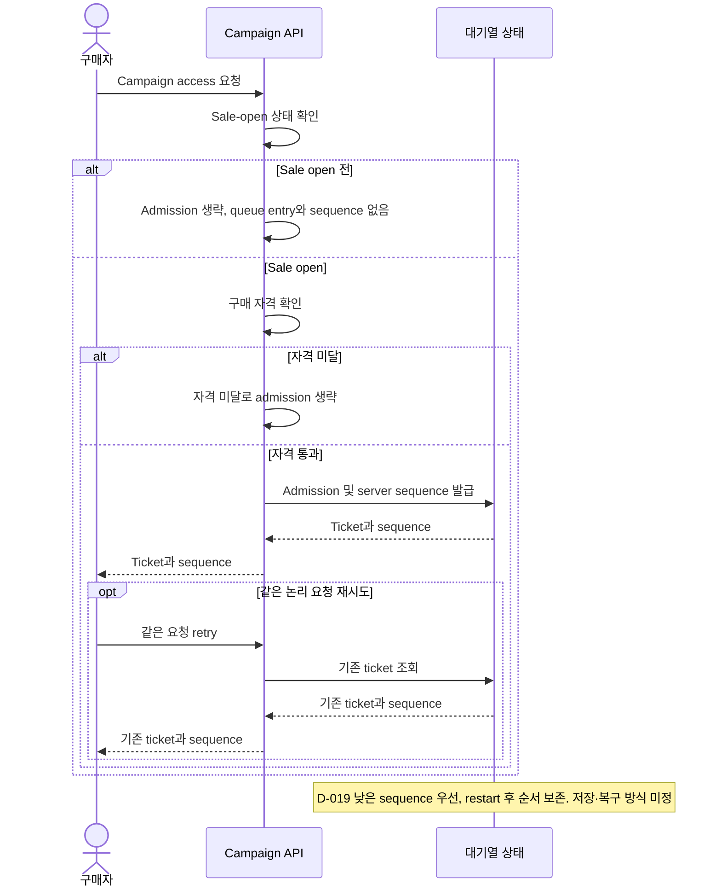

# 비즈니스 규칙
문서 유형: 기준 자료

규칙 상태: `✓ Confirmed baseline`, `△ Proposed`, `? OPEN`. 가상 scenario 기준이며 구현/실험 결과 아님. queue admission, ticket, idempotency key는 [Glossary](../01-discovery/glossary.md) 참조.

| ID | 규칙 | 상태 | 미정 경계 |
|---|---|---|---|
| BR-001 | 초기 시나리오: sale open 후 자격 통과 요청만 대기열에 등록. 등록 시 sequence 발급 ([D-020](../00-governance/decision-log.md)), 낮은 순번 우선 ([D-019](../00-governance/decision-log.md)), 같은 요청 retry ticket 재사용 ([D-021](../00-governance/decision-log.md)), restart 후 순서 보존 ([D-022](../00-governance/decision-log.md)). | ✓ Baseline (D-019~D-024) | [Q-003](../00-governance/assumptions-and-open-questions.md): storage/key/payload/expiry/re-entry/tie/bot/다른 유형 정책 ? OPEN. [Issue #24](https://github.com/Neo1228/ATLAS/issues/24), [Issue #33](https://github.com/Neo1228/ATLAS/issues/33). |
| BR-002 | 초기 시나리오: 대체 가능한 수량형 SKU 1종과 campaign별 독립 pool ([D-023](../00-governance/decision-log.md)). 예약·판매 수량은 pool capacity 이내. | △ Proposed ([D-017/D-023](../00-governance/decision-log.md)) | [Q-002/Q-004](../00-governance/assumptions-and-open-questions.md): 재고 생명주기, 조정·취소·환불·결제 경합 ? OPEN. |
| BR-003 | [D-025~D-029](../00-governance/decision-log.md): PSP 요청 전 inventory hold; capture success 후 claim. Fixed buyer timer starts on confirmed hold; initial PayPal `AUTHORIZE` must be submitted before expiry. Expiry closes checkout without extension. If AUTHORIZATION was submitted before expiry, PENDING/UNKNOWN follows D-027: hold remains, same-attempt reconciliation, no new attempt until resolved. Confirmed non-payment and void/expiry precede release. | ✓ Baseline | [Q-004/Q-005/Q-009](../00-governance/assumptions-and-open-questions.md): numeric TTL, completion-time evidence, provider deadline, retry/key retention, escalation/compensation ? OPEN. [Issue #46](https://github.com/Neo1228/ATLAS/issues/46); [REF-034~041](../00-governance/reference-register.md). |

## 기준 흐름 — 합성 scenario
1. Seller가 한 campaign에 수량형 SKU 1종과 독립 재고 pool을 설정. 실제 수량은 실험 profile에서 결정.
2. Sale open 전에는 queue admission과 sequence 발급 없음 ([D-024](../00-governance/decision-log.md)).
3. Sale open 후 자격 통과 Buyer 요청을 admission하고 server sequence 발급. 낮은 sequence 우선 ([D-019/D-020](../00-governance/decision-log.md)).
4. 같은 논리 queue 요청 retry는 기존 ticket/sequence 재사용. service/worker restart 후 순서 유지 ([D-021/D-022](../00-governance/decision-log.md)).
5. Inventory hold confirmation starts the fixed Buyer-facing timer ([D-028/D-029](../00-governance/decision-log.md)).
6. Buyer must submit initial `AUTHORIZE` request before expiry. Expiry closes checkout without extension; if no request was submitted, no payment attempt exists.
7. If `AUTHORIZE` was submitted before expiry, its result may resolve later. Capture/void `PENDING`/UNKNOWN follows D-027: hold stays unavailable, reconcile the same attempt, and do not start a new attempt.
8. Confirmed capture success claims inventory. Otherwise release only after confirmed non-payment and authorization void/expiry ([D-027](../00-governance/decision-log.md)).

첫 sequence diagram은 [D-019~D-024](../00-governance/decision-log.md)의 queue 기준. 잔여 경계 [Q-003](../00-governance/assumptions-and-open-questions.md). 다음 state diagram은 [D-025~D-027](../00-governance/decision-log.md)의 inventory/payment lifecycle만 나타내며 PSP API/DB 구현 아님. [Issue #33](https://github.com/Neo1228/ATLAS/issues/33), [Issue #35](https://github.com/Neo1228/ATLAS/issues/35), [Issue #37](https://github.com/Neo1228/ATLAS/issues/37), [Issue #42](https://github.com/Neo1228/ATLAS/issues/42) 참조.

## 결제 중 재고 hold 흐름 — 초기 시나리오
[D-025~D-029](../00-governance/decision-log.md)에서 확정한 inventory/payment state boundary. PSP API, DB transaction, inventory storage 방식은 정하지 않음. TTL duration와 deadline 수치는 [Q-004/Q-005](../00-governance/assumptions-and-open-questions.md)에서 OPEN.

```mermaid
stateDiagram-v2
    state "UNKNOWN operation" as Unknown
    state "Capture pending" as CapturePending
    state "Capture declined" as CaptureDeclined
    state "Authorization void pending" as VoidPending
    [*] --> Available
    Available --> Held: hold confirmed; fixed timer starts
    Held --> Available: TTL expires before AUTHORIZE submission
    Held --> Authorized: AUTHORIZE confirmed
    Held --> Unknown: submitted before expiry; result ambiguous
    Authorized --> CapturePending: capture requested
    Authorized --> VoidPending: TTL/cancel; capture not completed
    CapturePending --> Claimed: capture completed
    CapturePending --> CaptureDeclined: decline confirmed
    CapturePending --> Unknown: outcome ambiguous
    CapturePending --> CapturePending: still pending; stock unavailable
    CaptureDeclined --> VoidPending: authorization still active
    CaptureDeclined --> Available: definitive non-payment; no active authorization
    Unknown --> Claimed: reconciliation confirms capture completed
    Unknown --> CapturePending: reconciliation confirms capture pending
    Unknown --> CaptureDeclined: reconciliation confirms capture declined
    Unknown --> VoidPending: not captured; authorization active
    Unknown --> Available: definitive non-payment; no active authorization
    Unknown --> Unknown: reconcile same operation/attempt
    VoidPending --> Available: void/expiry and non-payment confirmed
    VoidPending --> Claimed: capture success confirmed
    VoidPending --> Unknown: void outcome ambiguous
```

The buyer-facing timer ends at initial AUTHORIZE submission; it does not override D-027 reconciliation or PSP operation deadlines. Numeric TTL and recovery deadlines remain OPEN ([Q-004/Q-005/Q-008](../00-governance/assumptions-and-open-questions.md)).
