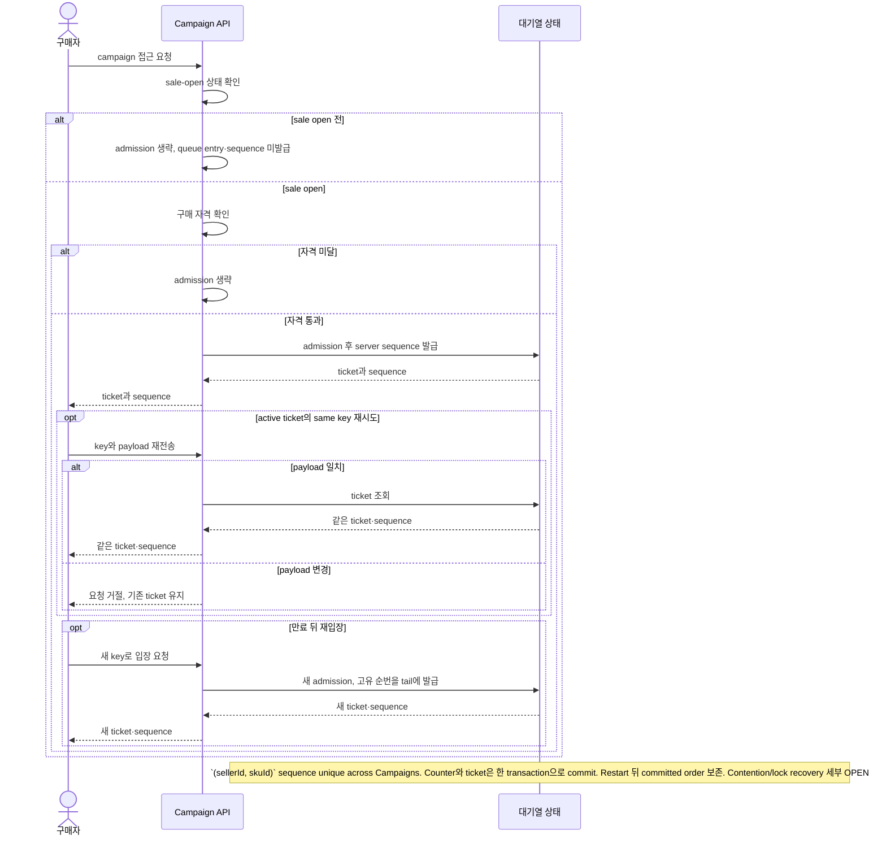

```mermaid
stateDiagram-v2
    state "UNKNOWN operation" as Unknown
    state "Capture pending" as CapturePending
    state "Capture declined" as CaptureDeclined
    state "Authorization void pending" as VoidPending
    state "Reserved (inventory hold)" as Held
    state "Claimed (capture confirmed)" as Claimed
    [*] --> Available
    Available --> Held: 1 unit hold 확정; fixed timer 시작
    Held --> Available: AUTHORIZE 제출 전 TTL 만료
    Held --> Authorized: AUTHORIZE 확인
    Held --> Unknown: 만료 전 제출; 결과 불명
    Authorized --> CapturePending: capture 요청
    Authorized --> VoidPending: TTL/cancel; capture 미완료
    CapturePending --> Claimed: capture 완료
    CapturePending --> CaptureDeclined: 거절 확인
    CapturePending --> Unknown: 결과 불명
    CapturePending --> CapturePending: pending 지속; stock unavailable
    CaptureDeclined --> VoidPending: authorization 유효
    CaptureDeclined --> Available: non-payment 확정; active authorization 없음
    Unknown --> Claimed: capture 완료 확인
    Unknown --> CapturePending: capture pending 확인
    Unknown --> CaptureDeclined: capture 거절 확인
    Unknown --> VoidPending: 미캡처, authorization 유효
    Unknown --> Available: non-payment 확정; active authorization 없음
    Unknown --> Unknown: 같은 operation/attempt reconcile
    VoidPending --> Available: void/expiry와 non-payment 확인
    VoidPending --> Claimed: capture success 확인
    VoidPending --> Unknown: void 결과 불명
```

# 비즈니스 규칙
문서 유형: 기준 자료

규칙 상태: `✓ Confirmed baseline`, `△ Proposed`, `? OPEN`. 내용은 합성 scenario이며 구현·실험 결과 아님. Queue admission, ticket, idempotency key 용어는 [Glossary](../01-discovery/glossary.md) 참조.

| ID | 규칙 | 상태 | 미정 경계 |
|---|---|---|---|
| BR-001 | Sale open 후 eligibility 통과 요청만 admission. Seller-SKU별 sequence를 발급하고 낮은 순서 우선. 같은 `(sellerId, skuId)`를 참조하는 Campaign은 하나의 bounded FIFO/K를 공유. Idempotency key와 ticket TTL은 Campaign-scoped: same key/payload는 기존 ticket 반환, mismatch 거절, expiry 후 새 key는 새 global tail sequence ([D-019~D-024/D-034/D-049](../00-governance/decision-log.md)). | ✓ Baseline | Production K/TTL, tombstone cleanup, additional payload fields, bot/auth, schema/lock recovery는 OPEN ([Q-003](../00-governance/assumptions-and-open-questions.md)). [ADR-0005](../06-decisions/adr/ADR-0005-seller-sku-inventory-global-admission.md), [Issue #89](https://github.com/Neo1228/ATLAS/issues/89). |
| BR-002 | Seller-SKU별 shared inventory pool. Reservation당 1개. 각 확정 전이 후 `available + reserved + claimed = initial capacity`; 모든 수량 ≥ 0. Hold 시 reserved, capture success 시 claimed. Confirmed non-payment와 필요한 authorization void/expiry 뒤 release. 초기 stock은 Seller-SKU 등록 때 설정 ([D-027/D-035/D-049](../00-governance/decision-log.md)). | ✓ Baseline | Local PostgreSQL baseline은 guarded UPDATE, per-order transaction lock, reservation row lock 사용. Lock/performance 대안은 [EXP-002](../08-experiments/experiment-registry.md)에서 비교; production 결론 아님. 다중 수량·location/channel·조정/재입고·post-claim 취소/환불은 OPEN ([Q-002](../00-governance/assumptions-and-open-questions.md)). |
| BR-003 | [D-025~D-030/D-041](../00-governance/decision-log.md): PSP 요청 전 inventory hold; capture success 후 claim. Confirmed hold부터 initial AUTHORIZE 제출까지 10분 local test window. Slot은 initial submission/expiry에서 반환; inventory unavailable이면 payment 없이 즉시 반환. PENDING/UNKNOWN은 hold 유지, same attempt reconcile; 결과 확인 전 새 payment attempt 금지. Fake PSP only. | ✓ Baseline | Production TTL/SLO, provider deadline, retry/key retention, escalation/compensation OPEN ([Q-004/Q-005/Q-008](../00-governance/assumptions-and-open-questions.md)); unresolved 동일 Buyer/campaign guard는 [D-042](../00-governance/decision-log.md). [Issue #48](https://github.com/Neo1228/ATLAS/issues/48), [Issue #72](https://github.com/Neo1228/ATLAS/issues/72). |

## 기준 흐름 — 합성 scenario
1. Seller 등록 후 Seller-owned SKU 등록 시 `initialStock`과 global `maxActiveCheckouts` 설정. 여러 Campaign이 같은 Seller-SKU를 참조하면 재고와 대기열을 공유 ([D-049](../00-governance/decision-log.md)).
2. Sale open 전에는 queue admission이나 sequence 발급 없음 ([D-024](../00-governance/decision-log.md)).
3. Sale open 후 자격을 통과한 Buyer 요청만 admission. Server sequence 부여, 낮은 순서 우선 ([D-019/D-020](../00-governance/decision-log.md)).
4. 같은 Campaign의 active ticket에서 같은 key·payload 재시도는 기존 ticket/sequence 반환. Payload 변경은 거절; 만료 후 재입장은 새 key 사용. 순번은 해당 Seller-SKU의 global tail에 배치 ([D-021/D-034/D-049](../00-governance/decision-log.md)). Service/worker restart 후 순서 보존 ([D-022](../00-governance/decision-log.md)).
5. Inventory hold 확정 시 Buyer-facing timer 시작 ([D-028/D-029](../00-governance/decision-log.md)).
6. Buyer는 만료 전 initial AUTHORIZE 요청 제출. 미제출이면 checkout 종료, payment attempt 없음.
7. 만료 전 제출한 AUTHORIZE는 만료 뒤에도 resolve 가능. Capture/void가 PENDING/UNKNOWN이면 stock을 hold하고 같은 attempt를 reconcile; 새 attempt 금지 ([D-027](../00-governance/decision-log.md)).
8. Capture success 후 inventory claim. 그 외에는 non-payment와 authorization void/expiry가 확인된 뒤 release ([D-027](../00-governance/decision-log.md)).
9. 각 확정 전이 후 `available + reserved + claimed = initial capacity`; 각 값은 0 이상 ([D-035](../00-governance/decision-log.md)).

대기열 흐름은 [D-019~D-024/D-034](../00-governance/decision-log.md) 기준. 남은 경계: [Q-003](../00-governance/assumptions-and-open-questions.md). [Issue #60](https://github.com/Neo1228/ATLAS/issues/60).

## 결제 중 재고 hold 흐름 — 초기 시나리오
[D-025~D-030/D-035](../00-governance/decision-log.md)의 inventory/payment 경계. 초기 pool은 reservation당 1개이며 각 상태 전이 뒤 `available + reserved + claimed = initial capacity`; 각 값은 0 이상. PostgreSQL 선택; schema·transaction/locking, PSP API, TTL·recovery deadline은 미정 ([Q-002/Q-004/Q-005](../00-governance/assumptions-and-open-questions.md)).

Buyer에게 보여주는 timer는 첫 AUTHORIZE 제출 시 종료. D-027 reconciliation이나 PSP operation deadline에는 영향 없음. TTL·recovery deadline 수치는 미정 ([Q-004/Q-005/Q-008](../00-governance/assumptions-and-open-questions.md)).
