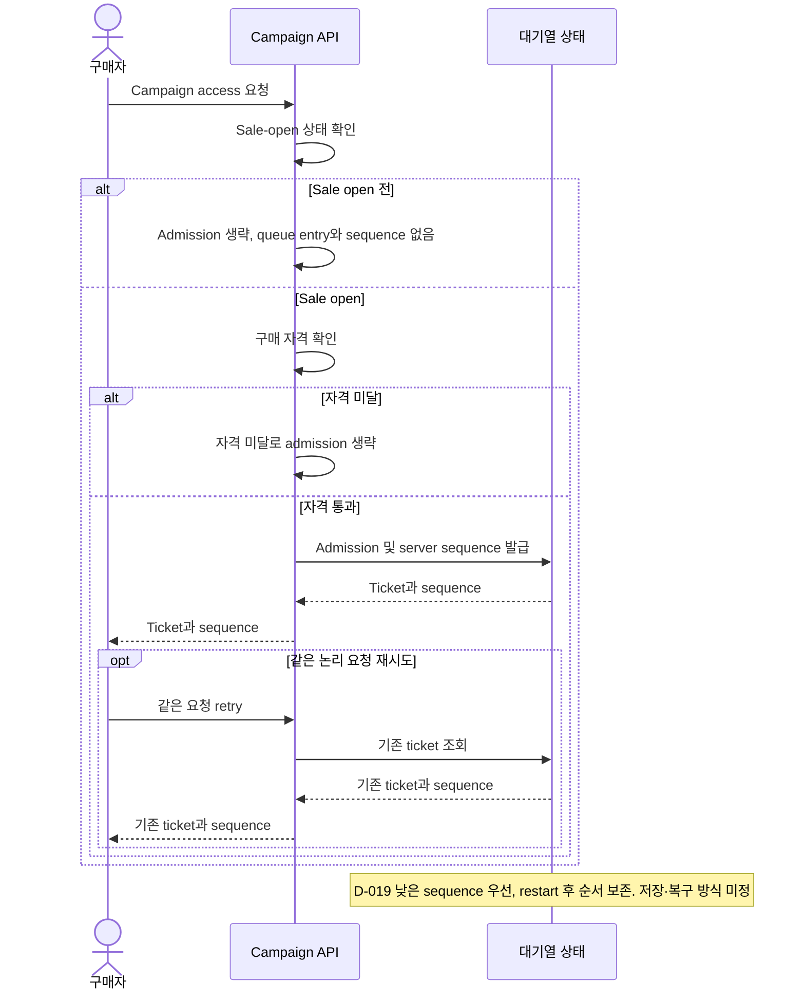

# 비즈니스 규칙
문서 유형: 기준 자료

규칙 상태: `✓ Confirmed baseline`, `△ Proposed`, `? OPEN`. 가상 scenario 기준이며 구현/실험 결과 아님. queue admission, ticket, idempotency key는 [Glossary](../01-discovery/glossary.md) 참조.

| ID | 규칙 | 상태 | 미정 경계 |
|---|---|---|---|
| BR-001 | 초기 시나리오: sale open 후 자격 통과 요청만 대기열에 등록. 등록 시 sequence 발급 ([D-020](../00-governance/decision-log.md)), 낮은 순번 우선 ([D-019](../00-governance/decision-log.md)), 같은 요청 retry ticket 재사용 ([D-021](../00-governance/decision-log.md)), restart 후 순서 보존 ([D-022](../00-governance/decision-log.md)). | ✓ Baseline (D-019~D-024) | [Q-003](../00-governance/assumptions-and-open-questions.md): storage/key/payload/expiry/re-entry/tie/bot/다른 유형 정책 ? OPEN. [Issue #24](https://github.com/Neo1228/ATLAS/issues/24), [Issue #33](https://github.com/Neo1228/ATLAS/issues/33). |
| BR-002 | 초기 시나리오: 대체 가능한 수량형 SKU 1종과 campaign별 독립 pool ([D-023](../00-governance/decision-log.md)). 예약·판매 수량은 pool capacity 이내. | △ Proposed ([D-017/D-023](../00-governance/decision-log.md)) | [Q-002/Q-004](../00-governance/assumptions-and-open-questions.md): 재고 생명주기, 조정·취소·환불·결제 경합 ? OPEN. |
| BR-003 | [D-025~D-027](../00-governance/decision-log.md): PSP 요청 전 inventory hold; `AUTHORIZE → CAPTURE`; capture success 확인 후 claim. TTL/cancel 시 capture 상태 확인; success면 claim, 아직 캡처되지 않고 authorization이 active면 void. Capture/void `PENDING`/UNKNOWN은 same-attempt reconcile하며 stock unavailable. Release는 confirmed non-payment 및 void/expiry 확인 후. | ✓ Baseline | [Q-004/Q-005/Q-009](../00-governance/assumptions-and-open-questions.md): TTL/deadline 값, retry/key retention, long-lived UNKNOWN escalation/compensation ? OPEN. [Issue #42](https://github.com/Neo1228/ATLAS/issues/42); [REF-034~037](../00-governance/reference-register.md). |

## 기준 흐름 — 합성 scenario
1. Seller가 한 campaign에 수량형 SKU 1종과 독립 재고 pool을 설정. 실제 수량은 실험 profile에서 결정.
2. Sale open 전에는 queue admission과 sequence 발급 없음 ([D-024](../00-governance/decision-log.md)).
3. Sale open 후 자격 통과 Buyer 요청을 admission하고 server sequence 발급. 낮은 sequence 우선 ([D-019/D-020](../00-governance/decision-log.md)).
4. 같은 논리 queue 요청 retry는 기존 ticket/sequence 재사용. service/worker restart 후 순서 유지 ([D-021/D-022](../00-governance/decision-log.md)).
5. Payment attempt 전 inventory hold. Authorization success는 funds hold이며 inventory claim 아님. Capture success 확인 후 claim ([D-025/D-026](../00-governance/decision-log.md)).
6. TTL/cancel이면 capture outcome 확인. Success면 claim; 미캡처 상태이며 authorization active면 void 요청 ([D-027](../00-governance/decision-log.md)).
7. Capture/void outcome `PENDING` 또는 UNKNOWN이면 failure로 추정하지 않고 same attempt reconcile. Stock는 계속 unavailable.
8. Confirmed non-payment 및 authorization void/expiry 확인 후 inventory release. TTL·deadline·장기 unresolved escalation 수치는 OPEN ([Q-004/Q-005](../00-governance/assumptions-and-open-questions.md)).

첫 sequence diagram은 [D-019~D-024](../00-governance/decision-log.md)의 queue 기준. 잔여 경계 [Q-003](../00-governance/assumptions-and-open-questions.md). 다음 state diagram은 [D-025~D-027](../00-governance/decision-log.md)의 inventory/payment lifecycle만 나타내며 PSP API/DB 구현 아님. [Issue #33](https://github.com/Neo1228/ATLAS/issues/33), [Issue #35](https://github.com/Neo1228/ATLAS/issues/35), [Issue #37](https://github.com/Neo1228/ATLAS/issues/37), [Issue #42](https://github.com/Neo1228/ATLAS/issues/42) 참조.

## 결제 중 재고 hold 흐름 — 초기 시나리오
[D-025~D-027](../00-governance/decision-log.md)에서 확정한 inventory/payment state boundary. PSP API, DB transaction, inventory storage 방식은 정하지 않음. TTL/deadline 수치와 escalation policy [Q-004/Q-005](../00-governance/assumptions-and-open-questions.md) OPEN.

```mermaid
stateDiagram-v2
    state "UNKNOWN operation" as Unknown
    state "Capture pending" as CapturePending
    state "Capture declined" as CaptureDeclined
    state "Authorization void pending" as VoidPending
    [*] --> Available
    Available --> Held: hold before PSP request
    Held --> Authorized: authorization confirmed
    Held --> Available: authorization definitively failed
    Held --> Unknown: authorization outcome ambiguous
    Authorized --> CapturePending: capture requested
    Authorized --> VoidPending: TTL/cancel before capture
    CapturePending --> Claimed: capture completed
    CapturePending --> CaptureDeclined: decline confirmed
    CapturePending --> Unknown: outcome ambiguous
    CapturePending --> CapturePending: still pending; stock unavailable
    CaptureDeclined --> VoidPending: authorization still active
    CaptureDeclined --> Available: definitive non-payment; no active authorization
    Unknown --> Claimed: reconciliation confirms capture completed
    Unknown --> CapturePending: reconciliation confirms capture pending
    Unknown --> CaptureDeclined: reconciliation confirms capture declined
    Unknown --> VoidPending: not captured; authorization active
    Unknown --> Available: definitive non-payment; no active authorization
    Unknown --> Unknown: reconcile same operation/attempt
    VoidPending --> Available: void/expiry and non-payment confirmed
    VoidPending --> Claimed: capture success confirmed
    VoidPending --> Unknown: void outcome ambiguous
```

Capture/void retry limits, deadlines, and escalation are not specified ([Q-004/Q-005](../00-governance/assumptions-and-open-questions.md)). A completed capture cannot be voided; post-capture reversal/refund remains outside this flow ([REF-035/036](../00-governance/reference-register.md)).
