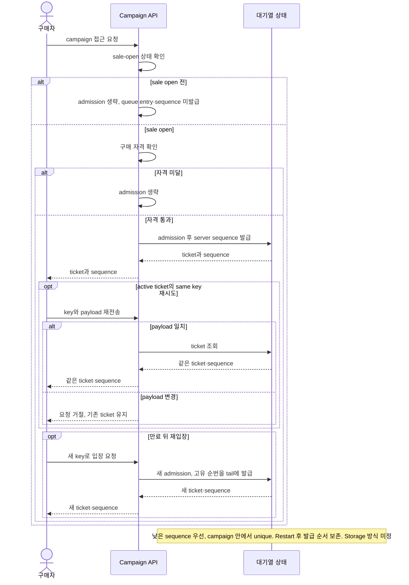

# 비즈니스 규칙
문서 유형: 기준 자료

규칙 상태: `✓ Confirmed baseline`, `△ Proposed`, `? OPEN`. 내용은 합성 scenario이며 구현·실험 결과 아님. Queue admission, ticket, idempotency key 용어는 [Glossary](../01-discovery/glossary.md) 참조.

| ID | 규칙 | 상태 | 미정 경계 |
|---|---|---|---|
| BR-001 | 초기 scenario: sale open 후 자격 통과 요청만 admission ([D-020/D-024](../00-governance/decision-log.md)); 낮은 sequence 우선 ([D-019](../00-governance/decision-log.md)). D-034: active ticket에 same key·same payload는 기존 ticket/sequence 반환; payload가 바뀌면 거절하고 ticket 유지; expiry 후 새 key로 재입장하면 새 unique sequence를 tail에 발급. Restart 후 발급 순서 보존 ([D-022](../00-governance/decision-log.md)). | ✓ Baseline (D-019~D-024/D-034) | [Q-003](../00-governance/assumptions-and-open-questions.md): key scope/retention, payload 비교 필드, expiry trigger/duration, storage/atomicity, bot defense, 다른 판매 유형 OPEN. [Issues #24](https://github.com/Neo1228/ATLAS/issues/24), [#60](https://github.com/Neo1228/ATLAS/issues/60), [#66](https://github.com/Neo1228/ATLAS/issues/66), [PR #67](https://github.com/Neo1228/ATLAS/pull/67). |
| BR-002 | 초기 기준: 대체 가능한 수량형 SKU 1종과 campaign별 독립 pool ([D-023](../00-governance/decision-log.md)). Reservation당 1개. 각 확정 전이 후 `available + reserved + claimed = initial capacity`; 모든 수량 ≥ 0. Hold 시 reserved, capture success 시 claimed. Release는 confirmed non-payment 뒤; authorization이 있으면 void/expiry 확인도 필요 ([D-027/D-035](../00-governance/decision-log.md)). | ✓ Baseline ([D-017/D-023/D-035](../00-governance/decision-log.md)) | 다중 수량, 공유 재고, 판매 중 조정·재입고, post-claim 취소·환불 정책은 초기 범위 제외. D-027의 checkout expiry/authorization void 복구는 유지. 저장·atomicity는 Gate 3 미정 ([Q-002/Q-004](../00-governance/assumptions-and-open-questions.md)). [Issue #62](https://github.com/Neo1228/ATLAS/issues/62), [PR #63](https://github.com/Neo1228/ATLAS/pull/63), [Issue #66](https://github.com/Neo1228/ATLAS/issues/66), [PR #67](https://github.com/Neo1228/ATLAS/pull/67). |
| BR-003 | [D-025~D-030](../00-governance/decision-log.md): PSP 요청 전 inventory hold; capture success 후 claim. Confirmed hold부터 initial AUTHORIZE 제출까지 10분 fixed window. Production TTL/SLO 미정. 만료 시 checkout 종료, 연장 없음. 제출된 PENDING/UNKNOWN은 D-027에 따라 같은 attempt를 reconcile; 결과 전 새 attempt 금지. | ✓ Baseline | Production TTL/completion SLO, 측정 분포, provider deadline, retry/key retention, escalation/compensation OPEN ([Q-004/Q-005/Q-008](../00-governance/assumptions-and-open-questions.md)); [Issue #48](https://github.com/Neo1228/ATLAS/issues/48), [Issue #66](https://github.com/Neo1228/ATLAS/issues/66), [PR #67](https://github.com/Neo1228/ATLAS/pull/67). |

## 기준 흐름 — 합성 scenario
1. Seller가 campaign 하나에 수량형 SKU 1종과 독립 inventory pool을 설정. 실제 수량은 test profile에서 선택. Reservation당 1개 ([D-023/D-035](../00-governance/decision-log.md)).
2. Sale open 전에는 queue admission이나 sequence 발급 없음 ([D-024](../00-governance/decision-log.md)).
3. Sale open 후 자격을 통과한 Buyer 요청만 admission. Server sequence 부여, 낮은 순서 우선 ([D-019/D-020](../00-governance/decision-log.md)).
4. Active ticket의 같은 key·payload 재시도는 기존 ticket/sequence 반환. Payload가 바뀌면 거절; 만료 후 재입장은 새 key와 새 순번 사용 ([D-021/D-034](../00-governance/decision-log.md)). Service/worker restart 후 순서 보존 ([D-022](../00-governance/decision-log.md)).
5. Inventory hold 확정 시 Buyer-facing timer 시작 ([D-028/D-029](../00-governance/decision-log.md)).
6. Buyer는 만료 전 initial AUTHORIZE 요청 제출. 미제출이면 checkout 종료, payment attempt 없음.
7. 만료 전 제출한 AUTHORIZE는 만료 뒤에도 resolve 가능. Capture/void가 PENDING/UNKNOWN이면 stock을 hold하고 같은 attempt를 reconcile; 새 attempt 금지 ([D-027](../00-governance/decision-log.md)).
8. Capture success 후 inventory claim. 그 외에는 non-payment와 authorization void/expiry가 확인된 뒤 release ([D-027](../00-governance/decision-log.md)).
9. 각 확정 전이 후 `available + reserved + claimed = initial capacity`; 각 값은 0 이상 ([D-035](../00-governance/decision-log.md)).

Queue sequence diagram은 [D-019~D-024/D-034](../00-governance/decision-log.md) 기준. 남은 경계: [Q-003](../00-governance/assumptions-and-open-questions.md). [Issue #60](https://github.com/Neo1228/ATLAS/issues/60).

## 결제 중 재고 hold 흐름 — 초기 시나리오
[D-025~D-030/D-035](../00-governance/decision-log.md)의 inventory/payment 경계. 초기 pool은 reservation당 1개이며 각 상태 전이 뒤 `available + reserved + claimed = initial capacity`; 각 값은 0 이상. PSP API, DB transaction, 저장 방식은 미정. TTL·recovery deadline도 OPEN ([Q-002/Q-004/Q-005](../00-governance/assumptions-and-open-questions.md)).

```mermaid
stateDiagram-v2
    state "UNKNOWN operation" as Unknown
    state "Capture pending" as CapturePending
    state "Capture declined" as CaptureDeclined
    state "Authorization void pending" as VoidPending
    state "Reserved (inventory hold)" as Held
    state "Claimed (capture confirmed)" as Claimed
    [*] --> Available
    Available --> Held: 1 unit hold 확정; fixed timer 시작
    Held --> Available: AUTHORIZE 제출 전 TTL 만료
    Held --> Authorized: AUTHORIZE 확인
    Held --> Unknown: 만료 전 제출; 결과 불명
    Authorized --> CapturePending: capture 요청
    Authorized --> VoidPending: TTL/cancel; capture 미완료
    CapturePending --> Claimed: capture 완료
    CapturePending --> CaptureDeclined: 거절 확인
    CapturePending --> Unknown: 결과 불명
    CapturePending --> CapturePending: pending 지속; stock unavailable
    CaptureDeclined --> VoidPending: authorization 유효
    CaptureDeclined --> Available: non-payment 확정; active authorization 없음
    Unknown --> Claimed: capture 완료 확인
    Unknown --> CapturePending: capture pending 확인
    Unknown --> CaptureDeclined: capture 거절 확인
    Unknown --> VoidPending: 미캡처, authorization 유효
    Unknown --> Available: non-payment 확정; active authorization 없음
    Unknown --> Unknown: 같은 operation/attempt reconcile
    VoidPending --> Available: void/expiry와 non-payment 확인
    VoidPending --> Claimed: capture success 확인
    VoidPending --> Unknown: void 결과 불명
```

Buyer-facing timer는 initial AUTHORIZE 제출 시 끝남. D-027 reconciliation이나 PSP operation deadline에는 영향 없음. TTL·recovery deadline 수치 OPEN ([Q-004/Q-005/Q-008](../00-governance/assumptions-and-open-questions.md)).
