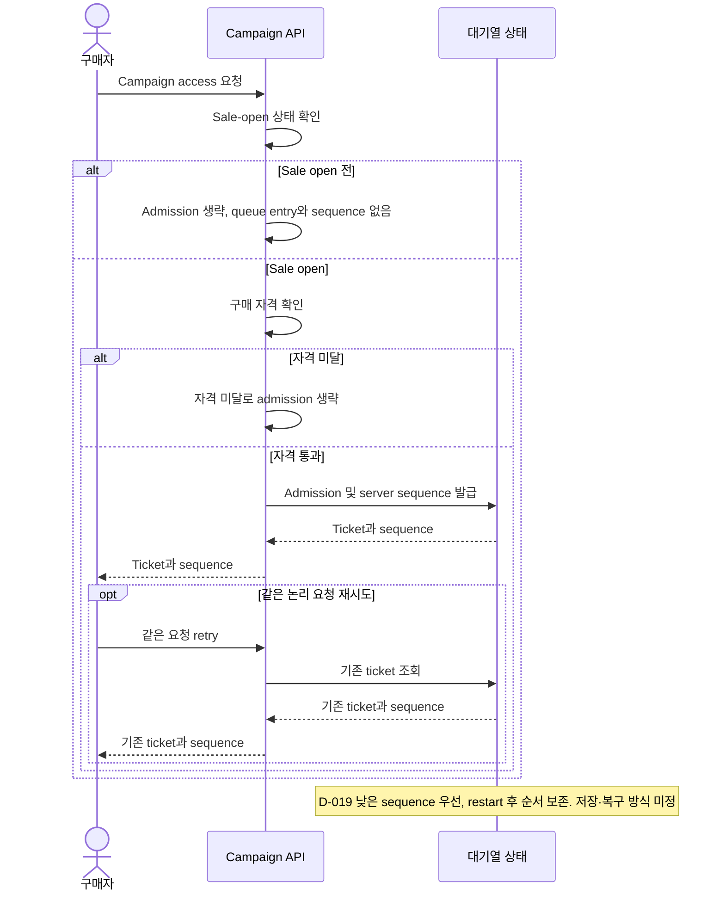

# 비즈니스 규칙
문서 유형: 기준 자료

규칙 상태: `✓ Confirmed baseline`, `△ Proposed`, `? OPEN`. 가상 scenario 기준이며 구현/실험 결과 아님. queue admission, ticket, idempotency key는 [Glossary](../01-discovery/glossary.md) 참조.

| ID | 규칙 | 상태 | 미정 경계 |
|---|---|---|---|
| BR-001 | 초기 시나리오: sale open 후 자격 통과 요청만 대기열에 등록. 등록 시 sequence 발급 (D-020), 낮은 순번 우선 (D-019), 같은 요청 retry ticket 재사용 (D-021), restart 후 순서 보존 (D-022). | ✓ Baseline (D-019~D-024) | Q-003: storage/key/payload/expiry/re-entry/tie/bot/다른 유형 정책 ? OPEN. [Issue #24](https://github.com/Neo1228/ATLAS/issues/24), [Issue #33](https://github.com/Neo1228/ATLAS/issues/33). |
| BR-002 | 초기 시나리오: 대체 가능한 수량형 SKU 1종과 campaign별 독립 pool (D-023). 예약·판매 수량은 pool capacity 이내. | △ Proposed (D-017, D-023) | Q-002/Q-004: 재고 생명주기, 조정·취소·환불·결제 경합 ? OPEN. |

## 기준 흐름 — 합성 scenario
1. Seller가 한 campaign에 수량형 SKU 1종과 독립 재고 pool을 설정. 실제 수량은 실험 profile에서 결정.
2. Sale open 전에는 queue admission과 sequence 발급 없음 (D-024).
3. Sale open 후 자격 통과 Buyer 요청을 admission하고 server sequence 발급. 낮은 sequence 우선 (D-019/D-020).
4. 예약·판매량은 pool capacity 초과 금지 (BR-002). 상태 전이와 acceptance는 미정.
5. 같은 논리 요청 retry는 기존 ticket/sequence 재사용. service/worker restart 후 순서 유지 (D-021/D-022).
6. Storage, key scope/retention, expiry/re-entry, tie, bot, 다른 판매 유형은 ? OPEN.

도식은 D-019~D-024의 초기 시나리오만 표현. Queue 미정 경계는 [Q-003](../00-governance/assumptions-and-open-questions.md). 저장/결제/성능 구현을 정한 것이 아님. [Invariants](invariants.md), [Experiment Registry](../08-experiments/experiment-registry.md), [Issue #33](https://github.com/Neo1228/ATLAS/issues/33) 참조.
