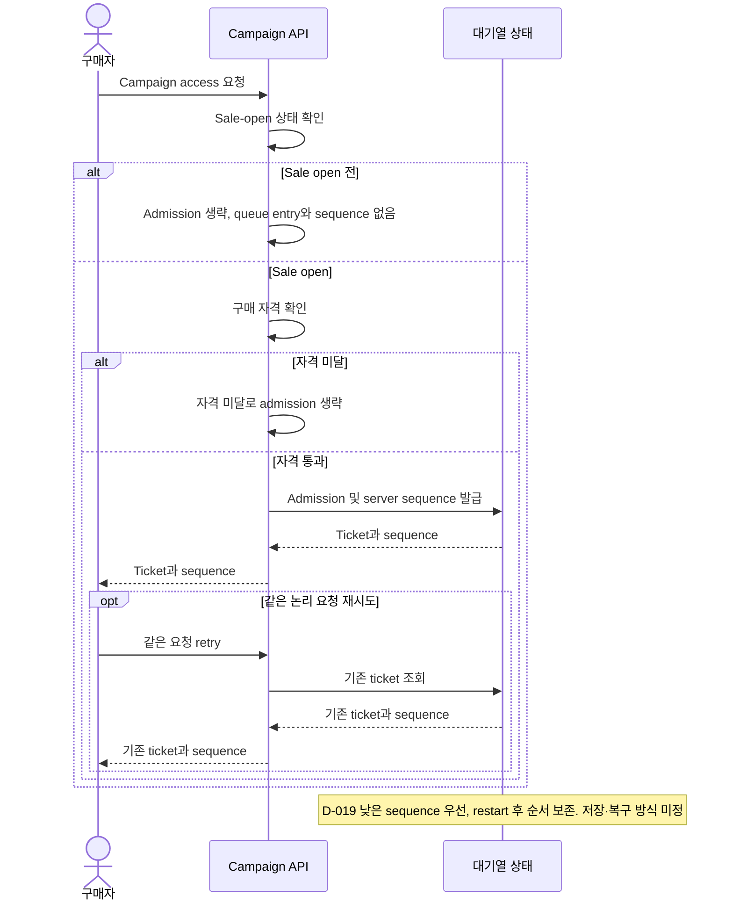

# 비즈니스 규칙
문서 유형: 기준 자료

규칙 상태: `✓ Confirmed baseline`, `△ Proposed`, `? OPEN`. 가상 scenario 기준이며 구현/실험 결과 아님. queue admission, ticket, idempotency key는 [Glossary](../01-discovery/glossary.md) 참조.

| ID | 규칙 | 상태 | 미정 경계 |
|---|---|---|---|
| BR-001 | 초기 시나리오: sale open 후 자격 통과 요청만 대기열에 등록. 등록 시 sequence 발급 ([D-020](../00-governance/decision-log.md)), 낮은 순번 우선 ([D-019](../00-governance/decision-log.md)), 같은 요청 retry ticket 재사용 ([D-021](../00-governance/decision-log.md)), restart 후 순서 보존 ([D-022](../00-governance/decision-log.md)). | ✓ Baseline (D-019~D-024) | [Q-003](../00-governance/assumptions-and-open-questions.md): storage/key/payload/expiry/re-entry/tie/bot/다른 유형 정책 ? OPEN. [Issue #24](https://github.com/Neo1228/ATLAS/issues/24), [Issue #33](https://github.com/Neo1228/ATLAS/issues/33). |
| BR-002 | 초기 시나리오: 대체 가능한 수량형 SKU 1종과 campaign별 독립 pool ([D-023](../00-governance/decision-log.md)). 예약·판매 수량은 pool capacity 이내. | △ Proposed ([D-017/D-023](../00-governance/decision-log.md)) | [Q-002/Q-004](../00-governance/assumptions-and-open-questions.md): 재고 생명주기, 조정·취소·환불·결제 경합 ? OPEN. |
| BR-003 | [D-025/D-026](../00-governance/decision-log.md): inventory hold before PSP request; initial flow `AUTHORIZE → CAPTURE`. Authorization success is intermediate; only confirmed capture success claims inventory. Definitive authorization failure releases hold. UNKNOWN at any operation is reconciled on same attempt before a new attempt. | ✓ Baseline | [Q-004/Q-005/Q-009](../00-governance/assumptions-and-open-questions.md): TTL, expiry, capture/void failure and cancellation recovery, endpoint/key/retry contract, long-lived UNKNOWN ? OPEN. [Issue #37](https://github.com/Neo1228/ATLAS/issues/37); [REF-030~032](../00-governance/reference-register.md). |

## 기준 흐름 — 합성 scenario
1. Seller가 한 campaign에 수량형 SKU 1종과 독립 재고 pool을 설정. 실제 수량은 실험 profile에서 결정.
2. Sale open 전에는 queue admission과 sequence 발급 없음 ([D-024](../00-governance/decision-log.md)).
3. Sale open 후 자격 통과 Buyer 요청을 admission하고 server sequence 발급. 낮은 sequence 우선 ([D-019/D-020](../00-governance/decision-log.md)).
4. 같은 논리 queue 요청 retry는 기존 ticket/sequence 재사용. service/worker restart 후 순서 유지 ([D-021/D-022](../00-governance/decision-log.md)).
5. Payment attempt 전에 inventory hold. Authorization success는 funds hold이며 inventory claim 아님. Capture success 확정 후 hold를 claim으로 전환 ([D-025/D-026](../00-governance/decision-log.md)).
6. Authorization이 definitive failure면 hold release. Timeout/통신 단절/ambiguous response는 operation별 UNKNOWN; same attempt를 reconcile하기 전 새 attempt 금지.
7. Capture failure, void/cancel 및 auth expiry의 stock/funds recovery policy는 OPEN. Authorization confirmed 상태에서는 capture/expiry policy가 합의될 때까지 재고 해제 여부를 추정하지 않음 ([Q-004/Q-005](../00-governance/assumptions-and-open-questions.md)).

첫 sequence diagram은 [D-019~D-024](../00-governance/decision-log.md)의 queue 기준. 잔여 경계 [Q-003](../00-governance/assumptions-and-open-questions.md). 다음 state diagram은 [D-025/D-026](../00-governance/decision-log.md)의 inventory/payment lifecycle만 나타내며 PSP API/DB 구현 아님. [Issue #33](https://github.com/Neo1228/ATLAS/issues/33), [Issue #35](https://github.com/Neo1228/ATLAS/issues/35), [Issue #37](https://github.com/Neo1228/ATLAS/issues/37) 참조.

## 결제 중 재고 hold 흐름 — 초기 시나리오
[D-025/D-026](../00-governance/decision-log.md)의 status boundary만 표현. PSP API/DB transaction/재고 저장 방식은 미정. Expiry, capture/void failure recovery [Q-004/Q-005](../00-governance/assumptions-and-open-questions.md) OPEN.

```mermaid
stateDiagram-v2
    state "UNKNOWN operation outcome" as Unknown
    state "EXPIRED_PENDING_PAYMENT" as ExpiredPending
    [*] --> Available
    Available --> Held: hold before PSP request
    Held --> Authorized: authorization confirmed
    Held --> Available: authorization definitively failed
    Held --> Unknown: authorization outcome ambiguous
    Authorized --> Claimed: capture success confirmed
    Authorized --> Unknown: capture outcome ambiguous
    Unknown --> Authorized: same attempt confirms authorization
    Unknown --> Claimed: same attempt confirms capture success
    Unknown --> Available: authorization definitively failed
    Unknown --> Unknown: reconcile same operation/attempt
    Unknown --> ExpiredPending: inventory TTL elapses while outcome unknown
    ExpiredPending --> Claimed: reconciliation confirms capture success
    ExpiredPending --> Available: definitive authorization failure
    ExpiredPending --> ExpiredPending: unresolved; inventory unavailable
```

`Authorized` hold expiry and capture/void failure transitions are intentionally omitted pending [Q-004/Q-005](../00-governance/assumptions-and-open-questions.md). Diagram is a domain flow, not a PSP API contract.
