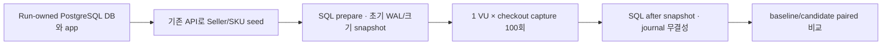

# EXP-022 — 정산 애플리케이션 쓰기 비용 A/B

**상태:** 역사적 측정 완료 · production index 미채택 · 현재 PayPal order flow와 비교 불가

## 목적과 범위

`settlement_journal(recorded_at, journal_id)` 후보 index가 기존 checkout capture 쓰기 경로의 latency, WAL, 저장 공간에 미치는 영향 비교.

- 실행: baseline/candidate 각 3회 · 회차별 capture 100건 · 1 VU
- 회차 중앙값의 중앙값: 양 arm 모두 **27 ms**
- Candidate WAL 추가량: 100건당 **8,056–8,344 bytes** · paired median **8,312 bytes**
- Candidate index: 측정 전 **8,192 bytes** · 100 journal 이후 **16,384 bytes**
- **결론:** write-path latency 개선 확인 없음. WAL·저장 공간 증가 확인. Production index 채택 근거 부족

## 검증된 경로와 범위

- Existing API: seller/product/SKU 생성 → Cart 등록 → checkout → checkout payment
- `CAPTURED` 응답 검증. [기존 k6 setup/checkout 패턴](../../load-tests/buyer-checkout.js), [Settlement ledger integration test](../../ATLAS-application/src/test/java/com/atlas/settlement/SettlementLedgerIntegrationTest.java)
- 합성 fixture: 판매자 1곳 · SKU 1개 · 단가 100 KRW · 재고 100. 회차별 고유 buyer와 checkout `Idempotency-Key`
- Setup은 별도 k6 `PHASE=seed`. SQL `prepare` snapshot 이후 `PHASE=measure`로 100회 직렬 checkout/capture 수행. 마지막에 SQL `snapshot`
- Refund HTTP는 end-to-end request/response 계약 미검증으로 제외. 새 route·direct SQL business write 없음

## 환경·데이터·workload

- macOS 27.2 arm64 · Docker Engine 29.5.2 · Linux Ubuntu 24.04.4 · 4 CPU · memory 10,405,494,784 bytes
- PostgreSQL 18.6 `sha256:3a4264520e121176619f54ff867d12774bc81e95e7b84db58d63bccdb6144b81`
- k6 2.3.0 `sha256:2dd4756ec6e14e62778916e1eb850108e4b499304c02df56760fa0bdb0fba0b8` · Java Temurin 25.0.5 runtime image `sha256:ecdc0adb37bde1a281c4d245a3cd535004b1fc8322d560f5b09463b248c81df0`
- Application JAR SHA-256: `19452d7965390f339cd206b29b8463e5c689d9a6ae895f3efc3f869ebad04dd4`
- PostgreSQL settings: `shared_buffers=128MB`, `work_mem=4MB`, `effective_cache_size=4GB`, `random_page_cost=4`, `synchronous_commit=on`, `fsync=on`, `full_page_writes=on`, `max_connections=100`
- Run별 DB/container/network 신규 생성. Docker internal network · host port 미공개 · named volume 없음 · 기본 `atlas` DB 미사용
- SQL은 `expected_arm`, `expected_phase`, 정확한 `expected_database`를 요구. `prepare`는 빈 ledger를 확인하고 candidate에만 index 생성. `snapshot`은 arm/index 상태 일치 확인
- Candidate DB는 1회 100 capture 이후 `journal=100`, `entry=200`; journal별 entry 수 2건, 차변/대변 불균형 0건

## 결과

| Arm | 회차 | Capture latency median [min–max] ms | p95 ms* | WAL bytes | DB bytes Δ | Journal bytes Δ | Candidate index bytes 후 |
|---|---:|---:|---:|---:|---:|---:|---:|
| Baseline | 1 | 26 [20–244] | 43.6 | 1,109,224 | 884,736 | 73,728 | — |
| Candidate | 1 | 27 [21–293] | 60.5 | 1,117,568 | 892,928 | 81,920 | 16,384 |
| Baseline | 2 | 27 [19–219] | 50.1 | 1,109,256 | 884,736 | 73,728 | — |
| Candidate | 2 | 27 [19–251] | 46.1 | 1,117,312 | 892,928 | 81,920 | 16,384 |
| Baseline | 3 | 27 [20–233] | 53.1 | 1,109,080 | 884,736 | 73,728 | — |
| Candidate | 3 | 26 [20–199] | 47.0 | 1,117,392 | 892,928 | 81,920 | 16,384 |

- Paired WAL Δ per 100 capture: **+8,344 / +8,056 / +8,312 bytes**
- Paired latency median Δ: **+1 / 0 / −1 ms**. No consistent improvement
- Candidate index: prepare 후 8,192 bytes · measured writes 후 16,384 bytes
- K6: 회차별 100 operations · 300 HTTP requests · failed rate 0 · 500/500 checks 통과
- SQL integrity: 회차별 100 journal · 200 entry · wrong entry-count 0 · unbalanced journal 0

\* 100회 표본의 기술 통계. p95는 SLO·capacity 기준이 아님. WAL byte delta는 SQL prepare snapshot 뒤부터 capture 후 snapshot까지 측정. Commit/transaction duration은 직접적·대칭적인 DB 측정법을 검증하지 못해 **측정 불가**.

## 제외한 사전 실행

초기 baseline 사전 실행에서 capture 100회는 완료했으나 k6 summary metric parser 오류로 SQL after-snapshot을 확보하지 못했다. 실험 전용 DB/container/network는 정리했으며 A/B 결과에서 제외. [제외 기록](results/exp-022/exp022-preflight-excluded-baseline-k6.json).

## 해석과 한계

- EXP-020의 좁은 기간 조회 개선과 별개로, 이번 실험은 정산 write path 비용만 평가
- 측정 표본: Seller 1곳·SKU 1개·1 VU·합성 checkout 100회. 이 결과로 동시 처리량·TPS/RPS·SLO·capacity를 추정하지 않음.
- App latency는 Cart/Order/Inventory/payment 전체 경로. Settlement 또는 commit 전용 시간이 아님
- Seed setup은 WAL 기준선 전에 실행. SQL snapshot은 누적 LSN과 크기이며 peak/rate가 아님
- 실험에서 migration, index, configuration, runtime 설정은 변경하지 않음.
- Prometheus/Grafana/Tempo/Alloy/Toxiproxy 미사용: 동시 부하·network fault·distributed trace 가설이 없는 직렬 비교. K6 latency와 PostgreSQL WAL/크기/ledger snapshot만 사용

## 재현 방법

> [!NOTE]
> 이 결과는 이전 checkout/capture 경로의 기록. PayPal provider `PENDING`은 API `AUTHORIZATION_PENDING`으로 매핑되고 checkout은 `PAYMENT_PENDING` 반환. Capture는 Buyer approval 이후; 기존 100-capture workload와 현재 Sandbox order smoke는 직접 비교 불가.

현재 order-submission smoke:

- [buyer-checkout.js](../../load-tests/buyer-checkout.js)·[gate4.js](../../load-tests/gate4.js)은 `AUTHORIZATION_PENDING`·`PAYMENT_PENDING`·approval URL 확인
- Buyer approval·capture·settlement write 미수행. 최신 K6 근거는 [EXP-027](EXP-027-k6-current-auth-and-paypal-order-smoke.md)

아래 원자료는 과거 결과 보존용이며 현재 PayPal 흐름의 재현 가능한 baseline이 아님.

## 재현 산출물

- 과거 K6 harness는 retired. 현재 smoke는 기존 100-capture workload를 재현하지 않음
- [요약 JSON](results/exp-022/exp022-summary.json)
- Per-run SQL/K6 원자료: 요약 JSON의 `rawResultFile`, `rawK6SummaryFile` 경로
- 스키마/entry-side 근거: [V10 settlement ledger migration](../../ATLAS-application/src/main/resources/db/migration/V10__gross_capture_settlement_ledger.sql)
- [EXP-020 정산 read/index 기준 실험](EXP-020-settlement-index-selectivity-cost.md)

## 참고 자료

- [GitLab — Database layout and access patterns](https://docs.gitlab.com/development/database/layout_and_access_patterns/): hot-row 경합, transaction 대기, index write/WAL 비용에 대한 질적 참고. 수치 목표를 ATLAS의 기준치로 일반화하지 않음
- [Datadog — Debugging PostgreSQL performance](https://www.datadoghq.com/blog/engineering/debugging-postgres-performance/): no-op `ON CONFLICT DO UPDATE`의 row lock/WAL 관측 사례. ATLAS와 동일 쿼리·workload로 간주하지 않음
