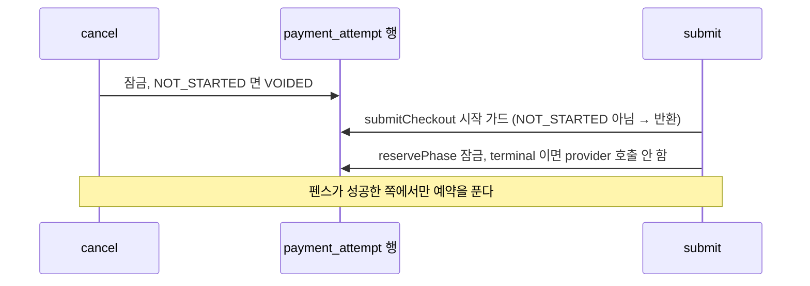

# EXP-049: 도메인 상태 전이·멱등성 결함 6건

**추적 이슈:** [#440](https://github.com/Neo1228/ATLAS/issues/440)

**상태:** 코드 감사 + 회귀 테스트 (PostgreSQL 18.6 Testcontainers, 단위 테스트)

## 왜 이 작업을 했는가

읽기 전용 도메인 감사가 정상적인 공개 API 호출 순서로 도달할 수 있는 결함을 찾았다. 각 결함을 코드로 다시 확인했고, 감사 주장이 틀린 부분은 고치지 않고 기록했다.

## 결함과 수정

| # | 결함 | 수정 | 회귀 테스트 |
|---|---|---|---|
| 1 | 운영자가 지급을 FAILED 로 처리하면 같은 기간을 다시 요청할 수 없다 | V56: 기간 유니크를 `state <> 'FAILED'` 부분 인덱스로 교체. 같은 키 재요청은 FAILED 를 그대로 보여주고, 새 키는 새 지급을 만든다 | `SettlementPayoutFailureRetryIntegrationTest` |
| 2 | 승격된 대기열 티켓이 가입 시점 만료를 유지해, 오래 기다린 구매자의 슬롯이 즉시 만료된다 | 승격 시 `expires_at = 획득 시각 + 그 티켓 캠페인의 TTL` | `AdmissionPromotionCheckoutWindowIntegrationTest` |
| 3 | 결제 시도 전 checkout 취소가 `CANCEL_PENDING` 에 영구 정체되고, 이후 reconcile 이 새 PayPal 주문을 만든다 | 결제 시도 행 펜스(`abandonUnstartedCheckout`) 성공 시에만 예약 해제·`CANCELLED` | `CheckoutCancelWithoutAttemptIntegrationTest` |
| 4 | FX provider 가 null 을 돌려주면 500 | null 을 캐시하지 않고 `PAYMENT_PROVIDER_UNAVAILABLE`(503) | `FxConversionServiceProviderUnavailableTest` |
| 5 | 결제 완료 캠페인 주문 취소가 200 no-op | `CONFLICT`(409), 환불 경로 안내 | `PaidOrderCancelContractIntegrationTest` |
| 6 | 환불 idempotency key 가 전 판매자에 걸쳐 전역 유니크 | V57: `(order_id, idempotency_key)` 유니크. 한 checkout 의 여러 판매자가 같은 키를 써도 payment 계층에서 충돌하지 않도록 provider 키를 `order:<orderId>:<key>` 로 저장 | `OrderRefundLifecycleIntegrationTest#refundIdempotencyKeyIsScopedToOrderSoOtherSellersCanReuseIt` |

## 감사가 틀렸거나 부분적으로만 맞았던 것

- **#4**: 실제 ECOS provider 는 장애 시 이미 `PAYMENT_PROVIDER_UNAVAILABLE` 을 던진다. 500 은 provider 가 예외 대신 null 을 돌려주는 경우에만 났다. 그 경로만 막았다.
- **#2**: 가입 시점 만료가 "총 예산"으로 의도됐는지 먼저 확인했다. 가입 즉시 슬롯을 받은 티켓은 `expires_at` 과 `checkout_slot_acquired_at` 을 같은 시각 기준으로 기록하고, 문서(D-041, ADR-0005, BR-001)도 TTL 을 캠페인별 체크아웃 창으로 다룬다. 승격 경로만 창을 갱신하지 않았으므로 결함으로 판단했다.

## #3 에서 처음 수정이 틀렸던 이유

처음에는 결제 시도가 NOT_STARTED 면 바로 예약을 풀고 `CANCELLED` 로 닫았다. 기존 단위 테스트 `CheckoutBehaviorTest#capturedPaymentWinsCancellationRaceAndIsRecorded` 가 이를 잡았다.

`submit` 은 checkout 잠금을 놓은 뒤 provider 를 호출한다. 그래서 취소 시점에 시도가 NOT_STARTED 로 보여도 곧 캡처될 수 있다. 그때 예약을 풀면 **결제는 성사됐는데 재고는 풀린 상태**가 된다.

해결은 checkout 이 아니라 **결제 시도 행에 펜스**를 거는 것이다.

펜스가 실패하면(이미 provider 단계) 취소는 예약을 유지한 채 `CANCEL_PENDING` 으로 두고 provider 결과로 수렴시킨다.

## 한계

- #3 의 실제 다중 스레드 경합은 단위 테스트(mock)로만 재현했다. 통합 테스트는 경합 직전 상태를 JDBC 로 만들어 펜스의 두 방향을 확인한다.
- #6 의 V57 롤백은 두 주문이 같은 키를 쓴 뒤에는 전역 유니크를 되살릴 수 없다.
- #1 에서 같은 키로 재요청하면 FAILED 지급이 그대로 반환된다. 이것은 의도된 멱등 재생이며, 새 지급은 새 키로만 만든다.
