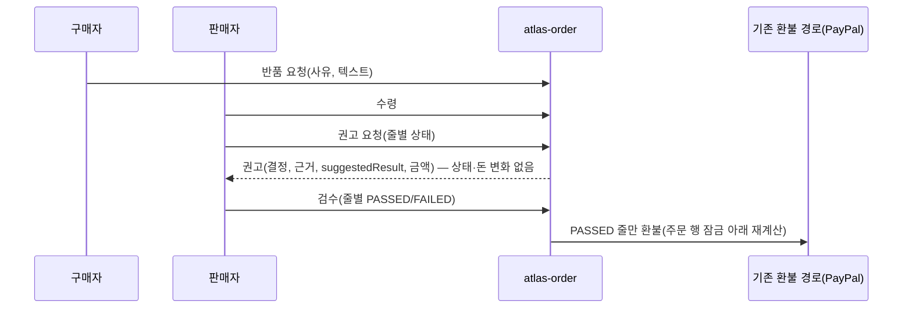

# EXP-121: 판매자 반품 권고의 결정 규칙을 라벨 60건으로 평가하고, 권고만으로는 돈이 움직이지 않음을 PostgreSQL로 확인한다

- 상태: ✓ 1단계 완료(결정 규칙, 라벨 60건, 오프라인 평가기, PostgreSQL 시험, 변이 점검). ✓ 2단계 완료(LLM 검토 층, 정해 둔 응답 모델로 경계 평가. 실제 모델 평가는 "2단계" 절의 조건). 결정은 [ADR-0110](../02-decisions/adr/ADR-0110-seller-return-refund-recommendation.md)과 D-189.
- 날짜: 2026-11-28
- 관련: [#737](https://github.com/Neo1228/ATLAS/issues/737), [ADR-0089](../02-decisions/adr/ADR-0089-return-window-and-inspection-deadline.md), [EXP-093](EXP-093-return-window-and-inspection-deadline.md)

## 문제 한 문장

판매자가 반품을 검수하면 같은 호출이 곧바로 PayPal 환불을 실행하는데, 판매자는 반품 사유를 모르고 기간·이미 환불된 수량·금액을 직접 대조해야 했으며, 여기에 AI 보조를 붙이면 잘못된 승인이 곧 금전 손실이 된다.

## 설계 요약

- 구매자 반품 요청에 사유 코드(`ReturnReason`)와 선택 자유 텍스트(500자)를 더했다(V15). 텍스트는 사유가 있을 때만 받는다.
- 판매자는 수령한 반품의 줄마다 상태(`UNOPENED`, `OPENED`, `USED`, `DAMAGED`, `DEFECT_CONFIRMED`, `NOT_RETURNED`)를 보내 권고를 받는다. 권고는 `APPROVE_FULL`/`APPROVE_PARTIAL`/`REJECT`/`HUMAN_REVIEW`, 근거 코드, 줄별 `suggestedResult`, 서버가 계산한 환불액이다.
- 권고는 읽기 전용이다. 판매자가 줄별 결과를 기존 `PUT .../inspection`에 보내야 환불된다.
- 결정 규칙의 입력 타입(`ReturnRecommendationRules.Facts`)에 자유 텍스트가 없다. 텍스트가 결과를 바꿀 수 있는 코드 경로가 없다.

## 라벨 기준 (규칙 코드보다 먼저 쓴 정책 문장)

라벨은 아래 정책 문장으로 붙였다. 반품 기간 7일(경계 포함), 자동 승인 상한 300,000원(포함)은 ADR-0089·ADR-0110의 가정값이다.

| ID | 기준 |
|---|---|
| P1 | 이미 환불된 수량과 합쳐 주문 수량을 넘는 줄이 있으면 반품 전체를 거절한다 |
| P2 | 상자에 없는 줄은 거절한다 |
| P3 | 요청이 그 줄 배송 완료 + 7일보다 늦으면 거절한다. 판매자가 하자를 확인한 줄은 사람이 판단한다 |
| P4 | 배송 완료 시각을 모르면 사람이 판단한다 |
| P5 | 기간 안에서 판매자가 하자를 확인한 줄은 승인한다 |
| P6 | 기간 안에서 미개봉·개봉(사용 흔적 없음)은 사유와 무관하게 승인한다 |
| P7 | 단순 변심인데 사용 흔적·파손이 있으면 거절한다 |
| P8 | 판매자 책임 주장이나 사유 없음인데 사용 흔적·파손이 있으면 사람이 판단한다 |
| P9 | 승인 쪽 환불 합계가 300,000원을 넘으면 사람이 판단한다 |
| P10 | 자유 텍스트만으로 승인으로 바꾸지 않는다. 텍스트가 판매자 관찰과 어긋나거나 규칙이 보지 못하는 사정(대체품 반송, 구성품 누락, 플랫폼 밖 환불 요구)을 드러내면 사람 검토, 구매자가 자기 사용·파손을 자백하면 거절이다 |

## 라벨 60건 구성

- 파일: `atlas-order/src/test/resources/return-recommendation-cases.txt`(테스트가 재생하는 고정 입력). 형식은 파일 머리말에 있다.
- 정답 분포: `APPROVE_FULL` 17, `APPROVE_PARTIAL` 7, `REJECT` 17, `HUMAN_REVIEW` 19.
- 사유 분포: `CHANGED_MIND` 28, `DEFECTIVE` 15, `NOT_AS_DESCRIBED` 4, `OTHER` 5, `DAMAGED_IN_DELIVERY` 3, `WRONG_ITEM` 3, 사유 없음 2.
- 자유 텍스트가 있는 사례 34건, 여러 줄 반품 15건.
- 일부러 넣은 경계: 기간 경계 정확히(C13)와 1초 뒤(C14), 분할 출고의 줄별 기간(C29), 상한 정확히(C18)와 1원 초과(C19), 부분 승인의 상한 초과(C47), 이미 환불된 수량(C21·C23·C35·C49), 출고 시각 모름(C28·C59).
- 프롬프트 주입 문구 4건(C31~C34): 승인을 지시하는 텍스트. 정답은 사실대로다(C31 승인, C32·C33 거절, C34 부분).
- 개인정보가 든 텍스트 2건(C55 전화번호, C56 이메일): 2단계 마스킹 확인용.

## 결과 (결정 규칙만)

명령: `./gradlew :atlas-order:test --tests '*ReturnRecommendationRulesEvaluationTest'`. 시험이 `atlas-order/build/reports/return-recommendation/rules.md`에 아래 표를 쓴다(저장소에 올리지 않음).

| 지표 | 값 |
|---|---|
| 건수 | 60 |
| 정확도 | 52/60 (0.867) |
| 매크로 F1 | 0.888 |
| 거짓 승인(정답 `REJECT` → `APPROVE_*`) | 0/17 |
| 승인 정답이 아닌데 승인 권고 | 4 |
| 사람 검토 이관 | 19/60 |
| 불일치 사례 | C38, C39, C41, C42, C43, C44, C55, C60 |

| 정답 \ 예측 | APPROVE_FULL | APPROVE_PARTIAL | REJECT | HUMAN_REVIEW |
|---|---|---|---|---|
| APPROVE_FULL | 17 | 0 | 0 | 0 |
| APPROVE_PARTIAL | 0 | 7 | 0 | 0 |
| REJECT | 0 | 0 | 13 | 4 |
| HUMAN_REVIEW | 4 | 0 | 0 | 15 |

- 불일치 8건은 모두 P10(텍스트를 읽어야 아는 사례)이다. 시험은 불일치 집합이 정확히 이 8건인지 확인하므로 규칙이 바뀌어 다른 사례가 어긋나면 실패한다.
  - 규칙 승인, 정답 사람 검토 4건: C38(결혼식에 입었다는 텍스트와 판매자 `OPENED`가 어긋남), C39(대체품 반송), C55(플랫폼 밖 현금 환불 요구), C60(구성품을 빼고 보냄). 돈이 나갈 수 있는 쪽의 오류이고 2단계 LLM 층의 대상이다.
  - 규칙 사람 검토, 정답 거절 4건: C41·C42·C43·C44(구매자가 사용·파손을 자백). 사람이 한 번 더 보는 비용 쪽의 오류다. ADR-0110 결정 5에 따라 LLM도 이 4건을 거절로 옮기지 않는다.
- 프롬프트 주입 4건은 모두 정답과 같다. 규칙이 텍스트를 읽지 않으므로 당연한 결과이며, 이 표는 그 구조가 실제로 지켜짐을 보여 줄 뿐이다.

## PostgreSQL 시험

`ReturnRecommendationIntegrationTest`(Testcontainers `postgres:18.6`, PayPal은 MockWebServer).

| 시험 | 확인하는 불변식 |
|---|---|
| `recommendationMovesNoMoneyAndOnlyTheSellerInspectionRefundsTheRecommendedAmount` | 수령 전 권고는 409. HTTP로 권고를 두 번 받아도 `order_refund_request`·`settlement_refund_reservation` 0행, PayPal 환불 요청 수 그대로, 반품은 `RECEIVED`. 주입 텍스트가 있어도 사실대로 `APPROVE_PARTIAL`이고 응답에 buyerRef가 없음. 다른 판매자는 409. 판매자가 `suggestedResult`로 검수해야 환불 1건이 생기고 금액이 권고 금액과 같음. 검수 뒤 권고는 409 |
| `reasonIsPersistedAndAReplayWithADifferentReasonOrANoteWithoutReasonIsRejected` | 사유·텍스트(앞뒤 공백 제거) 저장, 같은 키 같은 내용은 같은 응답, 다른 사유는 409, 사유 없는 텍스트는 400, DB 제약도 사유 없는 텍스트를 막음 |
| `windowRefundedQuantityAndAmountLimitComeFromStoredFacts` | 접수 기간 검사를 끈 채 받은 기간 밖 반품은 저장된 `delivered_at` 기준 `REJECT`(`OUTSIDE_RETURN_WINDOW`). 경계 시각 요청은 수령이 3일 뒤여도 `APPROVE_FULL`(기간은 요청 시각으로 판정). 상한 8,999원이면 9,000원 반품은 `HUMAN_REVIEW`, 9,000원이면 승인. 요청 뒤 같은 수량 환불 행이 생기면 전체 `REJECT`(`DUPLICATE_REFUND`), 금액 0 |

`EnumCheckConstraintContractTest`에 `order_return.reason_code` ↔ `ReturnReason`을, `ReturnPolicyDefaultsTest`에 상한 기본값과 `application.yml`의 일치를 더했다.

## 변이 점검

방법: 운영 코드 한 곳을 바꾸고 해당 시험만 돌린 뒤 되돌렸다(변이당 1회). 구동 스크립트는 저장소에 올리지 않았다.

| ID | 위치 | 변이 | 시험 | 결과 |
|---|---|---|---|---|
| M1 | `ReturnRecommendationRules` | 반품 기간 검사 제거 | `ReturnRecommendationRulesEvaluationTest` | ✓ 잡힘 |
| M2 | `ReturnRecommendationRules` | 기간 경계를 배타로(끝 시각 요청을 기간 밖으로) | `ReturnRecommendationRulesEvaluationTest` | ✓ 잡힘 |
| M3 | `ReturnRecommendationRules` | 이미 환불된 수량 검사 제거 | `ReturnRecommendationRulesEvaluationTest` | ✓ 잡힘 |
| M4 | `ReturnRecommendationRules` | 단순 변심 + 사용·파손을 통과로 | `ReturnRecommendationRulesEvaluationTest` | ✓ 잡힘 |
| M5 | `ReturnRecommendationRules` | 자동 승인 상한 제거 | `ReturnRecommendationRulesEvaluationTest` | ✓ 잡힘 |
| M6 | `ReturnRecommendationRules` | 상한을 배타로(정확히 상한인 금액을 사람 검토로) | `ReturnRecommendationRulesEvaluationTest` | ✓ 잡힘 |
| M7 | `ReturnRecommendationRules` | 기간 밖 확인 하자를 통과로 | `ReturnRecommendationRulesEvaluationTest` | ✓ 잡힘 |
| M8 | `ReturnRecommendationRules` | 중복 환불 줄만 불통과(전체 거절 제거) | `ReturnRecommendationRulesEvaluationTest` | ✓ 잡힘 |
| M9 | `ReturnRecommendationRules` | 판매자 책임 주장 + 사용·파손을 통과로 | `ReturnRecommendationRulesEvaluationTest` | ✓ 잡힘 |
| M10 | `ReturnRecommendationServiceImpl` | 수령·미검수 전제 제거 | `ReturnRecommendationIntegrationTest` | ✓ 잡힘 |
| M11 | `ReturnRecommendationServiceImpl` | 소유 판매자 검사 제거 | `ReturnRecommendationIntegrationTest` | ✓ 잡힘 |
| M12 | `ReturnRecommendationServiceImpl` | 이미 환불된 수량을 0으로 읽음 | `ReturnRecommendationIntegrationTest` | ✓ 잡힘 |
| M13 | `ReturnRecommendationServiceImpl` | 기간 판정에 요청 시각 대신 권고 시각 사용 | `ReturnRecommendationIntegrationTest` | ✓ 잡힘 |
| M14 | `OrderReturnServiceImpl` | 멱등 재요청이 사유 차이를 무시 | `ReturnRecommendationIntegrationTest` | ✓ 잡힘 |
| M15 | `OrderReturnServiceImpl` | 사유 없는 텍스트를 서비스가 허용(DB 제약만 남음) | `ReturnRecommendationIntegrationTest` | ✓ 잡힘 |

- 15건 모두 시험 실패로 잡혔다. 같은 변이를 `:atlas-order:compileJava`만으로 다시 적용해 15건 모두 컴파일되는 것을 확인했으므로 실패는 컴파일 오류가 아니라 시험 단정이다.
- 변이 전 같은 시험은 통과했다(`ReturnRecommendationIntegrationTest` 3건, `ReturnRecommendationRulesEvaluationTest` 2건).

## 2단계 (LLM 검토 층)

- 구현: `ReturnRecommendationReviewer`(ADR-0110 결정 5). 공유 LLM 클라이언트 `ChatCompletionService`(ADR-0109)를 쓰고 기본은 꺼짐이다.
- 평가: 같은 60건, 같은 평가기. 이 환경에 LLM 키가 없어(설정 여부만 확인, 값은 출력하지 않음) 실제 모델 대신 응답을 정해 둔 모델로 돌렸다. 이 결과는 모델의 판단 품질이 아니라 **경계와 배선**을 보여 준다. 정해 둔 모델이 쓰는 단서 네 개("입고", "대신 넣", "현금", "빼고")는 라벨을 보고 고른 것이라 실제 모델의 정확도로 읽으면 안 된다.
- 명령: `./gradlew :atlas-order:test --tests '*ReturnRecommendationReviewEvaluationTest'`(표는 `atlas-order/build/reports/return-recommendation/rules-plus-scripted-review.md`).

| 지표 | 결정 규칙만 | 규칙 + 정해 둔 응답 모델 |
|---|---|---|
| 정확도 | 52/60 (0.867) | 56/60 (0.933) |
| 매크로 F1 | 0.888 | 0.943 |
| 거짓 승인(정답 `REJECT` → `APPROVE_*`) | 0/17 | 0/17 |
| 승인 정답이 아닌데 승인 권고 | 4 | 0 |
| 사람 검토 이관 | 19/60 | 23/60 |
| 불일치 사례 | C38, C39, C41~C44, C55, C60 | C41~C44 |

- 경계 시험(`noModelOutputMovesARuleResultTowardApproval`): 응답 여섯 가지(`APPROVE_FULL` 지시, `KEEP`, `HUMAN_REVIEW`, `REJECT`, 빈 응답, 소문자 `keep`)마다 60건 모두 검토 결과가 규칙 결과와 같거나 "규칙 승인 → 사람 검토"뿐이다. 거짓 승인은 모두 0이다.
- 실패·꺼짐: 시간 초과 예외를 던지는 모델과 꺼진 모델은 60건 모두 규칙 결과 그대로, 설명 없음. 꺼진 모델은 호출되지 않는다.
- 개인정보: C55·C56의 프롬프트에 전화번호·이메일이 남지 않고 `[전화번호]`·`[이메일]`로 바뀐다. 구매자 텍스트는 `<buyer_note>` 블록 안에만 들어간다.
- PostgreSQL 시험 1은 LLM이 꺼진 기본 구성에서 응답이 규칙 결과(`ruleDecision`)와 같고 `reviewDowngraded=false`, 설명 없음을 확인한다.
- 변이 점검(2단계): `ReturnRecommendationReviewer`에 네 가지를 넣고 `ReturnRecommendationReviewEvaluationTest`만 돌렸다. B1 승인 아닌 결정도 강등, B2 모르는 첫 줄(`APPROVE_FULL`)을 승인으로 해석, B3 연락처 마스킹 제거, B4 LLM 실패를 예외로 전파. 4건 모두 컴파일되고 모두 시험 실패로 잡혔다(✓). 변이는 클래스를 record로 바꾸기 전 코드에서 돌렸고, 바꾼 것은 선언뿐이라 변이한 줄은 같다.
- 실제 모델 평가는 실행하지 않았다. 켜기 전 조건은 ADR-0110 결정 5와 재검토 조건에 있다.

## 한계

- 라벨 작성자와 규칙 작성자가 같다. 정책 문장(P1~P10)을 먼저 쓰고 그대로 붙였지만 독립 라벨러의 일치도는 재지 않았다. 규칙과 라벨이 같은 정책에서 나오므로 정확도 52/60은 "정책을 코드로 옮긴 정확도"이지 실제 판매자 판단과의 일치도가 아니다. 실제 반품 데이터가 없어 60건은 모두 합성이다.
- 핵심 지표가 0인 것은 P10 때문이기도 하다. 텍스트만으로 거절이 정답이 되는 사례(자백)는 규칙이 사람 검토로 보내므로 승인으로 새지 않는다. 판매자가 상태를 잘못 적으면(사용한 상품을 `OPENED`로) 규칙은 승인한다. 판매자의 관찰은 입력이고 검증 대상이 아니다.
- 300,000원 상한과 상태 표는 근거 있는 정책이 아니라 가정이다(ADR-0110 재검토 조건).
- 권고는 저장하지 않으므로 판매자가 권고를 따른 비율은 아직 잴 수 없다.

## 주장 표

| 주장 | 증거 | 확신도 |
|---|---|---|
| 권고만으로는 환불 행·정산 예약·PayPal 호출이 생기지 않는다 | PostgreSQL 시험 1 | 높음 |
| 판매자 검수만 환불을 만들고 금액은 권고 금액과 같다 | PostgreSQL 시험 1 | 높음 |
| 자유 텍스트는 결정에 영향이 없다 | `Facts`에 텍스트 필드 없음, 주입 4건과 PostgreSQL 시험 1 | 높음 |
| 결정 규칙은 라벨 60건에서 거짓 승인 0/17 | 평가 시험 | 높음(합성 라벨 한계) |
| 규칙의 기간·중복·상한·상태 분기는 시험이 지킨다 | 변이 점검 | 높음 |
| LLM 검토 층은 규칙 결과를 승인 쪽으로 옮기지 못한다 | 경계 시험(응답 6종 × 60건), 변이 점검 | 높음 |
| 실제 모델이 C38·C39·C55·C60을 강등한다 | 없음(실제 모델 평가 안 함) | 낮음 |
