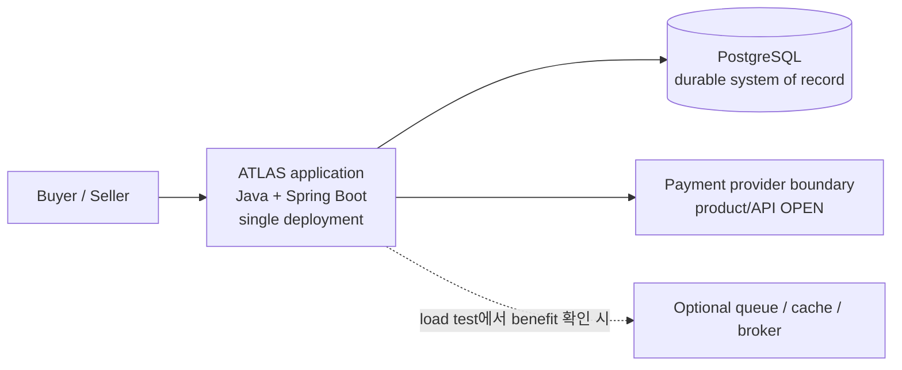

# ADR-0001: 초기 아키텍처 방향
- 상태: ✓ 구조·기술 방향 승인. 구현·배포는 별도 승인 대상.
- 승인일: 2026-11-02
- 담당: Project Owner
- 관련 요구사항: [FR-001~003](../../02-requirements/requirements-index.md), [NFR-001~002](../../02-requirements/requirements-index.md)

## 배경
- 주문·재고·결제·정산의 정합성과 장애 복구를 검증할 구조 필요.
- 팀 규모, traffic, 배포 제약 미정. 독립 서비스 운영 근거 없음.

## 판단 기준
- Module별 data ownership·transaction boundary 검증 가능성.
- 낮은 운영 부담과 재현 가능한 integration/failure test.
- 별도 queue/cache/broker는 측정된 bottleneck과 비교 가능한 이점이 있을 때만 검토.
- 장기 범위 A/B/C 유지.

## 대안과 trade-off

| 대안 | 설명 | 이점 | 비용·위험 |
|---|---|---|---|
| A. Modular Monolith First (선택) | 한 deployment 안에서 module boundary와 data ownership 유지 | transaction·test 단순화, 경계 명확화 | 독립 확장·배포 제한, 경계 약화 위험 |
| B. Microservices | 도메인별 service·deployment·storage 분리 | 독립 배포·확장 | network failure, distributed transaction, 운영 부담 증가 |
| C. 단순 monolith | 단일 application, 강제된 module/data boundary 없음 | 시작이 단순 | coupling 증가, 변경·검증 어려움 |

## 승인된 방향
- **Architecture:** Modular Monolith First. 한 deployment 안에서 module boundary와 data ownership 유지.
- **Stack:** Java + Spring Boot + PostgreSQL. 버전, infrastructure, PayPal product/API는 미정.
- PostgreSQL을 초기 durable system of record로 선택. Schema, transaction/isolation/locking, atomic sequence allocation은 Gate 3 설계 대상.
- 초기 설계에 별도 queue/cache/broker 없음. Load test에서 bottleneck과 비교 가능한 이점을 확인한 경우에만 추가 검토 ([EXP-012](../../08-experiments/experiment-registry.md)).
- Gate 2 current Buyer journey 승인. Gate 3 설계 승인; runtime implementation/deployment는 별도 승인 대상.

## 상위 아키텍처

그림은 deployment와 data 경계만 표시. 장기 제품 범위는 [Project Charter](../../00-governance/project-charter.md)와 [Requirements Index의 장기 역량 지도](../../02-requirements/requirements-index.md). Module boundary는 Gate 3 설계 대상.

## Gate 3 설계 범위
- Module ownership, public API, 허용되는 data access.
- PostgreSQL schema, transaction boundary, isolation/locking, sequence allocation, recovery.
- Synthetic workload와 환경 가정을 명시한 capacity model.
- PostgreSQL baseline 측정 후, 별도 queue/cache/broker 대안과 correctness·throughput·tail latency·DB pressure·운영 비용 비교 ([EXP-002/012](../../08-experiments/experiment-registry.md)).
- Runtime code·deployment·capacity claim은 별도 승인과 측정 전 보류.

## 재검토 조건
- 독립된 team/deployment 필요 발생.
- Module 간 변경·장애 결합 증가.
- Load test에서 단일 deployment 또는 PostgreSQL bottleneck 반복 확인.
- Data ownership 변경 또는 실측 결과가 현재 가설을 반증.

## 근거와 한계
- [REF-023](../../00-governance/reference-register.md): Shopify의 inventory reservation 사례. MySQL·고부하 구현을 PostgreSQL/ATLAS에 일반화하지 않음.
- [REF-050~052](../../00-governance/reference-register.md): modular monolith·waiting-room 사례. Architecture/scale 근거는 각 사례에 한정되며 ATLAS capacity를 보장하지 않음.
