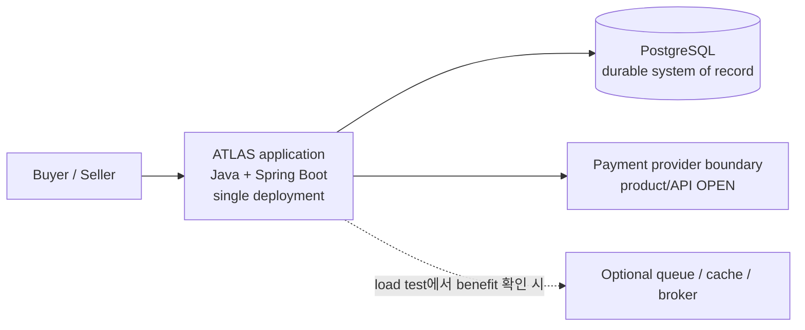
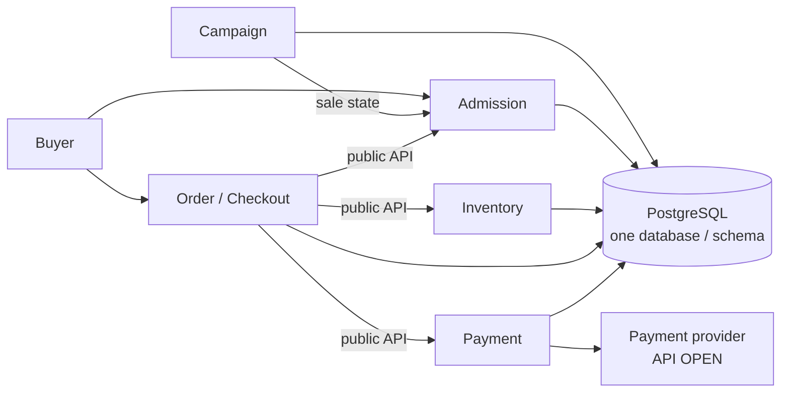

# ADR-0001: 초기 아키텍처 방향
- 상태: ✓ 구조·기술 방향 승인. 구현·배포는 별도 승인 대상.
- 승인일: 2026-11-02
- 담당: Project Owner
- 관련 요구사항: [FR-001~003](../../02-requirements/requirements-index.md), [NFR-001~002](../../02-requirements/requirements-index.md)

## 배경
- 주문·재고·결제·정산의 정합성과 장애 복구를 검증할 구조 필요.
- 팀 규모, traffic, 배포 제약 미정. 독립 서비스 운영 근거 없음.

## 판단 기준
- Module별 data ownership·transaction boundary 검증 가능성.
- 낮은 운영 부담과 재현 가능한 integration/failure test.
- 별도 queue/cache/broker는 측정된 bottleneck과 비교 가능한 이점이 있을 때만 검토.
- 장기 범위 A/B/C 유지.

## 대안과 trade-off

| 대안 | 설명 | 이점 | 비용·위험 |
|---|---|---|---|
| A. Modular Monolith First (선택) | 한 deployment 안에서 module boundary와 data ownership 유지 | transaction·test 단순화, 경계 명확화 | 독립 확장·배포 제한, 경계 약화 위험 |
| B. Microservices | 도메인별 service·deployment·storage 분리 | 독립 배포·확장 | network failure, distributed transaction, 운영 부담 증가 |
| C. 단순 monolith | 단일 application, 강제된 module/data boundary 없음 | 시작이 단순 | coupling 증가, 변경·검증 어려움 |

## 승인된 방향
- **Architecture:** Modular Monolith First. 한 deployment 안에서 module boundary와 data ownership 유지.
- **Stack:** Java + Spring Boot + PostgreSQL. 버전, infrastructure, PayPal product/API는 미정.
- PostgreSQL을 초기 durable system of record로 선택. Module ownership·short transaction 원칙은 [D-038](../../00-governance/decision-log.md), campaign counter row 방식은 [D-039](../../00-governance/decision-log.md). Physical schema, isolation, lock timeout/recovery는 Gate 3 설계에서 구체화.
- 초기 설계에 별도 queue/cache/broker 없음. Load test에서 bottleneck과 비교 가능한 이점을 확인한 경우에만 추가 검토 ([EXP-012](../../08-experiments/experiment-registry.md)).
- Gate 2 current Buyer journey 승인. Gate 3 설계 승인; runtime implementation/deployment는 별도 승인 대상.

## 상위 아키텍처

## Gate 3 초기 module·data 설계
Module scope는 현재 Buyer 흐름에 한정. 이름·경계는 실제 invariant와 dependency 기준으로 검증; 장기 capability 전체를 지금 module로 고정하지 않음.

| Module | 현재 slice의 책임 | 경계 |
|---|---|---|
| Campaign | 현재 campaign/SKU와 sale-open 상태 | Eligibility 정책은 OPEN |
| Admission | Ticket, key, sequence, retry·re-entry | 순번 기록은 D-039 |
| Inventory | Pool, reservation, claim/release, 재고 conservation | Lock 전략은 EXP-002에서 비교 |
| Order/Checkout | Buyer 흐름 orchestration, test window, order state transitions | PSP operation state는 Payment module 소유 |
| Payment | Provider operation state, AUTHORIZE/CAPTURE, reconciliation | PayPal product/API는 OPEN |

Tenant security, 확장 catalog, Settlement/Reconciliation은 장기 capability map에서 유지. 현재 module contract·구현 범위로 확정하지 않음.

- **Data ownership:** 한 PostgreSQL database/schema. Module별 table과 write ownership, cross-module 호출은 public API. 다른 module의 repository에 직접 접근 금지.
- **Transaction:** 필요한 domain invariant만 원자화하는 짧은 transaction. Module API는 같은 local transaction에 참여할 수 있으나, PSP network call은 transaction 밖. Isolation, 실제 경계·schema·lock recovery는 미정.
- **Queue sequence:** campaign counter row 증가와 ticket insert를 한 transaction으로 commit ([D-039](../../00-governance/decision-log.md)). 같은 campaign의 입장은 직렬화될 수 있어 accepted workload로 검증. PostgreSQL sequence는 rollback 후 gap과 commit order 차이가 있어 선택하지 않음 ([REF-057](../../00-governance/reference-register.md)).
- **Boundary checks:** Spring Modulith의 cycle/public API 검증은 후보 도구일 뿐 ([REF-055](../../00-governance/reference-register.md)); dependency/version 선택은 미정.
- **Capacity model input:** full Buyer journey, hybrid arrivals, 10,000 sessions/60m (average ~2.8 sessions/s), 2×/4× stress (~5.6/11.1 sessions/s). Synthetic report-only; these are session arrival rates, not request RPS/TPS or production demand. Record stage RPS and resolved-session TPS separately. Burst, concurrency, environment and production SLO remain OPEN.
- Inventory reservation의 conditional UPDATE/locking 선택은 [EXP-002](../../08-experiments/experiment-registry.md) 비교 전까지 미정.
- Runtime code·deployment·capacity claim은 별도 승인과 측정 전 보류.

## 재검토 조건
- 독립된 team/deployment 필요 발생.
- Module 간 변경·장애 결합 증가.
- Load test에서 단일 deployment 또는 PostgreSQL bottleneck 반복 확인.
- Data ownership 변경 또는 실측 결과가 현재 가설을 반증.

## 근거와 한계
- [REF-023](../../00-governance/reference-register.md): Shopify의 inventory 사례는 MySQL·Shopify 환경에 한정. PostgreSQL schema나 처리량 목표로 일반화하지 않음.
- [REF-050/052~055](../../00-governance/reference-register.md): modular monolith, boundary, package 설계 사례. Shopify 회고는 domain 이름만으로 runtime dependency를 추정하지 말라고 경고. Thoughtworks 자료는 설계 의견이며 benchmark 아님. Spring Modulith는 경계 검사 도구 후보일 뿐.
- [REF-056~058](../../00-governance/reference-register.md): PostgreSQL lock/sequence semantics와 vendor inventory 사례. 배포 PostgreSQL version은 OPEN. Vendor 성능 주장은 독립 검증되지 않음.
