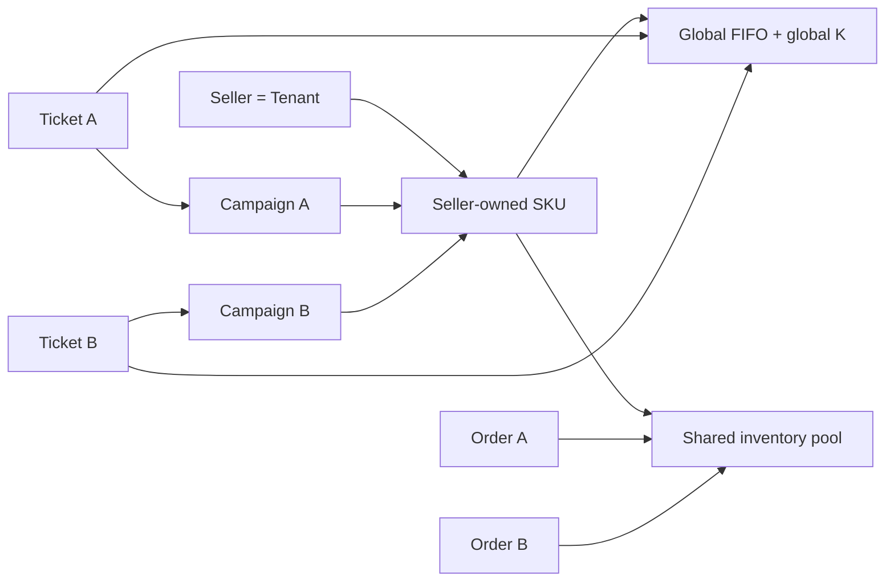

# ADR-0005: Seller-SKU 공유 재고와 전역 FIFO/K

- 상태: ✓ Accepted
- 날짜: 2026-11-03
- 담당자: Project Owner
- 관련 결정: [D-049](../../00-governance/decision-log.md)
- 관련 요구사항: [FR-001/FR-004](../../02-requirements/requirements-index.md)
- 추적: [Issue #89](https://github.com/Neo1228/ATLAS/issues/89), [PR #90](https://github.com/Neo1228/ATLAS/pull/90)
> Legacy data migration 방식은 [D-055](../../00-governance/decision-log.md)·[ADR-0006](ADR-0006-v6-clean-start.md)로 supersede. 이 ADR은 Seller-SKU ownership, shared stock, global FIFO/K 및 Campaign compatibility 선택을 계속 유효하게 기록한다.

## 배경과 문제

초기 모델은 Campaign마다 같은 SKU의 inventory pool과 admission queue를 별도로 생성. Seller identity가 없어 Campaign 간 재고 공유와 global FIFO를 표현할 수 없었음. Owner는 Seller=Tenant, Seller-owned SKU, Campaign 간 shared stock 및 Seller-SKU global FIFO 선택.

## 판단 기준·제약

- Local-only 시나리오. Cloud deployment, production capacity, load test 미포함.
- Seller/SKU identity와 stock은 Campaign 생성 시 중복 생성 금지.
- Inventory conservation, order idempotency, payment hold/recovery 유지.
- 추가 Gradle module·framework·authentication 불필요.
- Legacy Campaign data migration은 별도 [D-055](../../00-governance/decision-log.md) 결정에 따름. 이 ADR의 당시 migration 금지/보존 방향은 superseded.

## 검토한 대안

### A. Campaign별 stock과 queue 유지

현재 모델과 변경량 최소. 같은 실제 Seller-SKU가 여러 Campaign에 등록되면 재고가 중복·분리되어 공유 판매 계약을 표현하지 못함.

### B. Seller-SKU stock, Campaign별 queue

Oversell은 막을 수 있으나 Owner가 선택한 Campaign 간 global FIFO를 구현하지 못함. 서로 다른 queue의 순서와 active slot은 독립.

### C. Seller-SKU shared stock과 global FIFO — 선택

하나의 `(sellerId, skuId)` inventory pool, sequence counter, lock, active K와 FIFO. Campaign은 sale status·ticket TTL·ticket attribution을 유지.

## 결정

- **Identity:** Seller = Tenant. Seller가 SKU를 소유; `(sellerId, skuId)`가 Seller-SKU identity.
- **Seller API:** local Seller registration이 server-generated UUID 반환. 다른 요청은 `sellerId` 전달. Authentication/authorization 없음; 이 값은 data identity만 표현하며 tenant isolation/security boundary가 아님.
- **Stock:** Seller-SKU 등록 시 `initialStock` 설정 및 pool 1회 생성. Campaign 생성은 stock을 만들거나 더하지 않음. Stock pool/reservation은 `inventory-module` 소유.
- **Admission:** 모든 Campaign이 Seller-SKU global FIFO와 K 공유. 신규 Seller-SKU registration 때 `maxActiveCheckouts` 설정.
- **K:** Seller-SKU registration 때 새 K를 설정한다. 과거 Campaign K 집계·보존은 하지 않는다 ([D-055](../../00-governance/decision-log.md)).
- **Module:** Seller, SKU, Campaign은 기존 `campaign-module` 내에서 소유. 별도 Catalog/Seller module 추가 금지.
- **Compatibility:** Ticket TTL과 `(campaignId, idempotencyKey)` replay scope는 Campaign 단위로 유지. `campaignId`는 ticket/order attribution으로 보존.
- **Migration:** V6 clean-start only. V1–V5 application table에 행이 있으면 DDL 전에 실패하며 기존 data/schema를 바꾸지 않는다. 비어 있는 경우에만 구 schema를 제거하고 current Seller-SKU schema를 새로 만든다. Mapping·aggregate·backfill·legacy preservation 없음. 기존 local data는 앱 밖에서 명시적으로 보관·reset해야 하며 앱은 조용히 지우지 않는다 ([D-055](../../00-governance/decision-log.md), [ADR-0006](ADR-0006-v6-clean-start.md)). D-049의 shared stock·global FIFO/K 결정은 유지.

## 흐름 도식

## 결과·영향

- Campaign 간 동시 주문이 하나의 Seller-SKU balance를 사용; conditional stock update가 oversell 방지.
- Admission counter/sequence/held-slot count/expiry/promotion의 key가 Seller-SKU로 통일. Slot release는 다음 global FIFO ticket을 승격.
- Campaign별 FIFO보다 global transaction lock 범위가 넓어져 동일 Seller-SKU joins 직렬화. Correctness test 대상이며 throughput/capacity claim은 아님.
- `Campaign.inventoryCapacity`와 Campaign `maxActiveCheckouts` 제거. Seller-SKU registration API가 `initialStock`과 K 소유.
- `sellerId`는 인증 주체가 아님. Bind address를 외부로 바꾸거나 auth 없이 외부 network에 노출하는 것은 승인 범위 밖.
- **Legacy data:** 이전 mapping template은 사용하지 않는다. V6는 기존 데이터를 변환하거나 보존하지 않으며 clean-start 조건은 [ADR-0006](ADR-0006-v6-clean-start.md)에 따른다.

## 검증·완료 기준

- PostgreSQL/Testcontainers에서 두 Campaign의 concurrent join이 global sequence/K/FIFO를 공유.
- Cross-Campaign reserve/claim/release가 하나의 inventory conservation equation 유지.
- V6 empty-start 조건 및 nonempty fail-safe 검증은 [D-055](../../00-governance/decision-log.md)·[ADR-0006](ADR-0006-v6-clean-start.md)에 따름; legacy mapping/aggregate 테스트를 요구하지 않는다.
- `./gradlew --no-daemon check :application-module:bootJar` 통과. Load test 없음.

## 재검토 조건

- Authentication, tenant isolation, Seller membership 필요성이 생기면 `sellerId` request semantics 재검토.
- Location/channel stock, multi-quantity purchase, replenishment/adjustment, refund/post-claim stock policy가 승인되면 Inventory model 재검토.
- 측정된 local bottleneck 또는 운영 환경이 생긴 뒤 queue key/K/lock을 재검토. 현재 결과는 capacity claim 아님.

## 참고 자료

- [REF-023](../../00-governance/reference-register.md): Shopify reserve/claim consistency 사례; MySQL/location/high-scale 구조를 복사하지 않음.
- [REF-101](../../00-governance/reference-register.md): Alibaba Cloud Community의 Redis Snap-Up 사례에서 재고 차감 시점과 timeout release trade-off를 검토. Redis 구조·scale 수치는 적용하지 않음.
- [REF-102/103](../../00-governance/reference-register.md): Meituan의 queue 모델·최적화 글에서 ordering/parallelism trade-off를 검토. Campaign 간 global FIFO/K는 외부 자료의 권고가 아니라 owner 결정.
